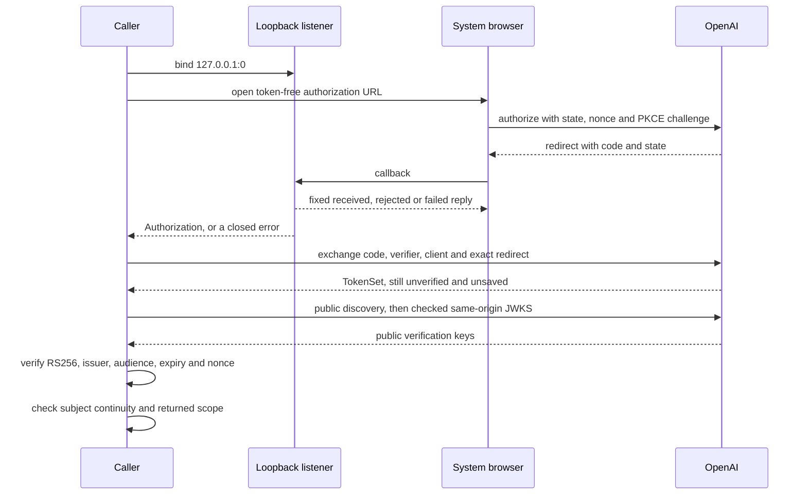
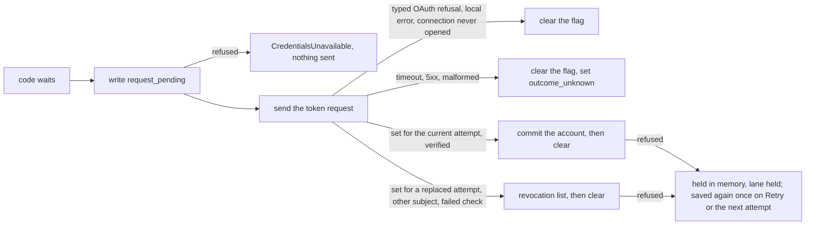
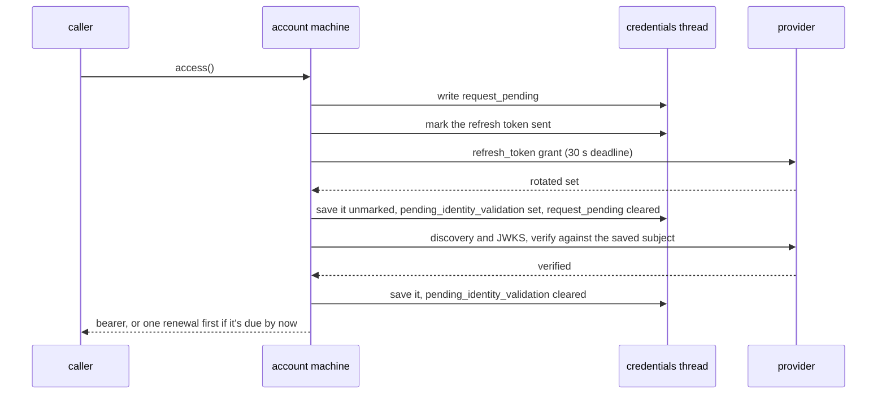
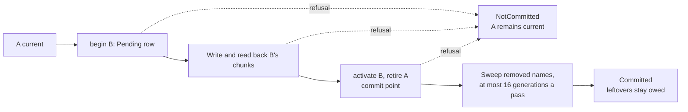
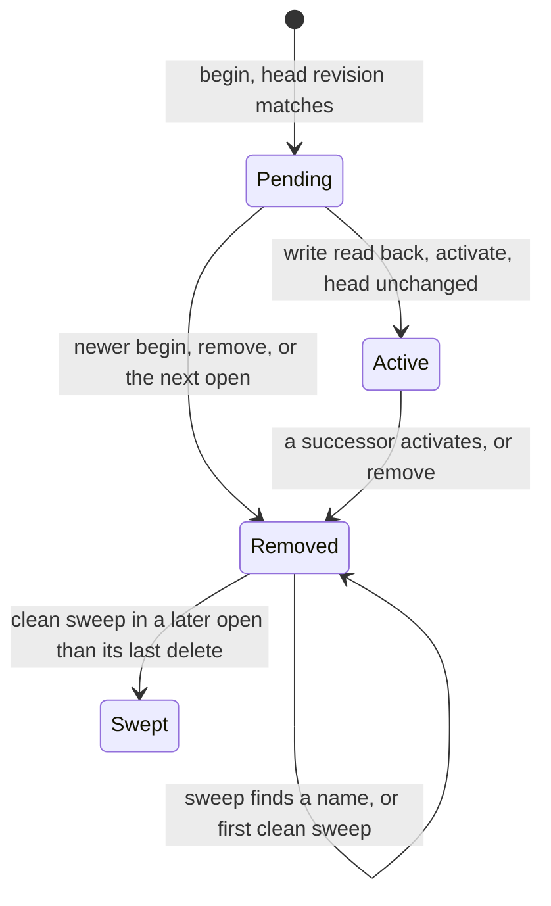

# Accounts

## Anthropic API key

The Settings → Accounts key row is wired but hidden until key chat is activated.
At the explicit Paste click, the UI thread samples the clipboard sequence number
as metadata. A row-only Windows adapter reads the payload off the UI thread:
it takes only Unicode text when present, never queries, reads or names any
other format, and never writes to the clipboard. The adapter strictly decodes
the terminated UTF-16 text and bounds the raw UTF-8 result to 2,048 bytes before
trim. Other platforms refuse the read. A validated paste stays in a zeroizing
buffer until the brain replies with a one-use staging plan; only its trimmed
byte length describes the key on the pipe.
The shell-core writer puts chunks in Credential Manager at those authority-owned
names in the background, then the shell sends `AnthropicKeyStaged { plan }`.
One 30-second deadline starts at the click and includes the read, the write and
the save reply. Disconnect or expiry discards the read and prevents late
replies or writes from triggering adoption. One native clipboard read can be
in flight; a timed-out read holds that slot until the OS call returns, with
no retry or UI wait. A queued writer won't start after the deadline, but
an already running OS write cannot be recalled. After Staged has been sent, a
missing acknowledgement leaves the save unconfirmed, not failed. A save
acknowledgement is separate from catalog verification.
After a lost acknowledgement, the row retains the unknown-save status through
Check. A successful local vault read for that Check on the same link unlocks
paste and, if a key is stored, removal of the revision it read. A queued
snapshot can't unlock the row. An unreadable vault leaves both actions locked
and allows another Check. The catalog's result shows separately and doesn't
block either action once the local read succeeds. Disconnect retires the
request but keeps the unknown outcome so the user can Check after reconnecting.
Whenever Paste is available, the row warns that it can replace a saved key.
A fresh shell can receive a cached Missing view while a prior adoption is
still in flight, so Missing does not suppress the warning.
The key never crosses the pipe or enters a file, log, command line or environment variable.
Only keys connected inside Kumochi are used; live checks must read the same Kumochi-owned
credential, never another app's key.

The key-chat transport gives each verified authority a nonzero random tag.
Without the transport, a readable saved key reports Unconfirmed; startup, Check
and successful adoption send no catalog request. There is no alternate client.
An ordinary check of the same verified revision keeps its tag. Adoption and removal
close both the authority's send fence and any queued catalog check before sending
work to the credential thread. If adoption fails, only a new local read proving the
old revision is still current can begin recovery; any recovered route has a new tag.
If failure changes the account view, the current shell receives that snapshot.
Only the shell epoch that submitted the paste can receive its receipt.
The coordinator receives only model metadata and a tag, never a key.

The saved key is the [credential authority](#credential-authority)'s `anthropic` record: Check
reads its current generation, and a removal confirmation applies only to the
authority revision shown when the dialog opened. A catalog result for that
revision doesn't invalidate confirmation. The worker compares that revision before
committing, then sweeps the names, so a stale confirmation can't delete a
replacement and a removed key is never read again even while Credential Manager
still serves it.
Neither the legacy `anthropic-key-staged.{service}` target nor the old
`anthropic-key.{service}` record is read. All work runs on the credential worker under the
vault's session lock, one job at a time and in order, so a Remove sent while a Check's native
read is blocked runs after it, and the runtime generation guard drops the stale Check's reply.
A cancelled waiter never interrupts an in-flight call.

A failed key removal remains pending in this brain process; Check/Retry retries
the same revision, and staging requests/notifications are refused without adoption.
A changed revision ends the old removal and reloads the current key, so removing
the replacement requires a new confirmation. The row waits for its own removal
receipt before offering Retry; queued connection snapshots don't count as receipts.
Until the removal transaction commits,
quitting or restarting loses that in-memory
intent and the next startup may load and check the still-current key; retry removal until it
succeeds. A paste refused while removal is pending requires a new explicit paste;
it is not automatically adopted.

The brain checks `GET https://api.anthropic.com/v1/models?limit=65` with a sensitive
`Authorization: Bearer` header and no `x-api-key`, redirects or environment proxy,
a 1 MiB body bound and a 15-second whole-check deadline. More than 64 entries or `has_more`
refuses the catalog. A successful catalog is tagged AnthropicKey; 401/403 rejects the saved key,
as does a 400 `invalid_request_error` naming the exact `anthropic-workspace-id` token
(`WorkspaceRequired`). No workspace id is accepted or provider message forwarded. Rate limits,
server, transport or catalog failures keep it Unconfirmed for a later Check.

An entry takes pictures only when its own `capabilities.image_input.supported` is a literal
`true`; absent, `null` or any other value means no, and never fails the Check. The other flags
keep the documented-model list. That fact reaches the screen gate only while it is fresh: the
current key's latest Check verified it. An inconclusive Check, a failed load, a refusal or a
replaced key clears it, and only the next verifying Check of the current generation restores it,
so meanwhile the key keeps text and omits pictures with the truthful `ModelCantSee` line.

A final HTTP 401 on a Messages post refuses the key itself, whichever run or job sent it. The
transport decides it from the status at the response head, never the body, closes the sending
authority's fence there, and tells the account the authority's tag; nothing else is sent. The
account then marks the row Unconfirmed, drops a Check still waiting on its load or catalog read
(a pending reconcile receipt reads as unknown), and clears the models, so the next ask is refused
as unavailable until a new Check reads the catalog and verifies the key under a new tag. A check
that ends after the fence closed can't restore Ready, and a tag from a replaced or removed
authority is ignored. The account hears the tag before the route change, and passes it on first:
the run that sent the refused post, or any run still current on that key, including one compacting
its context inline, ends with the rejected-key notice rather than as unavailable, whichever of the
tag and the post's own 401 reaches it first. A run on another connection, or on the key under a
newer tag, keeps its own outcome. A Check whose catalog read is refused retires the key the same
way and passes its tag on first too, so a run still current on the key ends with the rejected-key
notice whichever refusal the account handles first; asks after it are refused as unavailable. A title or compaction job shows nothing, but the row still
changes. Between the fence closing and the account handling the tag, the row can still show Ready
for a moment; no post can go out in that window, because the fence is already closed. With spoken replies the row can change before the
notice, which waits for the reply's audio to end.

A 403, any other status, and an error typed inside a 200 stream only show their notice and leave
the row as it is: a 403 can concern one model, and retiring the key for it would make the row flip
between Ready and Unconfirmed with every Check.
Every saved-key check or replacement fences late worker/HTTP replies
by generation and clears the old catalog. Catalog checks do not authorize inference or
automatic fallback to another connection. Fixtures are synthetic API-reference examples;
no live provider call is part of the tests.

### Authority paste staging

The worker mints one pending write-once plan for a validated 16–2048-byte
length without changing the saved key. One protocol helper owns its lowercase
generation spelling and 2,000-byte chunk layout for both processes. The shell
carrier is moved, not cloned or serialized, into an injected writer. On Windows
that writer calls CredWriteW with generic, local-machine persistence and a
zeroizing blob; it never uses keyring's enterprise-persistent secret path.

Begin replies are tied to the requesting link and request number. Disconnect
clears admission, and offline notifications cannot mint or adopt. Check retains
a pending paste, so a Check during Begin still gets
a plan reply and a Check after its reply does not discard the paste's admission.
Remove consumes issued admission. If a still-current Begin returns a plan for
the revision being removed, the shell gets Unavailable instead of a permit.
The serialized worker consumes an identified permit once; an unknown/superseded/consumed id
is Changed, not an empty-key Format rejection. One two-second settle budget
covers all staged reads; only complete present bytes are validated.

Adoption copies a valid paste into fresh names, verifies the writes, then
activates with the captured revision's compare-and-swap. The worker returns
the revision read inside the successful commit. Read, validation,
write or commit failure preserves both the saved key and the runtime key/view/
catalog. A successful commit enters the normal catalog-check path even if its
shell disconnected; generation, not link epoch, fences this brain-wide result.
`AnthropicKeyStageDone` reports only that paste's save outcome to its original
link, independently of the saved key's connection view. A committed paste reports
success even if a later Check or Remove fenced its runtime result or removed it.

The staged chunks and predecessor are swept after activation, never the new
active names. Any failed adoption and Remove also best-effort delete the
consumed plan's staged names; write/activation failure deletes the uncommitted
candidate's names too, without logging contents or retiring its row.
Failed deletes wait for the next begin or open. Remove consumes admission and
the permit even if its commit fails, so a late notification cannot adopt it.

A lost notification or failed operation leaves Pending until another begin
or the next open retires it. Startup never resumes a paste. A shell write can
outlive a brain restart, including the later lifetime that marks its generation
Swept. Such late chunks can remain physically orphaned but cannot authorize a
key: cleanup is not a physical-erasure guarantee. Removal from Kumochi does
not revoke the key at Anthropic.

## Stored namespaces and credential names

`protocol::constants::ProductIdentity` exposes `RELEASE` and `DEV` independently of the
caller's build profile. The app's existing constants select `ACTIVE` (Dev for debug,
release otherwise). `GATE` is the gate tools' own identity, selected only by the protocol's
`gate-identity` feature on a gate tool's command line (see [the gate identity](gate-identity.md)). Release tooling must select `RELEASE` explicitly, even when xtask
itself is built in debug. Stored spellings are unchanged; there is no migration.

The vault writes only write-once generation names, `<service>/gen/<kind>/<generation>/<index>`
(see [Credential authority](#credential-authority)). `account_target(service, entry)` and the
bounded `account_targets(service)` inventory name what earlier builds wrote: host, sign-out
marker, chatgpt/revoke manifests, and each record's two slots of 64 chunks, plus the active and
staged Anthropic targets in their dot form. These are 262 exact targets, not a service-prefix
match. Neither process reads or writes key bytes at these legacy names. Opens
delete all 262 by exact name before their first sweep, and a refused delete waits for the next
open. The pass repeats at each open until a clean pass in any open after the first one ends
it, recorded in credentials.db's `control` row; after that each open deletes only the
legacy staging name as defense against earlier writers. Anyone signed in on an earlier build sees Signed out and
connects again, and the revocations it still owed are dropped unsent.

Instance capabilities use keyring instead: `instance_entry(session)` is the account
`capability-<u32>`, and `parse_instance_entry` accepts only canonical decimal accounts.
On Windows, keyring stores `{account}.{service}`, represented by `instance_target`:
`capability-7.Kumochi instance`, or `capability-7.Kumochi Dev instance`. An enumerated
target is not an account and must not be fed directly to the account parser. Existing
instance callers retain keyring's default mapping. Anthropic paste staging uses
only authority generation names through the raw Windows writer described above;
`anthropic_staging_target` remains only in legacy cleanup inventories.

## Sign-in callback

`connections::oauth::SignIn::bind` binds `127.0.0.1` on port 0 before the browser
opens. Each attempt owns fresh 32-byte random state, nonce and PKCE verifier from
`getrandom`; the S256 challenge is unpadded base64url SHA-256. The attempt captures
only the saved client id, never saved tokens or email. `Intent::EnablePlan` adds
explicit consent; ordinary sign-in doesn't. The caller supplies the persisted host
id from the vault.

`open_browser` hands a `LaunchTarget` to an injectable `Launcher`. Production uses
`SystemBrowser` and `webbrowser`; tests record the URL without opening a browser.
The runtime opens it on tokio's blocking pool, because an OS launch can block the core loop.
`webbrowser` owns discovery of the OS browser
executable and its existing arguments. Neither `id_token_hint` nor `login_hint` is sent,
even when a saved record has ID, access and refresh tokens. Returning sign-in uses the
saved issued client id and lets the provider show its account selector. No launch URL,
callback request, state, nonce, verifier, authorization code or identity is logged or
sent over the pipe. Debug output redacts attempt and launch data. There is no `log`
to `tracing` bridge: webbrowser's command debug messages must stay disabled.
`deny.toml` bans `tracing-log` to enforce that dependency boundary.

`receive` consumes an attempt and returns `Authorization`, not an account or tokens.
It preserves the code, checked client id, verifier, nonce and exact redirect URI for
the later exchange. Drop the receive future to cancel and close its listener. Invalid
requests leave it live. After state matches, an incomplete or invalid registration ends
it as `SignInFailed` with a fixed failure page. A state-matching OAuth error also ends it
without an exchange; `access_denied` and other OAuth errors get the 200 received page.
Returning callbacks may omit the client id but cannot replace it. Initial registration
must supply a nonempty issued id, not `dynamic_agent_client`. The nonce is retained for
the signed ID token, not checked against an untrusted callback parameter.

The HTTP boundary accepts only `GET /auth/callback?... HTTP/1.1`, exactly one Host
header equal to `127.0.0.1:<selected port>`, no fragment or duplicate decoded query
parameter, and constant-time equality with the pending state. Malformed headers,
wrong path/host/port/state and stale errors get a 400 rejection and leave the attempt live.
The callback response is fixed nonreflecting text from `locales/en/brain.ftl`, formatted
with Fluent, served as UTF-8 plain text with no caching or referrer. Receiving a response
doesn't mean the account has been verified; that is the exchange's responsibility.

**Local policies:** an entire header, including its terminator, is at most 32 KiB and
has one absolute 2 s read deadline. A response has up to 1 s to write. The whole attempt,
including accepts, reads and replies, ends at five minutes on `tokio::time`. The listener
is serial: each idle preconnect can delay a queued valid callback by its 2 s read plus
up to 1 s writing its rejection, and multiple idle connections can queue within that
five-minute deadline. Sustained backlog starvation is a local denial of service: sign-in
times out, but nothing leaks. Timing tests use in-memory duplex streams and a paused clock;
socket tests cover an idle preconnect followed by a valid callback. No test uses outside hosts
or DNS; socket tests use only `127.0.0.1` port 0.

**Public provider contracts:**

| Values and behavior | Public OpenAI source |
| --- | --- |
| `https://auth.openai.com/api/accounts/authorize`, PKCE `S256` support | [Discovery](https://auth.openai.com/.well-known/openid-configuration) |
| `dynamic_agent_client`, issued callback `client_id`, `ext_agent_host_id`, initial `agent_name_hint`, `response_type=code` | [Registration and sign-in](https://developers.openai.com/siwc/token-sharing-open-source/sign-in) |
| `openid profile email offline_access resource.invoke chatgpt.tokens.use.direct`, resource `https://api.openai.com/v1` | [Registration and sign-in](https://developers.openai.com/siwc/token-sharing-open-source/sign-in) |
| `http://127.0.0.1:<port>/auth/callback`, state, nonce, PKCE and identical exchange redirect; `access_denied`; returning client binding; optional hints omitted here | [Registration and sign-in](https://developers.openai.com/siwc/token-sharing-open-source/sign-in) |
| `prompt=consent` only after the user requests plan use | [Errors and recovery](https://developers.openai.com/siwc/token-sharing-open-source/errors-and-recovery) |

The callback stops at `Authorization`; it doesn't exchange, verify or save credentials.

## HTTP, exchange and identity

The stateless helpers expose the sequence below. They don't replace an account or write the
vault; the account machine (below) owns cancellation, the token lane and persistence.

### Checked HTTP and roots

`connections::http_client::build()` is the only production constructor. It loads the current
user's public Windows ROOT store through `platform::trust_roots`, which includes machine-supplied
roots. The loader keeps only time-valid roots allowed for server authentication or all uses.
An unrestricted-use result requires a successful EKU call, zero identifiers and immediately
captured `CRYPT_E_NOT_FOUND`; unreadable usage isn't treated as unrestricted. Enumeration owns
one context at a time and transfers that ownership back to the next Win32 enumeration call.
Early returns free the held context and close the store. Nothing is installed or fetched.

Rustls parses those DER roots and verifies chains offline with ring. Empty or entirely
unparsable roots fail as `TrustStoreUnavailable`, without a fallback root bundle or permissive
verifier. There is no platform verifier, native-certs loader or certificate-override setting.
The real-store test runs in the normal Windows test suite: it reads bounded public certificates
only, writes nothing, and exercises the FFI ownership path rather than leaving it ignored.

The client enforces HTTPS, refuses redirects, disables proxy discovery, and exposes neither
the raw reqwest client nor raw transport errors. Discovery and validated JWKS requests contain
no credentials; only the fixed token endpoint accepts form fields. A scripted `Http` seam
lets exchange and JWT tests inspect request data without external traffic. TLS fixtures bind
only `127.0.0.1:0`, generate CA and leaf keys in memory, and never install a certificate.

**Local policies:** 15 s connect, 60 s read and 120 s total request limits; discovery and JWKS
requests have a 10 s limit. All success and error bodies are capped at 1 MiB, and a request-id
header is retained only as at most 256 graphic ASCII bytes. The root loader keeps at most
1,024 roots, caps each DER certificate and EKU buffer at 16 KiB, and counts skipped and unreadable entries separately.
Proxied networks cannot sign in until a user-set proxy setting exists. Each exchange builds its
own client on a blocking thread (`spawn_blocking`), because reading the trust store blocks; a
root store fixed since the last try is read again. A root Windows hasn't
installed yet fails as `UnknownIssuer`; verification never invokes an online OS chain builder.
ROOT entries present in Windows' Disallowed store or carrying a due disallowed-time property
are excluded. A Disallowed store that doesn't exist (`ERROR_FILE_NOT_FOUND`) counts as empty;
any other failure to open it fails closed. Distrusted server-supplied intermediates, root not-before/usage policies and revocation
checking remain outside this offline verifier. Client construction logs only root counts
and the loader's typed OS error, never certificate data; counts are unavailable on loader failure.

### Stateless code exchange

`oauth::exchange::exchange` borrows the callback's `Authorization` and posts the documented
form. It never uses a client id from the token response. `TokenSet` owns zeroizing, redacted
credentials independently of the active account, so a later verification error doesn't
consume them. A grant without a refresh token is representable; the account machine refuses it, since it
can't be renewed or revoked, and drops its access token to expire on its own. The caller also retains registration and
computes expiry through `Clock`, from the time the response arrived, before the identity check;
failed wall-time conversion doesn't consume the token set.

**Local policies:** the token response record is at most 48 KiB, including escaping and unknown
fields. Access and ID tokens are at most 16 KiB each, refresh tokens 8 KiB, granted scope 1 KiB,
and client ids and subjects 256 bytes. The code is capped at 16 KiB, the redirect at 256 bytes,
and the verifier must fit PKCE's 43–128 unreserved ASCII characters. `expires_in` is clipped to
86,400 seconds as in the spike; a zero lifetime is already expired, so 9b must refresh before use.
`earliest_refresh_at` is ignored. A parsed but unusable HTTP 200, or another 2xx,
returns its received refresh token in a redacted, zeroizing error for the caller to revoke,
including a mistyped sibling, duplicate key, or a field or record over its storage bound.
Only an OAuth error object with a
string `error` on a 4xx response conclusively reports refusal; transport failures, malformed
replies, oversized data and other statuses leave issuance uncertain for the later token lane.
No provider message or body enters an error.

`oauth::refresh::refresh` posts `grant_type=refresh_token`, the saved `client_id`, the refresh
token and `resource`, with a 30 s deadline [local policy], and parses the answer as an exchange's.
Unlike an exchange, it may leave out `id_token` or `refresh_token`; an exchange without `id_token`
is unusable. Empty or oversized inputs are refused before anything is sent.

### Signed identity and plan permission

`oauth::id_token::verify` checks discovery's exact issuer and allows JWKS only on
`https://auth.openai.com:443`, without userinfo or a fragment. It selects the declared `kid`
from that key set, skips unparseable keys and rejects duplicate key identifiers. A `kid` the set
lacks gets the set fetched once more, since one fetched while the provider rotates its keys can
lack the new key; still missing, it's `UnknownKey`. The clock is read again after that refetch,
so a token that expires while it runs is refused. A selected key
must be RSA, and must permit signatures and RS256 when those metadata fields are present. It
verifies the signature itself, with ring's RSA PKCS#1 v1.5 SHA-256 check for 2048- to 8192-bit
keys, before trusting claims. ring rounds that minimum up to a whole byte, so a modulus with fewer
than 2048 significant bits is refused before ring sees it. The token is exactly three unpadded
base64url parts, the header's
`alg` is `RS256`, and a header with `crit` is refused. Claims parse into typed fields, so a
claim with the wrong JSON type is refused rather than read as absent.
Issuer and audience must bind to OpenAI and the issued client. Expiry uses the injectable
wall `Clock`, not a library's hidden clock; nonce comparison is constant-time.
`check_subject` rejects a different saved subject, and `permits_plan` requires the exact
returned `chatgpt.tokens.use.direct` scope. A verified ID token alone doesn't enable inference.

**Local validation policies:** 30 s expiry tolerance, at most 64 JWKS keys and 16 audiences,
2 KiB for a discovered JWKS URL, 128 bytes for a nonce and 254 bytes for a display email.
The OIDC authorized-party check requires `azp` to match when present, and requires it for a
multi-audience token; this is a validation policy, not a claim that OpenAI always emits `azp`.
Email remains signed display data, not identity or a workspace identifier.

Application-owned token/code strings and response buffers are zeroizing and redact Debug.
The body buffer is pre-sized from bounded `Content-Length` when present, otherwise it grows;
earlier allocations released during growth aren't zeroed. HTTP/TLS library buffers and serde's internal parsing scratch allocations remain outside
that wipe boundary. Requests, URLs with queries, tokens and response bodies are never logged.
The JWT fixtures use public throwaway test keys through rustls's ring signer; they aren't
credentials for any account or service.

| Added provider contract | Public OpenAI source |
| --- | --- |
| `https://auth.openai.com/api/accounts/oauth/token`, form `grant_type=authorization_code`, issued `client_id`, `code`, `code_verifier`, exact `redirect_uri`, `resource`; no client secret; `invalid_grant` needs a fresh code | [Registration and sign-in](https://developers.openai.com/siwc/token-sharing-open-source/sign-in) |
| HTTP 200, `access_token`, conditional `refresh_token`, `id_token`, `token_type`, `expires_in`, `scope`, `earliest_refresh_at` | [Token reference](https://developers.openai.com/siwc/token-sharing-open-source/token-reference) |
| Issuer `https://auth.openai.com`, discovery at `/.well-known/openid-configuration`, `jwks_uri`, supported RS256 | [Discovery](https://auth.openai.com/.well-known/openid-configuration) |
| ID-token `iss`, `aud`, `exp`, `sub`, `nonce`, `email`, key selection by `kid`, and signed subject continuity | [Registration and sign-in](https://developers.openai.com/siwc/token-sharing-open-source/sign-in), [Identity verification and sample claims](https://developers.openai.com/siwc/website#6-verify-the-id-token) |
| Returned `chatgpt.tokens.use.direct` grant, and identity without plan permission | [Registration and sign-in](https://developers.openai.com/siwc/token-sharing-open-source/sign-in#4-validate-the-id-token-and-chatgpt-plan-permission) |
| `invalid_client`, typed errors and request-id diagnostics | [Errors and recovery](https://developers.openai.com/siwc/token-sharing-open-source/errors-and-recovery), [OpenAI's `x-request-id` header](https://developers.openai.com/api/docs/api-reference/debugging-requests#debugging-requests) |

## The account machine

`connections::account::AccountState` is pure: inputs in (an `AccountOp`, a connection, a finished
credential job, a listener or exchange result), effects out (a view, an error, a credential job,
start or close the listener, send a token request). `runtime::account::Accounts` runs those
effects. Credential jobs go, one at a time and in order, to a `credentials` thread that owns the
vault and its session lock; the listener and the exchange are tokio tasks; every result comes back
on one channel the core loop polls. The startup load runs there too, and the brain waits for it
before it stores the instance capability or serves anything. On
quit or close, a refresh already out runs to its end and its save, for up to `REFRESH_WAIT`
(5 s [guess]), with the session lock still held; past that the lock is released and the token
stays marked as sent, so the next start never sends it again. Then it waits for the job already dispatched, past the quit deadline if it must, before the instance
capability is deleted. The runtime delivers exactly one `Vault` result per dispatched job (the
credentials thread sends one per job it runs) and one `Exchanged` per sent request (the exchange
task's last step). No runtime test drives a full exchange yet, so the machine also ignores a
result with no request outstanding for its attempt, which keeps the next request and any owned
set intact (`a_repeated_exchange_result_leaves_the_next_request_to_finish`,
`a_repeated_exchange_result_keeps_the_owned_set`).

```mermaid
stateDiagram-v2
    [*] --> Busy: start, read the vault
    Busy --> SignedOut: read, no account
    Busy --> SignedIn: read, account
    Busy --> SigningOut: read, sign-out pending (resumes at its phase)
    Busy --> Busy: lock held; retried on each op and connection
    SignedOut --> SigningIn: SignIn / EnablePlan
    SignedIn --> SigningIn: SignIn / EnablePlan
    SigningIn --> SigningIn: SignIn replaces the attempt
    SigningIn --> SignedIn: verified set committed
    SigningIn --> SignedOut: cancelled, refused or failed
    SigningIn --> SignedIn: cancelled or failed with an account
    SignedIn --> SigningOut: SignOut (use stops)
    SigningIn --> SigningOut: SignOut with an account (attempt cancelled)
    SigningOut --> SigningOut: a step refused, waits for Retry or the next start
    SigningOut --> SignedOut: Finish, from the decided notice
```

Every op is answered with the current view; anything else sends one only when it changed.

**Attempts.** `attempt` names the one live sign-in; `SignIn` and `EnablePlan` move it, and so does
`CancelSignIn` while the attempt still waits for the browser. Once the browser has finished, while
the registration is saved, the code is exchanged or the set is saved, a cancel changes nothing and
the sign-in completes (`a_cancel_after_the_browser_finished_keeps_the_sign_in`). A first sign-in
saves the issued registration before its code is sent, so a failed exchange still keeps the
client. A replaced attempt's waiting code is never sent; a sent request is never aborted. An op
arriving while the current attempt's save runs waits for it (only the newest is kept); the save is
published first. A cancel during the save also drops a waiting Open again, so no browser opens
after it (`a_cancel_during_the_save_keeps_the_set_and_drops_a_waiting_open_again`).

**The token lane** admits one token request at a time and holds it until the result has a durable
owner: the account, the revocation list, or the knowledge that nothing was issued.

A received set never has two owners and never none. A refused save holds the set in memory and the
lane; it is tried again once when the attempt moves (as a list entry, since its attempt is gone)
or on Retry, never on every pass. A live attempt ends then with `CredentialsUnavailable` and
Retry, since its code could only wait behind the held set.
A pending flag a crash left behind becomes `outcome_unknown` as soon as the next start reads the
vault, before any save could finish it as known, and a later success never clears it.

**Replacing a token.** A refresh token leaves `chatgpt` only once the provider spent it, the list
holds the same client and token, or the marker records `outcome_unknown`. A sign-in's Commit
checks this against the disk, in the same credential job, before it saves: it lists the token
`chatgpt` holds (the old account's, a rejected or pending set, a spent one) as an exchange's
entry, stamped with the job's monotonic-safe time, but only while two exchange slots are free, so
the incoming set keeps the slot it was admitted on should its own save be refused. Otherwise, or
when the token can't fit an entry, it writes `outcome_unknown` first. An equal entry already
listed needs nothing, so a Retry never lists it twice. The job reports a list it saved even when
the account save is then refused; the machine takes its count and starts a revocation pass for it
before anything else runs. Once the account's generation is current, the sign-in is committed,
whatever the marker writes after it do.

Listing comes before replacing, so if the account save fails after the old account's token was
listed, that token can be revoked before the new set is installed: the old session's next refresh
gets `invalid_grant` and goes down the usual sign-in-again path. Retry can still commit the held
set; Cancel doesn't bring the old session back. With three exchanges listed, the replaced token is
recorded unknown instead, so the next sign-out's notice is unconfirmed.

**Local policies:**
- A grant without a refresh token is refused; nothing is saved for it.
- An unusable 200 response that named a refresh token lists that token, when it's non-empty and
  its list entry fits; otherwise its outcome is unknown.
- A list entry may take at most 9,817 serialized bytes (`MAX_ENTRY_BYTES`), so the account entry and
  four exchanges always fit one 48 KiB record. A received set whose refresh token escapes past
  that, or whose account record escapes past 48 KiB, is refused where it arrives, so no save that
  can never land is offered for Retry; the token's outcome is unknown, or it's listed when only
  the account record was too big.
- A 4xx without an OAuth error object (a proxy page, say) leaves issuance unknown.
- Sign-in is refused with `RevocationBacklog` when the list's four exchange slots, counting one
  reserved for the request in flight, are full. Nothing is dropped to make room.
- An unreadable `host` or record refuses sign-in (`CredentialsUnavailable`); Retry reads again.
- A refused registration or pending-flag write ends the attempt and offers a new sign-in, since
  Retry would have nothing to rerun.
- A Busy session lock at startup is retried 5 times, 250 ms apart [guess]; after that, on each
  op and each connection.
- A list entry stamped on a clock before 1970 gets `added_at = u64::MAX`, so age-out never
  evicts it early.

**Revocation outside a sign-out.** A pass revokes every listed entry, the account's first, then
rewrites the list without the ones an empty 200 confirmed. Passes run at startup, when an entry
is added and on `Retry`, never on a timer, one at a time: a request during a pass becomes one more
pass after it. None runs while the lock is Busy or a sign-out is pending. When the list empties,
the empty list is saved, then removed, and `sweep` clears. A pass that a sign-out overtook only
saves the shorter list: the sign-out's Delete removes it. Each save and removal is one authority
commit, so a crash or refusal at any step leaves the list as it was or as it became, and the next
start or Retry finishes the job.

`oauth::revoke` discovers `revocation_endpoint` (the document's issuer must match, and the URL
passes the same checks as `jwks_uri`), then POSTs `token`, `token_type_hint=refresh_token` and
`client_id`. Only an empty 200 confirms. A transport failure or a `5xx` is tried three times in
all, 0.5 s then 1 s apart, and the whole pass has one 10 s budget [local policy]. A discovery
document that fails a check sends no token anywhere.

**Age-out.** An entry leaves the list unrevoked once `now ≥ added_at + 32 days`: the documented
30-day refresh-token lifetime plus a 2-day margin [local policy]. It's checked at startup, and
when a full list would refuse a sign-in, so a full list frees what expired since, except entries
stamped `u64::MAX`, which never age out. While the brain runs, wall time moving more than an hour
[local policy] further than monotonic time is a clock jump: age-out waits for the next start. An
entry is stamped no earlier than the brain's start time plus its monotonic run time, so a clock
set back while it's listed only delays its age-out.

**Refresh** (`account::refresh`, design §3 rule 3). The bearer is handed out only through
`Accounts::access`, which answers on a oneshot. Each call checks the wall clock: a set with 60 s or
less left [local policy], or with no wall time, is refreshed first; there's no timer. The refresh
is one flight on the token lane, from the request until the rotated set is committed and its
identity token verified. Callers that arrive meanwhile join it, and all of them get the same
answer. The request and the identity check run as tokio tasks the brain never aborts, so a caller
that drops its receiver ends only its own wait. Each is supervised: one that ends without
reporting, as a panic does in a debug build (a release build aborts on panic), reports a
content-free failure instead. A refresh's outcome is then unknown, so the session ends and its
token stays marked; a check's set stays pending for the next use.

- The refresh token is marked as sent (`refresh_sent`, in the account record) after
  `request_pending` is written and before the request goes out. The successor's save replaces the
  whole set, so the mark clears in the same commit that makes the successor durable. A typed
  refusal, a local error or a connection that never opened (`HttpError::Connect`, which includes
  a connection or TLS handshake past its 15 s deadline, though reqwest also calls that a timeout) issued nothing:
  the mark is cleared and the token may go again. Any other ending may have consumed it, and so
  may a refresh a start finds still marked: the session ends with `SessionEnded` and Sign in, and
  the token stays for sign-out to revoke but is never sent again. An answer that names a
  successor Kumochi can't keep lists that successor and ends the session the same way. No reuse
  grace for a rotated token is documented, so a new sign-in is the safe recovery.
- The rotated set is saved before any further network work. A refused lane save holds its set
  in memory and tells waiting callers `CredentialsUnavailable`. The next `access` saves any held
  set again first, and never asks for another token for a rotated set that's held or being saved,
  Retry's included. A committed rotated set moves the generation, so a check or a refresh still
  meant for the set it replaced is dropped, and a check never verifies a set it didn't check.
- The identity check's save and an ended session's save run off the lane. They never clear the
  lane's pending flag, and one queued for a generation that has since moved is dropped, so it
  can't overwrite a newer sign-in. A check's flight lasts until its save ends, after a Retry with
  no caller too, so `access` joins that save instead of checking again. The check's save is
  built when it's dispatched, from the account as it is then with only the verification added,
  so it can never undo a sent mark saved after the check began.
- `pending_identity_validation` is durable, so a set left pending by a crash is checked before
  its first use after the restart. A failed check leaves it pending and blocks access; the next
  `access` checks again without a second refresh, and joins a check already out. A refresh that
  leaves out the identity token or the refresh token keeps the saved one and isn't pending.
- Once a verified or held set is saved, its expiry is checked again against the wall time the save
  ended. A bearer that's due is renewed first, once per flight. So is one a provider refused:
  a model round or catalog read that gets a 401 sends `Refused { generation }` with the
  generation its bearer came from, and while that's still the account's set, the next `access`
  renews it however long it has left. A good renewal lets the user's Retry through; a refused one
  takes the usual Sign in again path. A renewal that is already expired
  (a zero lifetime, say) is neither handed out nor renewed again: callers get `SignInFailed` with
  Retry, and the newest refresh token stays saved for the next `access`.
- `verify_refreshed` binds the token to the subject this account already verified, with no
  nonce and no expiry check. That's a local continuity policy and never applies to a sign-in.
  Another subject or an invalid token, like a pending set with nothing to check, ends the session
  and leaves the set in `chatgpt`, still pending so it's never used, with nothing written.
  Network, status, discovery, bounds and clock failures, and a key still missing after its
  refetch, leave the set pending, since a captive
  portal's page can fail discovery's parse or a document's size bound. The rejected set's token
  leaves `chatgpt` only through the next sign-in's Commit or the sign-out's Prepare, which own it
  first; a restart checks the set again and rejects it again, writing nothing.
- Ending a session (a `SignInAgain` code or a rejected set) keeps the registration and display
  email, answers `SessionEnded` with Sign in, and moves the generation. The view is
  `SignedIn { recovery: SignInAgain }` until the next sign-in or sign-out. After a `SignInAgain`
  code the tokens are gone, so that lasts in this process only: after a restart it's `SignedOut`.
  A rejected set stays pending and is rejected again, and a token kept because it may be consumed
  keeps its mark, so `SignInAgain` outlasts a restart.
- A result that arrives under an old generation never becomes the account: during a sign-out its
  rotated token replaces the listed `Account` entry, so the successor is what gets revoked. One
  that didn't rotate leaves the old token in place, so nothing is unknown.
- An unusable answer that names a refresh token lists it as an exchange's would be, when an
  exchange slot is free and its entry fits, and that list save ends its request; otherwise its
  outcome is unknown. Either way the session ends, since the token it replaced was consumed, and
  that token stays in `chatgpt`, marked as sent, so it's never sent again.
- A refresh queued behind a sign-out or a sign-in is never sent, and a check that lands after a
  sign-out saves nothing.

| Provider answer | Recovery | Shown |
| --- | --- | --- |
| `invalid_grant`, `invalid_refresh_token`, `token_expired`, `refresh_token_expired`, `refresh_token_invalidated`, `refresh_token_reused` on a 4xx | sign in again | `SessionEnded`, Sign in |
| `subscription_sharing_usage_unavailable`, `subscription_sharing_user_unavailable` on a 4xx, any other code on a 429 | retry later | `AccountOffline`, Retry |
| `subscription_sharing_user_not_eligible` on a 4xx | unavailable | `PlanUnavailable` |
| `invalid_client`, `chatpass_v2_scope_not_authorized`, `chatpass_v2_invalid_authorization_context` on a 4xx | fix the request | `AccountMisconfigured` |
| any other code on a 4xx other than 429 | unknown | `outcome_unknown` set, `RenewalUnconfirmed`, Sign in |
| connection never opened | nothing sent | `AccountOffline`, Retry |
| timeout, transport failure, a panicked refresh task | unknown | `outcome_unknown` set, `RenewalUnconfirmed`, Sign in |
| any 5xx, typed or not; a malformed, oversized or untyped 4xx | unknown | `outcome_unknown` set, `RenewalUnconfirmed`, Sign in |

The refresh parser reads an OAuth code only from a 4xx, so every 5xx is an unknown outcome here,
even though a plan request's 5xx asks for a retry. Only the first row deletes credentials: the
registration-only save happens only when the provider names the session as ended. The unknown
rows keep the set exactly as it was, marked as sent, so it's never sent again and stays for a
sign-in's Commit or the sign-out to revoke; an unlisted code isn't evidence that nothing was
issued. `RenewalUnconfirmed` ends the session like `SessionEnded`, but says the renewal may have
gone through unconfirmed rather than that ChatGPT ended it. The account keeps that reason with
the generation it ended, so a run's failure and the next task's refusal say the same, and it
sends the shell that error once before the view, since the view alone only says to sign in
again and a catalog read that asked may be cancelled; after a
restart, a set still marked as sent reads as `RenewalUnconfirmed`. A listed refusal or a
connection that never opened issued nothing, so it clears the pending flag without setting
`outcome_unknown`, and clears the sent mark.

**Sign-out** (`account::sign_out`, design §3 rule 5). `SignOut` with a signed-in account stops use
at once: the attempt moves, the listener closes, the account leaves memory, and the view is
`SigningOut { cleanup: Running, revocation_unconfirmed: true }`. A save the current attempt already
dispatched still lands behind that fence: no later op replaces the sign-out, the view stays
`SigningOut`, and Prepare adopts what it saved. One marker write then promotes the sign-out
(`sign_out: Keep/Revoking`, `sweep`, `notice`) before any token-bearing write or delete. If that's
refused, the view is `NotDurable` with `SignOutNotDurable` and Retry, and use stays fenced in this
process only: a restart loads the account again. Every later step is safe to repeat, and a restart
or Retry enters at the first step of the persisted phase:

1. **Settle.** The lane's outstanding request runs to its end, and a running revocation pass ends
   first. A queued code is never sent. A stale set gets its own list entry through the lane's own
   save, an ambiguous ending sets `outcome_unknown`, and a refused save holds the set (`Refused`)
   until Retry; after a crash its `request_pending` keeps the warning.
2. **Prepare.** `chatgpt`'s refresh token becomes the `Account` entry unless one is listed (that
   token or its successor) or the same client and token are, so a replay never duplicates or
   overwrites it. A record whose data is damaged persists `outcome_unknown` first; a damaged list
   isn't rewritten, but the account token is still revoked. So is a list the account token can
   never fit (`Bounds`): `outcome_unknown` is persisted first, the list stays as it was, and the
   token is revoked from memory; if that marker write is refused, the step is `Refused`. A refused read decides nothing: the step is `Refused` and Retry reruns it.
3. **Revoke.** One run over the list, inside the usual 10 s budget.
4. **Checkpoint.** The confirmed entries leave the list (a refused rewrite leaves them listed, which
   counts as unconfirmed), then one marker write enters `Deleting` and decides the notice: clear
   only when the saved list is empty and `request_pending` and `outcome_unknown` are clear. With
   `outcome_unknown` persisted, an absent list isn't checked against the account, so a damaged
   account still reaches Delete. If it's refused, the phase stays `Revoking` and nothing is deleted.
5. **Delete**, driven by the marker alone. Keep rewrites a readable account to its registration, a
   fresh generation. An account with no record, or with damaged data, is removed, as Erase does;
   a refused read removes nothing: the step is `Refused` and Retry reruns it. Then `revoke` is
   removed. Each removal is one authority commit; the removed names are swept after it, and a
   name the store keeps waits for the next start's sweep.
6. **Finish.** Only once the authority holds neither record current (Keep: only a registration),
   the marker becomes notice-only or empty. Use stays fenced until the vault is read again, so the next sign-in
   reuses the kept registration; then the view becomes `SignedOut { revocation_unconfirmed: notice }`.

```mermaid
stateDiagram-v2
    [*] --> Promote: SignOut
    Promote --> Promote: refused, NotDurable; Retry
    Promote --> Settle: marker Revoking, notice set
    state "phase Revoking (a start resumes at Settle)" as Revoking {
        Settle --> Prepare: lane free, no pass running
        Prepare --> Revoke: entries listed
        Prepare --> Checkpoint: nothing listed
        Revoke --> Checkpoint: confirmed entries
        Prepare --> Settle: refused; Retry or restart
        Checkpoint --> Settle: refused; Retry or restart
    }
    Checkpoint --> Delete: marker Deleting, notice decided
    state "phase Deleting (a start resumes at Delete)" as Deleting {
        Delete --> Finish: every name gone
        Delete --> Delete: refused; Retry or restart
        Finish --> Delete: refused; Retry or restart
    }
    Finish --> [*]: SignedOut, notice-only marker or none
```

While signing out, `SignIn`, `EnablePlan`, `CancelSignIn` and `SignOut` start nothing and are
answered with the view; `Retry` reruns a refused step. A live sign-out keeps the registration
(`Keep`), unless the catalog found the account's plan unavailable: then it erases it (`Erase`,
pick 2). `Erase` also comes from a persisted marker, a damaged one included (it reads as
`Erase`/`Revoking`). A refused marker read at startup
decides nothing: use stays fenced as `SigningOut { cleanup: Refused }`, and so does a lock error on
the load after Finish; Retry or the next start reads it again and resumes the phase it finds, or finds no sign-out. Fixtures crash after, and refuse, each of the store mutations a
whole sign-out makes, for Keep and Erase.

## Model catalog

`connections::catalog::read` sends one bearer GET to `/v1/models`. The response must be an
object with one `models` array of objects; positional forms fail the read. Listable rows have
`visibility: "list"`, a valid `ModelSlug`, and a one-line `ModelName` (1–80 characters).
A sendable row must also advertise at least one exact known `supported_reasoning_levels[].effort`
value: `low`, `medium`, `high`, `xhigh`, or `max`. Other shapes and names confer no
support, and the provider's default field does not add support. The first sendable row for
each slug supplies its effort and image capabilities; at most 200 sendable rows go to the shell,
in server order. Listable slugs without known support don't use those slots. The account retains
up to 200 distinct slugs outside the final offer, including supported rows beyond the offer cap.
They're for default repair only and authorize neither a request nor image capture. If a
further distinct slug doesn't fit, the account can't prove a saved choice disappeared, so it
doesn't repair that choice.
An admitted row takes images only if its own `input_modalities` array names `"image"`.
The catalog's [capture provenance](../../crates/brain/src/connections/catalog/README.md)
describes the recorded shape behind both decoders.

`runtime::Accounts` owns the catalog, in memory only. It reads when the account becomes usable
(`SignedIn`, plan `Enabled`, no recovery but Retry), and again on `Retry` or a new connection
while no read has succeeded. One read runs at a time. The catalog has an epoch that moves when the
account stops being usable: the read out is cancelled, whether it waits for the bearer, builds
its client or awaits the answer, and the list is cleared; the shell then hears an empty
`Models`. Closing cancels it too. Cancelling drops only its bearer wait, never a refresh that
wait started. It's keyed by that epoch rather than the machine's
generation, which moves on every rotation and would clear the list hourly.

| Answer | Shown |
| --- | --- |
| 200 with sendable models, or a genuinely empty/hidden list | `Models` on the data pipe, once per change and per connection |
| 200 with listable models but no known support, 200 that isn't a model list, a failed request, 401, 429, 5xx whatever its code | `AccountOffline`, Retry |
| 403 `subscription_sharing_user_not_eligible`, and only that | `PlanUnavailable`; the account shows `PlanState::Unavailable` |
| `subscription_sharing_user_not_eligible` on another 4xx | `AccountMisconfigured` |
| other codes | as the refresh table above maps them |

`Unavailable` lasts in memory until the account moves, and that account's sign-out erases the
registration. A 401 offers Retry and marks the bearer's set as due, so the Retry renews it first.

A read that finds `default_model` unset or proves its choice is no longer listed sets it as the
brain's own settings change: `gpt-6-luna` at `Low` if it offers Low, otherwise the first sendable
model at its lowest advertised effort. A listed choice is never overwritten, even if it can't send, and
an empty list changes nothing. Explicit non-ChatGPT or invalid saved intent is never repaired
from this catalog. Repairs recompute at the serialized settings write
boundary rather than applying the choice captured when the catalog arrived
(see [settings](settings.md#config-keys)).

Claude Code has a half of its own. While `ChatGPT` has no account at all (`AccountView::SignedOut`)
and a Claude Code launch would be admitted, an unset `default_model`, or a Claude Code one the
reviewed row doesn't list, becomes the row's own default, `haiku` at `Low`; it's queued after
every Claude Code report. A `ChatGPT` account whose session ended, or that is signing in or out,
keeps `ChatGPT`'s half, so a session that lapses for a while never moves anyone to Claude Code. A
queued repair whose recompute at the write would land on the other connection's half writes
nothing.

## Credential storage

Store access must be serialized: Rez's clean-store reproduction with two and four concurrent
workers still missed cross-thread reads after successful writes to disjoint names, even with
a barrier before reads and no deletes until all reads finished. A successful parallel delete
also left an entry, so tests verify cleanup by exact name. Production reads and writes all run on the
account system's one credentials thread, through the vault's one store handle. The
[credential authority](#credential-authority) decides what is current, so the store's answers
never change it: a save writes fresh names and reads them back within its settle budget, a read
of a current name that comes back absent is `Unsettled`, and a delete is only cleanup. Each
cleanup pass covers at most 16 removed generations; the rest, and any whose names come back,
stay owed to later passes and opens, so a sign-out's names may outlive the session that removed
them. Whether a concurrent write from another process (the shell, another app) causes the same
misses is untested. The shell's `keyring` read of the instance capability needs no retry of its
own: a failed read fails that handshake, and the link tries the whole handshake again every
50 ms for 10 s. A native Credential Manager call that never returns holds the credentials thread, so later
credential work and shutdown wait behind it. Removal stays safe, because jobs run in order and
the runtime generation guard drops stale worker replies, but nothing bounds that wait.
`Worker::system` is the only way outside tests to
reach the real store: `Vault::open` is private to `connections`, and `WindowsCredentialStore`
to the crate.

The brain's `platform::credential::CredentialStore` reads, writes and deletes one generic
credential by exact target name. Windows uses `CredWriteW` with
`CRED_PERSIST_LOCAL_MACHINE`: entries survive process exit and sign-in on this machine,
but don't roam to another PC. `keyring` 3.6.3, the version used here, hard-codes enterprise
persistence; it remains on the separate instance-capability path, unchanged. The newer
keyring-core 1.x stack's `windows-native-keyring-store` 1.1.0 supports local persistence.
We chose not to add that second keyring stack: our store is small and reviewed, returns
zeroizing bytes, and its guard wipes the validated native read blob and frees the allocation
on every exit, including panic unwinding. `CredentialStore` is the seam for a macOS Keychain store.

Credential Manager protects entries per Windows user, not per process. Any process running
as the same Windows user can read these entries. The session lock coordinates cooperating
brain instances; it does not provide isolation from other processes running as that user.

Account targets belong under `CREDENTIAL_SERVICE` (`Kumochi Dev` in debug builds), never
`INSTANCE_SERVICE`. A caller supplies the full target; the store doesn't rewrite it or
enumerate credentials. Secret bytes are held as `Secret<Zeroizing<Vec<u8>>>`; temporary
copies are bounded and wiped, and debug/error output contains no credential data.

The credentials thread is the production caller. Callers must run these synchronous operations
off the core loop and retain the vault, including its session lock, until all blocking work
ends, even if an async waiter is cancelled or shutdown begins. The vault owns the guard until
it is dropped.

`platform::SessionLock` guards the empty `%LOCALAPPDATA%\<DATA_DIR>\session.lock` using
`File::try_lock`; only contention returns typed `Busy`, and dropping the guard releases it.
`platform::session_lock_path()` uses the Dev data folder in debug builds. Startup wiring is separate.

## Vault records

`connections::vault::Vault` keeps each record as an authority kind, whose current generation's
chunks live in Credential Manager under `CREDENTIAL_SERVICE`:

| Record | Layout |
| --- | --- |
| `host` | A JSON UUIDv4 URN, generated from `getrandom` when no generation is current. |
| `chatgpt` | JSON holds `client_id`, optional `subject` and `email`, `plan_enabled`, and optional nested `tokens` (`access_token`, `refresh_token`, optional `id_token`, `scope`, `expires_at`, `pending_identity_validation`, `refresh_sent`, which reads as false when absent). Registration-only JSON contains just `client_id` and `subject`. |
| `revoke` | JSON holds `entries`, each with its own `client_id`, `refresh_token`, `added_at` Unix seconds, and `origin` (`Account` or `Exchange`). At most four exchanges and one account entry. |
| sign-out marker | Not in Credential Manager: `control.marker` in credentials.db, token-free compact JSON: `{v:1,sign_out,sweep,request_pending,outcome_unknown,notice}`. `sign_out` is null or `{disposition,phase}`, with `Keep`/`Erase` and `Revoking`/`Deleting`. Unknown fields, versions, enums or malformed data fail closed to an Erase/Revoking marker with uncertainty and notice set. |

A generation holds 1 to 25 chunks of at most 2,000 bytes. Both serialized JSON records are
capped at 48 KiB, including escaping. Access
and identity tokens are at most 16 KiB each, refresh tokens 8 KiB, client and subject 256
bytes, scope 1 KiB, and email 254 bytes. Fields are zeroizing strings; returned records and
serialized bytes are wrapped in `Secret`, and record Debug implementations redact all data.
Serialization uses a bounded, preallocated zeroizing buffer, so growing JSON never leaves
an older secret allocation behind. This doesn't wipe serde_json's internal scratch buffer
(used for strings with escapes) or discarded parsing-error text. Those temporary library
allocations remain an explicit limit of the current zeroization boundary.

A save begins a fresh generation, writes its chunks and reads them back, then commits it as
current in one authority transaction, which also retires the one it replaces. Before that
commit the old value remains current; afterwards the new one is, and `SaveResult::Committed`
says so even when the replaced generation's cleanup is still owed. Reads never fall back to an
older generation.
An unreadable `chatgpt` record is erased by sign-out's Delete, which fails closed. An unreadable `host` fails closed: sign-in is refused as `CredentialsUnavailable` and Retry
reads it again, but nothing replaces it, so a damaged host id blocks sign-in until it's fixed. This layer does not silently replace either record.

Marker updates merge the current persisted state, not a default or queued snapshot. A late
sweep cannot undo a sign-out promotion. The checkpoint atomically enters `Deleting`, decides
the notice, and folds uncertainty flags; repeating it cannot change that decision. Deletes
are fenced until the checkpoint and never change the marker; `delete_for_sign_out` runs the
whole Delete step from the marker's disposition. Finish checks that the authority holds
neither record current (Keep: only a registration) before clearing sign-out state, and never
waits for Credential Manager to forget a name. A cleared marker is stored as the empty JSON. Notice-only state
can survive local deletion without retaining tokens. `SignInCommitted` clears an old notice
only after a new token-bearing account commit, without resetting other control facts.
The instance capability is untouched.

```mermaid
stateDiagram-v2
    state "No pending sign-out" as NoSignOut
    [*] --> NoSignOut
    NoSignOut --> Revoking: promote and set notice
    Revoking --> Revoking: checkpoint refused; no deletes
    Revoking --> Deleting: checkpoint decides notice
    Deleting --> Deleting: cleanup or Finish refused
    Deleting --> NoSignOut: Finish leaves notice-only or absent state
```

Ordinary `load_account` reads return no usable account while a sign-out is pending.
`load_for_sign_out` is available only during that pending sign-out, so Prepare can adopt
the refresh token and Keep-Delete can read the registration. The existing account writer
allows only registration-only replacements during Keep/Deleting. Outside sign-out, revoke
deletion requires an empty list, or malformed data with persisted `outcome_unknown`;
OS read failures remain errors.

This module provides storage operations, not the startup/restart state machine, token lane,
request handling, age-out policy or revocation networking. Callers must serialize vault work
and revalidate queued ownership immediately before dispatch. They must supply the checkpoint's
evidence from durably saved revocation results before deletion, never infer confirmation from
the later absence of records, and resume sign-out according to its persisted phase.

The real Windows persistence tests run on every `cargo test`, under isolated random names:
`<CREDENTIAL_SERVICE>-credential-test-<nonce>` and
`<CREDENTIAL_SERVICE>-vault-test-<nonce>/...`. Cleanup follows assertions and panic unwinding,
but a terminated process can leave persistent test-only entries containing fixture strings.
The owner can remove stray entries matching those exact test patterns in Windows Credential
Manager; there is no automatic enumeration or cleanup of other test runs.

## Credential authority

`connections::authority` (OSC-233) decides which credential bytes count. On Rez, with two
processes writing, Credential Manager hid a fresh write for 120 ms and brought back a confirmed
delete 11.5 ms later, so the store alone can't say what is current. The authority is a SQLite
file, `credentials.db` in the data folder, apart from the history store so no purge touches it.
It holds no secret bytes. Those stay in Credential Manager under write-once names
`<CREDENTIAL_SERVICE>/gen/<kind>/<generation>/<index>`, where the generation is a random
128-bit id in hex. No legacy name starts with that prefix; a test checks all 262 of them.

Per kind (`host`, `chatgpt`, `revoke`, `anthropic`, `github`) it owns a head revision that every change
bumps, the one Active generation, at most one Pending candidate (unique indexes enforce both),
and each generation's layout: its chunk count (1 to 64) and byte length (at most 48 KiB). It
also owns the sign-out marker, which fails closed when malformed. `Authority::open` takes the
`SessionLock`, so only the session owner opens it. It runs in WAL mode with
`synchronous = FULL` and refuses a file from a newer build.

Whoever can write credentials.db decides which Credential Manager bytes count. The file holds
no secret, but a rewrite can make a removed generation current again while its bytes survive,
or clear a pending sign-out. So the file, its WAL and its folder need the same protection as
the user's credentials, and removal isn't tamper-proof against anyone who can rewrite them.

- **Save.** `begin` checks the head revision the caller expects and commits a Pending row for a
  fresh generation. Then `io::write` writes each name once and reads each back. It waits out
  absence within one 2 s budget for all the chunks together (`SETTLE`, a guess at about 16 times
  the 120 ms miss), polling every 10 ms and never sleeping past the deadline. A name first seen
  at or after the deadline doesn't count. Waiting is safe because a write-once name can only
  hold those bytes or nothing. Different bytes fail at once as `Unsettled`. Only a full read-back yields `Verified`. `activate` takes that, checks that
  the candidate is still Pending and that the head hasn't moved, and then, in one transaction,
  makes it Active, retires its predecessor, bumps the revision and, optionally, sets the marker.
- **Read.** `io::read` reads the Active generation's names once, each at its exact length. A
  missing chunk is `Unsettled`. There's no retry and no fallback to another generation, and
  nothing the store returns changes the authority. A stale or resurrected name can hide a
  credential, but it can never make one current.
- **Remove.** `remove` retires every Active and Pending generation of the given kinds and bumps
  their heads, with the marker in the same transaction. It reads nothing from the store first,
  so an unsettled store can't block sign-out.
- **Sweep.** `retired(limit)` lists at most `limit` Removed generations that this open hasn't
  deleted yet, never-attempted ones first, then the longest waiting, so each pass is bounded,
  the next pass reaches the ones after, and failures that never clear can't hold back the rest
  across opens. A failed or returning name waits for the next open, which lists
  every generation still owed. `io::sweep` deletes each name and reads it once, and `observed` records the result. A
  generation becomes Swept, and loses its layout, only after a clean sweep in a later open than
  its last delete. That way, a delete that comes back is caught by the next open's sweep.

Crash recovery rests on SQLite commits alone. `begin` commits its row before the first store
write, so no generation name exists without a row. A crash before `activate` leaves a Pending
row. The next `open` retires every Pending row, so a candidate from an earlier process is never
activated, and its names are swept like any other. `activate` and `remove` each commit
everything in one transaction or nothing. The test fake store can be write-once, and it can roll
back or resurrect names, so those cases run offline.

The vault reads and writes every record through the authority. It runs one sweep pass of 16
generations (`SWEEP`) when it opens and after each commit or removal. Generations past a
pass's 16, and any whose names come back, stay owed to later passes and opens.
