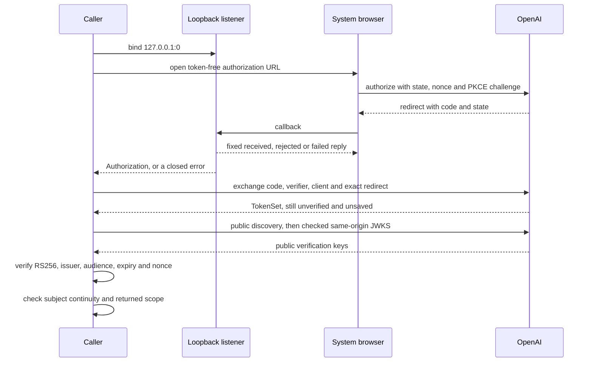
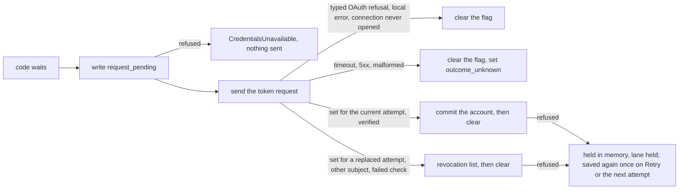

# Accounts

## Anthropic API key

Settings → Accounts shows the Anthropic API key row for pasting, checking, and removing a key.
At the explicit Paste click, the UI thread samples the clipboard sequence number
as metadata. A row-only Windows adapter reads the payload off the UI thread:
it takes only Unicode text when present, never queries, reads or names any
other format, and never writes to the clipboard. The adapter strictly decodes
the terminated UTF-16 text and bounds the raw UTF-8 result to 2,048 bytes before
trim. Other platforms refuse the read. A validated paste stays in a zeroizing
buffer until the brain replies with a one-use staging plan; only its trimmed
byte length describes the key on the pipe.
The shell-core writer puts chunks in Credential Manager at those authority-owned
names in the background, then the shell sends `AnthropicKeyStaged { plan }`.
One 30-second deadline starts at the click and includes the read, the write and
the save reply. Disconnect or expiry discards the read and prevents late
replies or writes from triggering adoption. One native clipboard read can be
in flight; a timed-out read holds that slot until the OS call returns, with
no retry or UI wait. A queued writer won't start after the deadline, but
an already running OS write cannot be recalled. After Staged has been sent, a
missing acknowledgement leaves the save unconfirmed, not failed. A save
acknowledgement is separate from catalog verification.
After a lost acknowledgement, the row retains the unknown-save status through
Check. A successful local vault read for that Check on the same link unlocks
paste and, if a key is stored, removal of the revision it read. A queued
snapshot can't unlock the row. An unreadable vault leaves both actions locked
and allows another Check. The catalog's result shows separately and doesn't
block either action once the local read succeeds. Disconnect retires the
request but keeps the unknown outcome so the user can Check after reconnecting.
Whenever Paste is available, the row warns that it can replace a saved key.
A fresh shell can receive a cached Missing view while a prior adoption is
still in flight, so Missing does not suppress the warning.
The key never crosses the pipe or enters a file, log, command line or environment variable.
Only keys connected inside Kumochi are used; live checks must read the same Kumochi-owned
credential, never another app's key.

The key-chat transport gives each verified authority a nonzero random tag.
Without the transport, a readable saved key reports Unconfirmed; startup, Check
and successful adoption send no catalog request. There is no alternate client.
An ordinary check of the same verified revision keeps its tag. Adoption and removal
close both the authority's send fence and any queued catalog check before sending
work to the credential thread. If adoption fails, only a new local read proving the
old revision is still current can begin recovery; any recovered route has a new tag.
If failure changes the account view, the current shell receives that snapshot.
Only the shell epoch that submitted the paste can receive its receipt.
The coordinator receives only model metadata and a tag, never a key.

The saved key is the [credential authority](#credential-authority)'s `anthropic` record: Check
reads its current generation, and a removal confirmation applies only to the
authority revision shown when the dialog opened. A catalog result for that
revision doesn't invalidate confirmation. The worker compares that revision before
committing, then sweeps the names, so a stale confirmation can't delete a
replacement and a removed key is never read again even while Credential Manager
still serves it.
Neither the legacy `anthropic-key-staged.{service}` target nor the old
`anthropic-key.{service}` record is read. All work runs on the credential worker under the
vault's session lock, one job at a time and in order, so a Remove sent while a Check's native
read is blocked runs after it, and the runtime generation guard drops the stale Check's reply.
A cancelled waiter never interrupts an in-flight call.

A failed key removal remains pending in this brain process; Check/Retry retries
the same revision, and staging requests/notifications are refused without adoption.
A changed revision ends the old removal and reloads the current key, so removing
the replacement requires a new confirmation. The row waits for its own removal
receipt before offering Retry; queued connection snapshots don't count as receipts.
Until the removal transaction commits,
quitting or restarting loses that in-memory
intent and the next startup may load and check the still-current key; retry removal until it
succeeds. A paste refused while removal is pending requires a new explicit paste;
it is not automatically adopted.

The brain checks `GET https://api.anthropic.com/v1/models?limit=65` with a sensitive
`Authorization: Bearer` header and no `x-api-key`, redirects or environment proxy,
a 1 MiB body bound and a 15-second whole-check deadline. More than 64 entries or `has_more`
refuses the catalog. A successful catalog is tagged AnthropicKey; 401/403 rejects the saved key,
as does a 400 `invalid_request_error` naming the exact `anthropic-workspace-id` token
(`WorkspaceRequired`). No workspace id is accepted or provider message forwarded. Rate limits,
server, transport or catalog failures keep it Unconfirmed for a later Check.
When native TLS is unsupported, the connection view reports UnsupportedPlatform on every
snapshot instead. It doesn't admit paste or Check, and an existing key can still be removed
locally by revision.

An entry takes pictures only when its own `capabilities.image_input.supported` is a literal
`true`; absent, `null` or any other value means no, and never fails the Check. The other flags
keep the documented-model list. That fact reaches the screen gate only while it is fresh: the
current key's latest Check verified it. An inconclusive Check, a failed load, a refusal or a
replaced key clears it, and only the next verifying Check of the current generation restores it,
so meanwhile the key keeps text and omits pictures with the truthful `ModelCantSee` line.

A final HTTP 401 on a Messages post refuses the key itself, whichever run or job sent it. The
transport decides it from the status at the response head, never the body, closes the sending
authority's fence there, and tells the account the authority's tag; nothing else is sent. The
account then marks the row Unconfirmed, drops a Check still waiting on its load or catalog read
(a pending reconcile receipt reads as unknown), and clears the models, so the next ask is refused
as unavailable until a new Check reads the catalog and verifies the key under a new tag. A check
that ends after the fence closed can't restore Ready, and a tag from a replaced or removed
authority is ignored. The account hears the tag before the route change, and passes it on first:
the run that sent the refused post, or any run still current on that key, including one compacting
its context inline, ends with the rejected-key notice rather than as unavailable, whichever of the
tag and the post's own 401 reaches it first. A run on another connection, or on the key under a
newer tag, keeps its own outcome. A Check whose catalog read is refused retires the key the same
way and passes its tag on first too, so a run still current on the key ends with the rejected-key
notice whichever refusal the account handles first; asks after it are refused as unavailable. A title or compaction job shows nothing, but the row still
changes. Between the fence closing and the account handling the tag, the row can still show Ready
for a moment; no post can go out in that window, because the fence is already closed. With spoken replies the row can change before the
notice, which waits for the reply's audio to end.

A 403, any other status, and an error typed inside a 200 stream only show their notice and leave
the row as it is: a 403 can concern one model, and retiring the key for it would make the row flip
between Ready and Unconfirmed with every Check.
Every saved-key check or replacement fences late worker/HTTP replies
by generation. A replacement, a removal, a refused Check or a Messages 401 clears the old catalog.
A Check that ends inconclusive keeps the last verified catalog, which sends are still granted on,
and a shell that connects later is offered that same catalog; once a 401 has closed the key's
fence, it is offered nothing. Catalog checks do not authorize inference or
automatic fallback to another connection. Fixtures are synthetic API-reference examples;
no live provider call is part of the tests.

### Authority paste staging

The worker mints one pending write-once plan for a validated 16–2048-byte
length without changing the saved key. One protocol helper owns its lowercase
generation spelling and 2,000-byte chunk layout for both processes. The shell
carrier is moved, not cloned or serialized, into an injected writer. On Windows
that writer calls CredWriteW with generic, local-machine persistence and a
zeroizing blob; it never uses keyring's enterprise-persistent secret path.

Begin replies are tied to the requesting link and request number. Disconnect
clears admission, and offline notifications cannot mint or adopt. Check retains
a pending paste, so a Check during Begin still gets
a plan reply and a Check after its reply does not discard the paste's admission.
Remove consumes issued admission. If a still-current Begin returns a plan for
the revision being removed, the shell gets Unavailable instead of a permit.
The serialized worker consumes an identified permit once; an unknown/superseded/consumed id
is Changed, not an empty-key Format rejection. One two-second settle budget
covers all staged reads; only complete present bytes are validated.

Adoption copies a valid paste into fresh names, verifies the writes, then
activates with the captured revision's compare-and-swap. The worker returns
the revision read inside the successful commit. Read, validation,
write or commit failure preserves both the saved key and the runtime key/view/
catalog. A successful commit enters the normal catalog-check path even if its
shell disconnected; generation, not link epoch, fences this brain-wide result.
`AnthropicKeyStageDone` reports only that paste's save outcome to its original
link, independently of the saved key's connection view. A committed paste reports
success even if a later Check or Remove fenced its runtime result or removed it.

The staged chunks and predecessor are swept after activation, never the new
active names. Any failed adoption and Remove also best-effort delete the
consumed plan's staged names; write/activation failure deletes the uncommitted
candidate's names too, without logging contents or retiring its row.
Failed deletes wait for the next begin or open. Remove consumes admission and
the permit even if its commit fails, so a late notification cannot adopt it.

A lost notification or failed operation leaves Pending until another begin
or the next open retires it. Startup never resumes a paste. A shell write can
outlive a brain restart, including the later lifetime that marks its generation
Swept. Such late chunks can remain physically orphaned but cannot authorize a
key: cleanup is not a physical-erasure guarantee. Removal from Kumochi does
not revoke the key at Anthropic.

## Stored namespaces and credential names

`protocol::constants::ProductIdentity` exposes `RELEASE` and `DEV` independently of the
caller's build profile. The app's existing constants select `ACTIVE` (Dev for debug,
release otherwise). `GATE` is the gate tools' own identity, selected only by the protocol's
`gate-identity` feature on a gate tool's command line (see [the gate identity](gate-identity.md)). Release tooling must select `RELEASE` explicitly, even when xtask
itself is built in debug. Stored spellings are unchanged; there is no migration.

The vault writes only write-once generation names, `<service>/gen/<kind>/<generation>/<index>`
(see [Credential authority](#credential-authority)). `account_target(service, entry)` and the
bounded `account_targets(service)` inventory name what earlier builds wrote: host, sign-out
marker, chatgpt/revoke manifests, and each record's two slots of 64 chunks, plus the active and
staged Anthropic targets in their dot form. These are 262 exact targets, not a service-prefix
match. Neither process reads or writes key bytes at these legacy names. Opens
delete all 262 by exact name before their first sweep, and a refused delete waits for the next
open. The pass repeats at each open until a clean pass in any open after the first one ends
it, recorded in credentials.db's `control` row; after that each open deletes only the
legacy staging name as defense against earlier writers. Anyone signed in on an earlier build sees Signed out and
connects again, and the revocations it still owed are dropped unsent.

Instance capabilities use keyring instead: `instance_entry(session)` formats the account
`capability-<u32>` with the session ID in decimal.
On Windows, keyring stores `{account}.{service}`, represented by `instance_target`:
`capability-7.Kumochi instance`, or `capability-7.Kumochi Dev instance`. Instance callers
retain keyring's default mapping. Anthropic paste staging uses
only authority generation names through the raw Windows writer described above;
`anthropic_staging_target` remains only in legacy cleanup inventories.

## Sign-in callback

`connections::oauth::SignIn::bind` binds `127.0.0.1` on port 0 before the browser
opens. Each attempt owns fresh 32-byte random state, nonce and PKCE verifier from
`getrandom`; the S256 challenge is unpadded base64url SHA-256. The attempt captures
only the saved client id, never saved tokens or email. `Intent::EnablePlan` adds
explicit consent; ordinary sign-in doesn't. The caller supplies the persisted host
id from the vault.

`open_browser` hands a `LaunchTarget` to an injectable `Launcher`. Production uses
`SystemBrowser` and `webbrowser`; tests record the URL without opening a browser.
The async attempt keeps the listener and times the launch on Tokio's blocking pool. The worker
gets only launch material, not the socket, and checks cancellation and expiry under the
process-spawn guard so a queued launch can't open a stale page. Cancel, replacement and
shutdown invalidate that permission before aborting the listener task; cancellation does
not depend on Tokio polling the listener again.
`webbrowser` owns discovery of the OS browser
executable and its existing arguments. Neither `id_token_hint` nor `login_hint` is sent,
even when a saved record has ID, access and refresh tokens. Returning sign-in uses the
saved issued client id and lets the provider show its account selector. No launch URL,
callback request, state, nonce, verifier, authorization code or identity is logged or
sent over the pipe. Debug output redacts attempt and launch data. There is no `log`
to `tracing` bridge: webbrowser's command debug messages must stay disabled.
`deny.toml` bans `tracing-log` to enforce that dependency boundary.

`receive` consumes an attempt and returns `Authorization`, not an account or tokens.
It preserves the code, checked client id, verifier, nonce and exact redirect URI for
the later exchange. Drop the receive future to cancel and close its listener. Invalid
requests leave it live. After state matches, an incomplete or invalid registration ends
it as `SignInFailed` with a fixed failure page. A state-matching OAuth error also ends it
without an exchange; `access_denied` and other OAuth errors get the 200 received page.
Returning callbacks may omit the client id but cannot replace it. Initial registration
must supply a nonempty issued id, not `dynamic_agent_client`. The nonce is retained for
the signed ID token, not checked against an untrusted callback parameter.

The HTTP boundary accepts only `GET /auth/callback?... HTTP/1.1`, exactly one Host
header equal to `127.0.0.1:<selected port>`, no fragment or duplicate decoded query
parameter, and constant-time equality with the pending state. Malformed headers,
wrong path/host/port/state and stale errors get a 400 rejection and leave the attempt live.
The callback response is fixed nonreflecting text from `locales/en/brain.ftl`, formatted
with Fluent, served as UTF-8 plain text with no caching or referrer. Receiving a response
doesn't mean the account has been verified; that is the exchange's responsibility.

**Local policies:** an entire header, including its terminator, is at most 32 KiB and
has one absolute 2 s read deadline. A response has up to 1 s to write. The whole attempt,
including accepts, reads and replies, ends after `[tuning.oauth] sign_in_s` on `tokio::time`
(five minutes by default, and never longer). The listener
is serial: each idle preconnect can delay a queued valid callback by its 2 s read plus
up to 1 s writing its rejection, and multiple idle connections can queue within that
original deadline. Sustained backlog starvation is a local denial of service: sign-in
times out, but nothing leaks. Timing tests use in-memory duplex streams and a paused clock;
socket tests cover an idle preconnect followed by a valid callback. No test uses outside hosts
or DNS; socket tests use only `127.0.0.1` port 0.

**Public provider contracts:**

| Values and behavior | Public OpenAI source |
| --- | --- |
| `https://auth.openai.com/api/accounts/authorize`, PKCE `S256` support | [Discovery](https://auth.openai.com/.well-known/openid-configuration) |
| `dynamic_agent_client`, issued callback `client_id`, `ext_agent_host_id`, initial `agent_name_hint`, `response_type=code` | [Registration and sign-in](https://developers.openai.com/siwc/token-sharing-open-source/sign-in) |
| `openid profile email offline_access resource.invoke chatgpt.tokens.use.direct`, resource `https://api.openai.com/v1` | [Registration and sign-in](https://developers.openai.com/siwc/token-sharing-open-source/sign-in) |
| `http://127.0.0.1:<port>/auth/callback`, state, nonce, PKCE and identical exchange redirect; `access_denied`; returning client binding; optional hints omitted here | [Registration and sign-in](https://developers.openai.com/siwc/token-sharing-open-source/sign-in) |
| `prompt=consent` only after the user requests plan use | [Errors and recovery](https://developers.openai.com/siwc/token-sharing-open-source/errors-and-recovery) |

The callback stops at `Authorization`; it doesn't exchange, verify or save credentials.

## HTTP, exchange and identity

The stateless helpers expose the sequence below. They don't replace an account or write the
vault; the account machine (below) owns cancellation, the token lane and persistence.

### Checked HTTP and roots

`connections::http_client::build()` is the account client's only production constructor.
It gets its TLS config from `platform::native_client_tls`, the factory shared with the direct
model connectors and voice downloader. On Windows the factory still loads the current user's
public ROOT store through `platform::trust_roots`, including machine-supplied roots. The loader
keeps only time-valid roots allowed for server authentication or all uses.
An unrestricted-use result requires a successful EKU call, zero identifiers and immediately
captured `CRYPT_E_NOT_FOUND`; unreadable usage isn't treated as unrestricted. Enumeration owns
one context at a time and transfers that ownership back to the next Win32 enumeration call.
Early returns free the held context and close the store. Nothing is installed or fetched.

Rustls parses those DER roots and verifies chains offline with ring. Empty or entirely
unparsable roots fail as `TrustStoreUnavailable`, without a fallback root bundle or permissive
verifier. There is no platform verifier, native-certs loader or certificate-override setting.
On builds without a native trust-store adapter, native account startup refuses before starting
its worker. Client constructors return a permanent unsupported-platform error, not the
retryable Windows trust-store error. The native Anthropic route refuses before allocating a
request budget. Loopback TLS tests can still inject their own roots.
The real-store test runs in the normal Windows test suite: it reads bounded public certificates
only, writes nothing, and exercises the FFI ownership path rather than leaving it ignored.

The client enforces HTTPS, refuses redirects, disables proxy discovery, and exposes neither
the raw reqwest client nor raw transport errors. Discovery and validated JWKS requests contain
no credentials; only the fixed token endpoint accepts form fields. A scripted `Http` seam
lets exchange and JWT tests inspect request data without external traffic. TLS fixtures bind
only `127.0.0.1:0`, generate CA and leaf keys in memory, and never install a certificate.

**Local policies:** 15 s connect, 60 s read and 120 s total request limits; discovery and JWKS
requests have a 10 s limit. All success and error bodies are capped at 1 MiB, and a request-id
header is retained only as at most 256 graphic ASCII bytes. The root loader keeps at most
1,024 roots, caps each DER certificate and EKU buffer at 16 KiB, and counts skipped and unreadable entries separately.
Proxied networks cannot sign in until a user-set proxy setting exists. Each exchange builds its
own client on a blocking thread (`spawn_blocking`), because reading the trust store blocks; a
root store fixed since the last try is read again. A root Windows hasn't
installed yet fails as `UnknownIssuer`; verification never invokes an online OS chain builder.
ROOT entries present in Windows' Disallowed store or carrying a due disallowed-time property
are excluded. A Disallowed store that doesn't exist (`ERROR_FILE_NOT_FOUND`) counts as empty;
any other failure to open it fails closed. Distrusted server-supplied intermediates, root not-before/usage policies and revocation
checking remain outside this offline verifier. Client construction logs only root counts
and the loader's typed OS error, never certificate data; counts are unavailable on loader failure.

### Stateless code exchange

`oauth::exchange::exchange` borrows the callback's `Authorization` and posts the documented
form. It never uses a client id from the token response. `TokenSet` owns zeroizing, redacted
credentials independently of the active account, so a later verification error doesn't
consume them. A grant without a refresh token is representable; the account machine refuses it, since it
can't be renewed or revoked, and drops its access token to expire on its own. The caller also retains registration and
computes expiry through `Clock`, from the time the response arrived, before the identity check;
failed wall-time conversion doesn't consume the token set.

**Local policies:** the token response record is at most 48 KiB, including escaping and unknown
fields. Access and ID tokens are at most 16 KiB each, refresh tokens 8 KiB, granted scope 1 KiB,
and client ids and subjects 256 bytes. The code is capped at 16 KiB, the redirect at 256 bytes,
and the verifier must fit PKCE's 43–128 unreserved ASCII characters. `expires_in` is clipped to
86,400 seconds as in the spike; a zero lifetime is already expired, so 9b must refresh before use.
`earliest_refresh_at` is ignored. A parsed but unusable HTTP 200, or another 2xx,
returns its received refresh token in a redacted, zeroizing error for the caller to revoke,
including a mistyped sibling, duplicate key, or a field or record over its storage bound.
Only an OAuth error object with a
string `error` on a 4xx response conclusively reports refusal; transport failures, malformed
replies, oversized data and other statuses leave issuance uncertain for the later token lane.
No provider message or body enters an error.

`oauth::refresh::refresh` posts `grant_type=refresh_token`, the saved `client_id`, the refresh
token and `resource`, then parses the answer as an exchange's. The tunable 30 s default covers
HTTP client setup and the request under one deadline. A timeout during setup or before dispatch
is definitely unsent; a timeout after dispatch is not.
Unlike an exchange, it may leave out `id_token` or `refresh_token`; an exchange without `id_token`
is unusable. Empty or oversized inputs are refused before anything is sent.

### Signed identity and plan permission

`oauth::id_token::verify` checks discovery's exact issuer and allows JWKS only on
`https://auth.openai.com:443`, without userinfo or a fragment. It selects the declared `kid`
from that key set, skips unparseable keys and rejects duplicate key identifiers. A `kid` the set
lacks gets the set fetched once more, since one fetched while the provider rotates its keys can
lack the new key; still missing, it's `UnknownKey`. The clock is read again after that refetch,
so a token that expires while it runs is refused. A selected key
must be RSA, and must permit signatures and RS256 when those metadata fields are present. It
verifies the signature itself, with ring's RSA PKCS#1 v1.5 SHA-256 check for 2048- to 8192-bit
keys, before trusting claims. ring rounds that minimum up to a whole byte, so a modulus with fewer
than 2048 significant bits is refused before ring sees it. The token is exactly three unpadded
base64url parts, the header's
`alg` is `RS256`, and a header with `crit` is refused. Claims parse into typed fields, so a
claim with the wrong JSON type is refused rather than read as absent.
Issuer and audience must bind to OpenAI and the issued client. Expiry uses the injectable
wall `Clock`, not a library's hidden clock; nonce comparison is constant-time.
`check_subject` rejects a different saved subject, and `permits_plan` requires the exact
returned `chatgpt.tokens.use.direct` scope. A verified ID token alone doesn't enable inference.

**Local validation policies:** 30 s expiry tolerance, at most 64 JWKS keys and 16 audiences,
2 KiB for a discovered JWKS URL, 128 bytes for a nonce and 254 bytes for a display email.
The OIDC authorized-party check requires `azp` to match when present, and requires it for a
multi-audience token; this is a validation policy, not a claim that OpenAI always emits `azp`.
Email remains signed display data, not identity or a workspace identifier.

Application-owned token/code strings and response buffers are zeroizing and redact Debug.
The body buffer is pre-sized from bounded `Content-Length` when present, otherwise it grows;
earlier allocations released during growth aren't zeroed. HTTP/TLS library buffers and serde's internal parsing scratch allocations remain outside
that wipe boundary. Requests, URLs with queries, tokens and response bodies are never logged.
The JWT fixtures use public throwaway test keys through rustls's ring signer; they aren't
credentials for any account or service.

| Added provider contract | Public OpenAI source |
| --- | --- |
| `https://auth.openai.com/api/accounts/oauth/token`, form `grant_type=authorization_code`, issued `client_id`, `code`, `code_verifier`, exact `redirect_uri`, `resource`; no client secret; `invalid_grant` needs a fresh code | [Registration and sign-in](https://developers.openai.com/siwc/token-sharing-open-source/sign-in) |
| HTTP 200, `access_token`, conditional `refresh_token`, `id_token`, `token_type`, `expires_in`, `scope`, `earliest_refresh_at` | [Token reference](https://developers.openai.com/siwc/token-sharing-open-source/token-reference) |
| Issuer `https://auth.openai.com`, discovery at `/.well-known/openid-configuration`, `jwks_uri`, supported RS256 | [Discovery](https://auth.openai.com/.well-known/openid-configuration) |
| ID-token `iss`, `aud`, `exp`, `sub`, `nonce`, `email`, key selection by `kid`, and signed subject continuity | [Registration and sign-in](https://developers.openai.com/siwc/token-sharing-open-source/sign-in), [Identity verification and sample claims](https://developers.openai.com/siwc/website#6-verify-the-id-token) |
| Returned `chatgpt.tokens.use.direct` grant, and identity without plan permission | [Registration and sign-in](https://developers.openai.com/siwc/token-sharing-open-source/sign-in#4-validate-the-id-token-and-chatgpt-plan-permission) |
| `invalid_client`, typed errors and request-id diagnostics | [Errors and recovery](https://developers.openai.com/siwc/token-sharing-open-source/errors-and-recovery), [OpenAI's `x-request-id` header](https://developers.openai.com/api/docs/api-reference/debugging-requests#debugging-requests) |

## The account machine

`connections::account::AccountState` is pure: inputs in (an `AccountOp`, a connection, a finished
credential job, a listener or exchange result), effects out (a view, an error, a credential job,
start or close the listener, send a token request). `runtime::account::Accounts` runs those
effects. Credential jobs go, one at a time and in order, to a `credentials` thread that owns the
vault and its session lock; the listener and the exchange are tokio tasks; every result comes back
on one channel the core loop polls. The startup load runs there too, and the brain waits for it
before it stores the instance capability or serves anything. On
quit or close, a refresh already out runs to its end and its save, for up to `REFRESH_WAIT`
(5 s [guess]), with the session lock still held; past that the vault is dropped and the token
stays marked as sent, so the next start never sends it again. Then it waits for the job already dispatched, past the quit deadline if it must, before the instance
capability is deleted. The runtime delivers exactly one `Vault` result per dispatched job (the
credentials thread sends one per job it runs) and one `Exchanged` per sent request (the exchange
task's last step). No runtime test drives a full exchange yet, so the machine also ignores a
result with no request outstanding for its attempt, which keeps the next request and any owned
set intact (`a_repeated_exchange_result_leaves_the_next_request_to_finish`,
`a_repeated_exchange_result_keeps_the_owned_set`).

```mermaid
stateDiagram-v2
    [*] --> Busy: start, read the vault
    Busy --> SignedOut: read, no account
    Busy --> SignedIn: read, account
    Busy --> SigningOut: read, sign-out pending (resumes at its phase)
    Busy --> Busy: lock held; retried on each op and connection
    SignedOut --> SigningIn: SignIn / EnablePlan
    SignedIn --> SigningIn: SignIn / EnablePlan
    SigningIn --> SigningIn: SignIn replaces the attempt
    SigningIn --> SignedIn: verified set committed
    SigningIn --> SignedOut: cancelled, refused or failed
    SigningIn --> SignedIn: cancelled or failed with an account
    SignedIn --> SigningOut: SignOut (use stops)
    SigningIn --> SigningOut: SignOut with an account (attempt cancelled)
    SigningOut --> SigningOut: a step refused, waits for Retry or the next start
    SigningOut --> SignedOut: Finish, from the decided notice
```

Every op is answered with the current view; anything else sends one only when it changed.

**Attempts.** `attempt` names the one live sign-in; `SignIn` and `EnablePlan` move it, and so does
`CancelSignIn` while the attempt still waits for the browser. Once the browser has finished, while
the registration is saved, the code is exchanged or the set is saved, a cancel changes nothing and
the sign-in completes (`a_cancel_after_the_browser_finished_keeps_the_sign_in`). A first sign-in
saves the issued registration before its code is sent, so a failed exchange still keeps the
client. A replaced attempt's waiting code is never sent; a sent request is never aborted. An op
arriving while the current attempt's save runs waits for it (only the newest is kept); the save is
published first. A cancel during the save also drops a waiting Open again, so no browser opens
after it (`a_cancel_during_the_save_keeps_the_set_and_drops_a_waiting_open_again`).

**The token lane** admits one token request at a time and holds it until the result has a durable
owner: the account, the revocation list, or the knowledge that nothing was issued.

A received set never has two owners and never none. A refused save holds the set in memory and the
lane; it is tried again once when the attempt moves (as a list entry, since its attempt is gone)
or on Retry, never on every pass. A live attempt ends then with `CredentialsUnavailable` and
Retry, since its code could only wait behind the held set.
A pending flag a crash left behind becomes `outcome_unknown` as soon as the next start reads the
vault, before any save could finish it as known, and a later success never clears it.

**Replacing a token.** A refresh token leaves `chatgpt` only once the provider spent it, the list
holds the same client and token, or the marker records `outcome_unknown`. A sign-in's Commit
checks this against the disk, in the same credential job, before it saves: it lists the token
`chatgpt` holds (the old account's, a rejected or pending set, a spent one) as an exchange's
entry, stamped with the job's monotonic-safe time, but only while two exchange slots are free, so
the incoming set keeps the slot it was admitted on should its own save be refused. Otherwise, or
when the token can't fit an entry, it writes `outcome_unknown` first. An equal entry already
listed needs nothing, so a Retry never lists it twice. The job reports a list it saved even when
the account save is then refused; the machine takes its count and starts a revocation pass for it
before anything else runs. Once the account's generation is current, the sign-in is committed,
whatever the marker writes after it do.

Listing comes before replacing, so if the account save fails after the old account's token was
listed, that token can be revoked before the new set is installed: the old session's next refresh
gets `invalid_grant` and goes down the usual sign-in-again path. Retry can still commit the held
set; Cancel doesn't bring the old session back. With three exchanges listed, the replaced token is
recorded unknown instead, so the next sign-out's notice is unconfirmed.

**Local policies:**
- A grant without a refresh token is refused; nothing is saved for it.
- An unusable 200 response that named a refresh token lists that token, when it's non-empty and
  its list entry fits; otherwise its outcome is unknown.
- A list entry may take at most 9,817 serialized bytes (`MAX_ENTRY_BYTES`), so the account entry and
  four exchanges always fit one 48 KiB record. A received set whose refresh token escapes past
  that, or whose account record escapes past 48 KiB, is refused where it arrives, so no save that
  can never land is offered for Retry; the token's outcome is unknown, or it's listed when only
  the account record was too big.
- A 4xx without an OAuth error object (a proxy page, say) leaves issuance unknown.
- Sign-in is refused with `RevocationBacklog` when the list's four exchange slots, counting one
  reserved for the request in flight, are full. Nothing is dropped to make room.
- A failed read of the saved ChatGPT record is distinct from no active record. The view
  distinguishes absent chunks, malformed records, and refused reads. **Check again** queues
  one local read of the marker and current ChatGPT record under the existing session lock. It
  does not open the vault, create a host, maintain the revocation list, or start provider work.
  The head and active layout are observed in one SQLite statement. Without a valid pinned
  revision, or if the revision changed, the shell cannot check again in this session. A
  readable current sign-in recovers locally; **Load models** is a separate provider action.
  For a missing component, the shared Accounts view explains that ordinary sign-in cannot
  reconnect ChatGPT, even when Check again isn't available. If another already connected
  account has an available model, the user can choose it in Settings → General.
  Check and its reply do not fence held input or change model routing. Account operations
  that can affect a route, including **Load models**, keep their existing hold fences.
  Host, vault-open and revocation prerequisites still block sign-in on their own paths.
- A refused registration or pending-flag write ends the attempt and offers a new sign-in, since
  Retry would have nothing to rerun.
- A Busy session lock at startup is retried 5 times, 250 ms apart [guess]; after that, on eacOn macOS, `platform::macos::credential::MacCredentialStore` is dormant: only tests construct it,
and the native store stays `Unsupported`. It uses the data protection keychain, never the
file-based login keychain: one generic password per exact target, as the account under
`CREDENTIAL_SERVICE`, not synchronizable, readable only while unlocked on this device. Every query
pins one access group, the process's own provisioned `com.apple.application-identifier`;
`MacCredentialStore::admitted` refuses a host without that entitlement before any Keychain call,
so an unauthorized read can't pass for absence. Every SecItem call carries its own `LAContext`
with interaction not allowed, so the adapter requests no UI; if that context can't be set up, the
call is refused. A write adds, or on a duplicate updates only the data. It hands the framework a
no-copy view of a zeroizing copy, freed only when nothing else holds the view (the framework may
still make its own copies, and a read's returned data can't be wiped). It keeps Windows' name and
2,560-byte limits. Measured once on macOS 26.5.1 arm64 with an ad-hoc-signed test build and a
scratch name: a missing read came back not-found, a delete returned `errSecMissingEntitlement`
(-34018), and nothing was written; signed CRUD, locked-store and UI behavior are Apple's documented
expectations, not measured. The native contract test is ignored until a signed test host exists.
h