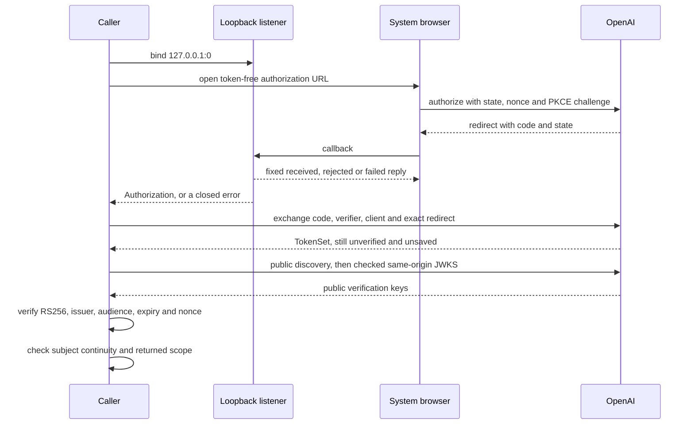
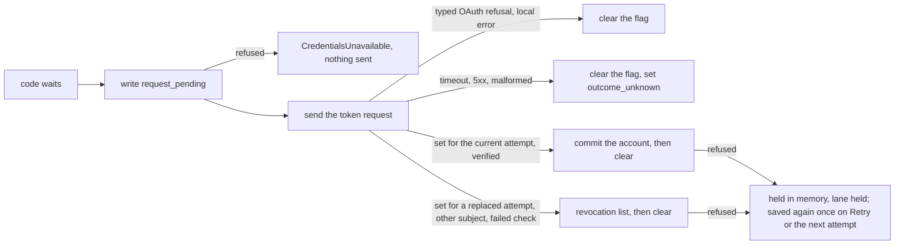
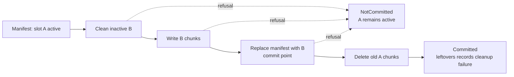

# Accounts

## Sign-in callback

`connections::oauth::SignIn::bind` binds `127.0.0.1` on port 0 before the browser
opens. Each attempt owns fresh 32-byte random state, nonce and PKCE verifier from
`getrandom`; the S256 challenge is unpadded base64url SHA-256. The attempt captures
only the saved client id, never saved tokens or email. `Intent::EnablePlan` adds
explicit consent; ordinary sign-in doesn't. The caller supplies the persisted host
id from the vault.

`open_browser` hands a `LaunchTarget` to an injectable `Launcher`. Production uses
`SystemBrowser` and `webbrowser`; tests record the URL without opening a browser.
`webbrowser` owns discovery of the OS browser
executable and its existing arguments. Neither `id_token_hint` nor `login_hint` is sent,
even when a saved record has ID, access and refresh tokens. Returning sign-in uses the
saved issued client id and lets the provider show its account selector. No launch URL,
callback request, state, nonce, verifier, authorization code or identity is logged or
sent over the pipe. Debug output redacts attempt and launch data. There is no `log`
to `tracing` bridge: webbrowser's command debug messages must stay disabled.
`deny.toml` bans `tracing-log` to enforce that dependency boundary.

`receive` consumes an attempt and returns `Authorization`, not an account or tokens.
It preserves the code, checked client id, verifier, nonce and exact redirect URI for
the later exchange. Drop the receive future to cancel and close its listener. Invalid
requests leave it live. After state matches, an incomplete or invalid registration ends
it as `SignInFailed` with a fixed failure page. A state-matching OAuth error also ends it
without an exchange; `access_denied` and other OAuth errors get the 200 received page.
Returning callbacks may omit the client id but cannot replace it. Initial registration
must supply a nonempty issued id, not `dynamic_agent_client`. The nonce is retained for
the signed ID token, not checked against an untrusted callback parameter.

The HTTP boundary accepts only `GET /auth/callback?... HTTP/1.1`, exactly one Host
header equal to `127.0.0.1:<selected port>`, no fragment or duplicate decoded query
parameter, and constant-time equality with the pending state. Malformed headers,
wrong path/host/port/state and stale errors get a 400 rejection and leave the attempt live.
The callback response is fixed nonreflecting text from `locales/en/brain.ftl`, formatted
with Fluent, served as UTF-8 plain text with no caching or referrer. Receiving a response
doesn't mean the account has been verified; that is the exchange's responsibility.

**Local policies:** an entire header, including its terminator, is at most 32 KiB and
has one absolute 2 s read deadline. A response has up to 1 s to write. The whole attempt,
including accepts, reads and replies, ends at five minutes on `tokio::time`. The listener
is serial: each idle preconnect can delay a queued valid callback by its 2 s read plus
up to 1 s writing its rejection, and multiple idle connections can queue within that
five-minute deadline. Sustained backlog starvation is a local denial of service: sign-in
times out, but nothing leaks. Timing tests use in-memory duplex streams and a paused clock;
socket tests cover an idle preconnect followed by a valid callback. No test uses outside hosts
or DNS; socket tests use only `127.0.0.1` port 0.

**Public provider contracts:**

| Values and behavior | Public OpenAI source |
| --- | --- |
| `https://auth.openai.com/api/accounts/authorize`, PKCE `S256` support | [Discovery](https://auth.openai.com/.well-known/openid-configuration) |
| `dynamic_agent_client`, issued callback `client_id`, `ext_agent_host_id`, initial `agent_name_hint`, `response_type=code` | [Registration and sign-in](https://developers.openai.com/siwc/token-sharing-open-source/sign-in) |
| `openid profile email offline_access resource.invoke chatgpt.tokens.use.direct`, resource `https://api.openai.com/v1` | [Registration and sign-in](https://developers.openai.com/siwc/token-sharing-open-source/sign-in) |
| `http://127.0.0.1:<port>/auth/callback`, state, nonce, PKCE and identical exchange redirect; `access_denied`; returning client binding; optional hints omitted here | [Registration and sign-in](https://developers.openai.com/siwc/token-sharing-open-source/sign-in) |
| `prompt=consent` only after the user requests plan use | [Errors and recovery](https://developers.openai.com/siwc/token-sharing-open-source/errors-and-recovery) |

The callback stops at `Authorization`; it doesn't exchange, verify or save credentials.

## HTTP, exchange and identity

The stateless helpers expose the sequence below. They don't replace an account or write the
vault; the account machine (below) owns cancellation, the token lane and persistence.

### Checked HTTP and roots

`connections::http_client::build()` is the only production constructor. It loads the current
user's public Windows ROOT store through `platform::trust_roots`, which includes machine-supplied
roots. The loader keeps only time-valid roots allowed for server authentication or all uses.
An unrestricted-use result requires a successful EKU call, zero identifiers and immediately
captured `CRYPT_E_NOT_FOUND`; unreadable usage isn't treated as unrestricted. Enumeration owns
one context at a time and transfers that ownership back to the next Win32 enumeration call.
Early returns free the held context and close the store. Nothing is installed or fetched.

Rustls parses those DER roots and verifies chains offline with ring. Empty or entirely
unparsable roots fail as `TrustStoreUnavailable`, without a fallback root bundle or permissive
verifier. There is no platform verifier, native-certs loader or certificate-override setting.
The real-store test runs in the normal Windows test suite: it reads bounded public certificates
only, writes nothing, and exercises the FFI ownership path rather than leaving it ignored.

The client enforces HTTPS, refuses redirects, disables proxy discovery, and exposes neither
the raw reqwest client nor raw transport errors. Discovery and validated JWKS requests contain
no credentials; only the fixed token endpoint accepts form fields. A scripted `Http` seam
lets exchange and JWT tests inspect request data without external traffic. TLS fixtures bind
only `127.0.0.1:0`, generate CA and leaf keys in memory, and never install a certificate.

**Local policies:** 15 s connect, 60 s read and 120 s total request limits; discovery and JWKS
requests have a 10 s limit. All success and error bodies are capped at 1 MiB, and a request-id
header is retained only as at most 256 graphic ASCII bytes. The root loader keeps at most
1,024 roots, caps each DER certificate and EKU buffer at 16 KiB, and counts skipped and unreadable entries separately.
Proxied networks cannot sign in until a user-set proxy setting exists. Each exchange builds its
own client on a blocking thread (`spawn_blocking`), because reading the trust store blocks; a
root store fixed since the last try is read again. A root Windows hasn't
installed yet fails as `UnknownIssuer`; verification never invokes an online OS chain builder.
ROOT entries present in Windows' Disallowed store or carrying a due disallowed-time property
are excluded. A Disallowed store that doesn't exist (`ERROR_FILE_NOT_FOUND`) counts as empty;
any other failure to open it fails closed. Distrusted server-supplied intermediates, root not-before/usage policies and revocation
checking remain outside this offline verifier. Client construction logs only root counts
and the loader's typed OS error, never certificate data; counts are unavailable on loader failure.

### Stateless code exchange

`oauth::exchange::exchange` borrows the callback's `Authorization` and posts the documented
form. It never uses a client id from the token response. `TokenSet` owns zeroizing, redacted
credentials independently of the active account, so a later verification error doesn't
consume them. A grant without a refresh token is representable; the account machine refuses it, since it
can't be renewed or revoked, and drops its access token to expire on its own. The caller also retains registration and
computes expiry through `Clock`; failed wall-time conversion doesn't consume the token set.

**Local policies:** the token response record is at most 48 KiB, including escaping and unknown
fields. Access and ID tokens are at most 16 KiB each, refresh tokens 8 KiB, granted scope 1 KiB,
and client ids and subjects 256 bytes. The code is capped at 16 KiB, the redirect at 256 bytes,
and the verifier must fit PKCE's 43–128 unreserved ASCII characters. `expires_in` is clipped to
86,400 seconds as in the spike; a zero lifetime is already expired, so 9b must refresh before use.
`earliest_refresh_at` is ignored. A parsed but unusable HTTP 200, or another 2xx,
returns its received refresh token in a redacted, zeroizing error for the caller to revoke,
including a mistyped sibling, duplicate key, or a field or record over its storage bound.
Only an OAuth error object with a
string `error` on a 4xx response conclusively reports refusal; transport failures, malformed
replies, oversized data and other statuses leave issuance uncertain for the later token lane.
No provider message or body enters an error.

### Signed identity and plan permission

`oauth::id_token::verify` checks discovery's exact issuer and allows JWKS only on
`https://auth.openai.com:443`, without userinfo or a fragment. It selects the declared `kid`
from that key set, skips unparseable keys and rejects duplicate key identifiers. A selected key
must permit signatures and RS256 when those metadata fields are present. It verifies the
signature before trusting claims.
Issuer and audience must bind to OpenAI and the issued client. Expiry uses the injectable
wall `Clock`, not the JWT library's hidden clock; nonce comparison is constant-time.
`check_subject` rejects a different saved subject, and `permits_plan` requires the exact
returned `chatgpt.tokens.use.direct` scope. A verified ID token alone doesn't enable inference.

**Local validation policies:** 30 s expiry tolerance, at most 64 JWKS keys and 16 audiences,
2 KiB for a discovered JWKS URL, 128 bytes for a nonce and 254 bytes for a display email.
The OIDC authorized-party check requires `azp` to match when present, and requires it for a
multi-audience token; this is a validation policy, not a claim that OpenAI always emits `azp`.
Email remains signed display data, not identity or a workspace identifier.

Application-owned token/code strings and response buffers are zeroizing and redact Debug.
The body buffer is pre-sized from bounded `Content-Length` when present, otherwise it grows;
earlier allocations released during growth aren't zeroed. HTTP/TLS library buffers and serde's internal parsing scratch allocations remain outside
that wipe boundary. Requests, URLs with queries, tokens and response bodies are never logged.
The JWT fixtures use public throwaway test keys through rustls's ring signer; they aren't
credentials for any account or service.

| Added provider contract | Public OpenAI source |
| --- | --- |
| `https://auth.openai.com/api/accounts/oauth/token`, form `grant_type=authorization_code`, issued `client_id`, `code`, `code_verifier`, exact `redirect_uri`, `resource`; no client secret; `invalid_grant` needs a fresh code | [Registration and sign-in](https://developers.openai.com/siwc/token-sharing-open-source/sign-in) |
| HTTP 200, `access_token`, conditional `refresh_token`, `id_token`, `token_type`, `expires_in`, `scope`, `earliest_refresh_at` | [Token reference](https://developers.openai.com/siwc/token-sharing-open-source/token-reference) |
| Issuer `https://auth.openai.com`, discovery at `/.well-known/openid-configuration`, `jwks_uri`, supported RS256 | [Discovery](https://auth.openai.com/.well-known/openid-configuration) |
| ID-token `iss`, `aud`, `exp`, `sub`, `nonce`, `email`, key selection by `kid`, and signed subject continuity | [Registration and sign-in](https://developers.openai.com/siwc/token-sharing-open-source/sign-in), [Identity verification and sample claims](https://developers.openai.com/siwc/website#6-verify-the-id-token) |
| Returned `chatgpt.tokens.use.direct` grant, and identity without plan permission | [Registration and sign-in](https://developers.openai.com/siwc/token-sharing-open-source/sign-in#4-validate-the-id-token-and-chatgpt-plan-permission) |
| `invalid_client`, typed errors and request-id diagnostics | [Errors and recovery](https://developers.openai.com/siwc/token-sharing-open-source/errors-and-recovery), [OpenAI's `x-request-id` header](https://developers.openai.com/api/docs/api-reference/debugging-requests#debugging-requests) |

## The account machine

`connections::account::AccountState` is pure: inputs in (an `AccountOp`, a connection, a finished
credential job, a listener or exchange result), effects out (a view, an error, a credential job,
start or close the listener, send a token request). `runtime::account::Accounts` runs those
effects. Credential jobs go, one at a time and in order, to a `credentials` thread that owns the
vault and its session lock; the listener and the exchange are tokio tasks; every result comes back
on one channel the core loop polls. The brain reads the vault before it serves anything, and on
quit waits for the job already dispatched, past the quit deadline if it must, before the instance
capability is deleted.

```mermaid
stateDiagram-v2
    [*] --> Busy: start, read the vault
    Busy --> SignedOut: read, no account
    Busy --> SignedIn: read, account
    Busy --> SigningOut: read, sign-out pending (fenced)
    Busy --> Busy: lock held; retried on each op and connection
    SignedOut --> SigningIn: SignIn / EnablePlan
    SignedIn --> SigningIn: SignIn / EnablePlan
    SigningIn --> SigningIn: SignIn replaces the attempt
    SigningIn --> SignedIn: verified set committed
    SigningIn --> SignedOut: cancelled, refused or failed
    SigningIn --> SignedIn: cancelled or failed with an account
```

Every op is answered with the current view; anything else sends one only when it changed.

**Attempts.** `attempt` names the one live sign-in; `SignIn`, `EnablePlan` and `CancelSignIn` move
it. A first sign-in saves the issued registration before its code is sent, so a failed exchange
still keeps the client. A replaced attempt's waiting code is never sent; a sent request is never
aborted. An op arriving while the current attempt's save runs waits for it (only the newest
is kept); the save is published first.

**The token lane** admits one token request at a time and holds it until the result has a durable
owner: the account, the revocation list, or the knowledge that nothing was issued.

A received set never has two owners and never none. A refused save holds the set in memory and the
lane; it is tried again once when the attempt moves (as a list entry, since its attempt is gone)
or on Retry, never on every pass. A live attempt ends then with `CredentialsUnavailable` and
Retry, since its code could only wait behind the held set.
A pending flag a crash left behind becomes `outcome_unknown` on the next request, and
a later success never clears it.

**Local policies:**
- A grant without a refresh token is refused; nothing is saved for it.
- An unusable 200 response that named a refresh token lists that token, when it's non-empty and
  within 8 KiB; otherwise its outcome is unknown.
- A 4xx without an OAuth error object (a proxy page, say) leaves issuance unknown.
- Sign-in is refused with `RevocationBacklog` when the list's four exchange slots, counting one
  reserved for the request in flight, are full. Nothing is dropped to make room.
- An unreadable `host` or record refuses sign-in (`CredentialsUnavailable`); Retry reads again.
- A refused registration or pending-flag write ends the attempt and offers a new sign-in, since
  Retry would have nothing to rerun.
- A Busy session lock at startup is retried 5 times, 250 ms apart [guess]; after that, on each
  op and each connection.
- A list entry stamped on a clock before 1970 gets `added_at = u64::MAX`, so age-out never
  evicts it early.

Sign-out, revocation and age-out land in slice 3 PR 9b part 2. Until then `SignOut` and a
backlog `Retry` are answered with the view, and a pending sign-out found at startup keeps the
account fenced (`SigningOut`, `Cleanup::Refused`).

## Credential storage

Store access must be serialized: Rez's clean-store reproduction with two and four concurrent
workers still missed cross-thread reads after successful writes to disjoint names, even with
a barrier before reads and no deletes until all reads finished. A successful parallel delete
also left an entry, so tests verify cleanup by exact name. Production reads and writes all run on the
account system's one credentials thread, through the vault's one store handle, which takes
neither failure at its word: "not found" for a name the handle wrote and hasn't deleted since
is tried 4 times, 25 ms apart [guess], then fails as `Unsettled` instead of reading as absent,
and every delete is read back and retried the same way until the name is gone. Whether a
concurrent write from another process (the shell, another app) causes the same misses is
untested. `Worker::system` is the only way outside tests to
reach the real store: `Vault::open` is private to `connections`, and `WindowsCredentialStore`
to the crate.

The brain's `platform::credential::CredentialStore` reads, writes and deletes one generic
credential by exact target name. Windows uses `CredWriteW` with
`CRED_PERSIST_LOCAL_MACHINE`: entries survive process exit and sign-in on this machine,
but don't roam to another PC. `keyring` 3.6.3, the version used here, hard-codes enterprise
persistence; it remains on the separate instance-capability path, unchanged. The newer
keyring-core 1.x stack's `windows-native-keyring-store` 1.1.0 supports local persistence.
We chose not to add that second keyring stack: our store is small and reviewed, returns
zeroizing bytes, and its guard wipes the validated native read blob and frees the allocation
on every exit, including panic unwinding. `CredentialStore` is the seam for a macOS Keychain store.

Credential Manager protects entries per Windows user, not per process. Any process running
as the same Windows user can read these entries. The session lock coordinates cooperating
brain instances; it does not provide isolation from other processes running as that user.

Account targets belong under `CREDENTIAL_SERVICE` (`Kumochi Dev` in debug builds), never
`INSTANCE_SERVICE`. A caller supplies the full target; the store doesn't rewrite it or
enumerate credentials. Secret bytes are held as `Secret<Zeroizing<Vec<u8>>>`; temporary
copies are bounded and wiped, and debug/error output contains no credential data.

Chunk helpers use 2,000-byte chunks, below Windows' `CRED_MAX_CREDENTIAL_BLOB_SIZE`
(2,560 bytes), and at most 64 chunks (128,000 bytes). Given a base target
`<service>/<record>/<slot>`, they use exactly `<base>/0` through `<base>/<count-1>`.
An empty value uses one empty chunk. Reads require an explicit bounded count, all chunks,
and full-length nonfinal chunks. Deletes are idempotent and attempt every specified name,
reporting the first failure. Only `ERROR_NOT_FOUND` means absence.

The credentials thread is the production caller. Callers must run these synchronous operations
off the core loop and retain the vault, including its session lock, until all blocking work
ends, even if an async waiter is cancelled or shutdown begins. The vault owns the guard until
it is dropped.

`platform::SessionLock` guards the empty `%LOCALAPPDATA%\<DATA_DIR>\session.lock` using
`File::try_lock`; only contention returns typed `Busy`, and dropping the guard releases it.
`platform::session_lock_path()` uses the Dev data folder in debug builds. Startup wiring is separate.

## Vault records

`connections::vault::Vault` uses exact targets under `CREDENTIAL_SERVICE`:

| Record | Layout |
| --- | --- |
| `host` | One credential containing a JSON UUIDv4 URN, generated from `getrandom` on first use. |
| `chatgpt` | A manifest `{slot,chunks}` and chunks in slots `0` and `1`. JSON holds `client_id`, optional `subject` and `email`, `plan_enabled`, and optional nested `tokens` (`access_token`, `refresh_token`, optional `id_token`, `scope`, `expires_at`, `pending_identity_validation`). Registration-only JSON contains just `client_id` and `subject`. |
| `revoke` | Its own manifest and two slots. JSON holds `entries`, each with its own `client_id`, `refresh_token`, `added_at` Unix seconds, and `origin` (`Account` or `Exchange`). At most four exchanges and one account entry. |
| `signout` | One token-free compact JSON credential, never chunked: `{v:1,sign_out,sweep,request_pending,outcome_unknown,notice}`. `sign_out` is null or `{disposition,phase}`, with `Keep`/`Erase` and `Revoking`/`Deleting`. Unknown fields, versions, enums or malformed data fail closed to an Erase/Revoking marker with uncertainty and notice set. |

Each chunked record has exactly 129 possible names: its manifest and 64 chunk indices in
each slot. Both serialized JSON records are capped at 48 KiB, including escaping. Access
and identity tokens are at most 16 KiB each, refresh tokens 8 KiB, client and subject 256
bytes, scope 1 KiB, and email 254 bytes. Fields are zeroizing strings; returned records and
serialized bytes are wrapped in `Secret`, and record Debug implementations redact all data.
Serialization uses a bounded, preallocated zeroizing buffer, so growing JSON never leaves
an older secret allocation behind. This doesn't wipe serde_json's internal scratch buffer
(used for strings with escapes) or discarded parsing-error text. Those temporary library
allocations remain an explicit limit of the current zeroization boundary.

A save cleans the inactive slot before reuse, writes its chunks, then replaces the single
manifest. Before that commit the old value remains active; afterwards the new one is active.
`SaveResult::Committed { leftovers }` distinguishes a successful commit with failed old-slot
cleanup from `NotCommitted`. An unknown or dirty inactive slot gets a full 64-name sweep;
ordinary post-commit cleanup uses the old manifest's count. Reads never fall back to old data.
An unreadable `chatgpt` manifest requires sign-out recovery, whose orchestration belongs to
PR 9. An unreadable `host` fails closed: sign-in is refused as `CredentialsUnavailable` and Retry
reads it again, but nothing replaces it, so a damaged host id blocks sign-in until it's fixed. This layer does not silently replace either record.

Marker updates merge the current persisted state, not a default or queued snapshot. A late
sweep cannot undo a sign-out promotion. The checkpoint atomically enters `Deleting`, decides
the notice, and folds uncertainty flags; repeating it cannot change that decision. Deletes
are fenced until the checkpoint and never change the marker. Finish checks secret names
absent, including orphan chunks, before removing sign-out state; Keep allows only the live
registration-only slot. An empty marker is deleted rather than stored. Notice-only state
can survive local deletion without retaining tokens. `SignInCommitted` clears an old notice
only after a new token-bearing account commit, without resetting other control facts.
The instance capability is untouched.

```mermaid
stateDiagram-v2
    state "No pending sign-out" as NoSignOut
    [*] --> NoSignOut
    NoSignOut --> Revoking: promote and set notice
    Revoking --> Revoking: checkpoint refused; no deletes
    Revoking --> Deleting: checkpoint decides notice
    Deleting --> Deleting: cleanup or Finish refused
    Deleting --> NoSignOut: Finish leaves notice-only or absent state
```

Ordinary `load_account` reads return no usable account while a sign-out is pending.
`load_for_sign_out` is available only during that pending sign-out, so Prepare can adopt
the refresh token and Keep-Delete can read the registration. The existing account writer
allows only registration-only replacements during Keep/Deleting. Outside sign-out, revoke
deletion requires an empty list, or malformed data with persisted `outcome_unknown`;
OS read failures remain errors. A cleanup check that finds surviving names reports `NotGone`,
distinct from a control-state fence.

This module provides storage operations, not the startup/restart state machine, token lane,
request handling, age-out policy or revocation networking. Callers must serialize vault work
and revalidate queued ownership immediately before dispatch. They must supply the checkpoint's
evidence from durably saved revocation results before deletion, never infer confirmation from
the later absence of records, and resume sign-out according to its persisted phase.

The real Windows persistence tests run on every `cargo test`, under isolated random names:
`<CREDENTIAL_SERVICE>-credential-test-<nonce>` and
`<CREDENTIAL_SERVICE>-vault-test-<nonce>/...`. Cleanup follows assertions and panic unwinding,
but a terminated process can leave persistent test-only entries containing fixture strings.
The owner can remove stray entries matching those exact test patterns in Windows Credential
Manager; there is no automatic enumeration or cleanup of other test runs.
