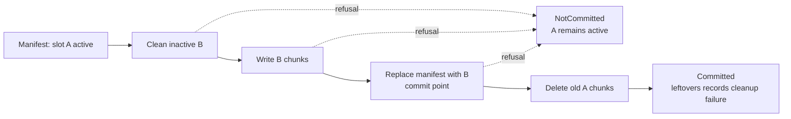

# Accounts

## Sign-in callback

`connections::oauth::SignIn::bind` binds `127.0.0.1` on port 0 before the browser
opens. Each attempt owns fresh 32-byte random state, nonce and PKCE verifier from
`getrandom`; the S256 challenge is unpadded base64url SHA-256. The attempt captures
only the saved client id, never saved tokens or email. `Intent::EnablePlan` adds
explicit consent; ordinary sign-in doesn't. The caller supplies the persisted host
id from the vault.

`open_browser` hands a `LaunchTarget` to an injectable `Launcher`. Production uses
`SystemBrowser` and `webbrowser`; tests record the URL without opening a browser.
`webbrowser` owns discovery of the OS browser
executable and its existing arguments. Neither `id_token_hint` nor `login_hint` is sent,
even when a saved record has ID, access and refresh tokens. Returning sign-in uses the
saved issued client id and lets the provider show its account selector. No launch URL,
callback request, state, nonce, verifier, authorization code or identity is logged or
sent over the pipe. Debug output redacts attempt and launch data. There is no `log`
to `tracing` bridge: webbrowser's command debug messages must stay disabled.
`deny.toml` bans `tracing-log` to enforce that dependency boundary.

`receive` consumes an attempt and returns `Authorization`, not an account or tokens.
It preserves the code, checked client id, verifier, nonce and exact redirect URI for
the later exchange. Drop the receive future to cancel and close its listener. Invalid
requests leave it live. After state matches, an incomplete or invalid registration ends
it as `SignInFailed` with a fixed failure page. A state-matching OAuth error also ends it
without an exchange; `access_denied` and other OAuth errors get the 200 received page.
Returning callbacks may omit the client id but cannot replace it. Initial registration
must supply a nonempty issued id, not `dynamic_agent_client`. The nonce is retained for
the signed ID token, not checked against an untrusted callback parameter.

The HTTP boundary accepts only `GET /auth/callback?... HTTP/1.1`, exactly one Host
header equal to `127.0.0.1:<selected port>`, no fragment or duplicate decoded query
parameter, and constant-time equality with the pending state. Malformed headers,
wrong path/host/port/state and stale errors get a 400 rejection and leave the attempt live.
The callback response is fixed nonreflecting text from `locales/en/brain.ftl`, formatted
with Fluent, served as UTF-8 plain text with no caching or referrer. Receiving a response
doesn't mean the account has been verified; that is the exchange's responsibility.

**Local policies:** an entire header, including its terminator, is at most 32 KiB and
has one absolute 2 s read deadline. A response has up to 1 s to write. The whole attempt,
including accepts, reads and replies, ends at five minutes on `tokio::time`. The listener
is serial: each idle preconnect can delay a queued valid callback by its 2 s read plus
up to 1 s writing its rejection, and multiple idle connections can queue within that
five-minute deadline. Sustained backlog starvation is a local denial of service: sign-in
times out, but nothing leaks. Timing tests use in-memory duplex streams and a paused clock;
socket tests cover an idle preconnect followed by a valid callback. No test uses outside hosts
or DNS; socket tests use only `127.0.0.1` port 0.

**Public provider contracts:**

| Values and behavior | Public OpenAI source |
| --- | --- |
| `https://auth.openai.com/api/accounts/authorize`, PKCE `S256` support | [Discovery](https://auth.openai.com/.well-known/openid-configuration) |
| `dynamic_agent_client`, issued callback `client_id`, `ext_agent_host_id`, initial `agent_name_hint`, `response_type=code` | [Registration and sign-in](https://developers.openai.com/siwc/token-sharing-open-source/sign-in) |
| `openid profile email offline_access resource.invoke chatgpt.tokens.use.direct`, resource `https://api.openai.com/v1` | [Registration and sign-in](https://developers.openai.com/siwc/token-sharing-open-source/sign-in) |
| `http://127.0.0.1:<port>/auth/callback`, state, nonce, PKCE and identical exchange redirect; `access_denied`; returning client binding; optional hints omitted here | [Registration and sign-in](https://developers.openai.com/siwc/token-sharing-open-source/sign-in) |
| `prompt=consent` only after the user requests plan use | [Errors and recovery](https://developers.openai.com/siwc/token-sharing-open-source/errors-and-recovery) |

Token exchange, signed identity verification, account state-machine wiring and storage
mutations are outside this layer.

## Credential storage

The brain's `platform::credential::CredentialStore` reads, writes and deletes one generic
credential by exact target name. Windows uses `CredWriteW` with
`CRED_PERSIST_LOCAL_MACHINE`: entries survive process exit and sign-in on this machine,
but don't roam to another PC. `keyring` 3.6.3, the version used here, hard-codes enterprise
persistence; it remains on the separate instance-capability path, unchanged. The newer
keyring-core 1.x stack's `windows-native-keyring-store` 1.1.0 supports local persistence.
We chose not to add that second keyring stack: our store is small and reviewed, returns
zeroizing bytes, and its guard wipes the validated native read blob and frees the allocation
on every exit, including panic unwinding. `CredentialStore` is the seam for a macOS Keychain store.

Credential Manager protects entries per Windows user, not per process. Any process running
as the same Windows user can read these entries. The session lock coordinates cooperating
brain instances; it does not provide isolation from other processes running as that user.

Account targets belong under `CREDENTIAL_SERVICE` (`Kumochi Dev` in debug builds), never
`INSTANCE_SERVICE`. A caller supplies the full target; the store doesn't rewrite it or
enumerate credentials. Secret bytes are held as `Secret<Zeroizing<Vec<u8>>>`; temporary
copies are bounded and wiped, and debug/error output contains no credential data.

Chunk helpers use 2,000-byte chunks, below Windows' `CRED_MAX_CREDENTIAL_BLOB_SIZE`
(2,560 bytes), and at most 64 chunks (128,000 bytes). Given a base target
`<service>/<record>/<slot>`, they use exactly `<base>/0` through `<base>/<count-1>`.
An empty value uses one empty chunk. Reads require an explicit bounded count, all chunks,
and full-length nonfinal chunks. Deletes are idempotent and attempt every specified name,
reporting the first failure. Only `ERROR_NOT_FOUND` means absence.

There are no production callers of `Vault` yet. Callers must run these synchronous operations
off the core loop and retain the vault, including its session lock, until all blocking work
ends, even if an async waiter is cancelled or shutdown begins. The vault owns the guard until
it is dropped.

`platform::SessionLock` guards the empty `%LOCALAPPDATA%\<DATA_DIR>\session.lock` using
`File::try_lock`; only contention returns typed `Busy`, and dropping the guard releases it.
`platform::session_lock_path()` uses the Dev data folder in debug builds. Startup wiring is separate.

## Vault records

`connections::vault::Vault` uses exact targets under `CREDENTIAL_SERVICE`:

| Record | Layout |
| --- | --- |
| `host` | One credential containing a JSON UUIDv4 URN, generated from `getrandom` on first use. |
| `chatgpt` | A manifest `{slot,chunks}` and chunks in slots `0` and `1`. JSON holds `client_id`, optional `subject` and `email`, `plan_enabled`, and optional nested `tokens` (`access_token`, `refresh_token`, optional `id_token`, `scope`, `expires_at`, `pending_identity_validation`). Registration-only JSON contains just `client_id` and `subject`. |
| `revoke` | Its own manifest and two slots. JSON holds `entries`, each with its own `client_id`, `refresh_token`, `added_at` Unix seconds, and `origin` (`Account` or `Exchange`). At most four exchanges and one account entry. |
| `signout` | One token-free compact JSON credential, never chunked: `{v:1,sign_out,sweep,request_pending,outcome_unknown,notice}`. `sign_out` is null or `{disposition,phase}`, with `Keep`/`Erase` and `Revoking`/`Deleting`. Unknown fields, versions, enums or malformed data fail closed to an Erase/Revoking marker with uncertainty and notice set. |

Each chunked record has exactly 129 possible names: its manifest and 64 chunk indices in
each slot. Both serialized JSON records are capped at 48 KiB, including escaping. Access
and identity tokens are at most 16 KiB each, refresh tokens 8 KiB, client and subject 256
bytes, scope 1 KiB, and email 254 bytes. Fields are zeroizing strings; returned records and
serialized bytes are wrapped in `Secret`, and record Debug implementations redact all data.
Serialization uses a bounded, preallocated zeroizing buffer, so growing JSON never leaves
an older secret allocation behind. This doesn't wipe serde_json's internal scratch buffer
(used for strings with escapes) or discarded parsing-error text. Those temporary library
allocations remain an explicit limit of the current zeroization boundary.

A save cleans the inactive slot before reuse, writes its chunks, then replaces the single
manifest. Before that commit the old value remains active; afterwards the new one is active.
`SaveResult::Committed { leftovers }` distinguishes a successful commit with failed old-slot
cleanup from `NotCommitted`. An unknown or dirty inactive slot gets a full 64-name sweep;
ordinary post-commit cleanup uses the old manifest's count. Reads never fall back to old data.
An unreadable `chatgpt` manifest requires sign-out recovery, whose orchestration belongs to
PR 9. An unreadable `host` has no recovery yet: sign-out preserves it, and PR 9 must decide
that policy. This layer does not silently replace either record.

Marker updates merge the current persisted state, not a default or queued snapshot. A late
sweep cannot undo a sign-out promotion. The checkpoint atomically enters `Deleting`, decides
the notice, and folds uncertainty flags; repeating it cannot change that decision. Deletes
are fenced until the checkpoint and never change the marker. Finish checks secret names
absent, including orphan chunks, before removing sign-out state; Keep allows only the live
registration-only slot. An empty marker is deleted rather than stored. Notice-only state
can survive local deletion without retaining tokens. `SignInCommitted` clears an old notice
only after a new token-bearing account commit, without resetting other control facts.
The instance capability is untouched.

```mermaid
stateDiagram-v2
    state "No pending sign-out" as NoSignOut
    [*] --> NoSignOut
    NoSignOut --> Revoking: promote and set notice
    Revoking --> Revoking: checkpoint refused; no deletes
    Revoking --> Deleting: checkpoint decides notice
    Deleting --> Deleting: cleanup or Finish refused
    Deleting --> NoSignOut: Finish leaves notice-only or absent state
```

Ordinary `load_account` reads return no usable account while a sign-out is pending.
`load_for_sign_out` is available only during that pending sign-out, so Prepare can adopt
the refresh token and Keep-Delete can read the registration. The existing account writer
allows only registration-only replacements during Keep/Deleting. Outside sign-out, revoke
deletion requires an empty list, or malformed data with persisted `outcome_unknown`;
OS read failures remain errors. A cleanup check that finds surviving names reports `NotGone`,
distinct from a control-state fence.

This module provides storage operations, not the startup/restart state machine, token lane,
request handling, age-out policy or revocation networking. Callers must serialize vault work
and revalidate queued ownership immediately before dispatch. They must supply the checkpoint's
evidence from durably saved revocation results before deletion, never infer confirmation from
the later absence of records, and resume sign-out according to its persisted phase.

The real Windows persistence tests run on every `cargo test`, under isolated random names:
`<CREDENTIAL_SERVICE>-credential-test-<nonce>` and
`<CREDENTIAL_SERVICE>-vault-test-<nonce>/...`. Cleanup follows assertions and panic unwinding,
but a terminated process can leave persistent test-only entries containing fixture strings.
The owner can remove stray entries matching those exact test patterns in Windows Credential
Manager; there is no automatic enumeration or cleanup of other test runs.
