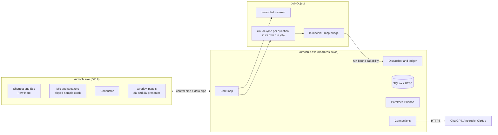
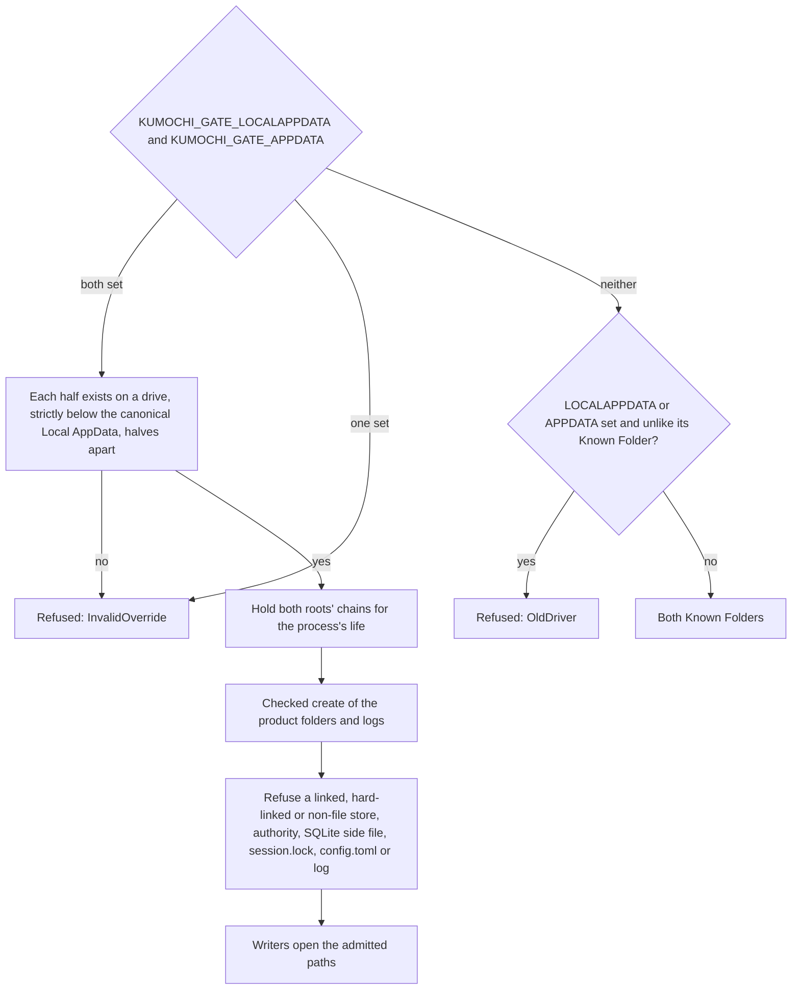
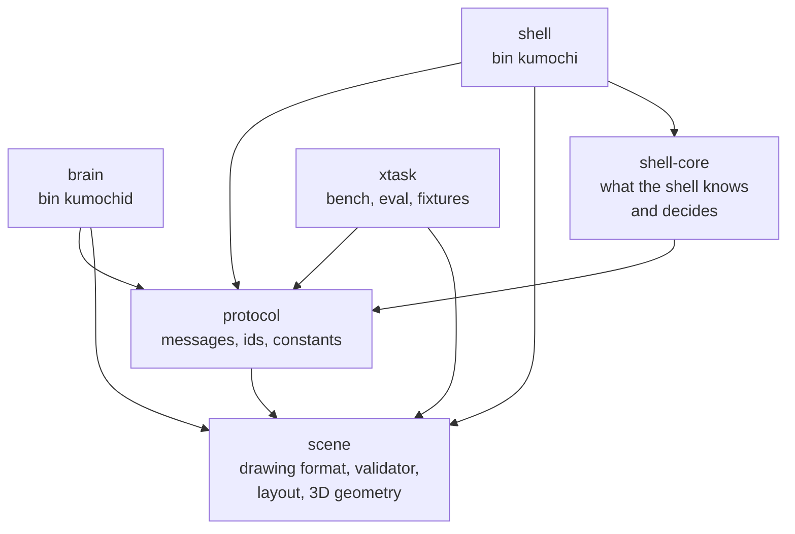
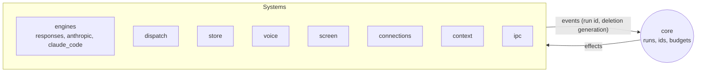
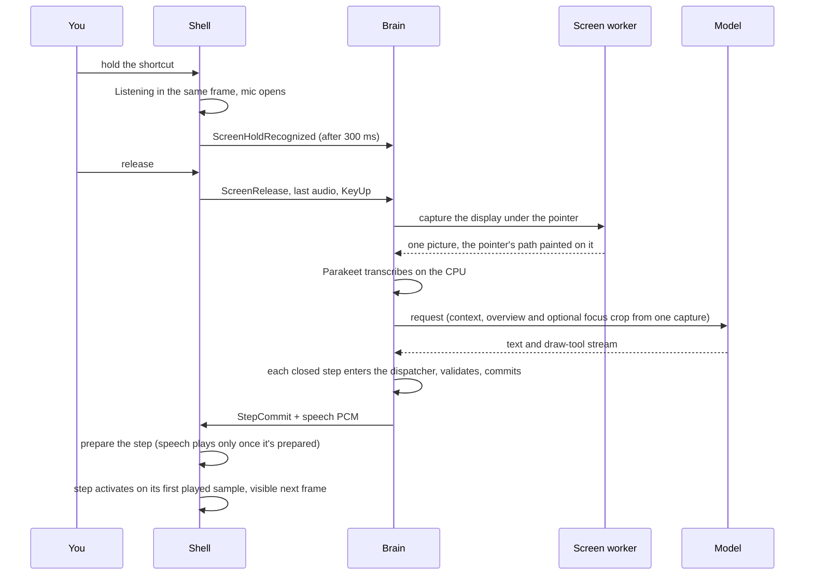
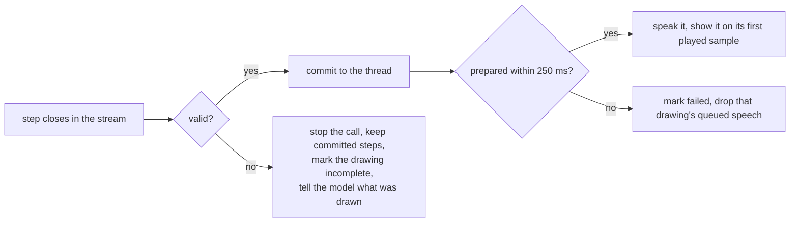
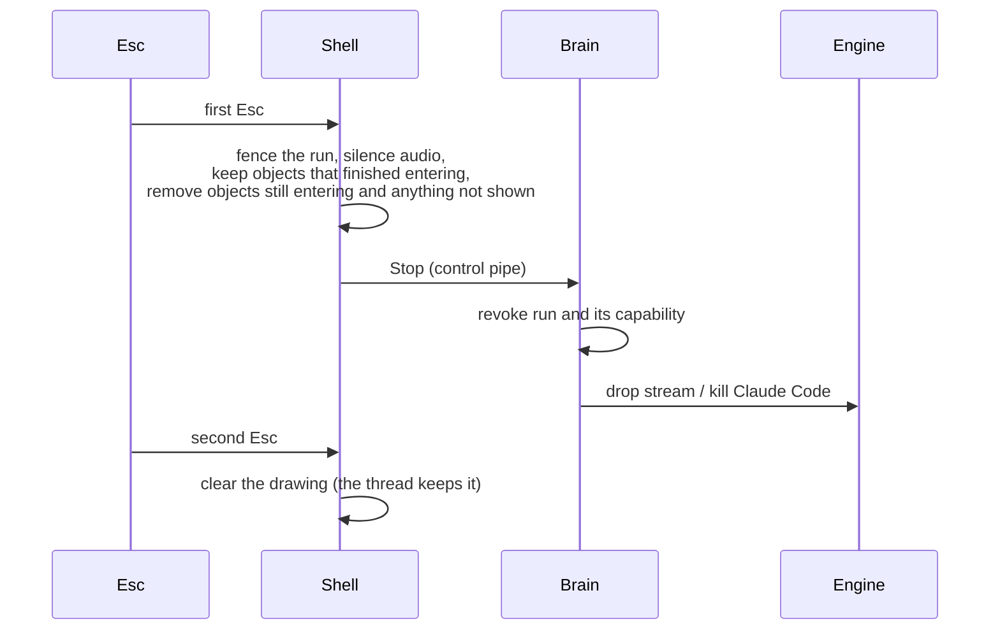
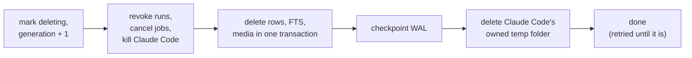

# Architecture

How Kumochi works inside. This page is the map. Each module has its own page under `docs/development/` with the detail. The full design record lives outside the repo.

The [glossary](glossary.md) maps user-facing words to code and protocol terms.

Kumochi is built in slices. Slice 0 is the skeleton: the two processes, their pipes and handshake, and the Job Objects. Sections below describe the whole first release, so some of what they show arrives with later slices.

## The two processes

Kumochi is a GPUI **shell** and a headless **brain**. The shell owns everything you touch, see and hear. The brain owns history, models and authority. The brain keeps its helpers in a Windows Job Object, so a brain crash never leaves them running.



| Process | Owns |
|---|---|
| Shell | The shortcut, Esc, microphone, speakers and their clock, the overlay and panels, scene layout and painting |
| Brain | Runs, the tool dispatcher, connections and credentials, the store, scene validation, voice models, the Job Object |
| Screen worker | Screen capture, UI Automation, OCR and image encoding. It's killable, because a stuck UIA provider can't be stopped any other way |
| Claude Code | The user's own Claude Code, started fresh for each question in its own nested run job, restricted to Kumochi's tools. Ending a question terminates that run job only |

The shell keeps no state on disk, only its log and an empty single-instance lock file, so restarting it is always safe. Both processes log through `tracing` to the `Kumochi\logs` folder in the local application data root (`Kumochi Dev` for debug builds), one file per process per day, kept for seven days. Content is never logged, and panics record only their source location. A shell started by hand finds a running brain through a rotating instance capability in Windows Credential Manager.

Each crate resolves its data folder behind its own `platform` interface, and on Windows the
shell and the brain ask one resolver in `kumochi-storage`. An ordinary release build keeps each
row's route: the store, logs, voice models, session lock, settings and the shell read
`LOCALAPPDATA` or `APPDATA` and require an absolute path, so missing, empty or relative values
never put data under the working directory, and the Claude Code base and sherpa staging read the
Known Folder. It never reads the override variables.

Gate-identity and debug builds take one root pair from one source, so a run can't land in the
real profile by accident:



With the pair set, `LOCALAPPDATA` and `APPDATA` are ignored. The canonical containment check is
only an early refusal; admission holds the chain of each half as spelled, so a junction or link
on it refuses at its own component, and nothing is created at its target. The first row a
process resolves admits the pair, which in every process is the log folder, before its first
write. The shell checks its instance lock the same way before it opens it. The Claude Code
folder, the voice models and the staging pins were already made by the checked create under a
held parent; the Claude Code base and the staging root now hold their parent's chain while they
create the product folder, in every build. A refusal ends startup with the fixed data-root error.

The chain check itself (`hold_chain`, the checked create and the checks they're built from)
lives in `kumochi-storage`'s Windows module, shared by the shell and the brain; the brain's
markers, private trees, deletion and model storage build on it. The brain's session lock uses the
same local data root. It is the profile's one
writer lock: the brain takes it before it opens the store and holds it for its whole run.

The ordinary shell asks its instance-lock owner to acquire the lock. Windows holds one lock
per session until exit, named `<SHELL_LOCK>-<session id>.lock` in the existing data folder.

macOS has no Windows-style session ID. Its lock is per user and product identity:
`~/Library/Application Support/<DATA_DIR>/<SHELL_LOCK>.lock` (`kumochi-dev-shell.lock` for Dev).
The file is mode `0600` and is locked exclusively without waiting. The file stays in place:
closing the lock handle or exiting the process releases the lock. Platforms without an
admitted lock target still refuse before opening a file, with no fallback location.

Detached brain startup acquires both pipes before touching the store. It takes the profile's
writer lock, then opens and recovers the store, loads settings, starts accounts, and builds the Brain. It retries any interrupted
voice model removals before creating the helpers' Job Object, then starts the optional workers.
Only then does it publish the instance capability and serve the shell. The lifecycle owner
keeps the pipes alive through teardown. Before capability publication, a failure drops the
resources that started without entering graceful shutdown. The store and credential workers
each keep a reference to the writer lock until they finish, so neither a failed start nor a
close that stopped waiting releases it while a writer still runs. After serving, it quits or closes
the Brain, shuts down the Job off the async thread, and deletes the capability in that order.
Detached keeps the result of serving as its exit status; an incomplete Quit or capability
deletion warning does not change that status.

## Crates



`scene` has no GPUI and no tokio. The shell gives it text measurement through a small trait.

`shell-core` holds what the shell knows and decides, apart from how it is drawn. No UI
framework is in its dependency tree, dev-dependencies included, so nothing in it can name
GPUI; the shell is the crate that does. `cargo xtask check-core` holds that in CI: the core's
direct dependencies are a list in `xtask/src/check_core.rs`, so a new one is a reviewed line,
and the whole tree is searched for a framework's name.

On macOS, shell and brain use the same Application Support lookup in `kumochi-storage`.
It asks Darwin for the user-domain path, resolving any home-relative result through the
OS account, not `HOME`. It opens and creates nothing. Callers append or admit the product
folder separately; a candidate does not authorize a write.

`kumochi_storage::admit_support` holds and inspects that folder the way `open_shell_storage`
does, creating nothing. On the held anchor, `Support::product_folder` looks up this edition's
product folder: only `ENOENT` from opening that exact name in the held folder is `Missing`, and a
folder there must pass the same private-folder checks. `Support::try_setup_guard` takes a
nonblocking exclusive `flock` on a fresh open of the held folder. It is per user and coarser than
the Windows guard, since every edition and anything else that locks Application Support contends
for it. Closing the guard or its holder's exit releases it, and `Busy` says nothing about who
holds it. `open_shell_storage` starts with `admit_support`; the product-folder lookup and the
guard have no caller yet.

Linux is a build and test host for `shell-core`, not a supported runtime. Its native
IPC, process launch, credential storage, file logging, and audio entry points return
`Unsupported`. The shared tests use scripted audio and need ALSA development headers
to compile CPAL, not an audio device. Real Windows pipe and device tests and tests that
need the brain stay on Windows while the brain cannot build on Linux.

The shell's tests build the core as a dependency, without `cfg(test)`. So a test double in
the core is gated on `any(test, feature = "test-support")`, and only a dev-dependency may
turn that feature on. `check-core` fails on any other spelling of a test gate that could
switch behaviour, and when the feature reaches a normal dependency anywhere in the
workspace. One build is outside its reach: `cargo build --all-targets` resolves features
once for the whole command, so the `kumochi.exe` it writes carries the core's test support.
That has to fail safe, so test support only ever takes something away: a device becomes a
stub that reports itself unavailable, never the other way round.

The shared, read-only `protocol::profile` classifier describes a local installation, not a
Kumochi account. First open can be a background setup candidate only with positive evidence
for a disjoint protected root and credential namespace, and definite absence of all known
profile footprints. An intact installation can reopen. `ResumeSetup` permits reinspection
only: even a pending, unstarted owner reservation can receive this result while its credential
namespace is unverified. A writer must reacquire the guard and revalidate that namespace and
the exact step before any write. Uncertain or conflicting evidence leaves the data untouched.
Windows and macOS use the same policy. `profile::observe` feeds it: it tries the setup guard
without waiting, samples the legacy footprints, the root slot and the owner record under that
guard, and releases it on return. A busy or unavailable guard samples nothing. Objects inside
the new-format root count as absent only with the root, and fresh targets stay unverified
until an allocator can prove them disjoint, so observation never yields first use. No
executable calls it yet, and its decisions do not authorize writes, reconnect a provider, or
identify a person.

Tests that need files use the shared scratch guard in `tests/support/scratch.rs`. It creates
a new child of Temp (or of an existing trusted root for fixtures that need one), skips
occupied names, and removes its recorded child path on return or unwind. It does not
sweep old folders or follow symbolic links in the scratch tree, but removal by path
cannot distinguish a directory swapped into that path during a test. Speech fixtures
leave scratch in place if they cannot confirm child teardown.

Dev and test builds compile ten dependencies at opt-level 2: image, zune-jpeg, libsqlite3-sys,
rusqlite, serde_json, sha2, ring, memchr, postcard and base64, every version of each
(`[profile.dev.package]` in the root `Cargo.toml`). The brain's tests spend most of their CPU in
them. The workspace crates and every other dependency stay at 0, and release builds are
unchanged. CI alone runs the tests four at a time (`RUST_TEST_THREADS: 4`), because they mostly
wait on processes, pipes and deadlines; elsewhere libtest uses one thread per core. A dev or test
measurement pair whose two commits sit on either side of the commit that added that table
compares two different builds of those crates, so build both sides with the same table.

CI runs two jobs side by side. `lint` runs fmt, cargo-deny for dependency or CI configuration
changes and on every scheduled or manual run, `check-vendor`, `check-core`, clippy on the core
alone without test support, and clippy on the workspace. `test` runs the workspace tests and the
vsync test. Each job restores its own cache, and only runs on main save one. The test job points
`TEMP` and `TMP` at the runner's work disk: the tests' scratch stores make many durable writes,
and the profile's temp folder on C: takes them seven to ten times slower.

## The brain is a game loop

The brain has a small **core loop**: a coordinator that takes events and returns effects, with no I/O of its own. Everything else is a **system** that does I/O and reports back as events.



Every event carries its run id and the thread's deletion generation. The core drops stale ones, so a late result from a stopped run or a deleted thread changes nothing. Because the core does no I/O, the order of Esc, interruptions and deletion is tested as plain unit tests.

## A voice question, end to end (direct route: ChatGPT or the Anthropic key)



- **Capture happens only on a recognized hold or Include screen.** A tap or double tap never captures. The screen worker refuses any request without a ticket, and no tool can mint one.
- **Screenshots go only to the model you chose**, and every one sent is saved in the thread.

## Drawings

A drawing is one tool call holding `begin`, a list of `step` records, and `end`. Each step is a sentence plus a few shapes.

Direct route shown. On Claude Code, the whole call arrives at once and its valid steps commit in order.



- **ChatGPT and the Anthropic key:** steps commit one by one as they stream.
- **Claude Code:** the MCP call is the authority. When it arrives, its valid steps commit in order up to the first invalid one, then play in order.
- **Nothing from an unclosed step is shown**, and speech only describes steps that already validated.
- **Speech waits for its picture.** A step's sentence plays only once the shell has prepared the step, after a wait of up to 250 ms. A step that isn't prepared by then shows as failed and is never spoken, and the rest of that drawing's queued speech is dropped.
- **Caps** are checked on expanded work before anything is allocated, and nothing is silently truncated.

A committed replacement removes its victims durably. The shell can keep only their frozen
presentation owners for up to 250 ms while preparing the successor, then select its first
nonempty sample on the same shown host. Capacity pressure releases this visual hold instead
of refusing an otherwise-fitting successor. Expiry and late failure do not restore old scenes;
fixed original-thread feedback reports when a replacement failed after removing them.

**3D** uses a CPU depth-buffered raster; the planned shell host paints its BGRA image because
GPUI on Windows has no depth buffer for element content. Opaque solids write per-sample depth;
translucent polygons follow in centroid order without writing depth, which can blend intersecting
translucent geometry in the wrong order (OSC-242). Rest frames supersample edges. The scene frame
stage transforms indexed source geometry at the sampled, attachment-composed pose, culls back
faces, clips near and guard planes in f64, projects, snaps and shades into reserved raster scratch.
Every source face shares one reciprocal-depth plane across its triangles. Camera defaults target
the 3D bounds' centre; authored cameras can enter geometry, and clipping rather than a distance
clamp handles that case. The near plane includes a world-coordinate precision floor. These scene
primitives exist and scene admission charges 3D steps, but the brain refuses them at its ingress
until the shell host lands. Scene picking reads an
owned `DisplayedFrame`: ids, camera, sampled poses, geometry revision, solid-to-part handles and
the frozen logical destination/DPI/exact integer raster dimensions. Each pointer axis maps
independently; labelled geometry returns a part, unlabelled geometry blocks and background misses.
An edge neighbourhood of one internal texel can differ from an exact ray; translucent ids follow
the approximate painted order. The later host must publish the image and this entire snapshot
together at accepted paint, never on worker completion alone. A worker writes only the other
owned id buffer; failed, skipped or superseded paints leave the displayed pair unchanged.

## Esc

The shell stops first, with no round trip to the brain.



Kumochi holds Esc from other apps only while it's speaking or a drawing is on screen.

## Tools and authority

Every tool call from every engine goes through one dispatcher. A Claude Code call arrives through the stdio bridge with a capability bound to one run, and that run is fixed the moment the request arrives. A retried request with the same id is answered from the ledger and never runs twice. Filing an issue needs a complete call and your confirmation of the exact content. If GitHub's reply is lost, the action stays "unknown" unless a lookup finds exactly one match.

| Tool | Effect |
|---|---|
| `draw` | Screen |
| `look`, `get_screenshot`, `search_history`, `read_history` | Read |
| `new_thread` | Local write |
| `draft_issue` | Outside write, after confirmation |

## The pipes

Two owner-only named pipes per connection, with `postcard` frames and caps checked before allocation.

| Pipe | Carries |
|---|---|
| Control | Esc and Stop, shortcut edges, run state, consent, errors, handshake |
| Data | Steps, speech audio, chat text, images and pages, under receiver credits |

The run id is the epoch. The shell drops any message from a revoked run when it applies the message, not when it arrives.

## Deleting a thread



Deletion covers every copy Kumochi controls. It can't reach issues already filed or what providers keep under their own terms, and the delete dialog says so.

## Claude Code

Each question starts a fresh process:

```text
claude -p --restricted --strict-mcp-config --mcp-config <owned>
       --disable-slash-commands --tools "" --no-session-persistence ...
```

It runs with an allowlisted environment, telemetry opt-outs, and a working folder and temp folder that Kumochi owns. Before any real input, an audit of its startup facts, checked against a schema for that exact Claude Code version, must show only Kumochi's tool and the reviewed built-in plugins, no skills or commands, and the user's own plan. Anything else fails closed. Claude Code doesn't report hooks or memory, so those rest on restricted mode and launch settings rather than the audit. Kumochi never reads Claude Code's credentials.

## Rules that protect you

- Kumochi itself sends no telemetry. Nothing leaves the machine except calls to the accounts you set up.
- Claude Code is your own program. Kumochi asks it to switch telemetry off, shows what it reports, and runs it either way.
- Secrets live only in Windows Credential Manager, never in logs, arguments or files. The one exception: Claude Code's own credential file may exist only inside Kumochi's Claude Code folder, readable by the user and SYSTEM only. Kumochi never reads, copies or relays its contents, and Disconnect removes it (logout, then delete).
- Prompts, transcripts and screenshots are never logged.

## Where to read next

`processes.md`, `ipc.md`, `settings.md`, [frame-rate.md](frame-rate.md), `scene.md`, [engines.md](engines.md), `store.md`, [accounts.md](accounts.md), [voice.md](voice.md), `screen.md`, [claude-code.md](claude-code.md), [onboarding.md](onboarding.md), each added with its module.
