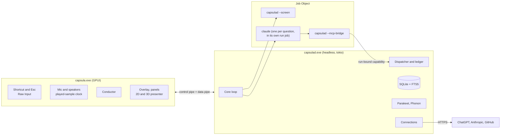
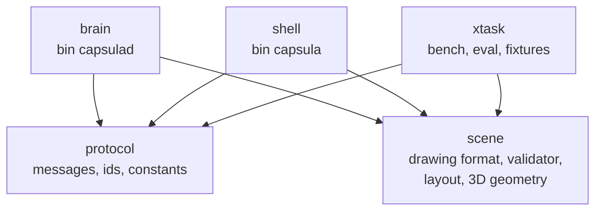
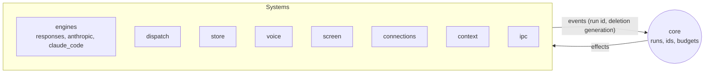
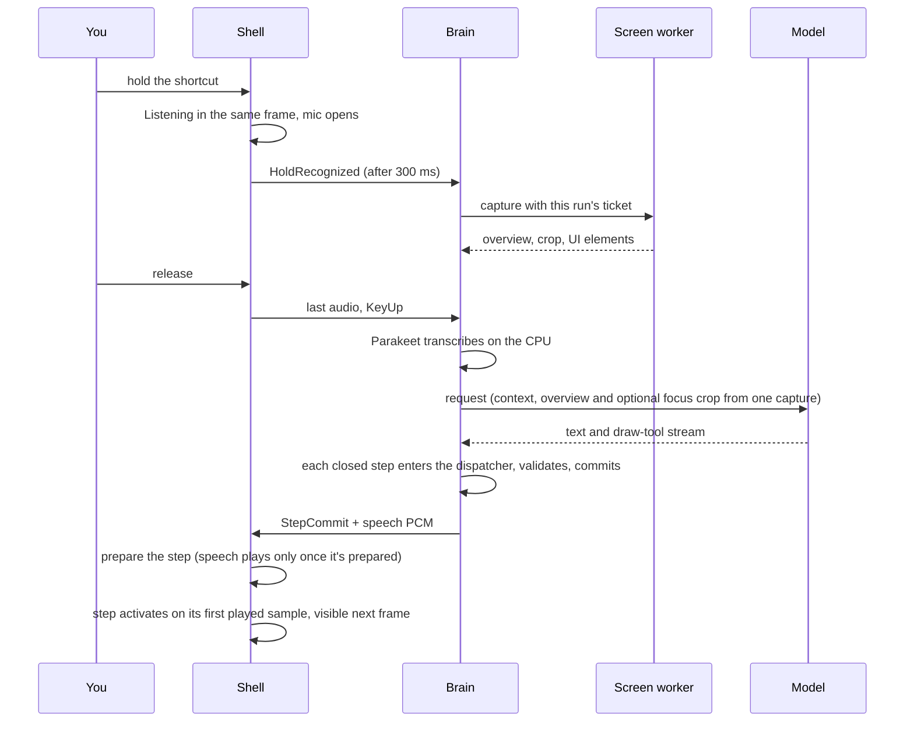
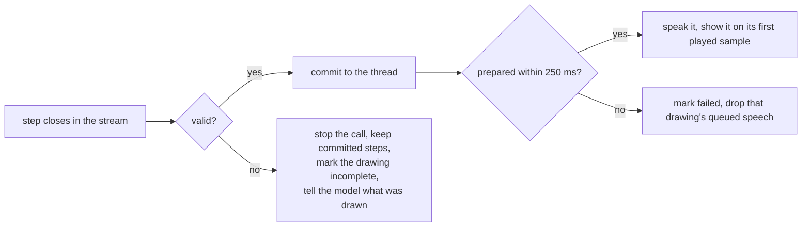
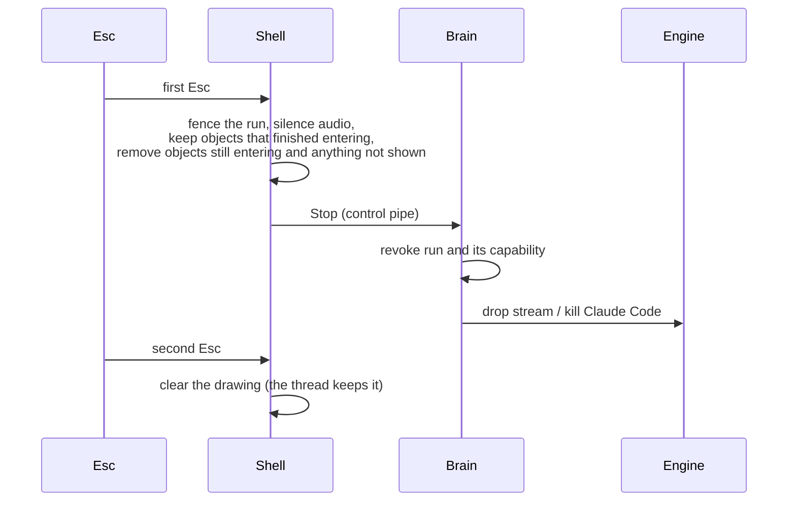
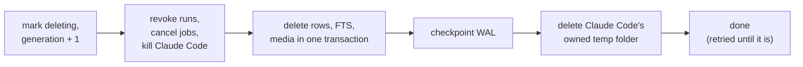

# Architecture

How Capsula works inside. This page is the map. Each module has its own page under `docs/development/` with the detail. The full design record lives outside the repo.

Capsula is built in slices. Slice 0 is the skeleton: the two processes, their pipes and handshake, and the Job Objects. Sections below describe the whole first release, so some of what they show arrives with later slices.

## The two processes

Capsula is a GPUI **shell** and a headless **brain**. The shell owns everything you touch, see and hear. The brain owns history, models and authority. The brain keeps its helpers in a Windows Job Object, so a brain crash never leaves them running.



| Process | Owns |
|---|---|
| Shell | The shortcut, Esc, microphone, speakers and their clock, the overlay and panels, scene layout and painting |
| Brain | Runs, the tool dispatcher, connections and credentials, the store, scene validation, voice models, the Job Object |
| Screen worker | Screen capture, UI Automation, OCR and image encoding. It's killable, because a stuck UIA provider can't be stopped any other way |
| Claude Code | The user's own Claude Code, started fresh for each question in its own nested run job, restricted to Capsula's tools. Ending a question terminates that run job only |

The shell keeps nothing on disk, so restarting it is always safe. A shell started by hand finds a running brain through a rotating instance capability in Windows Credential Manager.

## Crates



`scene` has no GPUI and no tokio. The shell gives it text measurement through a small trait.

## The brain is a game loop

The brain has a small **core loop**: a coordinator that takes events and returns effects, with no I/O of its own. Everything else is a **system** that does I/O and reports back as events.



Every event carries its run id and the thread's deletion generation. The core drops stale ones, so a late result from a stopped run or a deleted thread changes nothing. Because the core does no I/O, the order of Esc, interruptions and deletion is tested as plain unit tests.

## A voice question, end to end (direct route: ChatGPT or the Anthropic key)



- **Capture happens only on a recognized hold or Include screen.** A tap or double tap never captures. The screen worker refuses any request without a ticket, and no tool can mint one.
- **Screenshots go only to the model you chose**, and every one sent is saved in the thread.

## Drawings

A drawing is one tool call holding `begin`, a list of `step` records, and `end`. Each step is a sentence plus a few shapes.

Direct route shown. On Claude Code, the whole call arrives at once and its valid steps commit in order.



- **ChatGPT and the Anthropic key:** steps commit one by one as they stream.
- **Claude Code:** the MCP call is the authority. When it arrives, its valid steps commit in order up to the first invalid one, then play in order.
- **Nothing from an unclosed step is shown**, and speech only describes steps that already validated.
- **Speech waits for its picture.** A step's sentence plays only once the shell has prepared the step, after a wait of up to 250 ms. A step that isn't prepared by then shows as failed and is never spoken, and the rest of that drawing's queued speech is dropped.
- **Caps** are checked on expanded work before anything is allocated, and nothing is silently truncated.

**3D** draws through GPUI paths, because GPUI on Windows has no depth buffer for element content. This CPU path is a design choice for the restricted tier, not the only possible one. Correct order comes from a BSP tree that splits intersecting triangles. It's cached until the solids' geometry or transforms change, so orbiting never rebuilds it. Its build work is budgeted and checked before the step commits. Moving solids rebuild off the UI thread, and the shell swaps in a new pose only when its drawing and picking data are both complete. Faces crossing the near plane are clipped, not dropped. Picking ray-casts against the same fragments on screen, ordered by camera-space depth, so an unlabelled box in front blocks a click on the part behind it. The camera is constrained, so orbiting can't enter the model.

## Esc

The shell stops first, with no round trip to the brain.



Capsula holds Esc from other apps only while it's speaking or a drawing is on screen.

## Tools and authority

Every tool call from every engine goes through one dispatcher. A Claude Code call arrives through the stdio bridge with a capability bound to one run, and that run is fixed the moment the request arrives. A retried request with the same id is answered from the ledger and never runs twice. Filing an issue needs a complete call and your confirmation of the exact content. If GitHub's reply is lost, the action stays "unknown" unless a lookup finds exactly one match.

| Tool | Effect |
|---|---|
| `draw` | Screen |
| `look`, `get_screenshot`, `search_history`, `read_history` | Read |
| `new_thread` | Local write |
| `draft_issue` | Outside write, after confirmation |

## The pipes

Two owner-only named pipes per connection, with `postcard` frames and caps checked before allocation.

| Pipe | Carries |
|---|---|
| Control | Esc and Stop, shortcut edges, run state, consent, errors, handshake |
| Data | Steps, speech audio, chat text, images and pages, under receiver credits |

The run id is the epoch. The shell drops any message from a revoked run when it applies the message, not when it arrives.

## Deleting a thread



Deletion covers every copy Capsula controls. It can't reach issues already filed or what providers keep under their own terms, and the delete dialog says so.

## Claude Code

Each question starts a fresh process:

```text
claude -p --restricted --strict-mcp-config --mcp-config <owned>
       --disable-slash-commands --tools "" --no-session-persistence ...
```

It runs with an allowlisted environment, telemetry opt-outs, and a working folder and temp folder that Capsula owns. Before any real input, an audit of its startup facts, checked against a schema for that exact Claude Code version, must show only Capsula's tool and the reviewed built-in plugins, no skills or commands, and the user's own plan. Anything else fails closed. Claude Code doesn't report hooks or memory, so those rest on restricted mode and launch settings rather than the audit. Capsula never reads Claude Code's credentials.

## Rules that protect you

- Capsula itself sends no telemetry. Nothing leaves the machine except calls to the accounts you set up.
- Claude Code is your own program. Capsula asks it to switch telemetry off, shows what it reports, and runs it either way.
- Secrets live only in Windows Credential Manager, never in logs, arguments or files.
- Prompts, transcripts and screenshots are never logged.

## Where to read next

`ipc.md`, `scene.md`, `engines.md`, `store.md`, `voice.md`, `screen.md`, each added with its module.
