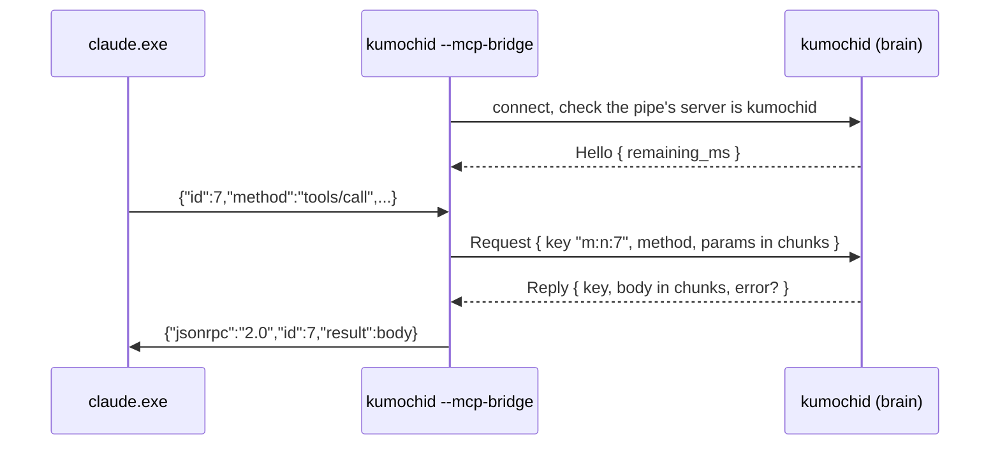
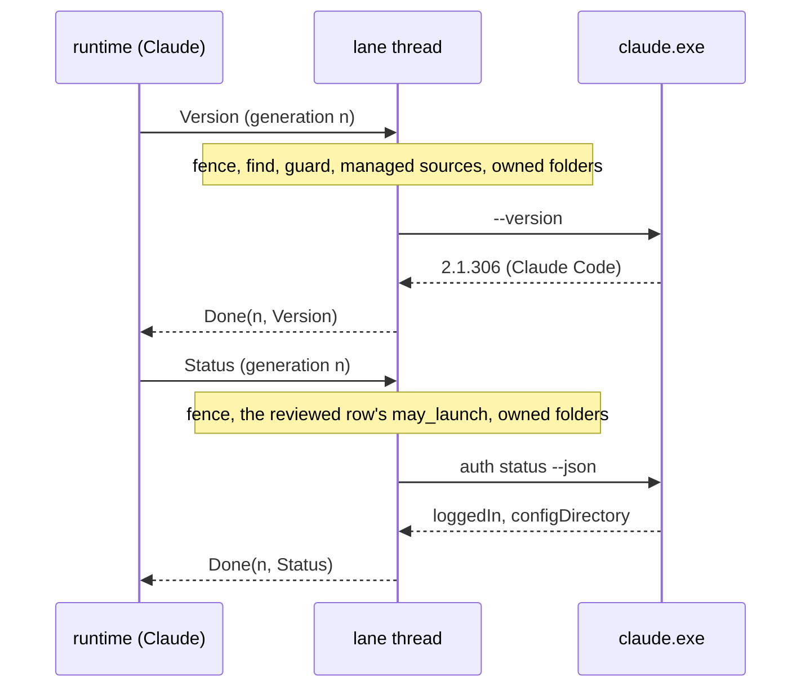
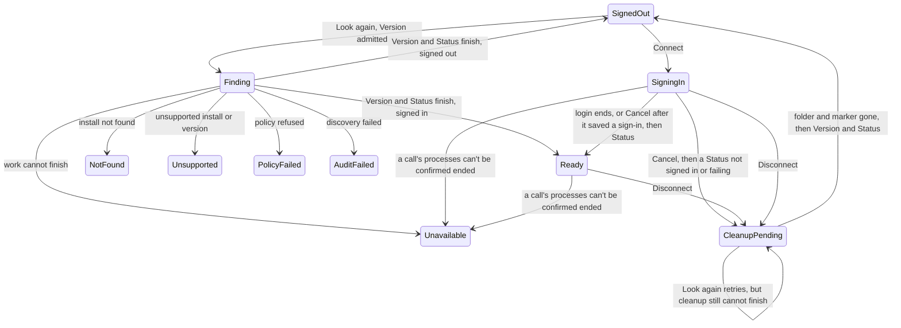
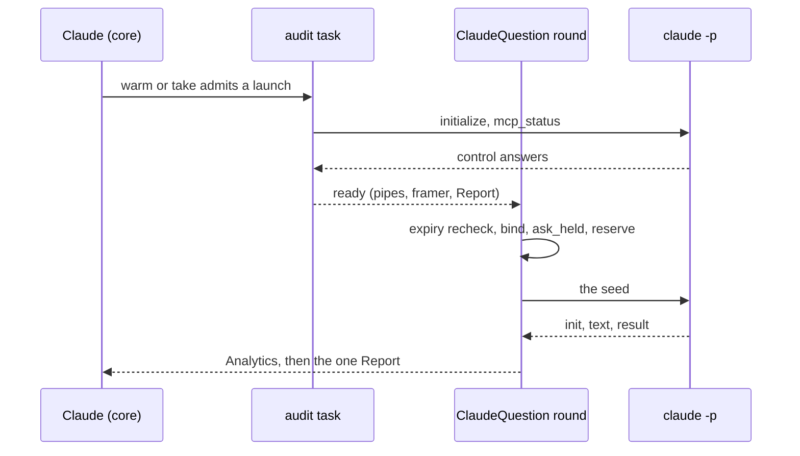
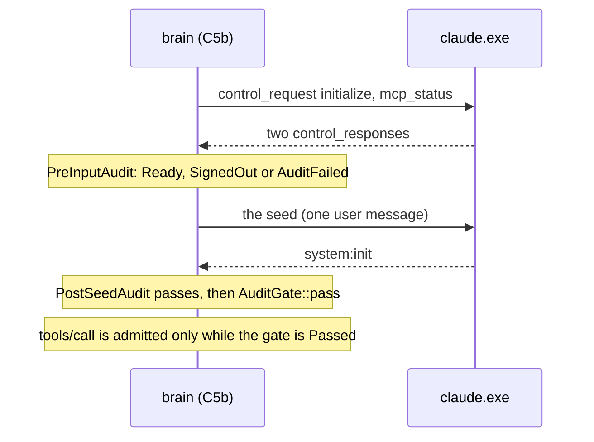
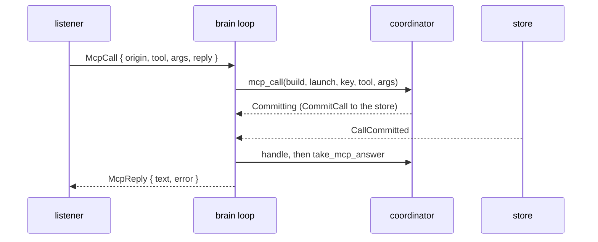

# Claude Code

Kumochi runs Claude Code through its installed `claude.exe`, headless, with `stream-json` on
stdin and stdout. Kumochi's own tools reach it as an MCP server named in `--mcp-config`. That
server is a mode of the brain's own executable, the bridge.

The lane and supervisor own queueing, deadlines, admission and teardown order. They use
`platform::process` for the contained child, stdio and explicit environment, and the platform's
protected-folder and peer-checked pipe adapters for each launch. Startup selects the native host
before it can run any of that work. Non-Windows builds still refuse native startup without
creating a worker or transport.

A macOS adapter would have to discover the approved executable and policy sources, hold private
folders through launch and cleanup, and admit only the expected local bridge peer. Its containment
also needs to make process creation and admission atomic and prove that the child and its
descendants ended. The shared queue, deadline and refusal policy stays the same.

## The bridge

Native bridge connections require the platform's owner-only pipe and peer process checks. The
client opens the pipe and checks the server image in one platform call, preserving native I/O
errors separately from an image mismatch. The listener holds an opaque peer guard through the
session, so the relay never needs the native process handle. In-memory tests exercise the same
framing without standing in for those native checks.

`kumochid --mcp-bridge <launch>` is a stdio MCP server. Claude Code starts it, and it connects
back to the brain on `\\.\pipe\<prefix>-<session>-claude-bridge-<launch>`, where `<launch>` is 32
lowercase hex digits drawn for that launch. The bridge decides nothing about tools: it checks each
JSON-RPC line's envelope and id, relays requests, and writes the brain's answers back under the
original id. It logs no message body.



- **Squatting fails closed.** Right after connecting, the bridge asks for the pipe's server process
  (`GetNamedPipeServerProcessId`) and requires its image to be the bridge's own executable.
  Otherwise it sends nothing and exits 1.
- **Lines.** A stdin line holds at most 512 KiB. A longer one gets `-32600` with a null id, and the
  rest of it is discarded up to the next newline. Batches, a missing or wrong `jsonrpc`, and an id
  that is null, an object, a float, past `i64`, or a string over 29 bytes are `-32600`, and so
  is a request whose `params` are present but neither an object nor an array; an unknown method
  is `-32601`; bad JSON is `-32700`. A notification is never answered, whatever its params.
- **Ids** go back by value: a number as itself, a string re-escaped from its decoded value. On the
  pipe a call is keyed `m:n:<number>` or `m:s:<hex of the string's bytes>`, so the two never
  collide.
- **Methods.** `ping` is answered locally. `initialize`, `tools/list` and `tools/call` go to the
  brain. `notifications/initialized` is forwarded; other notifications are dropped.
- **One call at a time.** A second request while one is in flight gets `-32600`. A call Claude
  Code cancelled keeps the bridge busy until the brain answers it or the launch ends.
- **Chunks.** Both directions travel in chunks under the data pipe's frame cap. A reply over 3 MiB
  becomes `-32603` for its call. The brain's side (C4b) reassembles a request up to 512 KiB.
- **Bodies.** The brain sends a result or error body, which must be valid JSON; the bridge splices
  it into the envelope unparsed.
- **Hello first.** The brain must send `Hello` within 5 seconds of the connect, before anything
  else; otherwise the bridge exits 1 without forwarding a line.
- **Ending.** stdin's end, or the pipe's, ends the bridge with exit 0, without reconnecting. When
  the deadline in `Hello` passes, the call in flight gets `-32603` and the bridge exits 1. Every
  wait counts against that deadline, pipe writes included: a brain that stops reading can't hold
  the bridge past it, and a write it cut short ends the connection rather than being retried.
- **stdin's end wins over waiting.** The stdin thread raises a flag the moment a read sees EOF,
  before it queues its last lines, and the `Hello` wait, every pipe write and every wait for
  stdout space end on it. Lines still queued then are dropped: nobody is left to read their
  replies. The exit is 0, or 1 when stdout can't take its last lines within the flush wait. The
  guarantee covers only an end the reader has seen: a reader blocked on a full line queue (16
  lines behind a stalled write) can't read the EOF, and the deadline ends that case.
- **Stdout is bounded.** At most four lines wait for stdout. When a reader stops reading, the
  relay waits instead of queueing, and at the end the bridge gives stdout one second to take its
  last lines before it exits 1.
- **Debug prints no content.** Lines, params, bodies, ids and call keys format as their kind and
  length only.
- **Logging never stops it.** If its log file can't open, the bridge runs anyway, with the panic
  hook installed.
- **Threads.** stdin and stdout run on their own threads. The pipe runs on a current-thread tokio
  runtime, because synchronous Windows pipe I/O serializes reads and writes on one file object.

## The listener

The brain's end of a launch's pipe (`bridge::listener`). C5a creates it for each launch, before it
writes `mcp.json`, under a fresh `LaunchId`; it's never recreated for the same launch.

- **One instance, one client.** The pipe is owner-only, refuses remote clients, and is created as
  the first and only instance of its name (`Instance::Only`, an OS maximum of one), so a taken
  name fails the launch and nobody can add a second server instance. `serve` consumes the
  listener: the first connection uses up the session, refusals included.
- **The client checks**, on one process handle opened from the pid the pipe reports, before any
  byte is written: the process hasn't exited, it runs the brain's executable, and it's inside this
  launch's own run job. Any failure ends the session with no `Hello`, and C5a fails the launch.
- **What the checks prove** (Captain's ruling, 2026-11-05). The DACL admits only the owner's
  account, and code running as that account can already read its Credential Manager entries and
  open Kumochi's processes. So the checks turn away stray and unrelated connections (another app,
  an earlier launch's bridge, another executable, a process outside the launch's job); they aren't
  a defence against same-user code. They don't prove the connection's opener is the process the
  pid now names: the opener can exit and its pid be reused, or hand its pipe handle to another
  process. Job membership proves a process came from the run, not that it's the one bridge, so
  execution stays gated by the audit, the bind and revocation.
- **Requests.** One at a time, every read and write raced against the launch's deadline. A
  request's first chunk fixes its key, which must be one the bridge makes (`m:n:<i64>` or
  `m:s:<hex>` of at most 29 bytes), and its method; a chunk that doesn't continue it, an
  `initialized` inside it, or the pipe's end inside it ends the session `Broken`. A request over
  512 KiB gets one `-32603` when its last chunk arrives, and the session goes on.
- **Methods.** `initialize` echoes a protocol version it knows, or offers `2025-06-18`.
  `tools/list` gives the launch's frozen tools whatever the gate says, so the audit can see them.
  `tools/call` takes named params only (`name`, `arguments`, `_meta`), each once; anything
  else, `arguments` that isn't an object (`null` included), or a tool outside the frozen set, is
  `-32602` with fixed text. Omitted `arguments` are `{}`. The bridge relays `params` as the client
  wrote them and refuses a line that repeats `jsonrpc`, `id`, `method` or `params`, so the
  dispatcher weighs and checks the original argument bytes, whitespace, escapes and repeated keys
  included.
- **Admission.** For a well-formed call, the listener reads the launch's `Binding` (set once,
  when the core answers the bind, to the build whose calls it carries and its effective deadline,
  the earliest of the launch's, its question's and its build's, or to none), checks that
  deadline, then loads C3's `AuditGate`, with no wait in between. That load is
  the instant of admission: a `fail()` before it refuses the call, and one after it doesn't undo it.
  A refused call gets an error result and is dropped, never held for a later bind. Revocation
  (C5a: Disconnect, the route turned off, thread deletion) must fail the gate before it ends the
  launch, since killing the job doesn't stop input already in the pipe.
- **Calls go to the brain.** An admitted call goes, with its origin (`McpOrigin { build, launch,
  key }`), its tool and its original argument bytes, into the Claude Code core's one-slot
  mailbox, and the listener waits for its one reply; both waits end at the effective deadline or
  when the gate fails, both checked before the work at every wake, and a revoked launch's
  listener is aborted. A reply the brain lets go is the error result "This
  call ended before it finished." See [MCP calls](#mcp-calls).
- **Release.** A tool's content leaves only while the gate passes and the effective deadline is
  ahead: checked when the answer is read, and again before every write to the pipe, the deadline
  first, then the gate, so a pipe that turns writable just as either ends takes nothing more. A
  failed gate wakes a blocked write at once. Either ends the session on the frame as it stands,
  unfinished (`SessionEnd::Deadline` or `Withheld`), rather than complete it. Bytes the OS
  already accepted aren't recalled: the bridge may already have read part of the unfinished
  frame.
- **Nothing the client sent is printed.** Error bodies are fixed; `McpOrigin`, `McpCall`,
  `McpReply` and `SessionEnd` print kinds, ids and lengths only.
- **macOS counterpart:** the peer pid through `LOCAL_PEERPID` and a process-group check, which is
  weaker (unverified).

## The launch policy

`REVIEWED_CLAUDE_CODE` (`engines/claude_code/policy.rs`) holds one row per reviewed Claude Code
version: its launch policy and the facts its audit expects. Any other version is
`Unsupported::Unreviewed`, with no override. Adding a version is a reviewed PR with its probe.

- **Arguments.** `--version`, `auth status --json`, `auth login` and `auth logout` get only their
  subcommand. A question gets P0's argv: `-p --restricted --strict-mcp-config --mcp-config <file>
  --disable-slash-commands --tools "" --no-session-persistence --allowedTools <tools>
  --input-format stream-json --output-format stream-json --verbose --include-partial-messages
  --max-turns 8 --exclude-dynamic-system-prompt-sections --model <model>`, then `--effort` when the
  snapshot names one. `--allowedTools` takes every value up to the next switch, so it never comes
  last. A dev brain whose environment sets `KUMOCHI_CLAUDE_ONE_TURN` (`policy::native_turns`)
  passes every Claude Code launch, title jobs included, `--max-turns 1` to request one native
  turn, `--permission-mode dontAsk` in place of `--allowedTools`, and an empty tool offer, so its
  MCP server, both audits and its seed expect no tool. That's for the desk's picture check;
  release builds and unflagged dev builds launch as before. It doesn't bound provider requests:
  one native turn can retry its request (`system:api_retry`).
- **Environment, built and never inherited.** `CLAUDE_CONFIG_DIR`, `USERPROFILE`, `HOME`,
  `APPDATA`, `LOCALAPPDATA`, `TEMP`, `TMP` and `CLAUDE_CODE_TMPDIR` point at Kumochi's own
  folders. Six documented switches are `1`: `DISABLE_AUTOUPDATER`, `DISABLE_TELEMETRY`,
  `DISABLE_ERROR_REPORTING`, `CLAUDE_CODE_DISABLE_NONESSENTIAL_TRAFFIC`,
  `CLAUDE_CODE_SKIP_PROMPT_HISTORY` and `CLAUDE_CODE_DISABLE_AUTO_MEMORY`, and
  `ENABLE_CLAUDEAI_MCP_SERVERS` is `false`, so a claude.ai sign-in's connectors are never fetched
  and Kumochi's server is the only one offered, whatever `--strict-mcp-config` does; the audit
  still refuses any other server. `MCP_TOOL_TIMEOUT` is `300000`, above `MAX_LAUNCH`, which
  bounds every wait a call has, and `CLAUDE_CODE_MCP_TOOL_IDLE_TIMEOUT` is `0`, which turns the
  idle check off (v2.1.187 and later): Claude Code can't time a call out while its launch lives, so
  it never repeats one under a new id after a timeout. `SystemRoot`,
  `SystemDrive` and `PATH` come from the OS (`platform::system_env`): `PATH` is the system folder
  then the Windows folder, never the brain's own `PATH`, and there's no `PATHEXT`. `auth login`
  gets the same environment, and Kumochi sets no `BROWSER`. Claude Code's opener runs as a child
  of the launch, so it inherits this environment and the brain's jobs, and on Windows no browser
  came up, either with its own `rundll32 url,OpenURL` or with `BROWSER` set to explorer.exe. The
  cause is unconfirmed (OSC-244).
- **Ownership.** C3 returns owned `LaunchData`; C2 and C5a keep it alive and borrow it into
  `platform::Launch` with the exe, the `work` folder, the stdio and the jobs. C3 starts nothing.
- **Before any launch,** `may_launch` refuses with `PolicyFailed::ManagedPolicy` when an endpoint
  managed source is present or can't be ruled out, or when the policy requires a server-managed
  signal; and with `TurnCap` when the version's `--max-turns 8` isn't verified. The presence check
  (`platform::managed_presence`) looks at `C:\Program Files\ClaudeCode\` (`managed-settings.json`,
  `managed-settings.d`, `managed-mcp.json`) and the `Settings` value under
  `HKLM\SOFTWARE\Policies\ClaudeCode` and `HKCU\SOFTWARE\Policies\ClaudeCode`. It never enumerates
  or reads them. Only "file not found" or "path not found" is absent; anything else counts as
  present. Server-managed policy from a Team or Enterprise organization can't be seen, so it's
  disclosed instead (`ServerManaged::Disclosed`).
  Without a native managed-policy probe, every source is indeterminate. The Linux test host
  does not look for alternate locations or treat an unavailable probe as permission to launch.

## Discovery and the lane

`engines/claude_code/lane.rs` is the only code that starts `claude`. It runs one call at a time on
its own thread; `runtime/claude.rs` asks it for work and turns the results into
`ClaudeCodeView`.

Without a protected-path adapter, holding, creating and removing Claude Code's private paths
and markers all refuse. A scratch directory does not stand in for native ownership and
handle checks, and there is no native Claude Code lane on the Linux test host.
The native lane, launch supervisor and named-pipe listener compile only on Windows. The offline
tests still exercise the shared connection policy, bounded stdio and in-memory bridge session.



- **Finding.** Only `CLAUDE_CODE_PATHS` under the user's profile, never `PATH`. A path that isn't
  a native `.exe`, or that runs through `node_modules`, is `Unsupported::Shim` before anything is
  looked at. The version is `--version`'s first word, and it must have a reviewed row. That row
  pins the model alias Kumochi requests, not the backend the CLI resolves on an internal retry.
- **Before every start.** The lane needs this brain's own lock on `claude-code.lock`, beside the
  vault's, and takes it on its first call only while the account worker reports the vault lock
  held. Before Version every managed-policy source must be absent; before Status the reviewed
  row's `may_launch` runs again. Kumochi's folders under `claude-code` are made owner-only and
  held from the volume root. Then the whole `claude-code` folder is walked without following
  anything. Every folder and file in it must pass the held-path checks (a trusted owner, and no
  one untrusted may change it or its security), no one but the user and SYSTEM may read it, and
  through an inheritable entry no one untrusted may read or change the security of what's made
  in its folders. One that fails is refused, never re-secured, so Claude Code's own sign-in file
  stays readable by the user and SYSTEM only. A refusal starts nothing; a policy or lock refusal
  also makes no folder, but the walk runs after missing standard folders are made, so they stay. When another brain
  holds the lock, or this one doesn't hold the vault's, the view is `InUse`.
- **Signed in.** `auth status --json` must exit 0 or 1 and name exactly Kumochi's `config` folder
  as `configDirectory`, byte for byte; anything else fails closed. Signed in counts only with
  `authMethod` `claude.ai` and `apiProvider` `firstParty`: a key, a token, another provider or a
  missing field is `Malformed`. Signed out, neither field is judged.
- **One job per process,** nested in the brain job. A call ends only when its root has exited, its
  job is terminated and confirmed empty, and both pipes have ended. If the job can't be confirmed
  empty the lane is stuck: it refuses everything, never lets the lock go, and shows `Unavailable`,
  whose reason is `ClaudeCodeUnavailable` with Open Settings. A question a stuck or closing lane
  refuses fails with that reason too.
- **Bounds.** The queue holds 4 jobs and refuses more without waiting. A job it refuses leaves
  nothing out and shows `Busy`: Settings says "Claude Code is still finishing an earlier
  question. Try again in a moment." and its reason is `ClaudeCodeBusy` with Retry. The queue
  drains by itself, and the core finds again as soon as the lane takes a job off it, so a Retry
  after that is answered; Settings' Find tries at once. An op the drained lane takes reads
  `Finding` until it settles, never the stuck lane's `Unavailable`. stdout is capped at 4 KiB for
  Version and 64 KiB for Status, stderr at 64 KiB (read and dropped); one byte more fails the call.
  A read that fails before a pipe's end fails the call, whatever it read first; an interrupted
  read is retried.
- **Time.** A call gets 10 seconds [guess] to exit, then it's ended. Ending it is bounded but
  separate: up to 5 seconds for its job to be confirmed empty, then about a second for each pipe
  to end. The lock stays held throughout, so a call can take up to about 17 seconds.
- **The fence.** Each job carries the generation it was queued under, and a job from an older
  generation does nothing. A call running when a newer generation starts is ended, and its
  result is dropped before it's sent. Finds asked for while one runs coalesce into one more.
- **Close.** `Brain::quit` and `Brain::close` close the lane before the accounts: no more work, the
  running call's processes end, queued jobs are dropped, and the lock goes only once every job was
  confirmed empty.
- **The sign-in store** is option a (owner call 1, 2026-11-05), so `SIGN_IN` ships
  `FileWithDacl`. It's the one exception to keeping secrets only in Credential Manager: Claude Code's own credential file may exist only inside Kumochi's Claude Code folder, readable by the user and SYSTEM only. Kumochi never reads, copies or relays its contents. It opens handles only to check the file's metadata and permissions, and to delete it. Disconnect removes it (logout, then delete).
  Connect, Cancel and Disconnect work as "Signing in and out" below describes. `Undecided`, the
  off position, stays for tests: Connect, Cancel and Disconnect do nothing, a signed-out install
  shows `Unsupported(SignInStore)`, and a sign-in found in the owned folder is shown but never
  used, because C5a's question path checks the store, not only Ready.
- **One view.** The key's half of `ConnectionsView` belongs to the account worker and Claude Code's
  half to `runtime/claude.rs`; every Connections frame is put together from both when it's sent.

### Signing in and out



- **Connect** runs `auth login` in a console the user answers, in its own job, for up to 5 minutes,
  then a Status. The Accounts screen shows the managed-policy notice and manual paste-code guidance
  before the command is admitted. Discovery publishes `Finding` only after a Version round is
  admitted and never replaces `Ready`; a missing lane stays `NotFound`. The shell disables Connect
  during Finding, and the brain independently refuses it while work is outstanding.
  A second Connect while one runs is ignored. **Cancel** and **Disconnect** start a
  new generation; the running call sees it at its next 20 ms poll, its job is terminated within the
  bounds above, and its late result is dropped. Cancel only stops the sign-in: if Claude Code had
  already saved one, the Status after it shows Ready, and only Disconnect signs out. If that
  Status isn't signed in, or it or the Version before it fails, the brain removes Kumochi's
  Claude Code folder without a logout (Disconnect's deletion) and finds again, because a job
  ended part way through Claude Code's save may have left a sign-in file no view would offer to
  remove. Only two failures of either call delete nothing: Busy (another brain holds the lock)
  and Refused (the lane is stuck). A second
  Cancel while the first's Status is out is ignored. For now the expected path is the paste-code
  fallback (OSC-244): the user opens the link the console prints, signs in, and pastes the code
  the page shows back into the console. Kumochi never reads or relays that link or code.
- **Disconnect** holds the chain from the volume root, then makes `claude-code.deleting` beside the
  folder as a new file, never truncating or following what's at that name; one an earlier
  Disconnect left is taken only if it's a plain file with no other name that passes the folder
  checks through its handle. It flushes the marker, runs `auth logout`, and deletes the folder,
  then the marker. If the marker can't be made or taken, nothing is signed out or deleted and the
  view is `CleanupPending`. A sign-out that exits nonzero, fails to start or is refused by policy
  still ends in the deletion. One whose processes can't be confirmed ended leaves the lane stuck,
  with the folder in place and the marker down. A second Disconnect while one is pending is
  ignored; one the lane can't queue marks nothing and may be asked again.
- **While the marker stands,** every call that would start `claude` first tries the deletion, and
  if it can't finish, starts nothing and answers `CleanupPending`. A marker is taken only through
  the same checks Disconnect uses, with the chain held, and removed through that handle; anything
  else at its name asks for no deletion and starts nothing either. So a brain that stopped part
  way finishes the deletion before its first discovery. A Find while it's pending retries the
  deletion alone. With the off switch, only that deletion runs.
- **The deletion** holds the chain from the volume root, then opens each entry in Kumochi's folder
  without following it, checks it through that handle like a held folder or file, and deletes it
  through that handle. Each folder stays open while its entries are listed through a second handle
  shown to be the same folder, so its name can't be rebound mid-walk. A reparse point, or a folder someone else could change, stops the deletion, leaving its
  target alone and the marker down.
- **What each open asks for.** Both walks (the check before a start and the deletion) open every
  entry, file or folder, for read-control and read-attributes only: enough for the reparse, final
  path and security checks, and never the read-data bit, so no handle to Claude Code's sign-in file
  could read it. Those two rights don't count against sharing, so a file someone holds without
  sharing is still checked. The deletion adds DELETE and nothing else. Only once an entry is known
  to be a folder is it opened a second time, with list-directory alone, by its name with a trailing
  separator, which opens only a folder. That handle is used only if its volume and file ID match
  the checked handle's, so nothing put at the name between the two opens is listed. The checked
  handle stays open while the folder is listed and, in the deletion, its entries are deleted.
  The marker's name and the folder are constants, never a path from input.
- shortcut: a pending deletion is retried at each start and each Find, not on a timer; add one if
  locked files turn out to outlive a session.

## Launches

`engines/claude_code/supervisor.rs` runs a question: a `claude -p ...` process in its own run job,
with its own owner-only folder `claude-code\engine\<32 hex>\{work,tmp}` and its own bridge pipe
(`work\mcp.json` names the brain exe and `--mcp-bridge <hex>`, no secret). A launch is a second
kind of item in the lane's queue, so it shares the lane's lock, checks and stuck state, and runs
one at a time. A run whose choice names Claude Code starts one through `Claude::question` (see
[A question](#a-question)).

- **Admission.** `Claude::launch` admits only while the view is `Ready`, `SIGN_IN` is
  `FileWithDacl`, the lane finds and isn't cleaning, no version is quarantined, and the lifetime
  is at most `MAX_LAUNCH` (150 s). Normal questions and their warm attempts use the configured
  `claude_launch_s`, which can only shorten that lifetime. Admission fixes the id, deadline,
  binding and gate, and `Launch` reads them (`id()`, `deadline()`, `binding()`, `gate()`), so the
  core knows them before the lane's turn. An id that can't be drawn is `Identity`, and a full lane
  queue (`LANE_QUEUE`, 4) is `Busy`; nothing is queued then, and the core only ever `try_send`s.
- **The lease.** The run holds a `RunLease`; revoking or dropping it ends the launch. One atomic
  word decides stdin: the pump admits each chunk by compare-exchange `Open → Writing` before its
  write, and `revoke()` swaps `Open → Revoked` (`Idle`: no write admitted after that instant,
  none in flight) or `Writing → RevokedWriting` (`WriteInFlight`: that one write settles before
  the folder is deleted). `revoke()` fails the gate and wakes stdin, and never waits.
- **Pipes.** stdin and stdout are bounded channels of `PIPE_QUEUE` (4) chunks. stdout's chunks
  are at most `CHUNK` (64 KiB). stdout never parks in a blocking send: on a full channel it retries every
  `POLL`, and once the round lets go it drops what it reads until EOF. stderr is drained and
  dropped. The stdout and stderr read buffers and stdout's chunks are zeroed when they drop.
  Queuing a chunk and taking it off the queue move the same allocation and wipe nothing. A chunk
  is zeroed when the pump discards it after a release or a closed queue, when the queue drops it
  still queued, or when the round drops it after copying it into the framer. A read buffer is
  zeroed only when its pump returns, so a read blocked in the pipe may keep bytes after a
  release. A release or cancellation isn't proof that every drop has run. The framer grows lazily, doubling up to `MAX_LINE` plus
  one `CHUNK` (bigger only for a bigger push), by copying into a zeroed replacement and dropping
  the old allocation, which zeroes it. Compaction clears the bytes it vacates; consumed lines stay
  until the next push or the framer's drop.
- **The stdin writer.** The round writes stdin only through the launch's one `StdinWriter`
  (`Pipes::writer()` gives it once). The two control lines share `MAX_CONTROL` (4 KiB). The one
  seed is checked whole against `MAX_SEED` (16 MiB, the encoded line and its newline) before its
  first chunk, and asking for it uses it up, refused or not. Each chunk is at most `CHUNK`: the
  writer reserves a slot under the deadline, then sends a copy of the borrowed slice, so at most
  256 KiB of payload waits in the queue (the seed itself, the pump's buffer and the OS pipe come
  on top). A wait for room ends with `Deadline`, or `Revoked` once the revoked launch's pump
  lets go.
- **Dormant picture path.** The seed encoder budgets one validated capture's JPEG and dimensions
  together (2 MiB and 1280×720), the encoded text-only line including LF (512 KiB), and the pictured line
  (4 MiB). A borrowed size precheck rejects oversized input before constructing text blocks.
  The image goes after the newest user text, directly into exact-sized zeroing storage; the
  ordinary prompt and tool text copies made while formatting are not zeroed. Only a foreground
  build with the held picture grant can queue that seed. The stdin pump reserves the grant for
  one pipe call, then checks Stop, observed stdout EOF and the deadline before marking the held
  lease and writing. The reader publishes EOF or a terminal read error before cleaning up its
  pipe. Every chunk, short-write remainder and interrupted retry needs a fresh
  reservation. Stop closes the question's picture grant before scheduling cancellation.
  Turning off Show Screen closes its grant and ends the active question that was granted
  that screen picture, even if the child already read it and could retry with it. This happens
  at receipt, before settings are saved, and the connected shell gets the failed run state and
  run-end frames on their own pipes. If close wins, there is no new admission; if admission wins,
  that one write may still begin or finish after close returns. Only confirmed teardown proves
  the child and pumps have stopped. A first attempt counts even if the pipe accepted no bytes;
  control writes don't count. Picture chunks are zeroed on drop, including queued chunks the
  pump discards. No alias fact or switch is enabled here.
  Stdin is the only picture sink: never argv, environment, files or chat history. A structured
  picture echo or oversized stdout fails closed without forwarding its contents. The read buffers,
  stdout's chunks and the framer zero their own storage as described under Pipes, but the
  parser's copies (JSON values such as a control response's body, strings and errors), memory
  other code already freed, and the child's and the OS's pipe buffers are not wiped, so echoed
  picture bytes are still not fully wiped. The owner-only launch
  folder is removed best effort after confirmed teardown, not securely erased. This is not a
  sandbox or a guarantee about what the CLI or provider retains.
  A string where a control response, its body or its `account`, or a pictured user message's
  `content` belongs fails as `Mistyped` with a type error that names only the kind, so serde_json
  doesn't copy the string into it. The pictured check reads every block before it judges an
  image. Accepted controls still build `rest: Value` and `Field`. Other type errors, serde_json's
  scratch and the child's or OS's copies can still hold echoed text.
  While the shortcut's current offer goes to Claude Code (`Presence::current_offer`, the check
  the shortcut publishes, so an unchecked box or another default model ends it before the brain
  replies), the Privacy tab's help gives this route's narrower promise
  (`show-screen-help-claude-code`) instead of the general one: stdin rather than the
  command line, nothing in chat history, a private temporary folder removed best effort, and no
  guarantee about copies Claude Code or its provider keeps. The history icon's text is
  route-neutral: a stored turn doesn't record its route, so it says only that the picture may
  have been sent and that Kumochi doesn't save the image in chat history.
- **The held send.** The round moves its seed's `SendLease` into the launch (`hold_send`) before
  the first seed chunk, and asks for it with `SendGate::ask_held`, whose deadline is the launch's
  lifetime plus `SETTLE` (15 s [guess]). Claude Code sends the user message again on each native
  turn while any of its processes lives, so the lease covers the whole job, not just the write.
  Stopping seals the slot first, and the worker drops the lease, which settles it, only at
  Settled. A `Stuck` teardown abandons it unsettled (`SendLease::abandon` sends nothing), so its
  deletes stay held until the coordinator's deadline fails them closed, whatever happens to the
  lane afterwards. A lease offered to a revoked or stopping launch is handed back unused.
- **Who revokes.** Stop or Esc (the lease drops with the round), a finished run, Disconnect
  (before its logout), a settled view that isn't `Ready` (`Finding` and rounds in progress never
  revoke), deleting the launch's thread, and closing the lane.

```mermaid
stateDiagram-v2
    [*] --> Queued: Claude::launch fixes the deadline
    Queued --> Ended: revoked, expired or closing at dequeue (no spawn)
    Queued --> Starting: its turn
    Starting --> Stopping: a step fails after the listener or the job exists
    Starting --> Ended: a step fails before either exists
    Starting --> Live: pipes sent
    Live --> Stopping: revoked, closing, deadline, or the process exited
    Stopping --> Stuck: job not confirmed empty, or a pump didn't end
    Stopping --> Settled: job empty and all three pumps ended
    Settled --> FolderLeft: deletion still failing after a grace (swept later, under the lock)
    Settled --> Ended: folder deleted (Done)
```

Stopping always goes in this order: revoke, abort the listener and wait up to `PIPE_GRACE` (1 s)
for its task to end, terminate the run job and confirm it empty, then wait up to `PIPE_GRACE` for
each pump. A pump still running after that gets the round's stdout let go and up to `PIPE_GRACE`
again, so each pump can take up to two graces. A failed termination, a pump that doesn't end or a
listener task that didn't end is `Stuck`: the job is still terminated, but the lane goes stuck,
keeps the lock and the folder, and refuses the next call. Only a settled launch drops its
folder's handles and deletes it, after waiting up to `PIPE_GRACE` more for Claude Code's own
process to finish exiting: Windows counts a process out of its job before it closes the process's
handles, its working folder among them, so a deletion in between would fail. A delete that fails
with an I/O error, as on a file still in use, is retried every 20 ms until one more `PIPE_GRACE`
has passed, and none starts after it, since another process the launch started, such as the
bridge, may close its handles after Claude Code; any other failure, or one that lasts past that
grace, is `FolderLeft`. A pump thread that can't start fails the launch as `Spawn` through the
same stop.

**The folder is the crash record.** Every launch process sits in the kill-on-close brain job, so a
crash leaves only files under `engine\`, which is reserved for launch folders. `settle()` takes
the account lock first on every call, then pins the chain to `engine\` with `hold_chain` and
deletes each leftover with `remove_tree`, so a second lane or brain never sweeps a live launch,
and a reparse point anywhere on the way is refused rather than followed. A leftover that won't
delete doesn't fail the call.

The same sweep empties two folders Claude Code fills on each launch inside Kumochi's folder:
`config\sessions\`, where it writes a `<pid>.json` record that only a clean exit removes, so a
Stop or a deadline leaves one behind; and `local\claude-cli-nodejs\Cache\`, where its MCP logs
record each session's id, its working folder, the tools it called and their timings. Only those
two folders' children go, through the same `hold_chain` and `remove_tree`: nothing at the root of
`config\` (the sign-in file is there), nothing else under `local\`, and not `config\backups\`.
Nothing is opened for reading, and no name, size or content is logged. A failed delete is left for
the next sweep, as `engine\` leftovers are.
- shortcut: a locked leftover is retried only before each lane call and at brain start, not on a
  timer, so it can stay for an idle session; add a timer if that turns out to matter.

What the sweep leaves, and why it stays small (seen on Rez by name and size only):

- `local\Kumochi Dev\logs\kumochi-bridge.<date>.log`: the bridge's own log, which rotates daily
  and keeps seven files (`logging::init`), each seen empty;
- `config.lock\`, `config\.oauth_refresh.lock\` and `config\.claude.json.lock\`: Claude Code's lock
  folders, at most one each, seen empty or absent;
- `config\.claude.json` and `config\backups\.claude.json.backup.<ms>`: Claude Code's config and its
  backups, four files after nine days of use; Claude Code's own, not proven bounded. They stay:
  removing them could turn a damaged `.claude.json` into a reset.

### Quarantined versions

A version whose audit failed is never seeded again. `Claude::audit_failed(version, reason)`
refuses every launch at once and shows `AuditFailed(reason)`; then the lane writes the empty
marker `claude-code.quarantine-<version>` (`CLAUDE_CODE_QUARANTINE`) beside Kumochi's Claude
Code folder, outside what Disconnect deletes, with the same marker checks as the Disconnect
marker. Each `Version` find lists the markers under the account lock before it trusts a version:

- a marker naming the found version refuses it (`AuditFailed`), so Disconnect, a sign-in and a
  restart all keep it;
- no find clears a marker, so going back to a refused version, after any other one, refuses it
  again. A different reviewed version found once the marker is written ends the refusal held in
  memory, which covers every version, and only that; an unreviewed one ends nothing;
- a name with the prefix that isn't exactly a version's marker, or a listing that fails, refuses
  every version (`AuditFailed(Malformed)`), clears nothing and shows nothing of the name.

The core also writes that marker itself (`lane::mark_quarantined`) as it takes an audit failure
it counts, before anything else it does with the report, so a brain that quits straight after,
before the lane has run its queued write, still keeps the version refused; the lane's write then
finds the marker there and keeps it. The core writes nothing for a replaced attempt's failure.

Until the marker write succeeds, the refusal held in memory covers every version, and each find
retries the write. Only a quit between the attempt sending its report and the core taking it, or a
failure of both writes, loses the marker.

## A question

`engines/claude_code/launch.rs` runs one question on one launch. `runtime/claude.rs` owns the
attempts. A run's round, or a title or summary job, whose choice names Claude Code asks one: the
runtime's `Brain::owned_engine` calls `Claude::question` for both. It uses the reviewed row's own
alias for `--model` and maps the chosen effort to its CLI word (`low`, `medium`, `high`, `xhigh`,
`max`) only if that alias lists it. It fixes the snapshot's tool offer and takes a fresh attempt. A
refusal becomes a round that fails at once through `Unserved`: with Claude Code's own reason while
no launch would be admitted, and otherwise with the refusal's: `ModelUnavailable` with Open
Settings for an unlisted alias or effort, `ClaudeCodeBusy` with Retry while the lane's queue is
full, and `RequestRefused` for a launch id that couldn't be drawn or a lifetime past the bound.
Never `Access(None)`, which reads as a `ChatGPT` sign-in. Nothing warms yet, so `Claude::warm`
still has no production caller.

The models and their supported efforts reach the shell as `Models` for `ClaudeCode`, from the same
reviewed row that admits a launch, in its order (Sonnet, Opus, Haiku, Fable). The 2.1.306
`initialize` probe listed all five efforts for each of those aliases; it isn't rerun to decide
each question. The shell receives an empty list once a launch wouldn't be admitted.
`Brain::claude_reported` records the
list after every op and wake, and the shell hears it only when it changes. A shell that connects
hears the current list if it isn't empty, and nothing before Claude Code's first report.

- **The snapshot.** A `LaunchSnapshot` fixes the thread, model, effort, Claude Code's connection
  generation, the tools it offers (`Offer::Nothing`, or `Offer::Mcp` with the authorized tools:
  `Offer::authorized` keeps those of the built request's tools that the origin may also call over
  MCP) and the version. A foreground build can call `draw` on the overlay and `draft_issue`
  with title and body only, each when the build offers it. Jobs and tool-free builds, including
  inline compaction, offer `Nothing`. The same trusted schemas supply the listener's list, both
  audits' expected names and the seed's tool inventory. Model-only history schemas aren't
  offered. Tool-shaped text in instructions, user text, history or stdout grants no authority.
  `Claude::snapshot` makes one only while the view is `Ready`. A snapshot is current only while
  the view is `Ready` at its version and its generation is Claude Code's current one; `warm`,
  `take` and every reuse of the warm attempt check that first. A stale snapshot is refused as
  `NotReady`, and an equal warm attempt is revoked rather than reused for it. Its `Debug` shows
  the model and effort by length only.
- **The warm slot.** `warm(snapshot)` admits a launch before the question is asked. Its audit task
  runs the audit before input straight away. A repeat for an equal snapshot keeps the slot and its
  expiry, and another snapshot replaces it. The slot expires `WARM` (30 s) after it's filled. The
  core's own wait then revokes it, so an unused launch never holds the lane, which runs one launch
  at a time.
- **Taking.** `take(snapshot)` hands over the warm attempt if its snapshot is equal and current,
  its launch is neither revoked nor torn down, and the clock is before its expiry, whether or not
  its audit has finished. A repeat `warm` keeps the slot on the same terms. Otherwise it drops
  the warm attempt and admits a fresh one with no expiry.
  It returns a `ClaudeQuestion`, an `Engine` whose one round owns the attempt; a second start
  fails at once.
- **The audit task.** It writes the two control lines and reads stdout through the launch's one
  `LineFramer` until the audit before input decides, within `AUDIT` (3 s) of the control lines
  and before the launch's deadline. A pass hands the pipes, the writer, the framer, the mapper and
  the attempt's `Report` over through `ready`. The framer keeps any bytes after the last control
  answer, so nothing is read twice. Dropping the attempt aborts the task.
- **The round.** In order, it:
  1. waits for `ready`;
  2. rechecks the warm expiry. A warm attempt that's ready only after its expiry is dropped, and
     one `Refresh` asks the core for a fresh attempt;
  3. binds the run, which fixes the question's deadline: `QUESTION` (120 s) from the bind, or
     the launch's deadline if that's sooner. The ask, the seed and the read all end at it, and
     at it the launch is revoked and the attempt reports `Deadline`. A Grant or stdin room that's
     ready only once it has passed is refused the same way, since a timeout polls its work first;
  4. asks with `ask_held` for the launch's deadline plus `SETTLE` (a `Rebuild` writes nothing
     and spends no question);
  5. reserves one question from `KUMOCHI_CLAUDE_QUESTIONS` (debug builds only; out means
     `ClaudeCodeBudget` and the lease goes back unused);
  6. moves the lease into the launch, and seeds.

  Then every init goes through the one `PostSeedAudit`. The gate passes only after the first one
  matches; a text, end or control line before it is `Malformed`, and a later init that differs
  fails the question. Text is forwarded, and at the end the round closes stdin, then sends
  `Usage` and `Finished`.
- **One report per attempt.** `take` and `warm` make each attempt's one `Report`. The audit
  task reports its own failures, and on a pass the `Report` moves into the round, which reports
  the post-seed failures. If nobody reports, the guard's drop sends `Clean`. The core keeps an
  attempt's entry until both its teardown has ended and its report has arrived, so the order the
  two reach the core doesn't matter. An audit failure quarantines its version, and a sign-out shows
  `SignedOut`. A report from an attempt that was replaced changes nothing. A find leaves
  launches alone, so an attempt can outlive its generation; its audit failure still quarantines
  the version, and its sign-out changes nothing. A seeded launch's `analytics_disabled`, init's value over initialize's, sets
  `analytics_on` only while the view is `Ready` at the attempt's generation.
- **Provider failure is not a sign-out verdict.** If a seeded question returns
  `Failed(Provider)`, record the failure before waiting for usage delivery, then
  retire its launch and ask the same lane for one `auth status --json`. The lane
  uses the earlier of the question and its owning build or job's deadline, and
  stops on cancellation or Quit. The same deadline bounds the Windows process-start
  lock's wait, and the lane rechecks admission inside it. A confirmed signed-out
  result for the current connection generation settles the account like ordinary
  status, even if delivered late. It does not run the cleanup reserved for a
  cancelled sign-in. Only the still-current question within its deadline can be
  reclassified as `ClaudeCodeSignedOut`. Otherwise its provider failure stands,
  including at the turn deadline. If the shell is full when the terminal is sent,
  sign-out still clears the offered models before reconnect. A new Find or
  Disconnect supersedes the recheck. The question is never retried. Audit refusals,
  transport failures and turn-cap results do not recheck.



## The audit

`engines/claude_code/audit.rs` judges what C6's mapper parsed, in two parts, and returns an
`AuditFailed` reason, never what it saw.



- **Before stdin:** the version; no commands; exactly the reviewed agents; then `account`, by
  shape, first failure wins. The stream parser reads `account` straight into its four judged
  fields as the line is parsed, so `email` and `organization` are never held. A missing account,
  an `apiProvider` that isn't a string, or a `tokenSource` or `subscriptionType` that is present
  but not a string (null included) is `Malformed`. An `apiProvider` other than `firstParty` is
  `TokenSource` (a third-party provider). An `apiKeySource` that is present at all, null included,
  is `KeySource` (a key from the environment, settings or a helper overrides the sign-in). `tokenSource` `"none"` with no `subscriptionType` is signed
  out: the launch is torn down before stdin and the run fails with `ClaudeCodeSignedOut`, not an
  audit failure. A `subscriptionType` with no `tokenSource`, or with exactly `"claude.ai"`, is
  the stored sign-in (2.1.306 sends no `tokenSource` for it). Anything else is `TokenSource`.
  Then
  exactly one server, `kumochi`, `connected`, whose tools are exactly the launch's frozen set. An
  error response, an unknown or repeated id, or a body of the wrong shape is `Malformed`.
  2.1.306 starts connecting the server at start-up and answers `pending`, with no tools, until it
  has. While the one `kumochi` server reads `pending`, the audit task asks `mcp_status` again
  every `ASK_AGAIN` (100 ms), each time with a fresh id (`k-mcp-status-1`, `-2`, …), and only
  the latest ask's answer counts. Any other status fails at once, and a server still `pending` at
  `AUDIT` ends the launch like a late answer: `Deadline`, unseeded, no quarantine. Nothing but
  `mcp_status` reaches stdin before the audit passes.
- **After the seed:** `system:init` must show the version, exactly the frozen tool set, the one
  server, exactly the reviewed plugins each at `builtin`, no skills or slash commands, the reviewed
  agents and an `apiKeySource` of `none`. A later init must equal the first. `analytics_disabled`
  is recorded and shown, never judged; so is initialize's, which `PreInputAudit::analytics()`
  gives once initialize passed.
- **The gate** is pending, passed or failed, each read as one load. It starts pending, and only
  the post-seed audit passes it. Failure is terminal, so a pass that races a failure loses, and
  it wakes every wait on `AuditGate::failed`, which registers before it reads the state so no
  failure is missed. A tool already admitted isn't undone; a call still waiting for admission is
  refused. Failing it neither kills the child nor reports an audit error.
- **The stated limit:** the seed can reach the chosen model before init is checked, but no tool
  runs before the check.
- **The log:** a failure is logged as a warning with its closed check and its phase, before stdin
  or after the seed, and nothing Claude Code sent. The audit's own deadline before stdin is logged
  as the `Deadline` check, though the launch ends as `Deadline` with no quarantine.

The brain's side of the pipe, and the launch that writes `mcp.json`, come with C4b and C5a.
On macOS the pipe would be a Unix socket in the owned folder (unverified).

## MCP calls

A question's launch reaches Kumochi's tools only through its listener, and the brain decides every
call on its own loop (`runtime/claude/mcp.rs`). Claude Code's stdout never runs a tool.

1. **Authorize before the seed.** A round whose launch offers tools binds the launch to its
   `BuildKey` and sends `Note::Bind` with its frozen offer and the earlier of the launch's and the
   question's deadlines. The brain answers, with the effective deadline it also caps at the
   build's, only for a live launch of the
   connection's generation the lane holds and hasn't bound, and the run's current admitted build
   for that launch's thread and origin that offers every tool the launch does and has no launch yet
   (`Coordinator::mcp_bound`). Only then does the round ask for its send. A refused bind ends the round as a rebuild, and no answer
   by the launch's deadline fails it. A tool-free launch, a job's included, is bound to no build
   and takes no call.
2. **Dispatch.** The listener admitted the call before the mailbox, so the core checks again when
   the brain takes it out: a call nobody waits for starts nothing, and `Coordinator::mcp_call`
   refuses one whose launch lost its authority (below) as ended, and a tool the launch doesn't
   offer as not here, before anything is charged or replayed. Only then does a new key cost one of
   the run's 16 calls, and the call goes out as `Caller::Mcp`, whose build control the dispatcher
   checks again before the ledger sees the key. A refusal is answered at once. Arguments over
   16 KiB never reach the mailbox: the bridge and listener carry them only within the transport's
   512 KiB bound, the call carries `None`, and the dispatcher refuses it as `TooLarge` and keeps
   the key refused. Nothing over the cap reaches the core, the tool parser or a tool.
3. **Reply once.** A dispatched call waits; after every coordinator transition the brain takes its
   settled answer (`Coordinator::take_mcp_answer`), which for a write comes only with the store's
   acknowledgement. Text goes back as a text result, a `ToolError` as an error result. A call whose
   launch lost its authority, or whose listener stopped waiting, is let go unanswered, and an
   immediate answer, a ledger replay's included, leaves only while it's still authorized.
4. **One authority, one revocation.** A bound launch stands one of three ways: callable, pending
   or revoked. It's revoked unless it's the run's bound one for its current admitted build, its
   effective deadline is ahead, the build's control is live, the run isn't finishing and no source
   of the build is deleted or voided; otherwise it's as its gate says. Pending (bound, its audit
   still to pass) refuses work and replies as ended, charges nothing, records nothing and keeps the
   binding. `Coordinator::mcp_authorized(build, launch, tool)` is the one check, made wherever MCP
   work starts or content leaves the core: at dispatch, before the charge and the ledger, at
   settlement and on every reply. It holds only while callable and the tool is among those frozen
   at bind. Revocation is `revoke_mcp`: dropping the authority fails the launch's gate, so the
   listener releases nothing more, and that launch's own draws are interrupted by their host call
   ids. A step already issued settles; nothing more of theirs is submitted, and their answers can't
   reach the next launch. The core raises it in the transition that ends the binding: a new build
   or rebuild, a delete that voids a source, the run finishing, a `SetModel` or other input that
   cancels a held run, and every way the run leaves, before it's detached. `fence_mcp`, before
   every coordinator input and at dispatch, revokes for causes outside the core: a gate failed by
   the audit, a withdrawal, replacement or teardown, and the deadline. A revoked launch's waiter
   is let go by `settle_mcp`, which runs right after `Brain::handle`, `mcp_call` and
   `claude_reported`. ChatGPT's availability report (`availability_changed`) is the one direct
   coordinator input that doesn't, so a waiter revoked there goes at the next of those. Its gate
   failed already, so the listener releases nothing of it meanwhile.



- **One schema set.** The foreground offer builds the trusted tool schemas once. The launch's
  listener, audit and seed all read that same immutable set; binding still checks the offered
  tool names against the admitted build.
- **Overlay only.** The Claude seed and MCP list offer the overlay schema and prompt. An MCP call
  containing a screen begin or a box target is refused before handing anything to the drawing
  system. The refusal stays in memory for that key, with no call row or scene write.
- **Bridge loss.** The listener keeps reading the authenticated pipe while a request waits for
  dispatch, a store acknowledgement, or a reply write. End of pipe fails the launch's existing
  audit gate, so the coordinator revokes its tool binding before handling the next input. An
  already issued drawing write can settle, but no later step or tool reply comes from that call.
- **Stopped draws.** A draw that stopped part way answers with its committed steps and its typed
  failure as text, with `isError` true. The ledger keeps that per call key, so a replay of the
  key answers the same way.
