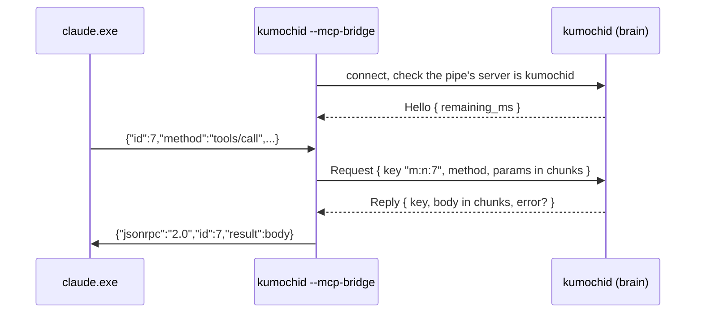

# Claude Code

Kumochi runs Claude Code through its installed `claude.exe`, headless, with `stream-json` on
stdin and stdout. Kumochi's own tools reach it as an MCP server named in `--mcp-config`. That
server is a mode of the brain's own executable, the bridge.

## The bridge

`kumochid --mcp-bridge <launch>` is a stdio MCP server. Claude Code starts it, and it connects
back to the brain on `\\.\pipe\<prefix>-<session>-claude-bridge-<launch>`, where `<launch>` is 32
lowercase hex digits drawn for that launch. The bridge decides nothing about tools: it checks each
JSON-RPC line's envelope and id, relays requests, and writes the brain's answers back under the
original id. It logs no message body.

- **Squatting fails closed.** Right after connecting, the bridge asks for the pipe's server process
  (`GetNamedPipeServerProcessId`) and requires its image to be the bridge's own executable.
  Otherwise it sends nothing and exits 1.
- **Lines.** A stdin line holds at most 512 KiB. A longer one gets `-32600` with a null id, and the
  rest of it is discarded up to the next newline. Batches, a missing or wrong `jsonrpc`, and an id
  that is null, an object, a float, past `i64`, or a string over 29 bytes are `-32600`; an
  unknown method is `-32601`; bad JSON is `-32700`.
- **Ids** go back by value: a number as itself, a string re-escaped from its decoded value. On the
  pipe a call is keyed `m:n:<number>` or `m:s:<hex of the string's bytes>`, so the two never
  collide.
- **Methods.** `ping` is answered locally. `initialize`, `tools/list` and `tools/call` go to the
  brain. `notifications/initialized` is forwarded; other notifications are dropped.
- **One call at a time.** A second request while one is in flight gets `-32600`. A call Claude
  Code cancelled keeps the bridge busy until the brain answers it or the launch ends.
- **Chunks.** Both directions travel in chunks under the data pipe's frame cap. A reply over 3 MiB
  becomes `-32603` for its call. The brain's side (C4b) reassembles a request up to 512 KiB.
- **Bodies.** The brain sends a result or error body, which must be valid JSON; the bridge splices
  it into the envelope unparsed.
- **Hello first.** The brain must send `Hello` within 5 seconds of the connect, before anything
  else; otherwise the bridge exits 1 without forwarding a line.
- **Ending.** stdin's end, or the pipe's, ends the bridge with exit 0, without reconnecting. When
  the deadline in `Hello` passes, the call in flight gets `-32603` and the bridge exits 1. Every
  wait counts against that deadline, pipe writes included: a brain that stops reading can't hold
  the bridge past it, and a write it cut short ends the connection rather than being retried.
- **Stdout is bounded.** At most four lines wait for stdout. When a reader stops reading, the
  relay waits instead of queueing, and at the end the bridge gives stdout one second to take its
  last lines before it exits 1.
- **Debug prints no content.** Lines, params, bodies, ids and call keys format as their kind and
  length only.
- **Logging never stops it.** If its log file can't open, the bridge runs anyway, with the panic
  hook installed.
- **Threads.** stdin and stdout run on their own threads. The pipe runs on a current-thread tokio
  runtime, because synchronous Windows pipe I/O serializes reads and writes on one file object.

The brain's side of the pipe, and the launch that writes `mcp.json`, come with C4b and C5a.
On macOS the pipe would be a Unix socket in the owned folder (unverified).
