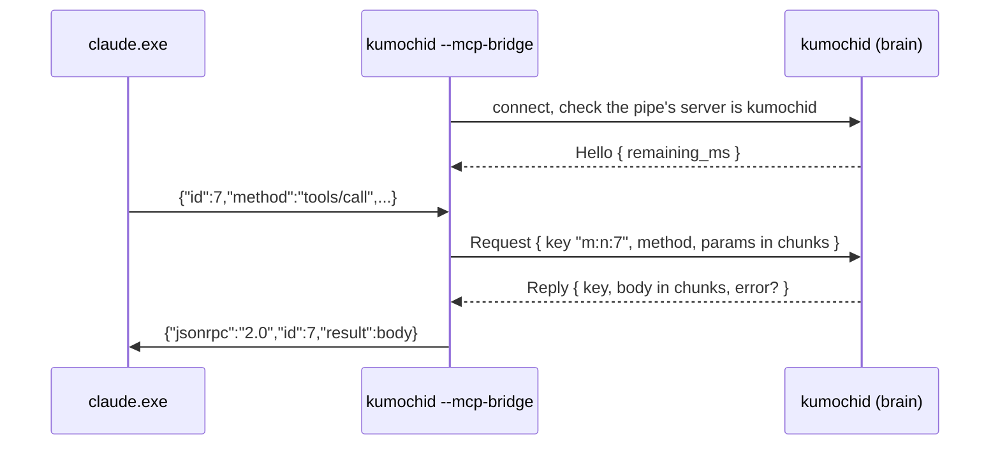
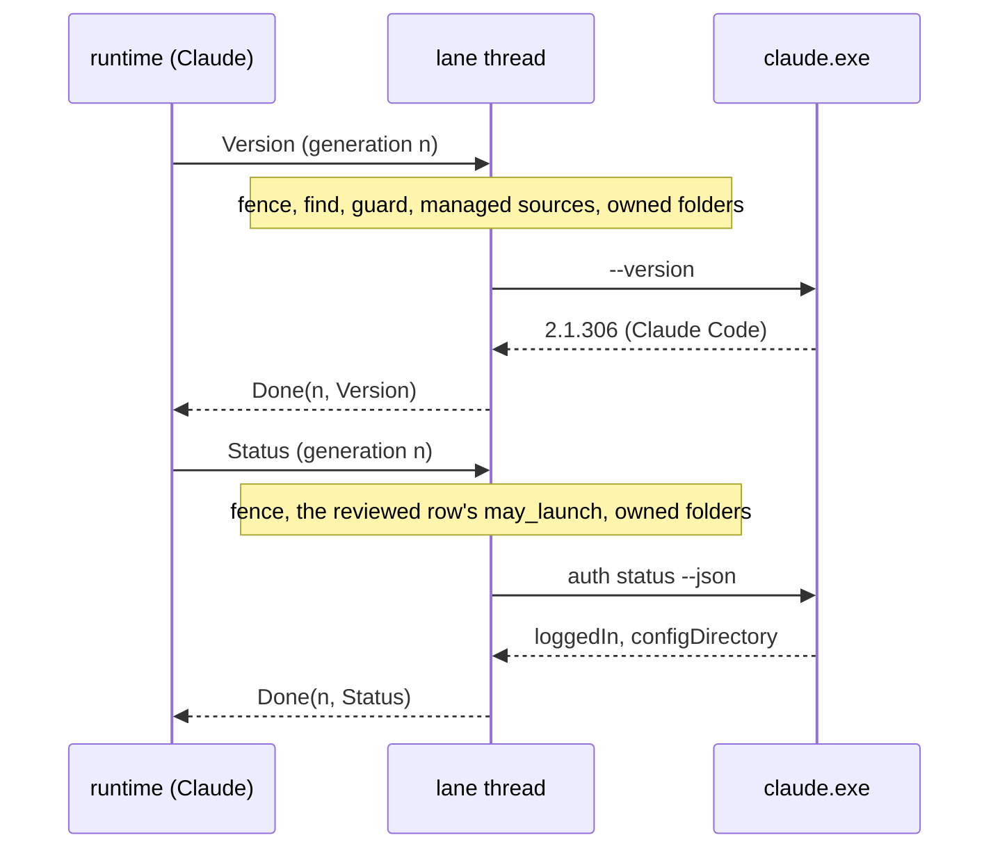
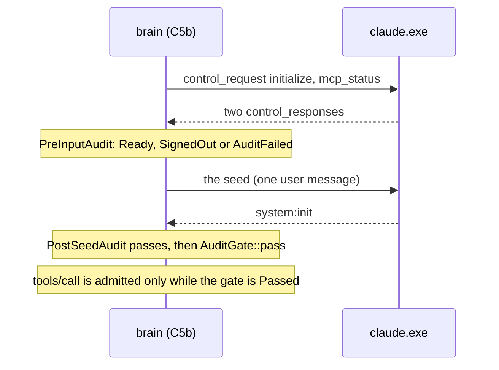

# Claude Code

Kumochi runs Claude Code through its installed `claude.exe`, headless, with `stream-json` on
stdin and stdout. Kumochi's own tools reach it as an MCP server named in `--mcp-config`. That
server is a mode of the brain's own executable, the bridge.

## The bridge

`kumochid --mcp-bridge <launch>` is a stdio MCP server. Claude Code starts it, and it connects
back to the brain on `\\.\pipe\<prefix>-<session>-claude-bridge-<launch>`, where `<launch>` is 32
lowercase hex digits drawn for that launch. The bridge decides nothing about tools: it checks each
JSON-RPC line's envelope and id, relays requests, and writes the brain's answers back under the
original id. It logs no message body.

- **Squatting fails closed.** Right after connecting, the bridge asks for the pipe's server process
  (`GetNamedPipeServerProcessId`) and requires its image to be the bridge's own executable.
  Otherwise it sends nothing and exits 1.
- **Lines.** A stdin line holds at most 512 KiB. A longer one gets `-32600` with a null id, and the
  rest of it is discarded up to the next newline. Batches, a missing or wrong `jsonrpc`, and an id
  that is null, an object, a float, past `i64`, or a string over 29 bytes are `-32600`, and so
  is a request whose `params` are present but neither an object nor an array; an unknown method
  is `-32601`; bad JSON is `-32700`. A notification is never answered, whatever its params.
- **Ids** go back by value: a number as itself, a string re-escaped from its decoded value. On the
  pipe a call is keyed `m:n:<number>` or `m:s:<hex of the string's bytes>`, so the two never
  collide.
- **Methods.** `ping` is answered locally. `initialize`, `tools/list` and `tools/call` go to the
  brain. `notifications/initialized` is forwarded; other notifications are dropped.
- **One call at a time.** A second request while one is in flight gets `-32600`. A call Claude
  Code cancelled keeps the bridge busy until the brain answers it or the launch ends.
- **Chunks.** Both directions travel in chunks under the data pipe's frame cap. A reply over 3 MiB
  becomes `-32603` for its call. The brain's side (C4b) reassembles a request up to 512 KiB.
- **Bodies.** The brain sends a result or error body, which must be valid JSON; the bridge splices
  it into the envelope unparsed.
- **Hello first.** The brain must send `Hello` within 5 seconds of the connect, before anything
  else; otherwise the bridge exits 1 without forwarding a line.
- **Ending.** stdin's end, or the pipe's, ends the bridge with exit 0, without reconnecting. When
  the deadline in `Hello` passes, the call in flight gets `-32603` and the bridge exits 1. Every
  wait counts against that deadline, pipe writes included: a brain that stops reading can't hold
  the bridge past it, and a write it cut short ends the connection rather than being retried.
- **stdin's end wins over waiting.** The stdin thread raises a flag the moment a read sees EOF,
  before it queues its last lines, and the `Hello` wait, every pipe write and every wait for
  stdout space end on it. Lines still queued then are dropped: nobody is left to read their
  replies. The exit is 0, or 1 when stdout can't take its last lines within the flush wait. The
  guarantee covers only an end the reader has seen: a reader blocked on a full line queue (16
  lines behind a stalled write) can't read the EOF, and the deadline ends that case.
- **Stdout is bounded.** At most four lines wait for stdout. When a reader stops reading, the
  relay waits instead of queueing, and at the end the bridge gives stdout one second to take its
  last lines before it exits 1.
- **Debug prints no content.** Lines, params, bodies, ids and call keys format as their kind and
  length only.
- **Logging never stops it.** If its log file can't open, the bridge runs anyway, with the panic
  hook installed.
- **Threads.** stdin and stdout run on their own threads. The pipe runs on a current-thread tokio
  runtime, because synchronous Windows pipe I/O serializes reads and writes on one file object.

## The listener

The brain's end of a launch's pipe (`bridge::listener`). C5a creates it for each launch, before it
writes `mcp.json`, under a fresh `LaunchId`; it's never recreated for the same launch.

- **One instance, one client.** The pipe is owner-only, refuses remote clients, and is created as
  the first and only instance of its name (`Instance::Only`, an OS maximum of one), so a taken
  name fails the launch and nobody can add a second server instance. `serve` consumes the
  listener: the first connection uses up the session, refusals included.
- **The client checks**, on one process handle opened from the pid the pipe reports, before any
  byte is written: the process hasn't exited, it runs the brain's executable, and it's inside this
  launch's own run job. Any failure ends the session with no `Hello`, and C5a fails the launch.
- **What the checks prove** (Captain's ruling, 2026-11-05). The DACL admits only the owner's
  account, and code running as that account can already read its Credential Manager entries and
  open Kumochi's processes. So the checks turn away stray and unrelated connections (another app,
  an earlier launch's bridge, another executable, a process outside the launch's job); they aren't
  a defence against same-user code. They don't prove the connection's opener is the process the
  pid now names: the opener can exit and its pid be reused, or hand its pipe handle to another
  process. Job membership proves a process came from the run, not that it's the one bridge, so
  execution stays gated by the audit, the bind and revocation.
- **Requests.** One at a time, every read and write raced against the launch's deadline. A
  request's first chunk fixes its key, which must be one the bridge makes (`m:n:<i64>` or
  `m:s:<hex>` of at most 29 bytes), and its method; a chunk that doesn't continue it, an
  `initialized` inside it, or the pipe's end inside it ends the session `Broken`. A request over
  512 KiB gets one `-32603` when its last chunk arrives, and the session goes on.
- **Methods.** `initialize` echoes a protocol version it knows, or offers `2025-06-18`.
  `tools/list` gives the launch's frozen tools whatever the gate says, so the audit can see them.
  `tools/call` takes named params only (`name`, `arguments`, `_meta`); anything else, or a tool
  outside the frozen set, is `-32602` with fixed text.
- **Admission.** For a well-formed call, the listener reads the launch's `Binding` (set once, at
  bind), checks the deadline, then loads C3's `AuditGate`, with no wait in between. That load is
  the instant of admission: a `fail()` before it refuses the call, and one after it doesn't undo it.
  A refused call gets an error result and is dropped, never held for a later bind. Revocation
  (C5a: Disconnect, the route turned off, thread deletion) must fail the gate before it ends the
  launch, since killing the job doesn't stop input already in the pipe.
- **No tool runs yet.** An admitted call gets the error result "This tool isn't available over MCP
  yet." C4b-2 hands its origin (`McpOrigin { run, launch, key }`) to the dispatcher.
- **Nothing the client sent is printed.** Error bodies are fixed; `McpOrigin` and `SessionEnd`
  print kinds, ids and lengths only.
- **macOS counterpart:** the peer pid through `LOCAL_PEERPID` and a process-group check, which is
  weaker (unverified).

## The launch policy

`REVIEWED_CLAUDE_CODE` (`engines/claude_code/policy.rs`) holds one row per reviewed Claude Code
version: its launch policy and the facts its audit expects. Any other version is
`Unsupported::Unreviewed`, with no override. Adding a version is a reviewed PR with its probe.

- **Arguments.** `--version`, `auth status --json`, `auth login` and `auth logout` get only their
  subcommand. A question gets P0's argv: `-p --restricted --strict-mcp-config --mcp-config <file>
  --disable-slash-commands --tools "" --no-session-persistence --allowedTools <tools>
  --input-format stream-json --output-format stream-json --verbose --include-partial-messages
  --max-turns 8 --exclude-dynamic-system-prompt-sections --model <model>`, then `--effort` when the
  snapshot names one. `--allowedTools` takes every value up to the next switch, so it never comes
  last.
- **Environment, built and never inherited.** `CLAUDE_CONFIG_DIR`, `USERPROFILE`, `HOME`,
  `APPDATA`, `LOCALAPPDATA`, `TEMP`, `TMP` and `CLAUDE_CODE_TMPDIR` point at Kumochi's own
  folders. Six documented switches are `1`: `DISABLE_AUTOUPDATER`, `DISABLE_TELEMETRY`,
  `DISABLE_ERROR_REPORTING`, `CLAUDE_CODE_DISABLE_NONESSENTIAL_TRAFFIC`,
  `CLAUDE_CODE_SKIP_PROMPT_HISTORY` and `CLAUDE_CODE_DISABLE_AUTO_MEMORY`. `SystemRoot`,
  `SystemDrive` and `PATH` come from the OS (`platform::system_env`): `PATH` is the system folder
  then the Windows folder, never the brain's own `PATH`, and there's no `PATHEXT`.
- **Ownership.** C3 returns owned `LaunchData`; C2 and C5a keep it alive and borrow it into
  `platform::Launch` with the exe, the `work` folder, the stdio and the jobs. C3 starts nothing.
- **Before any launch,** `may_launch` refuses with `PolicyFailed::ManagedPolicy` when an endpoint
  managed source is present or can't be ruled out, or when the policy requires a server-managed
  signal; and with `TurnCap` when the version's `--max-turns 8` isn't verified. The presence check
  (`platform::managed_presence`) looks at `C:\Program Files\ClaudeCode\` (`managed-settings.json`,
  `managed-settings.d`, `managed-mcp.json`) and the `Settings` value under
  `HKLM\SOFTWARE\Policies\ClaudeCode` and `HKCU\SOFTWARE\Policies\ClaudeCode`. It never enumerates
  or reads them. Only "file not found" or "path not found" is absent; anything else counts as
  present. Server-managed policy from a Team or Enterprise organization can't be seen, so it's
  disclosed instead (`ServerManaged::Disclosed`).

## Discovery and the lane

`engines/claude_code/lane.rs` is the only code that starts `claude`. It runs one call at a time on
its own thread; `runtime/claude.rs` asks it for work and turns the results into
`ClaudeCodeView`.

- **Finding.** Only `CLAUDE_CODE_PATHS` under the user's profile, never `PATH`. A path that isn't
  a native `.exe`, or that runs through `node_modules`, is `Unsupported::Shim` before anything is
  looked at. The version is `--version`'s first word, and it must have a reviewed row.
- **Before every start.** The lane needs this brain's own lock on `claude-code.lock`, beside the
  vault's, and takes it on its first call only while the account worker reports the vault lock
  held. Before Version every managed-policy source must be absent; before Status the reviewed
  row's `may_launch` runs again. Kumochi's folders under `claude-code` are made owner-only and
  held from the volume root. A refusal starts nothing and makes no folder.
- **Signed in.** `auth status --json` must exit 0 or 1 and name exactly Kumochi's `config` folder
  as `configDirectory`, byte for byte; anything else fails closed.
- **One job per process,** nested in the brain job. A call ends only when its root has exited, its
  job is terminated and confirmed empty, and both pipes have ended. If the job can't be confirmed
  empty the lane is stuck: it refuses everything and never lets the lock go.
- **Bounds.** The queue holds 4 jobs and refuses more without waiting. stdout is capped at 4 KiB for
  Version and 64 KiB for Status, stderr at 64 KiB (read and dropped); one byte more fails the call.
  One 10-second deadline [guess] covers the exit and both pipes.
- **The fence.** Each job carries the generation it was queued under, and a job from an older
  generation does nothing. Finds asked for while one runs coalesce into one more.
- **Close.** `Brain::quit` and `Brain::close` close the lane before the accounts: no more work, the
  running call's processes end, queued jobs are dropped, and the lock goes only once every job was
  confirmed empty.
- **The sign-in store isn't decided** (owner call 1), so `SIGN_IN` ships `Undecided`: Connect does
  nothing, and a signed-out install shows `Unsupported(SignInStore)`. Connect, Cancel and
  Disconnect come with C2b.
- **One view.** The key's half of `ConnectionsView` belongs to the account worker and Claude Code's
  half to `runtime/claude.rs`; every Connections frame is put together from both when it's sent.

## The audit

`engines/claude_code/audit.rs` judges what C6's mapper parsed, in two parts, and returns an
`AuditFailed` reason, never what it saw.

- **Before stdin:** the version; no commands; exactly the reviewed agents; then
  `account.tokenSource`. `"none"` means signed out: the launch is torn down before stdin and the run
  fails with `ClaudeCodeSignedOut`, not an audit failure. Any other value must be reviewed. Then
  exactly one server, `kumochi`, `connected`, whose tools are exactly the launch's frozen set. An
  error response, an unknown or repeated id, or a body of the wrong shape is `Malformed`.
- **After the seed:** `system:init` must show the version, exactly the frozen tool set, the one
  server, exactly the reviewed plugins each at `builtin`, no skills or slash commands, the reviewed
  agents and an `apiKeySource` of `none`. A later init must equal the first. `analytics_disabled`
  is recorded and shown, never judged.
- **The gate** starts pending. Failure is terminal, so a pass that races a failure loses. A tool
  already admitted isn't undone; a call still waiting for admission is refused.
- **The stated limit:** the seed can reach the chosen model before init is checked, but no tool
  runs before the check.
- **Signed-in sources aren't recorded yet,** so 2.1.306's row accepts no `tokenSource` but `none`
  (signed out). The signed-in probe, after owner call 1, adds the value.

The brain's side of the pipe, and the launch that writes `mcp.json`, come with C4b and C5a.
On macOS the pipe would be a Unix socket in the owned folder (unverified).
