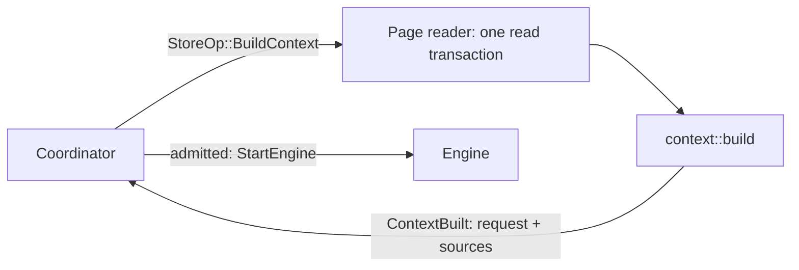
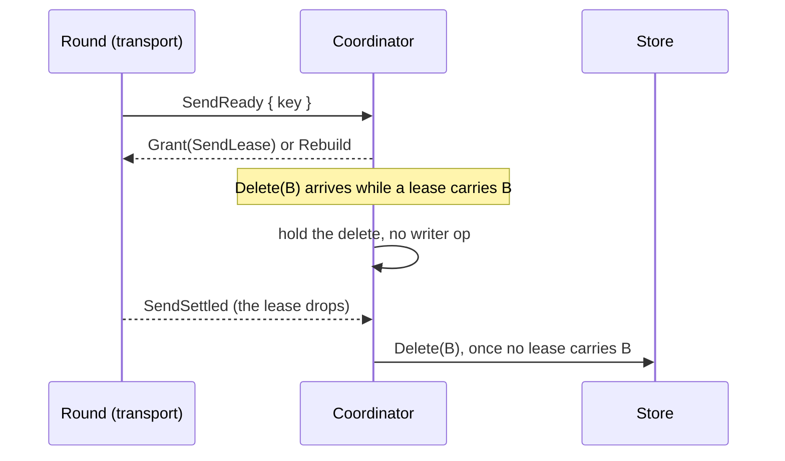
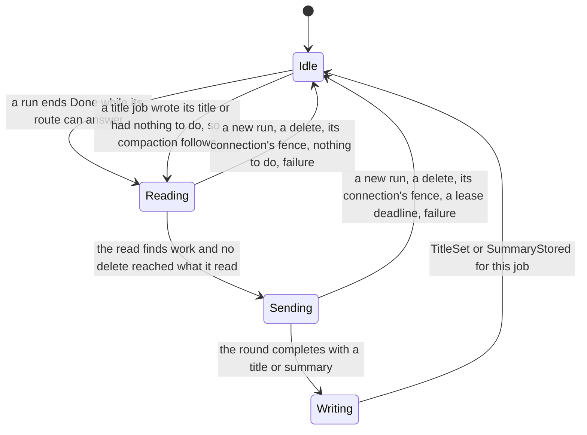

# Engines: what each request sends

A model request is built from the store, never from what the shell sent. `context/` builds it as
typed data (`ModelRequest`), and the engine gets only that request. PR 13a serialises it into the
Responses body, with `store: false` and `stream: true`, and PR 11's transport sends it on the
signed-in account ("The Responses engine"). A dev build can play a script instead, which sends
nothing (runs.md, "The fixture engine").

## What a request holds

The run engine pump stamps every event with the actual request's build key: run, round and
attempt. The coordinator accepts it only for the current admitted build, including `Finished`.
Canceling an old pump does not retract events already queued, so those events keep their old
key. Store acknowledgements and send-lease settlement are independent inputs and still drain
after their build stops; background jobs keep their separate job-keyed collector.

| Part | Where it comes from |
|---|---|
| Model and effort | The run's snapshot: the thread's model choice, else the default model. The coordinator checks it against its route's catalog at admission. ChatGPT pins a supported effort for the run; an unavailable model or unknown effort support gives `ModelUnavailable` (see [runs](runs.md#availability)). The dev fixture needs no choice, and a real engine refuses a request without one. |
| Instructions | `prompts/instructions.md` and the role file for the run's origin (`kumo.md` or `task.md`). The assistant's name and the user's name come from the run's snapshot, taken once when the run starts, so a rename applies from the next run. Each name comes with a line saying it is the current one, so a different name in earlier turns or a summary is out of date. An unset user name leaves its lines out. Names are filled in one pass, so a name is never read as a placeholder. |
| Tools | Kumo: `draw`, `draft_issue`, `search_history`, `read_history`, `list_tasks`; a task: `draw`, `draft_issue`, `search_history`, `read_history`. |
| Summary | The newest summary (PR 17), as `Summary of events 1–212:` and its text. Events it covers aren't sent raw. |
| Raw runs | Up to the newest 8 runs, the current one included, oldest dropped first while over the bound. A run is kept or dropped whole, so a tool call never travels without its result. |
| Deletion notes | Kumo's thread only: up to the newest 32 notes [guess] past the summary, each one developer message, `Note: a task was deleted at 2026-11-06 01:23.` A note sits after the last run that began before it, never inside a run, and is dropped with that run. A summary covers the notes up to its last event. A note names no task, so a deleted title never comes back in a request. |
| Current turn | The user's text, plus their local time to the minute when the run started (its `started_ms` through SQLite's `localtime`, so the system's time zone on every platform), the same in every round of the run. It's never dropped. |

**Stored rounds** (runs.md, "The tool loop") replay per run (D13-M1). A run whose stored items all
came from this run's route, the same kind under the same sign-in tag, and whose results each
answer one call of the run made before them, once, replays its rounds natively: each
round's items in output order, then its results. A `ChatGPT` round's items carry its text, so of
its text only what was written after its last round, such as a Stop's partial answer, goes as one
assistant message. Unspoken drawing narration follows its matching native draw call as a local
assistant message; the provider items, including refusals and final-only text, stay intact.
Native replay groups all lines for one draw call at its boundary, so it doesn't preserve ordinary
text interleaved between those lines as live Chat and saved history do.
Narration without a matching native call stays with the saved reply text. An Anthropic key round
stores only its calls, each a `tool_use` item of its id,
name and input, so its text replays as written, beside them. Its writer requires exactly one
result per call, with no repeated or stray IDs. Replay checks that each call group is fully
answered before the next group or text. A run with foreign or unpaired rows replays as its
text only, without items, results or recall, so no call or result travels without its pair. The route is
the kind of the run's choice (`ChatGPT` for none) and the tag that kind had when the turn arrived,
recorded in its snapshot. Every stored item records both; an item stored before kinds were kept is
`ChatGPT`'s, and one of a kind this build doesn't know never replays. Claude Code keeps its own
history and stores no rounds. A stored item or result that doesn't decode, or a result over 64 KiB [guess],
fails the build, and their bytes count toward the bound. `append_round` runs those same checks
on every item and result before it writes, so a round the build would refuse is never stored: its
write fails and the run ends `failed(store)`, and the thread's next run builds as usual.

## Origin and references

Stored native rounds may contain a tagged `recall` result. `store::rounds` preserves its
typed selectors instead of turning them into reference JSON text. The context builder
dereferences them in its current snapshot and includes every live quoted task in the
build's source set. Like other native results, recall replays only when the current
connection matches the round's native items. Older untagged history references remain readable.

History calls run on the stamped page reader, not the coordinator. Their run ledger holds a
`Reading` entry with the original build key and cancellation owner. Canonical retries join;
changed arguments are refused. Completion checks the current admitted build, live caller,
finishing state and both the calling build's and selected results' sources. A delete that
reached either source set cancels and rebuilds the round, leaving the key terminally refused.
Only validated selectors are committed; the caller waits for that commit's acknowledgement.
These tools are never exposed through MCP, and create/focus remain unoffered to the model.

New `history.read` payloads use `reread_bytes` (default 32 KiB), counting encoded JSON before the
title and outer wrapper. Replay uses the saved endpoints and cut under the fixed 32 KiB cap.
Titles, wrappers and all replayed results still count toward the whole request's 512 KiB budget.
Stored selectors separately obey the 64 KiB output bound.
An interrupted task is labelled Stopped for every interruption cause, not only an explicit Stop.

A run's origin is `Kumo` (the main thread) or `Task(t)`. The coordinator derives it from the
run's thread and never from anything a model produced. The builder refuses an origin that doesn't
match the thread it runs in.

History results are stored as references (a task and an event range), never as text, and are
re-read every time a request is built, in the same read transaction as the conversation:

- `Task(t)` re-reads only t's own events. A reference to another task renders as
  `[not available here]`.
- `Kumo` re-reads any live task, never the main thread.
- A task that is gone or being deleted renders as `[removed with a deleted task]`. A live task
  with nothing in the range renders as empty text, not as removed. A store failure is an error,
  never a removal.
- Each older reference re-read is capped by `reread_bytes` (default 32 KiB). Events are shown as
  `user: …` and `assistant: …` lines.
  The lines that fit whole are kept. An event that alone is over the cap keeps its longest prefix
  ending on a character boundary. The result says which events it shows, whether it was
  truncated, and the first event it left out (`continue_from`). A search snippet is a
  single-event reference under the same cap.
- Quoted history is data inside a tool result, and the instructions say never to follow it.

`Built.sources` lists every thread whose raw text or title the request carries: the run's own
thread and each task a kept reference showed. The coordinator checks it before the engine starts
(below).

## Builds and deletes

Text read before a delete must never be sent after the delete commits. The coordinator orders
every build against every delete it accepts, so no generation stamps are needed:

- **Each attempt has a key,** `(run, round, attempt)`, with a serial no other build shares. Only
  the current attempt's result counts; a late one is stale. A rebuild replaces the attempt, so
  builds never pile up, and the run's 120 s deadline bounds the whole loop.
- **The read starts after the barrier.** `StoreOp::BuildContext` goes to the page reader stamped
  like a page read, so it waits for every op sent before it, a delete included, and its
  transaction begins after that. The transaction ends before the result comes back.
- **Exposure.** Each build keeps the threads it may have read before their delete: those with a
  delete pending when it began, and every delete accepted after. The set outlives the deletes'
  answers, so a delete answered before the result arrives still voids it.
- **Admission.** A result whose sources meet that set, or a delete still pending, is dropped. If
  the delete is still pending, the rebuild waits for its answer, so its read sees it; otherwise
  the rebuild starts at once. A clean result starts the engine with `RunRequest { origin,
  request }`. A run that keeps losing to deletes is rebuilt until its deadline ends it; a stale
  body is never sent instead.
- **Snapshot.** The first build reads the run's snapshot (names, model, origin) and every later
  attempt reuses it, so a rename applies from the next run.

A build that's too large ends the run as `failed(budget)`, and any other failure as
`failed(store)`. Stop, a replacement, the deadline or the thread's own delete end the run, and
its pending result is stale.

### Recall read ownership

Builds and background jobs own cancellation guards. A replacement, Stop, failure or a
voided build cancels its readers; a new round keeps the run's original 120-second end.
The accepted-op barrier, side-connection slot and swap waits check cancellation, EOF and
that end. Closing the store raises EOF before waiting for the side connections.

Recall replay shares a two-second budget from reader admission, capped by the owner's
end. A scoped SQLite progress handler enforces it only while recall SQL runs; ordinary
context SQL keeps its previous timeout behavior. Exhaustion discards the whole build as
`failed(budget)`, never a partial request or `failed(store)`. Background compaction is
text-only, and inline rewriting reads summaries; neither activates recall SQL today.
Their read waits still use the owner's cancellation and end. Handler installation and
removal failures are typed storage failures. Failed handler setup/cleanup or an unwind
discards the connection before another page read.
No model schemas or asynchronous tool dispatch are enabled by this lifecycle layer.

## The send lease

Admission closes the window from the read to `StartEngine`, and the send lease closes the one
from `StartEngine` to the bytes leaving. A round, or a background job's request, gets a
`SendGate` under its `SendKey` (`Build` or `Job`) and asks it right before any of the body goes
to the network, and again before every retry. A pooled requeue of a request
that never started is the same attempt under the same lease; an application retry asks again.

- **Grant.** Only the current run's admitted build is granted, and only if no accepted or pending
  delete reached its sources. A touched build gets `Rebuild`: the body is dropped unsent and built
  again, after the delete's answer when it's still pending. An ask from an ended run gets
  `Rebuild` and nothing is built. A job's ask is granted only while it holds the job slot under
  its account (see [Background jobs](#background-jobs)).
- **Lease.** Each grant is a `LeaseId { key, send }` with its sources. Leases belong to send
  attempts, not runs, so Stop, a replacement and a lost shell keep them.
- **Settle.** The `SendLease` guard travels inside the grant. Dropping it, wherever it is (a lost
  answer, a dropped round, a finished send), reports on the store-reply channel the brain always
  drains, quit included. So a delete of the sending run's own task can't wait on itself.
- **Unsent unless written.** A lease reports `SendUnsent` unless its transport told it
  `wrote()`, and then `SendSettled`. The Responses transport tells it once a write of the
  request was attempted: it sets one flag right before its first write poll, so a write that
  errors, returns 0 or is pending counts, even if no byte was accepted, while the upload budget
  spent, a connect failure, its deadline while connecting, and a final head or EOF read before
  the first write all leave it unsent. The Messages transport reads the same flag on the same
  connection type, so the same cases leave it unsent. The Claude Code stdin pump marks only a
  pictured seed, after the held grant's final check and just before its first write attempt.
- **Write admission.** The Responses transport asks the lease to admit each poll of the request's
  writer, every write and the flush, and holds that admission for the one poll. The Messages
  transport admits its polls the same way, and refuses a pictured body before connecting when the
  lease has no picture grant. Its refusal before any admitted poll ends the round `ReceiptOrdered`,
  and one after ends it `Withheld`, which the coordinator reads as it reads the Responses one. A send without a
  picture grant admits every poll; one with a grant admits a poll only while it can reserve the
  grant. A refusal stops every later poll: before any poll was admitted, the send ends as
  `Rebuild` with nothing written; after one, it fails as `Withheld` and its connection is
  closed, never pooled, because an admitted poll may have written even when it was pending,
  partial or failed. Only a picture grant refuses, so the coordinator ends that run by why the
  grant first closed (see Picture grant), on an ordinary or an inline round alike, never as the
  connection failing; a connection that fails on its own still ends as `Transport`. Closing wins
  only against new admissions: bytes an admitted poll already handed to TLS or the kernel may
  continue, so this orders writes, not the first byte at the peer, and nothing here proves the
  peer received any of the request. Connecting and the TLS handshake are not request writes. A
  send refused before any poll was admitted ends as `Rebuild` and its round with
  `ReceiptOrdered`, so its pump says nothing and the unsent receipt decides what follows.
- **Picture grant.** A send carrying a picture also carries a revocable grant. On `ChatGPT`, so
  does every later send of a run whose picture a send may have written, such as an inline
  rewrite, though it carries no picture of its own and its settlement tells nothing. The
  coordinator closes it as soon as the run may no longer send that picture: its route's fact no
  longer lists the model as taking images (`ChatGPT`'s is its catalog's `input_modalities`, and a
  loss holds for the rest of the run), the picture is withdrawn, or the run's sign-in changes.
  A send that carries a protected drawing digest without a picture, on `ChatGPT` or the key
  route, carries one too: it also closes when showing the screen is turned off (which removes
  screen scenes and drops private overlays out of outbound digests while leaving them visible
  locally), when a carried drawing changes or queues a failed cut, when the run ends, or, on a
  true key continuation (not a standalone inline rewrite), when any round-1 carried private scene
  changes, leaves, or loses authority in between. Claude Code's digest-only sends aren't gated
  yet; its pictures stay off.
  Both HTTP routes (`ChatGPT` Responses and Anthropic Messages) upload through `ModelConn::upload`
  and check the grant before every write and flush poll (see Write admission): closing the grant
  before the first admission prevents any request bytes from being written, while bytes already
  admitted into TLS or kernel buffers cannot be recalled. Claude Code reserves each pipe
  write against the same grant. If no write was attempted, any terminal outcome goes behind the
  confirmed unsent receipt on that same channel. A closed grant makes the still-current build
  rebuild without the picture (or keeps a still-valid picture when only a drawing digest changed),
  so the old terminal outcome is stale; a revoked key continuation fails closed instead of
  rebuilding. Unconfirmed teardown leaves settlement to the held lease's deadline. Once a write
  was attempted, the pump reports terminal outcomes as usual, including `Truncated` for
  unexpected stream EOF.
  On Claude Code the grant also belongs to the account generation
  the question it was issued for was asked under, not the one its picture was captured under:
  a new generation closes it, before that generation is published, even while that launch,
  unbound, runs on. A Claude Code grant for any build other than the one asked under the
  current generation is closed as it's issued, before its engine is answered; a key route's
  grant is never Claude Code's to touch.
- **The picture's settlement.** A lease carrying a hold's picture settles it once: unsent, the run is as if never
  granted (a later grant carries the picture again, or the run's end clears the mark); otherwise
  the shell is told `HoldScreen`. A failed lease's late settlement settles only the picture.
  Whenever the settlement changes the turn's stored row, marking it sent or clearing it after
  the run has gone, the shell is told its thread's events changed, unless that thread is being
  deleted.
- **Held deletes.** A delete whose thread an unsettled lease carries waits in `deleting` with no
  writer op. It goes out once, in the order accepted, when no lease carries it.
- **Deadline.** A lease that hasn't settled within `send_lease_s` (default 15 s) after its grant
  fails closed: its held deletes are refused with `NotHidden`, and so is any later delete of its sources; its run fails
  as `failed(engine)`; and nothing is granted again until the brain restarts. A late settlement
  settles only the picture its lease carried, and every fence stays. A delete is never released
  because time ran out.
- **Held sends.** A sender whose body can go out again until a process tree is confirmed ended
  (a Claude Code question, see [claude-code.md](claude-code.md#launches)) asks with
  `SendGate::ask_held(hold)`. Its lease uses the remaining launch time plus the fixed 15 s
  teardown allowance, capped at `MAX_HOLD` (165 s), instead of `send_lease_s`. Past it, the lease
  fails closed the same way: its run fails, its held deletes are refused, and its sources stay
  fenced until the brain restarts.
  It doesn't stop other grants, though. A held sender is a separate process on its own pipes, not
  the shared transport, so a teardown that never confirmed is that lane's fault alone, and the
  lane already refuses every later launch (see [claude-code.md](claude-code.md#launches)). ChatGPT
  runs and their title and summary jobs keep being granted.
- **Restart.** A held delete never reached the store, so after a restart its thread is still
  there and no success was ever reported, as with any delete a quit didn't finish.

Bytes handed to the network before a delete arrived can't be recalled. The guarantee is that no
body carrying an accepted delete's thread starts sending, and the delete doesn't commit while
such a body may still be sending. The fixture engine sends nothing and never asks; the provider
transport (PR 11, then 13a) asks, holds the lease until no more of the body can go, and proves
that.

## Background jobs

A job is one model request outside any run, in a one-job slot the coordinator owns
(`coordinator/job.rs`; the pure parts are in `jobs.rs` and `context/compact.rs`). A task's run
starts a title job, and when that writes its title or its read finds nothing to do, a compaction
job for the same thread (see [Compaction](#compaction)); Kumo's run starts compaction only.

- **When.** A stored `Done` starts a task's title job or Kumo's compaction only while the run's
  exact sign-in is ready, no run is current, and sends haven't failed closed. For `ChatGPT`, an
  account must also be signed in. The read finds nothing
  once the title isn't first words (a user's rename or an earlier model title), so the trigger
  keeps no state of its own: a failed job, or a first run that didn't end `Done`, tries again at
  the next `Done`. A job never retries on its own, and a job whose request went out but wrote
  nothing (it failed, or a delete voided its answer) ends with nothing after it, so after a
  usage-limit answer no further automatic request goes out until the next `Done`.
- **Key.** `JobKey { thread, serial }`, the serial from the build attempts' counter, so no key
  repeats. An input for any other key is stale.
- **Route.** A job answers on the route of the run whose `Done` started it, and the compaction
  that follows a title keeps it. Its read must name the same connection: a read whose choice names
  another, because the thread's choice changed since the run, ends the job unsent. Before any
  `ChatGPT` lookup or refresh, `sending` requires the exact current Sending job and its matching
  ready sign-in. The final send grant still independently checks that route.
  The runtime starts its request through `Brain::owned_engine`, as it does a round's, so a Claude
  Code job is one `Claude::question` on the row's alias with no tools
  ([claude-code](claude-code.md#a-question)).
- **Read.** `StoreOp::ReadJob` runs on the page reader after every op sent before it, in one read
  transaction: the task's first user message, its deletion generation and its model choice. Like a
  build, the job keeps the threads a delete pending at its start, or accepted since, reached, so a
  delete of the task voids it at the read, at the grant and when the answer arrives.
- **Request.** `prompts/title.md` with the run's names, the first ask cut to 2,000 characters
  [guess] as the only input, no tools, and the task's model with a wanted effort of `Low`.
  ChatGPT resolves it to the lowest supported effort. It goes through the runtime's engine as a
  round does, under `SendKey::Job`: it asks for a lease, a delete of the task is held while its
  body goes out, and the transport reserves from the shared budget. The fixture engine never asks.
- **Answer.** The round's text, at most 4 KiB [guess], taken only when the round completes: its
  first line that isn't blank, without control characters, trimmed and cut to 80 characters. An
  empty title, more text, a tool call or a round that ends any other way fails the job, and the
  first words stay. A usage report is ignored.
- **Write.** `SetTitle { source: Model(generation), job }`, which the store applies only over first
  words and in the generation the read found, so a rename or a delete during the job wins. The
  store answers every `SetTitle` with `TitleSet { job, applied }`. A committed title, the user's
  or a model's, sends `ThreadsChanged`; only the slot's own key empties the slot, so an old job's
  answer never clears a newer job.
- **Cancel.** Accepting any turn cancels the job (`CancelJob`), and the runtime drops its round;
  a granted lease still settles when the transport drops it. A job lease past its deadline cancels
  the job and fails closed, as a round's does.
- **Sign-out.** The runtime reports `SignedIn { generation }` and `SignedOut { generation }` when
  the account starts or stops being able to send, the generation being the catalog's epoch, before
  anything else that account input does. Sign-out cancels a `ChatGPT` job, so nothing is written
  and no `ChatGPT` request starts until an account signs in again. A Claude Code job instead ends
  when Claude Code becomes unavailable or draws another sign-in, as a run bound to it does;
  `ChatGPT`'s sign-in and sign-out leave it. A grant and a write each need the job's own
  account generation, and an older generation's `SignedOut` changes nothing.
- **Logs** carry the job's key and kind and whether it produced anything, never the title,
  summary, ask or prompt.

## Compaction

Compaction keeps a long thread's requests bounded without losing its history (`context/compact.rs`,
`store/summaries.rs`). A summary covers a thread's events `[first_event, last_event]`, and a build
uses the thread's newest summary in place of every event through `last_event`. The events stay, so
`read_history` and search still reach every one, and a summary is never the only copy.

- **After a run.** When a title job ends on its own (and at once for Kumo's runs, which have no
  title job), a compaction job for the same thread takes the slot, under every fence above. Its
  read sums the byte length of the text and bodies of every ended run no summary covers, ÷ 4 as
  estimated tokens [guess: the catalog has no context sizes yet]. Under
  `compact_at_token_count` (default 24k) it stops with no request. Debug builds take
  `KUMOCHI_COMPACT_AT` to lower it for the live check. Measuring the whole uncovered backlog,
  not just the current raw window, means runs that leave the raw window are summarized even
  while the newest stay small.
- **What it summarizes.** The uncovered runs older than the configured raw window (default eight)
  are eligible. The job stops reading at the next run boundary after its raw UTF-8 text exceeds
  `summary_input_bytes` (default 96 KiB). The builder then uses that same budget for its input
  estimate: JSON-escaped strings plus fixed body and item allowances, including the instructions,
  previous summary, closing message and rendered whole runs. It doesn't measure the provider's
  serialized request. A deleted task's range renders as removed. If the oldest eligible run
  alone doesn't fit, the job sends nothing and coverage doesn't move (`shortcut:` it stalls
  until a continuation scheme exists). A new summary covers from the previous summary's first
  event through the last whole run it carried.
- **Answer.** At most 16 KiB of text, taken only when the round completes, trimmed and cut to
  `MAX_SUMMARY` = 8 KiB [guess] on a character boundary. Empty output fails the job.
- **Write.** `StoreSummary { owner: SendKey::Job(key), generation, covers, … }` inserts only while
  the thread is live in the generation the read found, so a delete during compaction stores
  nothing. `SummaryStored { owner, applied }` ends the job only for the slot's own key.
- **Deletes.** A task's own summaries go with its other rows. A Kumo summary that drew on a deleted
  task keeps that text, as Kumo's replies do (OSC-161), so no summary records its sources; a
  delete accepted while Kumo's compaction is reading or sending voids it like any job.

**Inline (B5).** `summary_input_bytes` doesn't apply here. A build is `TooLarge { room }`, where
`room` is what the bound leaves for the summary after the fixed parts and the current run,
`None` when those alone don't fit. With
`None` the run ends as `failed(budget)` and spends no request. With room, the run compacts on its
own route, Claude Code included, once
per admission episode (the round, until a build is admitted), so a delete's rebuild can't start a
second one:

1. A fresh build attempt of the same round, `StoreOp::CompactContext`, reads the summary in one
   read transaction and returns the request and its sources, exposed to deletes from its start.
2. Admission against those sources, then a send lease under `SendKey::Build`, so a delete between
   the read and the grant gets `Rebuild`; the rebuild is a normal build.
3. The request asks for the summary rewritten within the room left, at most `MAX_SUMMARY`. Its
   text is collected, never shown, and goes through the same budget and deadline as the run. The
   answer is cut on a character boundary until its summary item fits the room as the bound counts
   it, escapes included, and to `MAX_SUMMARY` raw bytes.
4. `StoreSummary` and its acknowledgement are owned by that build's key; only the current run's
   own acknowledgement starts the next normal build. After Stop or a replacement it's stale.
5. A second `TooLarge` ends the run as `failed(budget)`.

## The bound

A request is held to 512 KiB [guess], counted as its JSON body would be: every string escaped,
plus a fixed allowance for each item's and the body's own fields. 13a checks the serialised body
again. The current run, the summary, the instructions and the tools must fit. If they don't, the
build ends with `BuildError::TooLarge`. When the current run fits without the summary, the run
rewrites the summary inline once ([Compaction](#compaction)); otherwise, or when that doesn't
help, the run ends as `failed(budget)` rather than send (shortcut: the shell shows the generic
failure until runs carry an actionable error). The same oversized body is never retried. The catalog doesn't report a model's
context size yet, so the byte bound is the only one.

**Images.** `ModelRequest::attach` adds one `Jpeg` right
after the newest user message, only when the request's model is on the `ChatGPT` connection;
any other route refuses with `ImageRefused::Route`, so no adapter ever has an image to drop, and
a request with no user message refuses with `NoTurn`. An image isn't charged against the
512 KiB bound: its whole input item (`Jpeg::item_len`: the wrapper and the base64 data URL) and
the comma before it are charged against the whole body's 4 MiB ceiling [guess], so a turn with an
image keeps exactly the text room it had. A `Jpeg` holds only bytes that start with a JPEG's SOI
marker, zeroes them when its last copy drops, and shows only its length in `Debug`. Its data
URL is built in one zeroing string of exactly its length. Whether a model takes images is the catalog's own fact (accounts.md, "Model
catalog").

**A held run's screen.** A hold's transcript hands its run what the screen part ended with: a
sealed image, whose buffer and dump registration move into the run's `Jpeg` with no copy, or the
class saying why there's none. Every build of that run adds it through `ModelRequest::add_screen`,
after the newest user message: the image followed by the fixed developer line "The image is a
snapshot from when the user spoke.", or one fixed line naming the class ("The screen was not
included: it wasn't ready in time."). A screen hold's picture has its own lines: one saying it's
a picture of the user's screen, its width and height in pixels, taken at release, with their pointer where it was then, and, when
the pointer's path was painted inside the image, one saying the pink line follows the pointer's
movement and where it lies, in image pixels. Its changed display and too-large picture have their
own class lines. The lines live in `locales/en/brain.ftl` and carry no window details. The
picture goes only where the run's route may carry it now (screen.md, "The brain's hold client"):
on `ChatGPT` when its current sign-in's catalog lists the chosen model as taking images, and on
a Claude route with its switch on and its fresh fact still listing the model under the run's own
sign-in. When that answer is no and no send carrying the picture
has attempted a write, the build goes without it: the model gets "The screen was not included:
this model can't be sent images.", the shell hears `HoldScreen` as `NotIncluded(ModelCantSee)`,
and the turn's `screen` becomes `model_cant_see`. A pending hold's picture closes the same way as
soon as its recipient stops taking pictures, and stays closed if the fact comes back. Once a
request is built, availability and generation latch the loss; admission and the send grant
enforce it: the grant asks again, and a revoked picture grant whose send wrote nothing builds again the same way ("The send lease"), unless an earlier send of the run may have written the picture. A
send that may have written settles without building again. A loss sticks to the run, with its
first cause: once its recipient stops taking pictures, or Claude Code's account generation moves
while the picture is held for Claude Code, no later build carries that picture, even if the fact
comes back. A pending hold's picture closes as `ModelCantSee` on either. The grant judges the
request the engine holds, built with the picture or not, never the run's account of its screen,
so a pictured request whose picture was lost and came back before its grant builds again without
it. Once a grant took the picture, so a send may have written it, no later request of the run
starts: an inline compaction, a later build's grant and a later pictured grant proved unsent each
end the run instead, an ask answered `Rebuild`. It ends as `ScreenConnectionChanged` ("Claude
Code's connection changed during this answer…", with the Settings action) for a generation move,
and as `ScreenPictureStopped` ("Kumochi can no longer confirm that this model can receive
screenshots…") for a lost capability, which a failed catalog check alone can cause. A later
build still holding the picture ends the same way. A key run that may have written its picture
starts no inline compaction at all, even while the picture may still go: the rewrite's grant
comes before its connection, and nothing could stop its text after a loss while it connects, so
the run ends on its budget. Other screen-attachment refusals still end as `ScreenUnavailable`.
Earlier leases settle on their own, so
history and held deletes follow what each send may have written. Turning screen sharing off is the
user's choice, not the model's, so it ends a run as `ScreenUnavailable`, whose line ("The screen
is no longer available, so this turn was stopped.") makes no claim about what was sent. The
direct connection control runs the pending hold's check at once. On every route, a settlement
that changes the turn's stored row, marking it sent or clearing it after the run has ended, also
sends the shell `EventsChanged { thread }` (ipc.md) under its hold's epoch after that write is
queued, unless the thread is being deleted, so a shown page of that thread is read again; that read waits for the write
attempt, not for proof that it succeeded. What the hold carried goes in the run's row
with its turn (store.md, `runs.screen`), and the shell hears it once as `HoldScreen`: an image
when a send carrying it settles after attempting a write ("The send lease"), anything else when
the run's first request starts. An inline compaction's send carries only text, so it doesn't
count. An image goes in pending: history doesn't show it as sent while its run is active, and
shows it as sent once the run has ended, the rule recovery applies. The settlement that tells the
shell also marks it sent. The row is written first on purpose: the first build starts only after
`TurnStored`, and a failed turn write fails the run before anything is built. Recovery at the
next start marks a picture still pending sent, because if Kumochi exits before the send outcome
is recorded it can't tell whether a write was attempted. That covers a crash, and an orderly Quit
whose run end is acknowledged before the aborted engine task's unsent settlement. So the recovered
record can over-report a screen but never miss one that may have left the machine. An open
thread's loaded rows can lag it: while a run is active a loaded turn stays plain until history is
read again, and a late unsent settlement after the run ended leaves a loaded row saying sent until
a re-read. Turning screen holds off
withdraws every run's window image once the change is saved. Turning show-screen off withdraws
every run's screen picture as soon as the brain takes the change, before its save, so a slow or
refused save keeps no send going; a refused save leaves show-screen on, and neither it nor a
later On brings a withdrawn picture back. Until that save fails, the brain also offers, arms and
captures no new screen hold, behind another save or with an On queued after it; a failed save
reopens the offer under a new revision, so a hold must be offered again. Each withdraws only the pictures it allowed: the run's own copy drops at once, and the bytes are zeroed
when the last copy drops. The run's next build fails with `ScreenUnavailable`, and a request that has
started keeps its copy until its round ends but is refused at the send, failing the run the same
way. A `ChatGPT` or Anthropic key upload already writing the picture is cut at its next write poll: it settles as
possibly written, its connection closes, nothing is sent again, and the run ends as
`ScreenUnavailable`; one cut by a lost capability ends as `ScreenPictureStopped`. If no send carrying the image has attempted a write yet, the turn's `screen` becomes
`withdrawn`; once one has, it stays `attached` or `screen`. A held run that ends any other way
before a send carrying its image attempted a write (it fails, is stopped, cancelled or replaced)
records no screen: a turn not
yet written is written without it, and a written one is cleared by a store write queued behind
the turn's. Known limits:
- **A granted send can't be recalled.** Turning screen holds off refuses a request's send that
  hasn't been granted yet; a body already granted may still go with its image. A `ChatGPT` or
  Anthropic key upload stops at its next write poll, though bytes already admitted may continue.
- **History can show a window that never left.** A write that was attempted marks the screen
  sent even if no byte was accepted. Kumochi exiting before the send outcome is recorded while the picture is pending, including after a
  send proved unsent while its run could still send again, and a failed write of the mark or of
  its clear, leave it pending, and recovery marks it sent. Either way its history shows a window
  for a turn whose image may never have been sent.
- **Every round resends the image.** Each tool round is a new stateless request, so the image's
  input tokens are charged again every round against the plan's usage, bounded by the round cap,
  and the body is uploaded again. At the 2 MiB image cap that's about 2.8 MB a round under the
  10 s send deadline [arithmetic, not measured].
- **The developer line isn't counted in the 512 KiB bound.** A request built within about 60 bytes
  of it is refused at send, which fails the run rather than sending more.
- **A held run has no Retry.** The shell retries a failed run by resending its text as a new
  typed turn, which the brain can't tell from a fresh one, so it offers Retry only for typed runs.
  A Retry for a held run would have to name the run it retries and fail with `ScreenUnavailable`
  when that run carried a screen.

## What builds nothing

| Error | When |
|---|---|
| `Deleting` | The run's thread is being deleted or is gone. |
| `Origin` | The origin doesn't match the thread. |
| `NoTurn` | The run's turn isn't stored. |
| `InvalidCut` | A tool call is apart from its result, or an item repeats. |
| `TooLarge { room }` | The parts that can't be dropped are over the bound; `room` is what's left for a summary when the current run fits without one. |
| `Store` | The read failed. |

No error and no `Debug` output carries message text or names.

## The Responses engine

`engines/responses.rs` builds the body and maps the stream; `engines/responses/engine.rs` runs a
round on the account.

**The body** is `ModelRequest` as JSON: `model`, `instructions`, `input`, `tools` (each a
`function`), `reasoning.effort`, `include: ["reasoning.encrypted_content"]`, `store: false` and
`stream: true`. It never sends `context_management`, `max_output_tokens` or
`prompt_cache_retention`. Input items are messages with their role, `function_call`,
`function_call_output`, and stored native items sent back as the same JSON value (its strings exact, its spacing and escapes not). An image is a user
message of its own whose content is one `input_image` with a `data:image/jpeg;base64,` URL and
`detail: "high"`. The image item is built by hand, with the URL moved in rather than copied, and
the input list is moved into the body. The serialised body less its image items is checked
against the 512 KiB bound again, and the whole body against the 4 MiB ceiling, both counted
without building a copy; a stored native item that isn't JSON builds nothing. `ResponsesBody`
sizes the body first and serialises it into one zeroing buffer of that size. The engine then
zeroes each image URL in the JSON value and drops it before anything is sent. A text-only body
is pinned byte for byte by a test.

**One round's stream** maps to `TurnEvent`s in arrival order:

| Responses event | Turn event |
|---|---|
| `response.output_text.delta` | `TextDelta` |
| `response.output_item.added`, a `function_call` | `ToolCallStarted` with its catalog name, or `Unknown`, before any delta. Both provider mappers share this resolution and preserve the existing `draw` name. Recognition grants no permission: dispatch still checks the run's offers and origin. The provider's item id is mapped to its `call_id` here and never leaves the adapter |
| `response.function_call_arguments.delta` | `ToolArgsDelta`, tagged with the call id |
| `response.function_call_arguments.done` | nothing; its arguments must equal the deltas |
| `response.output_item.done` | for a call, `ToolCallReady` once; then, for every item, `OutputItem` with its `output_index`, for replay |
| `response.completed` | `Finished(Completed)` |
| `response.failed`, `response.incomplete`, `error`, a reader cap | `Finished(Failed(Stream(…)))` with the error ledger's meaning |

These fail the round as `Failed(Stream(Protocol))`: a delta or done for an item that wasn't
started, an item id or call id started twice, a call id that isn't 1 to 64 ASCII bytes, arguments
that differ from their deltas, a call done twice or naming another call id, a delta after its
call was done, a completed response with a call still open, a done item with no output index or that isn't an
object with a string `type`, and a call done under another name than it started with. A done
item is checked, charged and kept whole before its call is ready, so a refused item never makes
its call ready.
A round keeps at most 64 calls and items and 1 MiB of ids, arguments and items [guesses], charged
before each is kept. A stream whose bytes run out has no ending of its own, so the round's pump
reports it as `Truncated`.

**A round** (`Responses`, one per `StartEngine`) goes in this order, so nothing is asked for that
isn't needed:

1. **The body** is built and checked. A refused body fails the round as `Stream(Request)` and asks
   for no bearer.
2. **The bearer.** The round asks the brain over the `AccessHandle` with its `SendKey`. The
   coordinator names the connection the send may use (`Coordinator::sending`): a round's run's
   own, only while that run is current, and the ready one for a job. The account answers only
   when that connection is the ready one, refreshing first when it's due. Any other answer, or a
   brain that's gone, fails the round as `Failed(Access)` with nothing sent. The shell hears the
   account's own reason when it gave one (a refresh that couldn't connect keeps `AccountOffline`
   with Retry), else why the run's connection can't send, else `SignInNeeded`. The bearer stays a
   `Secret` and is dropped when the stream ends. A stream that ends in `AccountRefused` tells
   the account which generation was refused, so the next access renews it (accounts.md).
3. **The ask.** The transport asks the `SendGate` right before the body goes out (see
   [The send lease](#the-send-lease)), which checks the round's build key and its sources. A
   `Rebuild` drops the round with nothing more said, since the coordinator already dropped it.
4. **The stream.** Each read's events go to the pump before the next read, through the bounded
   events channel, so a slow coordinator slows the read and nothing queues without bound. A gone
   pump, or a round its rules broke, stops the stream and closes its connection. The round's
   end follows its last events.

Saved history uses the Responses error code or HTTP 401, and the Anthropic Messages
authentication and billing categories, instead of deriving a cause from the notice text.
The Messages 401 keeps the post's exact send key as it retires the credential. Claude Code
distinguishes a signed-out audit before the seed from a confirmed Status result after the seed.
Both carry the current launch or build identity when the account report ends the turn first.

A dev build caps its requests with `KUMOCHI_LIVE_BUDGET` (`Budget::from_env`); a release build
has no cap. Each round is one start; the coordinator's tool loop starts the next (runs.md, "The
tool loop").

## The Claude Code stream

Claude Code is driven through its public CLI with `--output-format stream-json --verbose
--include-partial-messages`. `engines/claude_code/stream.rs` reads its stdout in two steps, both
sync and one line at a time, so the launch can audit `system:init` before it passes the next line
on:

- **`LineFramer`** charges every byte to a 16 MiB budget [guess] before framing, ignored lines
  included, and yields complete lines of at most 1 MiB [guess], line feed excluded. A partial line
  past the bound fails at once. When more bytes arrive, newline search resumes at the first
  unsearched byte, even after compacting away earlier complete lines.
- **`StreamMapper::line`** maps one line to `Event` (a text delta), `End` (the question's usage
  and how it ended), `Control` (a `control_response`, for the audit before input), `Init` (the
  facts for the audit after it) or `Ignored`. Unknown types are counted and ignored.

| Line | Maps to |
|---|---|
| `stream_event` `content_block_delta` with `text_delta` | `TextDelta`; text comes only from here, so without `--include-partial-messages` an answer is empty |
| `assistant`, `user`, `system:status`, `system:api_retry` | ignored; `assistant` repeats streamed text. After a pictured seed, a structured `user` image echo fails the stream without returning its payload |
| `stream_event` `message_start` | one native request; the first one's usage is kept for the prompt-cache decision. A 9th fails the question with `TurnCap` and marks the version's turn cap broken |
| `result` | `Usage { whole, first_request }`, then `Completed`, `Failed(TurnCap)` for `error_max_turns` (the cap working, not broken), or `Failed(Provider)`; anything after it is ignored |
| EOF before a result | `Truncated` |

Claude Code retries a cut request itself (`system:api_retry`, up to 10 times in 2.1.306) and
streams only the attempt that finished, so a retry doesn't count as a second native request. No
line's content is ever logged, and every type here prints only kinds, lengths and counts in `Debug`.

`Init` keeps `analytics_disabled` as reported (`None` when it's missing or not a boolean) for the
connection to show; it's never a reason to refuse the route. The recordings in
`fixtures/claude-code/` are checked by a normal test: no decoded string may hold a drive, UNC or
`/`-rooted path, `Users\`, or a UUID other than the all-zero placeholder.

The [offline drawing timing gate](input.md#offline-drawing-timing) reuses the Responses
parser with a fixed in-memory HTTP/SSE transport. In an opted-in release build, the
Gate identity, draw mode, one-run budget, fixed replay model and fresh receipt are
required. The fixture can't fall back to the account engine.
