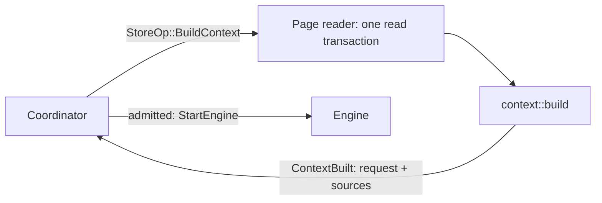
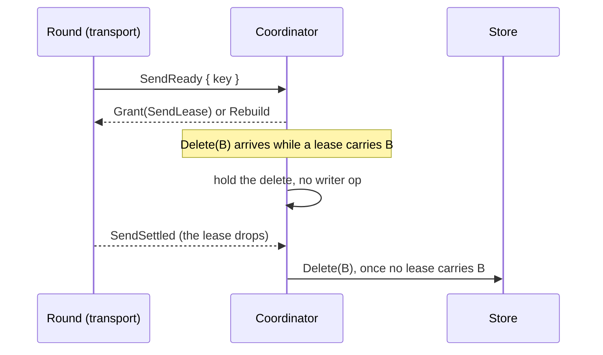

# Engines: what each request sends

A model request is built from the store, never from what the shell sent. `context/` builds it as
typed data (`ModelRequest`), and the engine gets only that request. PR 13a serialises it into the
Responses body, with `store: false` and `stream: true`, and PR 11's transport sends it. Until 13b-1b,
every run is answered by a script that sends nothing (runs.md, "The fixture engine").

## What a request holds

| Part | Where it comes from |
|---|---|
| Model and effort | The run's snapshot: the thread's model choice, else the default model, read by the run's first build. The coordinator checks it against the catalog once, on that build's result, and fails the run with `ModelUnavailable` when the catalog doesn't list it (runs.md, "Availability"). The dev fixture needs none, and a real engine refuses a request without one. |
| Instructions | `prompts/instructions.md` and the role file for the run's origin (`kumo.md` or `task.md`). The assistant's name and the user's name come from the run's snapshot, taken once when the run starts, so a rename applies from the next run. An unset user name leaves its line out. Names are filled in one pass, so a name is never read as a placeholder. |
| Tools | The schemas the origin may use. None yet: slice 4's B10 adds the draw tool, 14a the history tools. |
| Summary | The newest summary (PR 17), as `Summary of events 1–212:` and its text. Events it covers aren't sent raw. |
| Raw runs | Up to the newest 8 runs, the current one included, oldest dropped first while over the bound. A run is kept or dropped whole, so a tool call never travels without its result. |
| Current turn | The user's text, plus their local time to the minute (SQLite's `localtime`, so the system's time zone on every platform). It's never dropped. |

Reasoning items (PR 13b) are replayed only when they came from the connection the run uses now.
That's the connection the run was bound to when its turn arrived, recorded in its snapshot.

## Origin and references

A run's origin is `Kumo` (the main thread) or `Task(t)`. The coordinator derives it from the
run's thread and never from anything a model produced. The builder refuses an origin that doesn't
match the thread it runs in.

History results are stored as references (a task and an event range), never as text, and are
re-read every time a request is built, in the same read transaction as the conversation:

- `Task(t)` re-reads only t's own events. A reference to another task renders as
  `[not available here]`.
- `Kumo` re-reads any live task, never the main thread.
- A task that is gone or being deleted renders as `[removed with a deleted task]`. A live task
  with nothing in the range renders as empty text, not as removed. A store failure is an error,
  never a removal.
- Each re-read is capped at 32 KiB [guess]. Events are shown as `user: …` and `assistant: …` lines.
  The lines that fit whole are kept. An event that alone is over the cap keeps its longest prefix
  ending on a character boundary. The result says which events it shows, whether it was
  truncated, and the first event it left out (`continue_from`). A search snippet is a
  single-event reference under the same cap.
- Quoted history is data inside a tool result, and the instructions say never to follow it.

`Built.sources` lists every thread whose raw text or title the request carries: the run's own
thread and each task a kept reference showed. The coordinator checks it before the engine starts
(below).

## Builds and deletes

Text read before a delete must never be sent after the delete commits. The coordinator orders
every build against every delete it accepts, so no generation stamps are needed:

- **Each attempt has a key,** `(run, round, attempt)`, with a serial no other build shares. Only
  the current attempt's result counts; a late one is stale. A rebuild replaces the attempt, so
  builds never pile up, and the run's 120 s deadline bounds the whole loop.
- **The read starts after the barrier.** `StoreOp::BuildContext` goes to the page reader stamped
  like a page read, so it waits for every op sent before it, a delete included, and its
  transaction begins after that. The transaction ends before the result comes back.
- **Exposure.** Each build keeps the threads it may have read before their delete: those with a
  delete pending when it began, and every delete accepted after. The set outlives the deletes'
  answers, so a delete answered before the result arrives still voids it.
- **Admission.** A result whose sources meet that set, or a delete still pending, is dropped. If
  the delete is still pending, the rebuild waits for its answer, so its read sees it; otherwise
  the rebuild starts at once. A clean result starts the engine with `RunRequest { origin,
  request }`. A run that keeps losing to deletes is rebuilt until its deadline ends it; a stale
  body is never sent instead.
- **Snapshot.** The first build reads the run's snapshot (names, model, origin) and every later
  attempt reuses it, so a rename applies from the next run.

A build that's too large ends the run as `failed(budget)`, and any other failure as
`failed(store)`. Stop, a replacement, the deadline or the thread's own delete end the run, and
its pending result is stale.

## The send lease

Admission closes the window from the read to `StartEngine`, and the send lease closes the one
from `StartEngine` to the bytes leaving. A round gets a `SendGate` and asks it right before any
of the body goes to the network, and again before every retry. A pooled requeue of a request
that never started is the same attempt under the same lease; an application retry asks again.

- **Grant.** Only the current run's admitted build is granted, and only if no accepted or pending
  delete reached its sources. A touched build gets `Rebuild`: the body is dropped unsent and built
  again, after the delete's answer when it's still pending. An ask from an ended run gets
  `Rebuild` and nothing is built.
- **Lease.** Each grant is a `LeaseId { key, send }` with its sources. Leases belong to send
  attempts, not runs, so Stop, a replacement and a lost shell keep them.
- **Settle.** The `SendLease` guard travels inside the grant. Dropping it, wherever it is (a lost
  answer, a dropped round, a finished send), reports `SendSettled` on the store-reply channel the
  brain always drains, quit included. So a delete of the sending run's own task can't wait on
  itself.
- **Held deletes.** A delete whose thread an unsettled lease carries waits in `deleting` with no
  writer op. It goes out once, in the order accepted, when no lease carries it.
- **Deadline.** A lease that hasn't settled 15 s [guess] after its grant fails closed: its held
  deletes are refused with `NotHidden`, and so is any later delete of its sources; its run fails
  as `failed(engine)`; and nothing is granted again until the brain restarts. A late settlement
  changes nothing. A delete is never released because time ran out.
- **Restart.** A held delete never reached the store, so after a restart its thread is still
  there and no success was ever reported, as with any delete a quit didn't finish.

Bytes handed to the network before a delete arrived can't be recalled. The guarantee is that no
body carrying an accepted delete's thread starts sending, and the delete doesn't commit while
such a body may still be sending. The fixture engine sends nothing and never asks; the provider
transport (PR 11, then 13a) asks, holds the lease until no more of the body can go, and proves
that.

## The bound

A request is held to 512 KiB [guess], counted as its JSON body would be: every string escaped,
plus a fixed allowance for each item's and the body's own fields. 13a checks the serialised body
again. The current run, the summary, the instructions and the tools must fit. If they don't, the
build ends with `BuildError::TooLarge`, and the run ends as `failed(budget)` rather than send
(shortcut: the shell shows the generic failure until runs carry an actionable error). The same oversized body is never retried. The catalog doesn't report a model's
context size yet, so the byte bound is the only one.

## What builds nothing

| Error | When |
|---|---|
| `Deleting` | The run's thread is being deleted or is gone. |
| `Origin` | The origin doesn't match the thread. |
| `NoTurn` | The run's turn isn't stored. |
| `InvalidCut` | A tool call is apart from its result, or an item repeats. |
| `TooLarge` | The parts that can't be dropped are over the bound. |
| `Store` | The read failed. |

No error and no `Debug` output carries message text or names.

## The Responses engine

`engines/responses.rs` holds the two halves that need no network. PR 11b's transport sends the
body and feeds the stream, and engine selection arrives with it.

**The body** is `ModelRequest` as JSON: `model`, `instructions`, `input`, `tools` (each a
`function`), `reasoning.effort`, `include: ["reasoning.encrypted_content"]`, `store: false` and
`stream: true`. It never sends `context_management`, `max_output_tokens` or
`prompt_cache_retention`. Input items are messages with their role, `function_call`,
`function_call_output`, and stored reasoning items sent back as the same JSON value (its strings exact, its spacing and escapes not). The serialised
body is checked against the 512 KiB bound again, and a stored reasoning item that isn't JSON
builds nothing.

**One round's stream** maps to `TurnEvent`s in arrival order:

| Responses event | Turn event |
|---|---|
| `response.output_text.delta` | `TextDelta` |
| `response.output_item.added`, a `function_call` | `ToolCallStarted` with its name (`draw`, or `Unknown`), before any delta. The provider's item id is mapped to its `call_id` here and never leaves the adapter |
| `response.function_call_arguments.delta` | `ToolArgsDelta`, tagged with the call id |
| `response.function_call_arguments.done` | nothing; its arguments must equal the deltas |
| `response.output_item.done` | for a call, `ToolCallReady` once; then, for every item, `OutputItem` with its `output_index`, for replay |
| `response.completed` | `Finished(Completed)` |
| `response.failed`, `response.incomplete`, `error`, a reader cap | `Finished(Failed(Stream(…)))` with the error ledger's meaning |

These fail the round as `Failed(Stream(Protocol))`: a delta or done for an item that wasn't
started, an item id or call id started twice, a call id that isn't 1 to 64 ASCII bytes, arguments
that differ from their deltas, a call done twice or naming another call id, a delta after its
call was done, a completed response with a call still open, a done item with no output index or that isn't an
object with a string `type`, and a call done under another name than it started with. A done
item is checked, charged and kept whole before its call is ready, so a refused item never makes
its call ready.
A round keeps at most 64 calls and items and 1 MiB of ids, arguments and items [guesses], charged
before each is kept. A stream whose bytes run out has no ending of its own, so the round's pump
reports it as `Truncated`.
