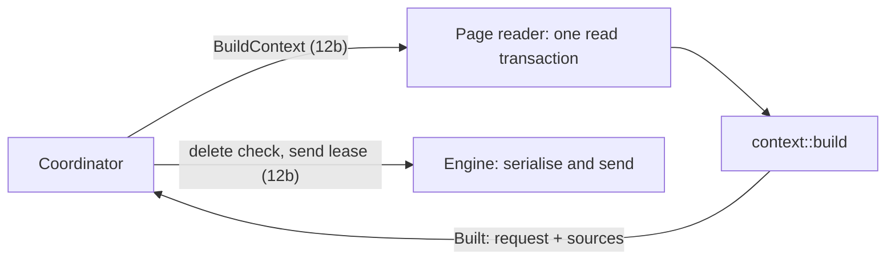

# Engines: what each request sends

A model request is built from the store, never from what the shell sent. `context/` builds it as
typed data (`ModelRequest`). PR 13a serialises that data into the Responses body, with
`store: false` and `stream: true`, and PR 11's transport sends it. Until PR 12b wires the builder
into the coordinator, nothing calls it and the fixture engine sends nothing.

## What a request holds

| Part | Where it comes from |
|---|---|
| Model and effort | The run's snapshot of the thread's model choice. |
| Instructions | `prompts/instructions.md` and the role file for the run's origin (`kumo.md` or `task.md`). The assistant's name and the user's name come from the run's snapshot, taken once when the run starts, so a rename applies from the next run. An unset user name leaves its line out. Names are filled in one pass, so a name is never read as a placeholder. |
| Tools | The schemas the origin may use. None yet: slice 4's B10 adds the draw tool, 14a the history tools. |
| Summary | The newest summary (PR 17), as `Summary of events 1–212:` and its text. Events it covers aren't sent raw. |
| Raw runs | Up to the newest 8 runs, the current one included, oldest dropped first while over the bound. A run is kept or dropped whole, so a tool call never travels without its result. |
| Current turn | The user's text, plus their local time. It's never dropped. |

Reasoning items (PR 13b) are replayed only when they came from the connection the run uses now.

## Origin and references

A run's origin is `Kumo` (the main thread) or `Task(t)`. The coordinator derives it from the
run's thread and never from anything a model produced. The builder refuses an origin that doesn't
match the thread it runs in.

History results are stored as references (a task and an event range), never as text, and are
re-read every time a request is built, in the same read transaction as the conversation:

- `Task(t)` re-reads only t's own events. A reference to another task renders as
  `[not available here]`.
- `Kumo` re-reads any live task, never the main thread.
- A task that is gone or being deleted renders as `[removed with a deleted task]`. A live task
  with nothing in the range renders as empty text, not as removed. A store failure is an error,
  never a removal.
- Each re-read is capped at 32 KiB [guess]. Events are shown as `user: …` and `assistant: …` lines.
  The lines that fit whole are kept. An event that alone is over the cap keeps its longest prefix
  ending on a character boundary. The result says which events it shows, whether it was
  truncated, and the first event it left out (`continue_from`). A search snippet is a
  single-event reference under the same cap.
- Quoted history is data inside a tool result, and the instructions say never to follow it.

`Built.sources` lists every thread whose raw text the request carries: the run's own thread
and each task a kept reference showed text from. PR 12b's coordinator checks it against the
deletes it sent since the build began, and again when a send is about to start. See the recall
and deletion note in the Captain's drive for that contract.

## The bound

A request is held to 512 KiB [guess], counted as its JSON body would be: every string escaped,
plus a fixed allowance for each item's and the body's own fields. 13a checks the serialised body
again. The current run, the summary, the instructions and the tools must fit. If they don't, the
build ends with `BuildError::TooLarge`, and the run should end with the too-large error rather
than send. The same oversized body is never retried. The catalog doesn't report a model's
context size yet, so the byte bound is the only one.

## What builds nothing

| Error | When |
|---|---|
| `Deleting` | The run's thread is being deleted or is gone. |
| `Origin` | The origin doesn't match the thread. |
| `NoTurn` | The run's turn isn't stored. |
| `InvalidCut` | A tool call is apart from its result, or an item repeats. |
| `TooLarge` | The parts that can't be dropped are over the bound. |
| `Store` | The read failed. |

No error and no `Debug` output carries message text or names.

## The Responses engine

`engines/responses.rs` holds the two halves that need no network. PR 11b's transport sends the
body and feeds the stream, and engine selection arrives with it.

**The body** is `ModelRequest` as JSON: `model`, `instructions`, `input`, `tools` (each a
`function`), `reasoning.effort`, `include: ["reasoning.encrypted_content"]`, `store: false` and
`stream: true`. It never sends `context_management`, `max_output_tokens` or
`prompt_cache_retention`. Input items are messages with their role, `function_call`,
`function_call_output`, and stored reasoning items sent back as the same JSON value (its strings exact, its spacing and escapes not). The serialised
body is checked against the 512 KiB bound again, and a stored reasoning item that isn't JSON
builds nothing.

**One round's stream** maps to `TurnEvent`s in arrival order:

| Responses event | Turn event |
|---|---|
| `response.output_text.delta` | `TextDelta` |
| `response.output_item.added`, a `function_call` | `ToolCallStarted` with its name (`draw`, or `Unknown`), before any delta. The provider's item id is mapped to its `call_id` here and never leaves the adapter |
| `response.function_call_arguments.delta` | `ToolArgsDelta`, tagged with the call id |
| `response.function_call_arguments.done` | nothing; its arguments must equal the deltas |
| `response.output_item.done` | for a call, `ToolCallReady` once; then, for every item, `OutputItem` with its `output_index`, for replay |
| `response.completed` | `Finished(Completed)` |
| `response.failed`, `response.incomplete`, `error`, a reader cap | `Finished(Failed(Stream(…)))` with the error ledger's meaning |

These fail the round as `Failed(Stream(Protocol))`: a delta or done for an item that wasn't
started, an item id or call id started twice, a call id that isn't 1 to 64 ASCII bytes, arguments
that differ from their deltas, a call done twice or naming another call id, a delta after its
call was done, a completed response with a call still open, a done item with no output index or that isn't an
object with a string `type`, and a call done under another name than it started with. A done
item is checked, charged and kept whole before its call is ready, so a refused item never makes
its call ready.
A round keeps at most 64 calls and items and 1 MiB of ids, arguments and items [guesses], charged
before each is kept. A stream whose bytes run out has no ending of its own, so the round's pump
reports it as `Truncated`.
