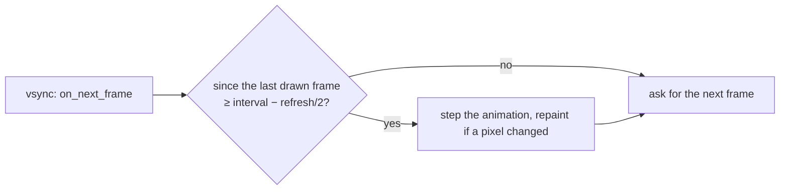

# Frame rate

Kumochi paces no animation of its own until the dock's peek returns one (B2b); when it does,
that animation draws no faster than the user's **Max frame rate** (Settings → General). A few of Kit's own animations run at the full
refresh; [Pacing](#pacing) lists them. The choices are Automatic (the default), 30, 60, 72, 120
and 144.
The code is `shell/src/presence/frame_rate.rs`; all of it is
cross-platform, reading the display's refresh through GPUI's `Window::refresh_interval`.

## The effective rate

A frame should wait the same whole number of refreshes every time, or the motion judders
between short and long frames. So the rate drawn is the refresh divided by the smallest whole
number that brings it to the cap or under. Automatic takes whichever of 60 and 72 comes out
higher, which is the one the refresh divides more evenly. Settings shows this rate. Between
73 and 119 Hz neither divides well, so Automatic draws at half the refresh or less (37.5 fps
at 75 Hz); pick a higher cap there.

| Refresh | Automatic | 30 | 60 | 72 | 120 | 144 |
|---|---|---|---|---|---|---|
| 60 Hz | 60 | 30 | 60 | 60 | 60 | 60 |
| 120 Hz | 60 | 30 | 60 | 60 | 120 | 120 |
| 144 Hz | 72 | 28.8 | 48 | 72 | 72 | 144 |
| 165 Hz | 55 | 27.5 | 55 | 55 | 82.5 | 82.5 |

Windows reports whole hertz, so a 59.94 Hz display reads as 59 or 60. A callback that reports
no refresh keeps the last one known. With none known at all, the cap itself is the rate (60
for Automatic) and the whole interval is the gap, so callbacks at any rate never beat the cap.

## Pacing

Frames still come from GPUI's `on_next_frame`, once per refresh, so pacing stays on vsync
with no timer. A frame that comes sooner than the effective interval less half a refresh
after the last drawn one only asks for the next frame: it steps nothing, so the dock isn't
invalidated and GPUI doesn't draw. GPUI may still present an undrawn frame for a second after
fast pointer input; the fixture runs below have none.

Half a refresh of slack keeps vsync jitter from adding or dropping a refresh at every
divisor. A fixed share such as 0.8 of the interval fails at five: at 144 Hz with a 30 cap,
0.8 × 34.7 ms lands exactly on the fourth refresh.

The cap and the refresh are read on every frame (a field read and a map lookup), so a new
setting or a move to another display applies on the next frame, with no window recreated.
Settings redraws its effective-rate line when its window's display or refresh changes, through
GPUI's `observe_window_display`, and its radio shows the newest choice while the brain saves it.

`Pacer` in `frame_rate.rs` owns this clock. Starting the loop starts it, so the first callback
always draws and steps only the time since the start, never a whole interval that hasn't passed.

A frame steps at most two effective intervals, so every cap moves in real time and a stall
(a debugger, a hung compositor) can't fling what it draws.

Kumochi's windows set `inactive_frame_interval: None`. They never activate, so GPUI's default
would throttle them to 30 fps, and nothing of theirs animates at rest.

Known limits: Kit animates some things through GPUI itself, at the full refresh and ignoring
the cap. They're short or occasional, so they're left until a profile shows them:
- the spinner on a waiting task (`thread_view.rs`);
- the Settings scrollbar's fade;
- the text caret, which notifies every 500 ms while an input has focus;
- input overscroll.

## The drawing overlay

The dock and the drawing overlay are separate windows with separate loops. The dock's animation
runs on presence's `FrameLoop`, as above. The overlay (`presence/overlay.rs`) has no loop yet:
its drawings rest, so it repaints once when a drawing appears, changes or clears, and arms no
`on_next_frame` callback. A resting drawing costs no frames. Moving drawings (B6) will ask a
loop of their own for frames, paced by the same Max frame rate, only while a scene view says
it is animating.
