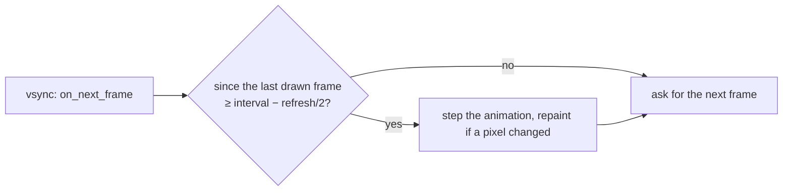

# Frame rate

Kumochi paces no animation of its own until the dock's peek returns one (B2b); when it does,
that animation draws no faster than the user's **Max frame rate** (Settings → General). A few of Kit's own animations run at the full
refresh; [Pacing](#pacing) lists them. The choices are Automatic (the default), 30, 60, 72, 120
and 144.
The code is `shell/src/presence/frame_rate.rs`; all of it is
cross-platform, reading the display's refresh through GPUI's `Window::refresh_interval`.

## The effective rate

A frame should wait the same whole number of refreshes every time, or the motion judders
between short and long frames. So the rate drawn is the refresh divided by the smallest whole
number that brings it to the cap or under. Automatic takes whichever of 60 and 72 comes out
higher, which is the one the refresh divides more evenly. Settings shows this rate. Between
73 and 119 Hz neither divides well, so Automatic draws at half the refresh or less (37.5 fps
at 75 Hz); pick a higher cap there.

| Refresh | Automatic | 30 | 60 | 72 | 120 | 144 |
|---|---|---|---|---|---|---|
| 60 Hz | 60 | 30 | 60 | 60 | 60 | 60 |
| 120 Hz | 60 | 30 | 60 | 60 | 120 | 120 |
| 144 Hz | 72 | 28.8 | 48 | 72 | 72 | 144 |
| 165 Hz | 55 | 27.5 | 55 | 55 | 82.5 | 82.5 |

Windows reports whole hertz, so a 59.94 Hz display reads as 59 or 60. A callback that reports
no refresh keeps the last one known. With none known at all, the cap itself is the rate (60
for Automatic) and the whole interval is the gap, so callbacks at any rate never beat the cap.

## Pacing

Frames still come from GPUI's `on_next_frame`, once per refresh, so pacing stays on vsync
with no timer. A frame that comes sooner than the effective interval less half a refresh
after the last drawn one only asks for the next frame: it steps nothing, so the dock isn't
invalidated and GPUI doesn't draw. GPUI may still present an undrawn frame for a second after
fast pointer input; the fixture runs below have none.

Half a refresh of slack keeps vsync jitter from adding or dropping a refresh at every
divisor. A fixed share such as 0.8 of the interval fails at five: at 144 Hz with a 30 cap,
0.8 × 34.7 ms lands exactly on the fourth refresh.

The cap and the refresh are read on every frame (a field read and a map lookup), so a new
setting or a move to another display applies on the next frame, with no window recreated.
Settings redraws its effective-rate line when its window's display or refresh changes, through
GPUI's `observe_window_display`, and its radio shows the newest choice while the brain saves it.

`Pacer` in `frame_rate.rs` owns this clock. Starting the loop starts it, so the first callback
always draws and steps only the time since the start, never a whole interval that hasn't passed.

A frame steps at most two effective intervals, so every cap moves in real time and a stall
(a debugger, a hung compositor) can't fling what it draws.

Kumochi's windows set `inactive_frame_interval: None`. They never activate, so GPUI's default
would throttle them to 30 fps, and nothing of theirs animates at rest.

Known limits: Kit animates some things through GPUI itself, at the full refresh and ignoring
the cap. They're short or occasional, so they're left until a profile shows them:
- the spinner on a waiting task (`thread_view.rs`);
- the Settings scrollbar's fade;
- the text caret, which notifies every 500 ms while an input has focus;
- input overscroll.

## The drawing overlay

Drawings and Kumo in the peek each have a `FrameLoop`, paced by the same cap. A drawing's
frames come from the dock's window, which peek, typing and Settings changes keep shown, and
Kumo's from the peek's window.
Windows sends a hidden window no `WM_PAINT`, so a frame callback armed on one waits until it's
shown again. The status panel hides whenever the peek closes or the typing panel or Settings is
open, so a drawing that took its frames from it stopped at its first sample (OSC-596). Kumo
shades nothing while the peek is hidden, so its frames can wait there. If the dock's placement
fails closed and hides it (presence.md, "The line and hit testing"), drawing frames wait too
until a position choice shows it again; nothing moves them to another window.

Each accepted drawing frame samples scene views at their own absolute clocks; the pacer's
capped delta never becomes a drawing's lifetime clock. Only changed samples invalidate the
overlay. Each loop idles when its client wants no motion. Unchanged frames do not refresh the
conversation panels.

A drawing's entrance starts at the overlay's first paint of its step, so a slow first paint,
such as a cold overlay window's, doesn't spend the entrance off screen. Until then the step's
first sample with something to paint is kept and drawing frames leave it as it is. When the
step's objects appear only later, after a delay, a word offset or a delayed parent, that sample
is taken at the first one's appearance even if its wake runs late, so it shows the object's
initial pose. Observing the paint begins the entrance and rearms the drawing's loop, which may
have rested meanwhile (scene.md, "Serialized activation and first-paint acknowledgement").
The exception is a step activated before its predecessor's first paint: the predecessor keeps
its staged clock, so it can first appear part-way through its entrance, and the paint begins
only the newer step's entrance. A first paint that never comes has no timeout; the 60-second
motion deadline bounds motion, not this wait.

Advance, retained-frame sampling, scene motion demand and future-wake selection use one
sampled Instant per owner update. The drawing's callback carries that sampled motion demand
through its final rest decision. A wake already due when its task registers runs immediately
to catch up the retained sample; a newer clock query cannot discard an unsampled boundary.
The final pose is sampled before the loop rests.

First visibility can require a fallback Stop when global Esc registration is refused. The
drawing's callback holds the dock's window, so the ordinary activity/escape/placement path
places the status panel through its own handle. Panel visibility commits only after
placement/configuration succeeds. A refusal ends the current drawing connection, cancels
preparation and scene wakes, disconnects its runs and empties the overlay through its existing
finite hide path; the original error still reaches the caller. Esc and Stop flags follow that
terminal activity without reattempting placement. The failed activity transition is not
retried by animation frames: the drawing's loop rests, and Kumo's separate loop is
unaffected. Run/conversation changes refresh the typing view separately from frame-only
activity changes, so a retained actionable notice is not cloned on each frame. Selection and
pull cancellation keep their existing precedence. No retry loop or per-frame defer is added.

A future scene start or delayed entrance at rest uses the existing scene watchdog task,
armed to the earliest preparation/recovery deadline or scene wake. While views animate,
the drawing's frame callback advances them instead of adding a second timer loop. Every
change recomputes demand; Stop, clear, disconnect and stale worker answers cannot restart
halted motion. A resting static drawing asks for no more frames.

Scene wakes are checked absolute additions to the adoption origin, not a fresh `now` plus
a rounded remaining duration. Fractional-millisecond samples therefore preserve the same
deadline and timer while Kumo moves. Overflow supplies no representable deadline and never
marks pending work complete; connection and deadline identities fence stale callbacks.

A first successful shown/nonempty paint requests one coalesced weak-owner defer, so its
acknowledgement does not depend on a later frame or input. This is not a presentation
timestamp. The one-off callback, effect-deque and control-queue allocations require measured
bounds separately from steady-state painting; unchanged paints never rearm the notification.
