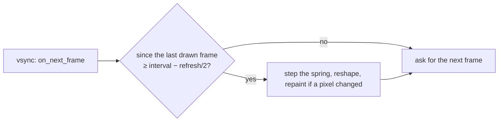

# Frame rate

The stretch is Kumochi's only animation, and it draws no faster than the user's **Max frame
rate** (Settings → General). The choices are Automatic (the default), 30, 60, 72, 120 and 144.
The code is `shell/src/presence/frame_rate.rs` and the stretch's `tick`; all of it is
cross-platform, reading the display's refresh through GPUI's `Window::refresh_interval`.

## The effective rate

A frame should wait the same whole number of refreshes every time, or the motion judders
between short and long frames. So the rate drawn is the refresh divided by the smallest whole
number that brings it to the cap or under. Automatic takes whichever of 60 and 72 comes out
higher, which is the one the refresh divides more evenly. Settings shows this rate. Between
73 and 119 Hz neither divides well, so Automatic draws at half the refresh or less (37.5 fps
at 75 Hz); pick a higher cap there.

| Refresh | Automatic | 30 | 60 | 72 | 120 | 144 |
|---|---|---|---|---|---|---|
| 60 Hz | 60 | 30 | 60 | 60 | 60 | 60 |
| 120 Hz | 60 | 30 | 60 | 60 | 120 | 120 |
| 144 Hz | 72 | 28.8 | 48 | 72 | 72 | 144 |
| 165 Hz | 55 | 27.5 | 55 | 55 | 82.5 | 82.5 |

Windows reports whole hertz, so a 59.94 Hz display reads as 59 or 60. With no refresh known,
the cap itself is the rate (60 for Automatic).

## Pacing

Frames still come from GPUI's `on_next_frame`, once per refresh, so pacing stays on vsync
with no timer. A frame that comes sooner than the effective interval less half a refresh
after the last drawn one only asks for the next frame: it steps nothing, so the dock isn't
invalidated and GPUI doesn't draw. GPUI may still present an undrawn frame for a second after
fast pointer input; the fixture runs below have none.

Half a refresh of slack keeps vsync jitter from adding or dropping a refresh at every
divisor. A fixed share such as 0.8 of the interval fails at five: at 144 Hz with a 30 cap,
0.8 × 34.7 ms lands exactly on the fourth refresh.

The cap and the refresh are read on every frame (a field read and a map lookup), so a new
setting or a move to another display applies on the next frame, with no window recreated.

The spring integrates in equal steps of at most 1/144 s, so the bulb moves alike at every
rate, and a frame gap steps at most 1/24 s, above every interval a 30 cap gives on a 48 Hz or
faster display.

Kumochi's windows set `inactive_frame_interval: None`. They never activate, so GPUI's default
would throttle them to 30 fps, and nothing of theirs animates at rest.

Known limit: the Kit spinner on a waiting task (`thread_view.rs`) animates through GPUI's own
`with_animation` at the full refresh and ignores the cap; cap it if it shows up in a profile.
