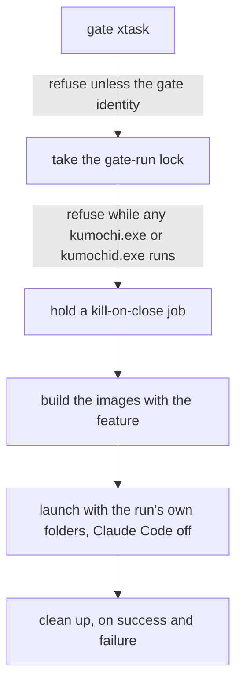

# The gate identity

The gate tools (`cold-start`, `gate-session`, `hover-gate`, `bench idle` and `slice2-gate`) start real
Kumochi processes on the developer's machine. A throwaway `%LOCALAPPDATA%` isolates files only:
anything named by the product identity (the pipes, the instance capability, Credential Manager
names and the folder the system reports for Local AppData) follows the build, not the environment.
So these tools run a third identity, `Kumochi Gate`, chosen when the binaries are built, and
never the installed `Kumochi` or the developer's `Kumochi Dev`.

## The three identities

| | Release build | Debug build | Gate build |
|---|---|---|---|
| Data and settings folder | `Kumochi` | `Kumochi Dev` | `Kumochi Gate` |
| Credential service | `Kumochi` | `Kumochi Dev` | `Kumochi Gate` |
| Instance service | `Kumochi instance` | `Kumochi Dev instance` | `Kumochi Gate instance` |
| Pipe and mutex prefix | `kumochi` | `kumochi-dev` | `kumochi-gate` |

- `kumochi-protocol`'s `gate-identity` feature selects `ProductIdentity::GATE` as `ACTIVE` in either
  profile. With it off, every constant is what it was, so nothing a user runs changes.
- The feature is enabled on the command line only: never in a manifest, as a default, or by another
  crate. If a manifest enabled it, feature unification would turn it on for every workspace build,
  and a plain `cargo build --release` would ship the gate names, moving users' data, credentials
  and pipes. `identities_preserve_stored_names_and_profile_aliases` asserts that `ACTIVE` is Dev or
  Release with no feature check, so CI's `cargo test --workspace` fails if a manifest or
  `--all-features` turns it on.
- A gate build is never shipped. There's no packaging task yet; the one that comes must refuse the
  gate identity. The brain and the shell log their identity (the data folder's name) at start, and
  `cold-start` and `gate-session` write it into `identity.txt`.

## Starting a gate tool

Each tool refuses unless it was itself built with the feature:

```bash
cargo run --release --package xtask --features kumochi-protocol/gate-identity -- <task> [<arguments>]
```

`slice2-gate` builds a debug brain whatever xtask's profile, since only a debug brain plays
fixture scripts.

A tool builds the images it launches itself, right before it uses them, with the feature, into
`gate` beside its own profile folders (`<target>/gate/{debug,release}`), and launches nothing
from anywhere else. Cargo rebuilds an image there that was built without the feature. `bench idle
--baseline <checkout>` builds that source checkout the same way into `<target>/gate-baseline`; a
checkout from before the feature existed fails to build, so it can't launch a real identity.

The measured sessions want no build running while they measure, so build first and then run the
built xtask, whose own build is then only cargo's up-to-date check. Each tool records how long its
build took as `build_seconds=` (in `identity.txt`, or on bench's and slice2-gate's output); a
timed result whose build took more than a few seconds started on a busy machine:

```bash
cargo build --release --package xtask --features kumochi-protocol/gate-identity
cargo build --release --package kumochi-shell --package kumochi-brain \
  --features kumochi-protocol/gate-identity --target-dir target/gate
./target/release/xtask.exe gate-session "$transcript"
```

## What a run does



1. **One at a time, in a new folder.** A run holds an exclusive lock on
   `kumochi-gate-run.lock` in the system's Local AppData (beside, never inside, `Kumochi Gate`)
   until it ends, and refuses while any `kumochi.exe` or `kumochid.exe` runs, of any identity. Two gate runs
   would share the gate pipes, and the shell's hotkey, raw input and tray icon belong to the
   Windows session, not the identity.
2. **Nothing outlives it.** The run puts itself in a kill-on-close job that forbids breakaway, so a
   shell a brain relaunches, or a brain a shell starts, ends with the run.
3. **Its own folders.** Every launch gets its own `%LOCALAPPDATA%` and `%APPDATA%` under the run's
   folder, and `%APPDATA%\Kumochi Gate\config.toml` says `[claude_code] enabled = false`, so the
   brain runs no `claude.exe` and reads no Claude Code policy. It also says `onboarded = true`: a
   gate launch isn't a first-run test, and onboarding's window would take the foreground. The brain logs `Claude Code
   setting enabled=false` at start, so the run's own brain log shows it.
4. **Cleanup.** At the end, success or failure, and only once no product process is left, the run:
   - reads each launch's own `credentials.db` and deletes the `Kumochi Gate/gen/<kind>/<generation>/<n>`
     names (chunks 0 to 63) of every generation recorded there, then, after a success, that
     launch's folders. A failed run keeps its folders, with the product logs, until the next run.
     It never deletes by prefix or wildcard, and never an entry it can't match to its own run. A
     launch whose authority can't be read keeps its folders and entries, and the run fails naming it;
   - deletes `capability-<session>.Kumochi Gate instance` by its exact name;
   - deletes `Kumochi Gate` in the system's Local AppData, which holds the Claude Code lane's lock.

A run creates its root folder, which must not exist yet, writes a new random run id into its
`gate-run` file, and names both in the lock file, as one line ending in a newline, until it has
cleaned up. If a run is interrupted (Ctrl-C, a killed xtask, a panic, or a product process still
running at the end), the next gate run cleans up that folder as above before it starts, so
rerunning any gate tool clears an interrupted one. The instance entry and the real `Kumochi Gate`
folder go at the end of that next run. Recovery starts only when the lock's line is whole and the
folder's `gate-run` holds the same id. Anything else, such as a lock cut short or a folder without
that id, is refused with a message naming the lock and the folder, and then nothing is deleted. A
recovery that starts and then keeps a launch (its authority unreadable, or another identity's
folder in it) has already deleted the other launches and every readable launch's entries, and
names what it kept. To finish by hand: with no gate run on, any `Kumochi Gate/gen/...` entry in
Credential Manager is a gate run's leftover and may be deleted. Delete the kept launch folder, then
rerun without deleting the lock, which completes the recovery. Delete the lock only after a
refusal that names a folder no gate run made.

The gate identity never signs in: the `live` checks refuse anything but the dev identity, and no
gate tool has a path that stores a credential.

## What it still shares

- The pipes and the instance capability are named by identity and Windows session and ignore the
  environment. A gate brain can't meet a dev or release brain there, but two gate runs would, which
  is why one runs at a time.
- The `Kumochi Gate` folder in the system's Local AppData (the lane's lock, and staged speech
  natives after a speech load), until the run deletes it.
- Credential Manager as a store, under the gate's own names only.
- The installed `claude.exe` and the Claude Code policy reads, only if Claude Code were on; gate
  runs turn it off.
- The per-session hotkey, raw input and tray icon.

## What a gate result speaks for

A gate image is the shipped code apart from its names: the same profile, configuration and
`BUILD_ID`. But a gate run fixes three things that earlier measurements didn't:

- Claude Code is off. With no settings file, a brain runs `claude --version` and its sign-in
  status at start, so earlier numbers taken with fresh folders included that work, and `bench idle`'s
  process tree no longer holds `claude.exe`.
- The data is fresh. All launches of one run share one data folder, so `cold-start`'s first launch
  is the first start of a profile already marked onboarded (a new store and authority, the
  legacy-name sweep and a host write), not a first-ever run, and the other nine start on warm
  data. Onboarding's own start cost is unmeasured. With ten launches, p95 is the maximum, so the first launch can
  decide it.
- `--baseline` builds that checkout's source with the current toolchain and this workspace's cargo
  configuration. It compares code under identical tooling, not the binary that shipped, and it
  can't build a commit from before the gate identity existed.

## Other systems

The gate tools are Windows-only today. A macOS port needs every stored name (the Application
Support folder, Keychain services, socket and lock names) taken from `ProductIdentity::ACTIVE`,
with the trusted root from the account record rather than `$HOME`; a per-launch data-root
override, since macOS has no `LOCALAPPDATA` and moving `HOME` would move the trusted root; and,
for the run itself, a Keychain delete by service and account, a process check, a kill-on-exit
process group and the lock.
