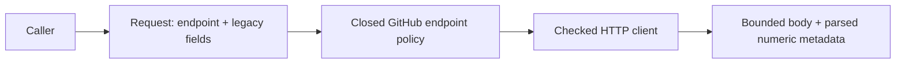
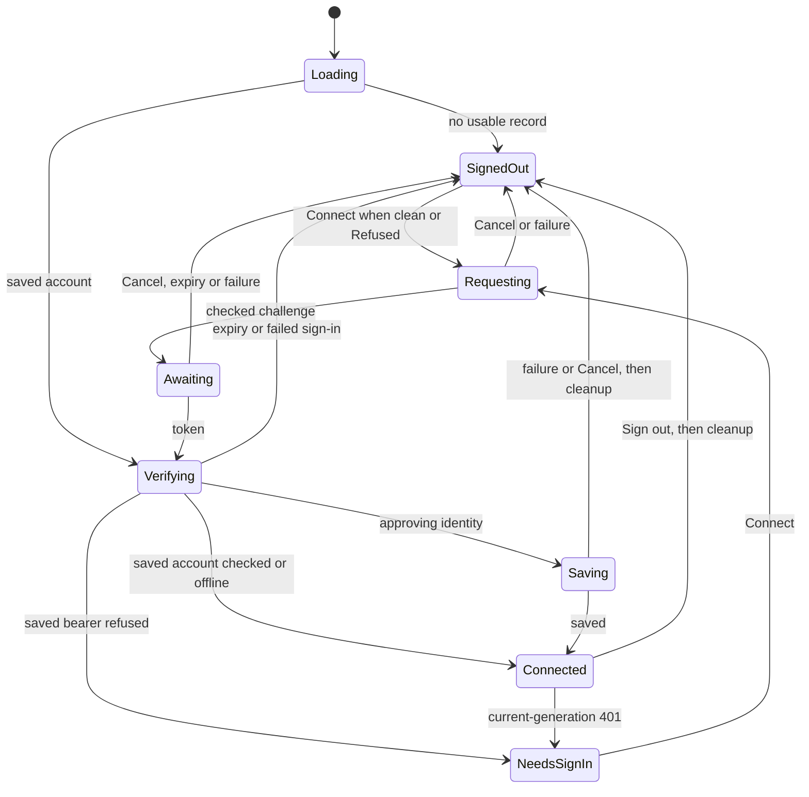

# GitHub

## Shell snapshots

The shell retains session-tagged GitHub snapshots in Settings. Replacement and
disconnect clear them; stale-session snapshots do not change them. Each accepted
scope transition replaces a strong origin identity before observers run, so a
batched loss and return cannot revive an earlier intent. Identical snapshots and
truncation-only changes preserve that identity. Current repository membership
must still be checked at activation, without treating a truncated list as proof
that an unlisted repository is available.

Live GitHub connection controls receive a fixed, tagged unavailable error. It
reaches the current session's retained GitHub error state without inventing a
connection snapshot or changing generic Accounts errors. An error followed by
its authoritative view retains the error; a later superseding view may clear it.
Offline controls leave no reply owed to a replacement session. Full or closed
control output ends the live connection instead of retrying the refusal.

This is state delivery, not visible Settings behavior: connection controls and
issue filing have no enabled production UI. No runtime GitHub owner, credential
job, sign-in or network effect is activated. Verified numeric account authority
and Store admission remain prerequisites for a future consent receiver.

## The checked HTTP boundary

GitHub uses the account HTTP client: manual OS trust roots, HTTPS, no proxies, no
redirects and no automatic retries. Its raw reqwest client stays inside
`connections/http_client.rs`. `connections/github` owns checked, transient endpoint
inputs, not a connection session, credential lookup or persistent state.

Two client rules cover every account call, not only GitHub's. Retries are pinned
off with `retry::never()`, which is inert while the build has no HTTP/2 or HTTP/3
and keeps a create from being resent if that changes. A failure while reading a
body is Timeout or Transport, never Connect, because account classification reads
Connect as "nothing was sent, so no tokens were issued". Bearer headers are built
in a wiped buffer and marked sensitive.

Each endpoint owns its credentials and payload, so methods and authentication
cannot be mixed independently. Device endpoints accept only their typed form
inputs and have no bearer. REST requests use the fixed product User-Agent,
`application/vnd.github+json`, API version `2026-03-10` and a checked `ghu_` bearer.
Only issue creation carries JSON. Nonempty legacy form fields are refused.
Every constructed GitHub URL is checked again for its exact host and path,
HTTPS/443 and absence of userinfo or fragments. Installation, repository and issue pages fix
`per_page=100`; page numbers are restricted to one or two. Link URLs aren't used.

The transport collects at most 4 KiB for device replies, 64 KiB for `/user`, and
1 MiB for other REST replies. The 1 MiB limit applies even to a page of 100 large
issues: a future preflight must fail without sending if the page exceeds it, and
a post-send lookup must remain Unknown. Never raise this cap or omit malformed
rows to make a lookup appear complete. The API layer applies these caps again to
injected `Http` responses; the issue layer also bounds both match pages together.

`ResponseMeta` retains only parsed Date, Retry-After and rate-window numbers.
Duplicate, oversized, malformed and overflowing headers become absent, not zero.
HTTP-date Retry-After requires a valid server Date; no local-clock replacement
is made. Issue-create 4xx replies keep their definite status and metadata without
reading diagnostic bodies. Body failures after headers never become Connect.
Per-request deadlines include the response body: 15 seconds for device, user,
installation-page and repository-page calls, 30 seconds for create and issue-page calls.

Create-outcome classification and two-page exact matching belong to the
`github/issues.rs` layer. The account layer owns polling, account
generations and repository aggregation, including a total installation traversal
bound; a two-page limit on each list alone does not bound that traversal.

Public contracts pinned for this policy:
[device flow](https://docs.github.com/en/apps/creating-github-apps/authenticating-with-a-github-app/generating-a-user-access-token-for-a-github-app#using-the-device-flow-to-generate-a-user-access-token),
[repository issues](https://docs.github.com/en/rest/issues/issues?apiVersion=2026-03-10),
and [user installations and repositories](https://docs.github.com/en/rest/apps/installations?apiVersion=2026-03-10).

## Typed device and account reads

`connections/github/api.rs` provides five stateless calls: request a device code,
poll once for a token, read the user, and read one installation or repository page.
Each injected `Http` future has an outer Tokio deadline equal to its transport
deadline, 15 seconds for these calls. Dropping the
API future drops the request future; no task or retry survives its caller.
The account layer owns polling intervals, attempt generations, persistence and sign-out.

Parsers reuse each endpoint's transport limit, so scripted clients get it too:
4 KiB for device/token responses, 64 KiB for the user, and 1 MiB for installation
and repository pages. A non-success status is refused before the size check, so a
known 4xx with a huge body stays definite. Trailing data after the document fails.
Known duplicate fields, invalid identifiers, missing or mistyped required values,
and pages over 100 rows fail closed; unknown fields are ignored. These calls do
not follow Link headers or aggregate across pages or installations.

Device replies must name the fixed verification page, contain a checked user
code, and have positive lifetimes and intervals no greater than 900 seconds.
Only a missing interval defaults to five seconds; null and malformed values fail.
Token replies return a checked `ghu_` bearer whose `token_type` is exactly
`bearer`, or a closed device-flow refusal when a 200 carries `error` and no token.
Refresh credentials are parsed only as bounded zeroizing strings and then refused
as `RefreshUnsupported`. Expiry fields without a refresh token are refused too,
so an expiring sign-in cannot silently become a non-expiring one.

`ApiError` retains only closed kinds, numeric status and parsed metadata. Its
shared definite-reason classification treats pre-dispatch/connect refusals as
Network and known 4xx responses as definite; throttled 403 and 429 are RateLimited.
An unusable but present Retry-After still makes 403 RateLimited, without inventing
retry advice. API refusals cap usable Retry-After advice to one hour (3,600 seconds).
Timeout, transport loss, redirects, malformed success and unexpected non-4xx
statuses remain uncertain. Hand-written Debug never prints credentials, user
codes, logins, repository names or provider text. These layers add no runtime caller.

## Single-attempt issue creation and exact matching

`connections/github/issues.rs` borrows checked `IssueTitle` and `IssueBody` through
`IssueContent`. Only that content can construct the private-field `IssuePayload`
used by the public create endpoint. Serialization writes just title and body into
a zeroizing buffer; arbitrary bytes and additional issue fields have no constructor.
`create_issue` makes one HTTP call under a 30-second outer deadline, with no retry.
Created requires a 201, a positive issue number and the exact canonical URL built
from the requested repository and number. Malformed or oversized 201 replies,
foreign URLs, unexpected non-4xx statuses and post-dispatch transport failures
are Uncertain. Pre-dispatch refusals and Connect are definite Network failures.
Known 4xx responses use the shared closed reason table and retain only numeric
status and parsed metadata, with usable retry advice capped at one hour.
`rate_reset_s` stays uncapped as absolute timestamp data; this layer derives no wait from it.

`list_matches` makes at most two GETs under one shared 30-second deadline. It
compares remote title/body exactly, without applying local authoring normalization
or bounds. A null body compares as empty; any `pull_request` field, even null,
excludes that row. Missing, mistyped, duplicate or malformed known fields, invalid
timestamps, duplicate issue numbers and pages over 100 rows fail the whole lookup.
Returned candidates contain only checked numbers, locally built URLs and creation
seconds, plus unchanged page-one metadata. A full second page is incomplete even
when every row was filtered out; no Link or third page is followed.

Parser-entry caps enforce 1 MiB even for injected clients. A large remote page
therefore fails the lookup that runs before a create, so nothing is sent, or
leaves the lookup after a send Unknown; callers must require completeness.
Dropping either API future drops its active request future. No task survives
cancellation. The action coordinator owns consent, durable admission, pre-send
exclusions, generation checks and placement; this layer never resends or
substitutes the local clock for missing server evidence.

## Device sign-in machine

The sans-I/O device machine owns one attempt and one connection generation.
It emits work rather than starting requests, timers, browser launches or
credential jobs. The runtime adapter must supply completions with their original
generation stamp, which identifies both an attempt and its connection. A changed
stamp, expired deadline or terminal state
makes a late completion inert. Sign out advances the shared generation before
emitting cancellation and serialized removal, so token consumers can fence
their final dispatch. The adapter must preserve queued saves when their result
receiver closes, and drain removal behind them. Cancel or expiry during a save also
queues removal, because that write may already have passed its fence check.

The first poll waits the code reply's interval. Each pending reply schedules
another wait; slow_down increases the interval by five seconds, takes the larger
of that and the reply's interval, and caps it at 900 seconds. The attempt ends
at its expiry even when a poll or identity read is outstanding. The API accepts
device error bodies on 200 and RFC 8628's 400; only 200 can yield a bearer.
The optional reply interval must be an integer from 1 to 900; null, duplicates
and out-of-range values refuse the whole reply, including a token reply.
Unknown codes and malformed replies end the attempt. Expiring token shapes
remain unsupported. No retry wait is derived from REST rate metadata.

The approving identity is read before saving. During interactive sign-in, only a
successful save produces Connected. Startup checks a loaded bearer with the same
user endpoint; a 401 drops it and shows NeedsSignIn. Cleanup outcomes remain signed
out, including
a failed durable removal. A clean SignedOut view has no cleanup warning. Connect
is also permitted after a refused physical delete, because durable removal has
already fenced the old credential; Running and NotDurable still block it.
Repository defaults are displayed and accepted only by exact membership in the
fetched list, preserving GitHub's spelling. `user()` returns the connected identity,
including persisted fallback after a genuine startup API failure, without its
bearer; issue admission takes the numeric id from it, never from a login, and
still requires fetched membership.

The verification page is the protocol's VERIFICATION_URI constant. The API
checks the reply against it; neither the view nor a brain effect carries a
provider-supplied URL. The machine and protocol are separate from the runtime
credential adapter and the connection UI. The connection UI's Open GitHub action
and browser-opening behavior belong to the shell layer, not this machine.

## Credential authority and lane

Accounts owns a dormant device-machine adapter on the existing credential lane.
Its production startup, effect dispatch and snapshot publication are explicitly
disabled; the live GitHub control receiver still returns the tagged unavailable
error. Ordinary account startup and its existing vault sweeps are unchanged.
There is no enabled GitHub sign-in, default executor, consent receiver or UI.

The admitted offline fixture path loads only after the account worker opens its
vault. Unavailable admission, a closed reply or an unavailable vault leaves the
machine Loading, with no successful SignedOut snapshot. A genuine empty load and
the exact cleanup outcome remain distinct. Loading is queried from the machine,
not copied into another loaded flag. Credential-only admission stops at an owned,
original-stamp ReadUser effect and never constructs HTTP. A separate production-off
verification policy can execute that effect through the existing fixed user API;
enabling it does not replay previously suspended work. Device authorization,
repository, default and wake effects remain suspended with their original identity.

One verification operation owns its client-construction or user-request handle,
original stamp and load-origin session. Its token stays outside the blocking
factory closure. The event loop joins the stored handle directly and retains
operation identity until disposition. An already joined completion may be retired
by cancellation; its later event is inert. A canceled construction is
joined; a canceled request is aborted and joined. An old event cannot replace a
new operation, and a retiring operation cannot be overwritten. The shared fence
is checked inside the request task before the API is first polled.

A real successful response supplies the current numeric identity without resaving
an already durable account. A real 401 means NeedsSignIn. Other genuine API/factory
failures retain the existing persisted-identity fallback and closed error; that is
not fresh verification or fetched repository authority. Cancellation and task
failure never manufacture API transport failure or Connected fallback. Lifecycle
loss leaves the machine unverified, without an implicit retry or a logged panic
payload. Current authority may reach a replacement, but errors require the
matching nonempty load-origin session. Loaded verification survives ordinary EOF.

Save and Remove enter the existing FIFO before any view/error is delivered.
Interactive cancellation clears suspended work, not admitted credential jobs or
their reply settlement. Shell loss cancels an attempt rather than signing out an
already connected account. A replacement gets the current non-Loading view, not
an old error. Shutdown admits compensation before dropping the job sender, settles
credential replies and waits for the existing worker to release its vault lock,
then joins any remaining canceled verification before returning. A running client
factory is not made abortable by its handle; the API's 15-second request/body
deadline does not bound construction or shutdown. No new wall-clock shutdown
guarantee is made.
The adapter borrows the sender and creates no second credential worker or account
cache. Numeric identity remains the machine's connected identity; fetched membership,
Store admission and separately reviewed activation remain prerequisites to filing.

GitHub records use the same credential thread, vault session lock and write-once
generation names as other accounts. The record contains only a checked `ghu_`
token, a checked login and a positive numeric user ID. JSON is limited to 2,048
bytes; unknown or duplicate fields fail closed. Jobs and replies have content-free
Debug output. A save checks the device machine's shared generation immediately
before writing. Closing its reply receiver never stops the credential thread or
discards a later removal; an admitted save finishes before that removal runs.

Authority schema v3 adds the `github` head. Upgrades rebuild only `heads`, with
foreign keys disabled before the transaction and checked before commit, then
enabled again. Existing generations and indexes are retained. Older binaries
refuse the whole v3 authority, including other accounts; they do not delete it.
Live testing must isolate application data and coordinate the credential service
instead of migrating an existing Dev authority silently.

Remove first commits durable retirement, then deletes the retired generation's
names. Load cleans retired GitHub rows without retiring a valid active record.
Explicit cleanup queries every removed GitHub row, including deletions attempted
in this process, so a refused delete can be retried immediately. Physical absence
is reported as clean, but the authority marks a row Swept only after another
process lifetime confirms absence. A failed retirement commit is NotDurable;
remaining names are Refused.

A whole malformed or oversized record is retired and cleaned. A failed or
missing chunk read instead refuses the load and leaves the active generation
unchanged, because a transient credential-store glitch is not sign-out. A vault
that could not open likewise returns a typed refusal. The runtime orchestration
and user-facing connection controls remain separate from this credential layer.
