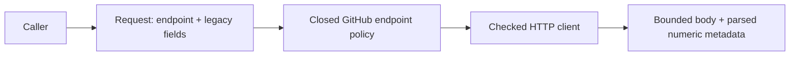

# GitHub

## The checked HTTP boundary

GitHub uses the account HTTP client: manual OS trust roots, HTTPS, no proxies, no
redirects and no automatic retries. Its raw reqwest client stays inside
`connections/http_client.rs`. `connections/github` owns checked, transient endpoint
inputs, not a connection session, credential lookup or persistent state.

Two client rules cover every account call, not only GitHub's. Retries are pinned
off with `retry::never()`, which is inert while the build has no HTTP/2 or HTTP/3
and keeps a create from being resent if that changes. A failure while reading a
body is Timeout or Transport, never Connect, because account classification reads
Connect as "nothing was sent, so no tokens were issued". Bearer headers are built
in a wiped buffer and marked sensitive.

Each endpoint owns its credentials and payload, so methods and authentication
cannot be mixed independently. Device endpoints accept only their typed form
inputs and have no bearer. REST requests use the fixed product User-Agent,
`application/vnd.github+json`, API version `2026-03-10` and a checked `ghu_` bearer.
Only issue creation carries JSON. Nonempty legacy form fields are refused.
Every constructed GitHub URL is checked again for its exact host and path,
HTTPS/443 and absence of userinfo or fragments. Installation, repository and issue pages fix
`per_page=100`; page numbers are restricted to one or two. Link URLs aren't used.

The transport collects at most 4 KiB for device replies, 64 KiB for `/user`, and
1 MiB for other REST replies. The 1 MiB limit applies even to a page of 100 large
issues: a future preflight must fail without sending if the page exceeds it, and
a post-send lookup must remain Unknown. Never raise this cap or omit malformed
rows to make a lookup appear complete. The API layer applies these caps again to
injected `Http` responses; the issue layer must also bound both match pages together.

`ResponseMeta` retains only parsed Date, Retry-After and rate-window numbers.
Duplicate, oversized, malformed and overflowing headers become absent, not zero.
HTTP-date Retry-After requires a valid server Date; no local-clock replacement
is made. Issue-create 4xx replies keep their definite status and metadata without
reading diagnostic bodies. Body failures after headers never become Connect.
Per-request deadlines include the response body: 15 seconds for device, user,
installation-page and repository-page calls, 30 seconds for create and issue-page calls.

Create-outcome classification and two-page exact matching belong to a later
`github/issues.rs` layer. The account layer owns polling, account
generations and repository aggregation, including a total installation traversal
bound; a two-page limit on each list alone does not bound that traversal.

Public contracts pinned for this policy:
[device flow](https://docs.github.com/en/apps/creating-github-apps/authenticating-with-a-github-app/generating-a-user-access-token-for-a-github-app#using-the-device-flow-to-generate-a-user-access-token),
[repository issues](https://docs.github.com/en/rest/issues/issues?apiVersion=2026-03-10),
and [user installations and repositories](https://docs.github.com/en/rest/apps/installations?apiVersion=2026-03-10).

## Typed device and account reads

`connections/github/api.rs` provides five stateless calls: request a device code,
poll once for a token, read the user, and read one installation or repository page.
Each injected `Http` future has an outer Tokio deadline equal to its transport
deadline, 15 seconds for these calls. Dropping the
API future drops the request future; no task or retry survives its caller.
The account layer owns polling intervals, attempt generations, persistence and sign-out.

Parsers reuse each endpoint's transport limit, so scripted clients get it too:
4 KiB for device/token responses, 64 KiB for the user, and 1 MiB for installation
and repository pages. A non-success status is refused before the size check, so a
known 4xx with a huge body stays definite. Trailing data after the document fails.
Known duplicate fields, invalid identifiers, missing or mistyped required values,
and pages over 100 rows fail closed; unknown fields are ignored. These calls do
not follow Link headers or aggregate across pages or installations.

Device replies must name the fixed verification page, contain a checked user
code, and have positive lifetimes and intervals no greater than 900 seconds.
Only a missing interval defaults to five seconds; null and malformed values fail.
Token replies return a checked `ghu_` bearer whose `token_type` is exactly
`bearer`, or a closed device-flow refusal when a 200 carries `error` and no token.
Refresh credentials are parsed only as bounded zeroizing strings and then refused
as `RefreshUnsupported`. Expiry fields without a refresh token are refused too,
so an expiring sign-in cannot silently become a non-expiring one.

`ApiError` retains only closed kinds, numeric status and parsed metadata. Its
shared definite-reason classification treats pre-dispatch/connect refusals as
Network and known 4xx responses as definite; throttled 403 and 429 are RateLimited.
An unusable but present Retry-After still makes 403 RateLimited, without inventing
retry advice. API refusals cap usable Retry-After advice to one hour (3,600 seconds).
Timeout, transport loss, redirects, malformed success and unexpected non-4xx
statuses remain uncertain. Hand-written Debug never prints credentials, user
codes, logins, repository names or provider text. Issue posting and matching are
a later `github/issues.rs` layer and add no caller here.
