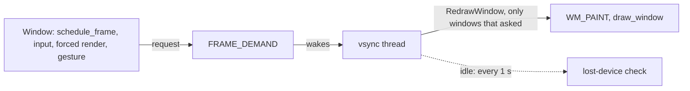

# The GPUI Windows patch

Kumochi carries GPUI's Windows backend, `gpui-pre-windows` 0.3.10, in `vendor/gpui-pre-windows/`
with three changes: an idle window no longer wakes on every vblank, a window opened hidden
takes its requested size at once, and a single fast successful vsync wait doesn't skip a frame.
`[patch.crates-io]` in
`Cargo.toml` points the crate at the vendored copy, and `cargo xtask check-vendor` (run by CI)
fails unless Cargo resolves the crate to that directory at the vendored version. Upstream tracking: zed-industries/zed#66221.
The core crate, `gpui-pre`, is not vendored.

## Why

Unpatched, the backend's vsync thread (`platform.rs` `begin_vsync_thread`) waits on
`DwmFlush` and then calls `RedrawWindow` on every GPUI window, every vblank, whether or not the
window has anything to draw. Each `WM_PAINT` reaches `draw_window` and GPUI's
`on_request_frame`, which finds nothing dirty and returns. On a 144 Hz display that's 144 wakes
a second per window, and a settled Kumochi (dock, card, overlay) spent about 2.5% of one core
doing nothing; a minimized window does it too.

## What the patch does

The scheduling lives in one new file, `src/vsync/frame_demand.rs`, kept free of Win32 so its unit
tests run in CI (`cargo test -p gpui-pre-windows --lib vsync`). Each window has a
`FrameRequest`, a "wants a frame" flag plus an input-sustain deadline. The vsync thread waits on
`FRAME_DEMAND` and invalidates only the windows whose request is set, so a settled app repaints
nothing.

A window asks for a frame when:

- GPUI schedules one (`schedule_frame`, called by the core after every update that leaves a
  window dirty, which also retries a frame skipped because the window was already drawing);
- a forced render is pending (after a device-lost recovery, or one GPUI deferred because another
  draw was on the stack or the window was throttled): the window asks again every vblank until
  GPUI attempts a forced draw, so repeated deferrals can't strand it;
- GPUI receives any input for it, by any route (window messages, accelerators, DirectManipulation,
  drag and drop): the window then keeps drawing every vblank for one second (`INPUT_SUSTAIN`);
- DirectManipulation's status changes, or it is active (touchpad pan and inertia);
- a touchpad contact reaches DirectManipulation (`DM_POINTERHITTEST`): the window keeps drawing
  every vblank, which runs `Update` and repaints only a changed view, until the status leaves
  READY or one second passes (`TOUCHPAD_CONTACT_MS`), and a new contact re-arms it. Without this,
  nothing runs `Update` at rest: the idle wake only checks the device, so if READY needs updates
  to become a gesture, a pan that starts after its hit-test frame would wait for other input. The
  one-second cap covers recognition of a deliberate gesture and matches `INPUT_SUSTAIN`; it is
  unverified on touchpad hardware, and fingers resting longer before moving are the case the desk
  check below covers.

With no frame wanted, the vsync thread still wakes once a second to check for a lost GPU device,
so an idle, visible window recovers without waiting for input. That wake reads the device state
and repaints nothing.

Two of these stand in for core behaviour that relies on being woken every vblank: GPUI retries
a re-entrant skip, and keeps presenting for a second after input that changed something. The
backend can't see either, so it errs on the side of drawing: it retries forced frames until GPUI
tries one, and sustains after every input, changed or not. That keeps the fix in the backend, so
`gpui-pre` stays a registry crate.
Two `#[cfg(any(test, feature = "test-support"))]` items (`window.rs`, `directx_renderer.rs`) are
narrowed to the feature alone, so the crate's own tests build without GPUI's test support.
Each modified file says so in its first line, as Apache-2.0 4(b) asks; the license text is
`vendor/gpui-pre-windows/LICENSE-APACHE` and `THIRD-PARTY-NOTICES.md` lists the crate.

## Fast successful vsync waits

`DwmFlush` can succeed in less than 1 ms during normal operation, including the first call after
the vsync thread becomes non-idle. Sleeping a full refresh after every such return delays the
requested frame. `VSyncProvider` now allows the first fast success without sleeping and reports
`NativeCallback`. A second consecutive fast success, and each subsequent one, sleeps one refresh
and reports `LocalSchedule`, so a sleeping or unplugged monitor still cannot spin. A successful
wait of at least 1 ms resets that history. A failed wait always sleeps and resets it too. The
previous fast wait counts only if the next wait starts less than two refresh intervals after
it ended, so isolated one-frame updates don't retain fast-wait history across idle gaps.
The history belongs to the vsync thread and introduces no per-frame allocation or lock.

Fake wait durations and sleep observation cover the first fast success, repeated successes,
the exact 1 ms boundary, normal waits, failures and recovery. Fake timestamps cover the
two-interval freshness boundary and a long idle gap, with recent fast returns still backing
off. CI's `vsync` test filter runs these alongside the existing frame-demand tests.

On Rez at 144 Hz and 100% scale, two interleaved idle samples per side (30 one-second
intervals after 30 seconds of warmup) compared the credential-free fixture with main's
backend against the repeated-fast fix. Calibrated one-core CPU median/p95 was
0.0606%/0.0865% before and 0.0600%/0.0806% after; no idle CPU regression was observed.
Neither side painted the dock during its idle samples. Wakeups were not collected.
These idle CPU measurements predate the idle-gap expiry above.

The control's 100-chord WM_INPUT-to-Present p50/p95/p99/max was
4.1620/7.8556/8.2558/8.2986 ms, with four chords over one refresh plus 1 ms (7.944 ms).
The corrected run on `0503854`, including idle-gap expiry, measured
4.6268/7.3910/7.8217/7.9703 ms, with one chord over that bar: 99 of 100 were within it.
The valid earlier control was retained; only the fix side was rerun, after at least 660 s
of measured idle, using the credential-free fixture at the same display settings.
The median rose, and the old 7 ms bar still fails: 13 misses after against 11 before.
This single pair does not establish statistical significance. The measurements below
describe only the original demand-driven patch.

## Measured

Rez, 144 Hz, release builds of main 5205b0c ("before") and this branch ("after"), product shell
via `cargo xtask bench` (calibrated cycles of the shell process as a share of one core), 20 s
runs, each set under one `measuring.lock` hold.

| Workload | Before | After |
|---|---|---|
| `idle` | 2.37%, 2.73% | 0.061% |
| `idle --panel` | 2.50% | 0.065% |
| `stretch` (animating) | 10.40%, 10.25% | 10.43%, 10.36% |

The once-a-second lost-device check costs about 0.001% of a core at rest: alternating `idle`
runs without and with it read 0.063% and 0.064% twice (18:11–18:16Z).

The `stretch` runs alternated before and after in one hold; the idle "before" runs come from an
earlier hold the same day. In every `stretch` run the fixture counted 8641 or 8642 ticks and
7159 to 7215 shape changes, before and after. Those are the fixture's own counters, not presents,
so they show the animation was driven the same way. Presents were measured only in a spike app,
with PresentMon: 2876 vs 2875 presents at 144 Hz and 1436 vs 1437 at a 72 fps
cap, with the same 6.94 ms and 13.89 ms median intervals.

These need hardware and are checked by hand at the desk (OSC-132):

- hover, drag and typing;
- touchpad pan and pinch, with inertia;
- an idle window with two fingers resting on the touchpad before a slow pan or pinch;
- device loss while Kumochi is idle, visible and unfocused, with no input or resize afterwards.

## Hidden windows open at their requested size

Upstream defers a hidden window's placement: `WindowsWindow::new` creates the window at
`CW_USEDEFAULT` and, when `show` is false, saves the requested placement in
`initial_placement` until `activate`. A window that's shown some other way, as Kumochi's
presence windows are (`SetWindowPos` without activation), kept Windows' default size until then,
and so did its renderer's textures: a 112×48 presence window opened with a 1904×1015 viewport on
Rez. The patch also applies that placement at once with `showCmd = SW_HIDE`, which sizes the
window and its renderer without showing it; `activate` still applies the saved placement as
before. `presence::tests::a_hidden_window_takes_its_requested_size` opens a real window, so it's
`#[ignore]`d: run it on Windows with `cargo test -p kumochi-shell -- --ignored hidden_window`.
macOS doesn't defer: `gpui-pre-macos` creates the `NSWindow` with the requested content rect
and `show` only decides whether to order it front.

## Re-vendoring on a GPUI bump

1. Check whether upstream fixed #66221. If it did, delete `vendor/gpui-pre-windows`, its
   `[patch.crates-io]` line, its `THIRD-PARTY-NOTICES.md` entry, `xtask/src/vendor.rs` with
   its `check-vendor` task and CI step, and `exclude = ["vendor"]`; let Cargo update the lock,
   and stop.
2. Bump `gpui-pre`/`gpui-pre-windows` (and gpui-kit's rev) as usual; `check-vendor` now fails.
3. Replace `vendor/gpui-pre-windows` with the new release's `.crate` contents, unchanged, minus
   `.cargo-ok`, and commit that alone; `diff -r` it against the registry source first.
4. Re-apply the patch from the previous release's patch commit (`git log -- vendor/`), fixing
   conflicts by hand. The patch touches six upstream files (`events.rs`, `platform.rs`,
   `window.rs`, `vsync.rs`, `direct_manipulation.rs`, `directx_renderer.rs`) and adds
   `vsync/frame_demand.rs`; the hidden-window sizing is the `SW_HIDE` placement in
   `WindowsWindow::new`'s `else` branch; `directx_renderer.rs` and `window.rs` carry the `test-support`
   cfg narrowing that lets CI run the `vsync` tests. Preserve the repeated-fast-wait fallback
   and its deterministic timing tests in `vsync.rs`. Check that `begin_vsync_thread`, `draw_window`, `schedule_frame` and
   `on_input` still have the shapes the patch assumes, and that the core still calls
   `schedule_frame` after updates and still has its input-rate sustain.
5. `cargo build --locked`, `cargo xtask check-vendor`, `cargo test --workspace`, and
   `cargo test -p gpui-pre-windows --locked --lib vsync`.
6. Run the hidden-window test above.
7. Re-measure `bench idle` (and `bench stretch` once the pull brings it back in C2a) as the gate
   identity, against the previous build's checkout with `--baseline` (see
   [the gate identity](gate-identity.md)), and
   repeat the OSC-132 hand checks.
