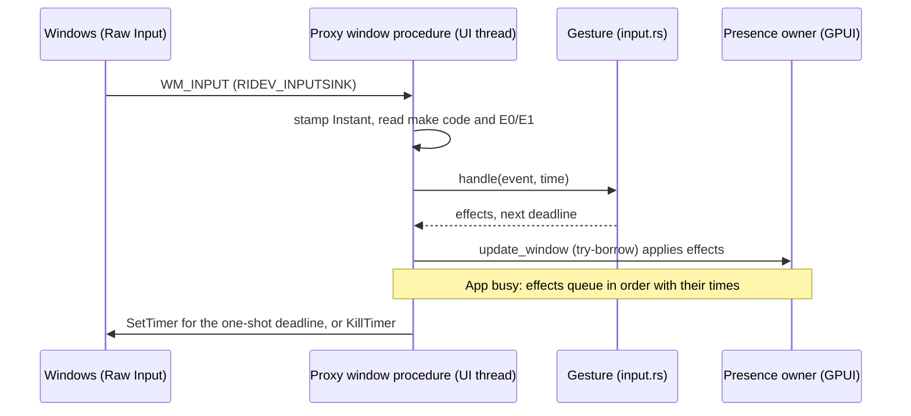

# Keyboard input and Esc

The shell recognizes one shortcut, left Ctrl plus left Alt, with Raw Input and no low-level
keyboard hook. It also decides locally what Esc does. Slice 1 has no microphone, screen capture,
runs or brain commands for either. Voice arrives in slice 7, capture in slice 6, and the run and
Stop protocol in slice 2.

## From key to Listening



- **Registration.** The hidden proxy window from the dock registers the keyboard with
  `RIDEV_INPUTSINK | RIDEV_DEVNOTIFY` before the brain link starts. The link thread used to start
  before GPUI; it now starts once the dock is open and the keyboard is armed (architecture §2.2).
- **Normalization.** Only make code 0x1D and 0x38 without a prefix are left Ctrl and left Alt.
  Right Ctrl (E0 0x1D) and AltGr's right Alt (E0 0x38) are other keys, so AltGr cancels instead of
  firing. AltGr's synthetic left Ctrl can't be told from a real one by its flags; the right Alt
  that follows still cancels. Pause (E1) resets, because it has no dependable key-up. A keyboard
  overrun resets. A key with no make code is named through `MapVirtualKeyW`.
- **Same callback.** The gesture lives in an `Rc<Cell<Gesture>>` shared by the native callback
  and the owner. The callback reduces it before anything else, so Listening is true by the time
  the callback returns. The dock's label then changes through `AsyncApp::update_window`, which
  only tries to borrow GPUI. If GPUI is already borrowed, because a nested message loop
  dispatched the callback, the effects wait in an ordered queue with their original times, and
  a foreground task retries them every millisecond until they apply or the owner is gone.
  Later effects queue behind them. Nothing panics and no key is lost.
- **Deadlines.** The gesture returns at most one deadline: the 300 ms hold or the double-tap
  window. The proxy arms it with `SetTimer` after delivery, for the time left from then, rounded
  up to whole milliseconds, so slow delivery never lengthens the hold, and disarms it
  when it's gone. There's no polling and no timer while nothing is pending. `KillTimer` can leave
  a WM_TIMER already queued; delivering it is harmless, because the gesture ignores a deadline it
  hasn't reached and returns the remaining one. Timer resolution is the system tick, about
  16 ms [guess, unmeasured on Rez].
- **Resets.** Device removal, any session change (lock or unlock), a desktop switch such as
  Ctrl+Alt+Del's secure desktop, suspend, an overrun and Pause all reset the gesture. Keys
  released while Capsula couldn't see them would otherwise stay held. A desktop switch arrives
  through an out-of-context WinEvent, not a keyboard hook. If the session or desktop watcher
  can't be registered, arming fails and undoes what it registered, rather than running without
  a reset source. Delivery isn't guaranteed in every
  case, so a missed key-up can still leave a modifier held until that key is pressed again.

## What each effect does

| Effect | Shell action in slice 1 |
|---|---|
| Listening | The dock shows Listening, overriding the link status until the gesture ends |
| Resting | The dock shows the link status again |
| HoldStarted | Every Capsula window gets `WDA_EXCLUDEFROMCAPTURE`, then the hold is logged. Slice 7 sends `HoldRecognized` only after this call returns |
| HoldEnded | Capture exclusion is removed |
| OpenInput | The typing panel opens and takes focus |

## The typing panel

A double tap opens a small panel where the hover panel would be, with one gpui-kit `Input`.
It's the only window Capsula activates. Windows allows the activation because the user just
pressed Alt. The panel remembers the window that was in front. Esc hides it and gives the
front back to that window, but only if Capsula still has the front and that window still exists.
The panel is hidden, not closed, so its draft survives. Hover never opens over it or dismisses it.
It has no Send, history or other controls yet.

## Esc

`escape.rs` decides each press: stop moving work first, clear an idle drawing second,
otherwise dismiss the topmost local panel, which in slice 1 is the typing panel. The local
effect always happens before any brain message. Slice 2 sends `Stop` and slice 4 sends
`ClearDrawing` after it.

Esc is held system-wide with `RegisterHotKey` only while Capsula speaks or shows a drawing.
Listening and an open hover panel never hold it. Slice 1 has neither speech nor drawings, so
global Esc stays unregistered. If registration is refused, the hover panel shows Stop instead,
and the refusal is logged without key or text content. An ignored fixture,
`cargo test -p capsula-shell -- --ignored escape_hold`, registers Esc on a hidden window, sees a
second registration refused with Stop shown, and sees Esc released. It holds the desktop's Esc
for milliseconds, so run it only in an approved session.

## Diagnostics for the input session

Two opt-in flags serve the approved gate-session harness. A normal run uses neither, and
creates no file.

- `--input-diagnostics=<file>` writes one line per input milestone, flushed as it happens, as
  `qpc=<QueryPerformanceCounter> <event> key=value…`. Durations are in microseconds since the
  native callback's entry. Lines carry no keys and no text:
  - `listening applied_us=N start_qpc=Q` and `listening painted_us=N`: the dock's label change,
    with `Q` the counter read when the `WM_INPUT` callback began, before parsing, then the
    GPUI paint phase of the frame that shows it (a paint closure, not a present). Both appear
    only while the gesture is still Listening; a press that rests first logs neither.
  - `resting`
  - `hold excluded=true|false` and `hold ended restored=true|false`: whether every surface,
    the dock's native proxy included, took the capture affinity
  - `input opened focused=true|false` and `input dismissed`
  - `input draft nonempty=true|false preserved=true|false`, after an `input opened` that follows
    a dismiss: whether the draft held at that dismiss was nonempty, and whether the input still
    holds exactly it. Only diagnostic runs keep that draft, in memory until the compare; no text,
    hash or length is logged, and an empty draft never counts as preserved. The first open logs
    no draft line.
  - `escape action=Stop|Clear|Dismiss|Ignore` and `escape wanted=true|false stop=true|false`
- `--esc-fixture` holds global Esc from startup until the first Esc arrives, without inventing
  speech or a drawing. The harness checks the hold, presses Esc once, and sees it released.
  It needs `--quit-after-ms` or `--smoke`, so a run can't keep Esc forever. If another process
  already holds Esc, `stop=true` and Stop shows at once: the hover panel opens and stays open,
  and an open typing panel shows its own Stop. They return to normal once Esc is held or no
  longer wanted.

A paint isn't a present. The gate harness joins its exact Canvas QPC to the separately logged
posted-completion interval and a unique eligible PresentMon row on the validated dock swapchain.
Missing, dropped, reused or ambiguous joins remain unmeasured; a Canvas marker alone never
passes the display gate. The UI thread only
queues lines; `tracing-appender`'s worker thread writes and flushes them, and drops lines if
its queue ever fills rather than blocking. `main` creates the file and the worker before GPUI
starts, and Quit drains the worker off the UI thread, so the UI thread never touches the disk.

Unit tests cover the reducer's thresholds and sequences, scan-code naming and Esc ordering.
Real AltGr layouts, focus, hold feel and Listening on screen need the approved desktop session.
The separate-process fixture owns its window loop in `platform/input_session/fixture.rs`.
On Windows 8 and later, layout loading must run in the process that owns keyboard focus, so
the runner sends a bounded numeric request to the foreground fixture and verifies its active
layout acknowledgement before typing. The fixture tracks newly loaded handles and restores
its original layout on request and on exit, including after a lost acknowledgement. The
runner then checks the loaded-layout list. The approved session separately compares the
owner's persistent language registry settings before and after the layouts phase; a change
stops the session and is reported, never silently repaired with registry writes.

## One approved final-main gate session

The separate `cold-start <path-session.txt>` task runs ten input-free cold launches in its own
approved quiet window before the owner session. It uses the same create-new transcript and
adjacent evidence-directory contract below, but never arms Ready or enters the input phase
sequence. It is not an extra loop inside `gate-session`.

The cold trace starts before process launch with the product executable-name filter; all its
rows must later match that one owned PID. A completed PID-filtered warm capture identifies the
dock swapchain. The first nondropped row on that chain after the first Dock paint must be inside
a recorded Dock paint/completion interval; an unavailable first row is never replaced by a later
one. Startup scenes can overlap but all contain the dock, so this endpoint does not claim a
specific geometry frame. Process creation comes from `GetProcessTimes`, mapped from its UTC
FILETIME through a precise-UTC/QPC bracket of at most 1ms. The anchor estimate is not a physical
lower bound, because creation-timestamp granularity is outside that bracket. Ten conservative
upper bounds produce nearest-rank p50/p95/max against 400ms. These are fresh
processes, not a cache-flushed boot: binaries are hashed before each launch and OS caches are not
purged. No input, foreground transfer, elevation or fixture is involved.

`gate-session` replaces the old per-phase `input-session` launcher. Preparation, a green build,
or a Good feel verdict does not authorize desktop input. Invoke it only after fresh owner
approval and the Captain's GO, with the release binaries and xtask already built and no builds
or other heavy work running. It refuses existing product processes and never retries a failed
input phase.

The complete stdout **and** stderr transcript is required evidence. In Git Bash, choose a fresh
absolute filename outside the repository, whose name ends in `-session.txt`, then use create-new
redirection. Do not run an unredirected session or reuse an old evidence directory:

```bash
set -o noclobber
transcript='C:/dev/capsula-ws/gate-runs/approved-unique-session.txt'
{ git rev-parse HEAD && git status --short &&
  ./target/release/xtask.exe gate-session "$transcript"; } >"$transcript" 2>&1
```

Run the release driver at normal priority; `nice -n 10` is only for builds and tests, never
the measurement command. The parent directory must already exist. The runner verifies that both actual disk output
handles resolve to the requested file before launching anything, then atomically creates its
adjacent `approved-unique/` directory. The transcript retains every calibration trial and every
role's raw cycle/time row. Phase directories retain diagnostics, observer records, PresentMon
commands/CSVs/exit status, recipient receipts, totals, limits and failed samples. Nothing deletes
outliers or removes these files during cleanup. Binary SHA-256 identities and before/after
display/background-process metadata identify the measurement environment.

### Feel, Ready and the persistent fixture

One owned EDIT/Ready fixture remains alive throughout the session. Injection starts disabled.
The initial release shell is bounded to 120 seconds while the owner has about 90 seconds to try
the 300ms hold, double tap and stretch by hand and choose independent categorical feel verdicts.
During feel the owner also presses Alt-Tab once and separately reports whether a product window
appears; this verdict may be an external owner reply, not a fourth GUI feel field. The nine
placements remain runtime-unmeasured; this session adds no placement sweep or flag.
The owner then physically clicks Ready, releases the button and steps away. Synthetic clicks,
posted messages and keyboard activation cannot arm Ready. The native fixture arms only after
button-up, then requires one guarded second with unchanged last-input time before injection
opens. There is no synthetic foreground transfer or replacement Ready click between phases.

Good, Off, Broken and Unrated remain separate human results, not approval tokens or substitutes
for measured gates. An Off or Unrated result needs owner disposition, but does not cancel already
authorized measurements after Ready. If Ready is absent, the session stops without injecting.

### Fixed automated order and bounds

Each automated phase launches a fresh stable shell PID at normal priority under the same
fixture lease. Idle alone gets a 120-second product bound; every other phase gets 90 seconds,
with its input cutoff at least 13 seconds before cleanup (77 seconds for instrumented phases).
The whole session has a one-hour limit and reserves another 30 seconds for final
cleanup; a phase cannot begin without its complete budget.

1. The idle CPU row and three separate stretch CPU rows each calibrate three saturated 2-second
   trials and settle for 30 seconds. Idle samples for 60 seconds; each stretch samples for 30.
   These phases send no motion or input
   and omit the gate observer. Calibrated cycles are the CPU gate, with GetProcessTimes alongside;
   limits are 1% of one core at idle and 10% during stretch. DWM and private bytes are retained too.
2. Keyboard runs 100 short 50ms chords with more than 300ms between releases, then one hold and
   restoration check. Every applied/Canvas sample is retained, including missing-paint failures.
3. Hover runs 100 guarded crossings. HWND hide observation polls for at most 300ms; its elapsed
   time is not a display timestamp. Observer IDs and panel paint frames feed the separate display
   summary.
4. Resting receipts run for 20 seconds, then motion/retraction receipts for 30 seconds in a fresh
   product. The harmless EDIT covers the tested area. Only actual EDIT/proxy recipient counts,
   screen points and QPCs prove delivery; WindowFromPoint checks alone are not receipts.
   Every required category needs stable native and measured display coverage. Rest additionally
   needs displayed-body receipts at the center and edge; motion needs them on the body and
   retracting edge. Dropped-only or otherwise unavailable display evidence makes the phase
   incomplete even when native routing succeeded.
   The left-edge resting points keep the bulb inside the pill on the middle-left fixture.
   Motion frame gaps use exact current-row changes to delimit drawing demand; warmup, capture
   edges and unchanged-pixel gaps are not missed frames. Every displayed gap and undisplayed
   dock row is retained; a missing demanded-frame join stays unmeasured, not a zero-duration pass.
5. Focus opens the typing surface by a completed double tap, types a known draft, dismisses it
   through local Esc, reopens it without typing, and uses the non-content observation to check
   draft preservation. Normal dismissal must return foreground to the fixture; there is no
   SetForegroundWindow workaround. Ordinary Esc must then reach the EDIT.
6. Layouts temporarily use German `00000407` and Spanish `0000040A` in the foreground fixture.
   Each checks the expected `@`/`€` pair without printing text, no Listening over the AltGr-only
   interval, and a positive left-modifier chord. The original HKL and loaded-layout inventory are
   restored. Recursive read-only registry snapshots include missing-key/read status and are
   compared even on failure; any difference stops the session and is never repaired.
7. Free and fixture-contested global Esc use separate products but the same fixture. Contested
   fallback visibility must exist before pointer movement and persist after leave.
8. A separate bounded contested-Esc product exercises the rendered Stop button, using its
   observed rectangle and exact owned panel HWND rather than a guessed coordinate. After the
   guarded click, wanted/Stop visibility must clear. The fixture then releases its own Esc
   reservation so ordinary Escape can reach the EDIT
   with an EscapeIgnore acknowledgement. The idle fixture proves clearing this affordance,
   not cancellation of a nonexistent backend request.

For instrumented phases, a PID-filtered warm trace has an 8-second fixed backstop. Three
input-free repaints and a guarded wait produce a completed CSV that must have zero loss and one
eligible dock swapchain before the main trace starts. Main trace backstops are fixed per phase:

| Phase | Main backstop |
| --- | ---: |
| Keyboard | 50s |
| Hover, resting receipts | 30s |
| Motion receipts | 40s |
| Focus, layouts | 20s |
| Free Esc, contested persistence, Stop button | 10s |

CPU rows have no main input trace. Normal completion stops only this harness's uniquely named
ETW session earlier. The trace is
finished and validated even if the trial fails, before the owned product exits and flushes its
observer close/end records. A fresh PID requires a fresh warm validation.
Immediately after the main trace starts, the input deadline is tightened to the earlier of the
product cutoff and two seconds before that phase's trace bound. Acknowledged downs are
released and the EDIT is uncovered before any potentially slow trace-finish wait, on both
success and failure.

Any physical input after Ready, lock/desktop change, foreign foreground/capture/menu/move loop,
or phase error stops the whole session. Cleanup releases only acknowledged injected downs,
restores owned fixture layout state, closes only owned windows/processes gracefully, and retains
all errors. It never force-kills another process or repairs language settings. Cursor restoration
is skipped after any abort, and otherwise remains guarded and confined to owned destinations.
Actual Alt-Tab into owner applications remains manual or unmeasured.
