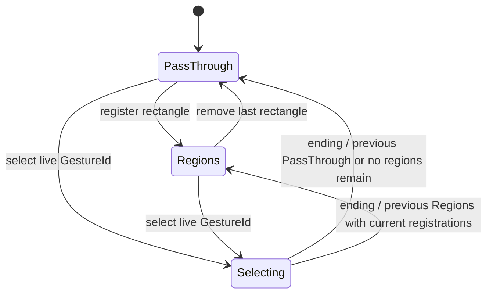
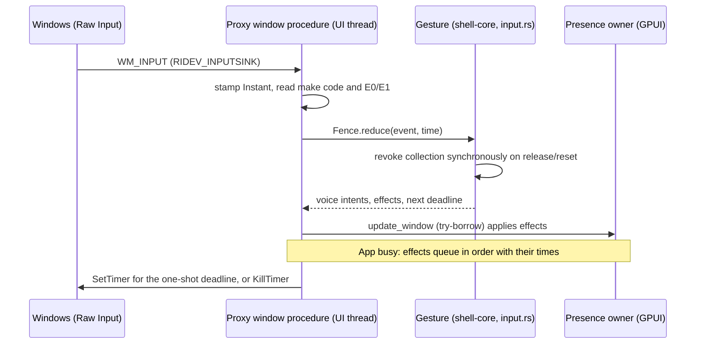
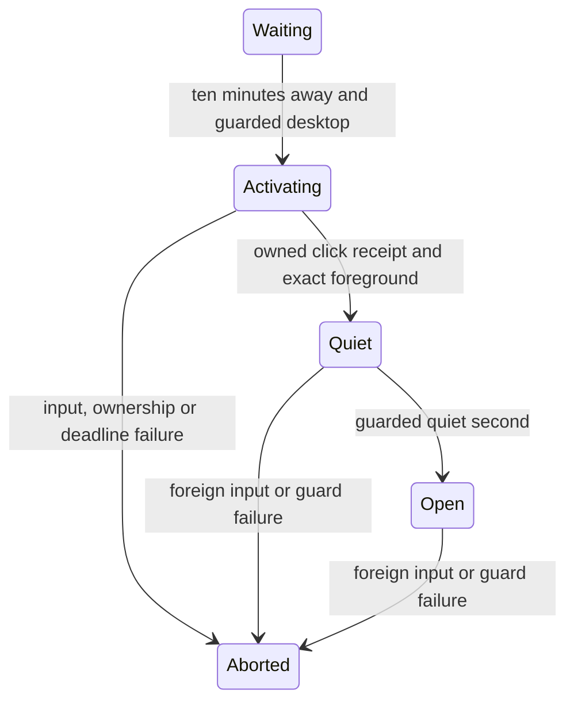

# Keyboard input and Esc

## Overlay pointer ownership

The presenter's `OverlayOwner` is the only overlay hit-test authority. Slice 5 registers
physical screen rectangles by `RegionId` and binds its input windows through `OverlayWindows`;
it never changes styles. Register/remove effects must be applied before the next input event.
Kumo requests a `DragLease` through the presence presenter on press, then returns it through
its terminal event. An orbit, a drag lease and a selection cannot own the pointer together.



Selection entry is two-phase. Apply orbit cancellation and Kumo's `Preempted` ending first,
then disable regions, raise the selection surface and take capture without activation.
Only after those effects return does `selected` start its separate `DragOwner`, with an input
stamp newer than the old capture loss. A failed raise/capture is fed back as `Err(())`:
it restores the previous mode, emits `Failed`, and never emits `SelectionStarted`.

Release, Esc, `GestureCancel`, brain loss, capture loss, window destruction, display change
and `HoldEnded` each restore once. Restoration uses today's registry, not a saved copy;
an empty registry restores PassThrough. A stale terminal event cannot end another gesture.
`HoldEnded` covers key-up and the 120-second hold clock: a rectangle at least 4×4 physical
pixels completes as a region; anything smaller cancels. B3a's low-level hook supplies Esc and
swallows it only while Selecting is live. B3a/B3b will produce selection entry; B0 sends no hold.
The pick stays on GPUI mouse events and the existing stamped capture-loss/reconcile bridge.

Native configuration always restacks, because placing or showing a presence window lifts it to
the top of the topmost band. It skips only the style changes when the mode and registry match the
last successful apply. That cache records what was last applied, not the windows' real state.
Binding changes invalidate it, and a failed partial apply invalidates it so restoration retries.
Restore errors don't drop selection notifications or Kumo's capture-loss/reconcile bridge:
all effects run, then the first error is reported. New bindings prune dead native handles and
skip duplicates within their layer.

The shell recognizes one shortcut, left Ctrl plus left Alt, with Raw Input and no low-level
keyboard hook. It also decides locally what Esc does, before the brain hears of it. Holding
the shortcut admits voice-only input; it grants no screen capture authority.

## From key to Listening



- **Registration.** The hidden proxy window from the dock registers the keyboard with
  `RIDEV_INPUTSINK | RIDEV_DEVNOTIFY` before the brain link starts. The link thread used to start
  before GPUI; it now starts once the dock is open and the keyboard is armed (architecture §2.2).
- **Normalization.** Only make code 0x1D and 0x38 without a prefix are left Ctrl and left Alt.
  Right Ctrl (E0 0x1D) and AltGr's right Alt (E0 0x38) are other keys, so AltGr cancels instead of
  firing. AltGr's synthetic left Ctrl can't be told from a real one by its flags; the right Alt
  that follows still cancels. Pause (E1) resets, because it has no dependable key-up. A keyboard
  overrun resets. A missing make code falls back to `MapVirtualKeyW` only when its result
  preserves the record's prefix evidence and doesn't guess a modifier side. An unsided
  modifier VK or conflicting prefix is loss of coverage, not a left-key make or break.
  The adapter hands the reducer semantic left Ctrl, left Alt, Escape or other-key events.
  Escape remains distinguishable from the registered Escape event, and bounded opaque
  slots track makes and breaks from up to two sources with keys down. Readable keyboard
  records with a null Raw Input device handle, as can occur with injected input, share one
  source distinct from every non-null handle. They follow the same shortcut and recovery
  rules as any keyboard. A second source sending a make or break for a left modifier still
  held by another source makes its identity ambiguous and resets input. An owner's decoded
  break still clears that owner's hold before the reset. If both banks are occupied, another
  source invalidates coverage. A decoded talk modifier still needs its owner's break even if
  its layout was unavailable or it couldn't fit in a bank. One overflow owner per modifier can
  be remembered; if that also fills, the modifier is refused until restart rather than guessing.
  The reducer doesn't decode Windows scan codes; diagnostics don't print devices, slots,
  layout identifiers or edge values.
- **Same callback.** The gesture lives in an `Rc<Cell<Gesture>>` shared by the native callback
  and the owner. The callback installs the shared hold fence and revokes collection before
  deferring anything. Voice intents capture the target revision, session generation, choice
  revision and original QPC; double-tap effects retain their ordinary typing path. Key-down's
  gate also freezes the screen offer published for that connection, choice and target
  ([notice revision](ipc.md#notice-revision)).
  Cancellations use the ordered gesture queue even when GPUI is free. The dispatch task
  sends each wire cancel off the UI thread and only on its original link generation. A refused
  cancel can't admit a replacement hold: a reconnect in that window shows the existing
  Hold Failed notice. An offer that never enters the control queue is discarded locally.
  The task then applies owner effects through `AsyncApp::update_window`, retrying every
  millisecond if GPUI is already borrowed. Ordinary Esc with no Hold still takes its
  local decision inline when the app is available and no earlier delivery is pending.
  Stopping a typed run still tries to queue `Stop` inline through the session's nonblocking
  control sender, without taking the outbox lock. Ordinary Warm and Hold admission still use
  the outbox lock; deferred Hold cancellation does not change those paths. If delivery is
  closed, the callback still revokes local input and hands any remaining cancels to the
  background executor without applying owner effects.
- **Deadlines.** The gesture returns at most one deadline: the 300 ms hold or the double-tap
  window. The proxy arms it with `SetTimer` after delivery, for the time left from then, rounded
  up to whole milliseconds, so slow delivery never lengthens the hold, and disarms it
  when it's gone. There's no polling and no timer while nothing is pending. `KillTimer` can leave
  a WM_TIMER already queued; delivering it is harmless, because the gesture ignores a deadline it
  hasn't reached and returns the remaining one. Timer resolution is the system tick, about
  16 ms [guess, unmeasured on Rez]. WM_TIMER is the lowest priority message, so a busy thread
  can delay it past the release. The shared delivery code also schedules each new deadline on
  GPUI's timer, which wakes the UI thread with a posted message that paint and timer messages
  can't starve. It reduces through the same path, and whichever timer arrives first wins; the
  other finds nothing due. A held chord key's auto-repeat also advances the gesture, a backstop
  that comes only after the keyboard's repeat delay. The recognition line logs whether the native
  deadline, the scheduled one, a repeat or the release reached the threshold, and a chord key
  more than 50 ms past an armed deadline logs the thread's message queue status once per gesture.
- **Resets.** An unreadable Raw Input record resets the gesture; a record known to be
  non-keyboard input does not. Device changes, observed keyboard-layout changes, session
  changes, desktop switches, suspend, overruns and Pause also reset it. On every decoded
  left Ctrl or left Alt record (make, repeat, or break), the proxy calls
  `GetForegroundWindow`, `GetWindowThreadProcessId`, and `GetKeyboardLayout` for the
  foreground thread, if it can identify one. The deferred release checks sample again,
  so a layout change that changes back between samples can escape detection. The decoded
  tracker uses fixed storage; that doesn't bound the cost of the native queries. After coverage loss,
  overflow or registered Escape, shell-core cancels the chord. A modifier known down at reset
  needs a decoded break from that same source before its next make counts. Removing a device
  retires only its ledger. A source with no evidence starts eligible: its first make may be a
  repeat of a key held before coverage, since Raw Input cannot distinguish the two. After a
  coverage gap, a make queued at or before the boundary cannot count or make its later repeats
  eligible. Rejected makes are kept out of tap and hold timing, but still reach the screen
  watch. A logical reset retains the ordered ledger without inventing a coverage gap.
  The reducer needs two eligible raw modifier makes. On the second recovery make, Windows
  reads left Ctrl and left Alt before and
  after a bounded `GetAsyncKeyState` sweep, using only the down bit; another down keyboard VK
  vetoes that attempt. Aggregate Ctrl/Alt aliases, mouse buttons and toggle state do not count.
  The second make can start a fresh hold if the observable keyboard state agrees. A current
  state read never substitutes for a queued make, and a failed read can only be retried on a
  later eligible raw pair. Time and OS state alone cannot rearm or prove a modifier neutral. The scan isn't
  atomic: a key can go down after its slot was read,
  access can change mid-sweep (zero means up or failure), two physical keys can share one VK,
  and firmware-only keys without a VK aren't visible. A stuck or remapped extra key vetoes for
  as long as Windows reports it down. The scan and behavior with elevated foreground windows,
  a secure desktop, AltGr or two keyboards remain unmeasured. OS bits don't give a device
  identity or a watch exemption. A desktop switch arrives via
  an out-of-context WinEvent, not a keyboard hook. If the session or desktop watcher can't
  be registered, arming fails and undoes what it registered.

## What each effect does

Custom matching is fixture-only and shares the default gesture's tap/hold timing.
It adds no saved shortcut, trial, hotkey registration or input route.

| Effect | Current shell action |
|---|---|
| Listening | Legacy effect ignored; only an admitted source's accepted Running receipt sets Listening |
| Resting | The dock's line returns to its resting fill |
| HoldStarted | Legacy effect ignored; recognized voice intent requests Brain admission, not screen authority |
| HoldEnded | Ignored; releasing a key is not capture retirement |
| OpenInput | The typing panel opens and takes focus (see [Taking the front](#taking-the-front)) |

The recognizer still measures short taps and rejects long presses as taps. Presence owns one
pending voice handoff: exact live Admitted permits source start; Loading never does. Running
is published before collection acceptance. Physical stop, successfully forwarded packet count
and native key-up rendezvous once before KeyUp is sent, regardless of UI delivery order.
Committed PCM may drain after native retirement; logical input/session/choice fences still
discard stale packets. Typed submissions remain text-only
(`ScreenChoice::None`). A recognized hold whose [standing notice](ipc.md#screen-holds) is on
goes out as `ScreenHoldRecognized`, and a release that still owns its input takes the
[exclusion lease](screen.md#local-shell-exclusion) and goes out as `ScreenRelease`
([presence](presence.md#a-screen-holds-pointer-line)). The native callback samples the pointer
when its delivery carries a recognition or a release that isn't a cancel. So the line starts
where the pointer was at recognition, and the picture is of the display it was on at release,
however late the UI thread applies the delivery. `input/hold.rs` never sees the pointer.
The shell checks the release's input stamp at both GPUI delivery boundaries and again
before arming its watch and sending `ScreenRelease`. An intervening edge other than a
proven modifier repeat makes the release voice-only; a reset cancels it. Cleanup for a
refused or failed release can clear only its own hold, watch and exclusion lease.

## The typing panel

A double tap opens a small panel where the status panel would be, with one gpui-kit `Input`.
While the onboarding window shows, a double tap opens nothing, except at its shortcut step, where
it finishes onboarding and then opens this panel ([onboarding](onboarding.md)).
Like the [tasks panel](panels.md), it activates only on a user command, as described in
[Taking the front](#taking-the-front). The
panel remembers the window that was in front. Esc hides it and gives the
front back to that window, but only if Kumochi still has the front and that window still exists.
Switching to another window also hides it and keeps the draft, without restoring the old
foreground: the user has already chosen the new window. Hidden and stale deactivation events
do not normally dismiss a newly active panel, except for the rapid away/back cache limit in
[presence](presence.md). The panel is hidden, not closed, so its draft survives.
Hover never opens over it or dismisses it.
Opening the typing panel dismisses Tasks and Settings. Settings uses its normal dismissal
path, saving an active field edit as on blur. The chat header's **Tasks…** and a recovery
notice's Settings actions open their panel in its place once the click is handled, because
GPUI can't hide a window from inside that window's own click. A hide that fails leaves the panel open with its history, so Esc and its
close button still work.
Enter submits to the [captured input target](runs.md#the-shells-input-target). When the target
isn't Kumo, the panel names it and offers **Back to Kumo**. A settings update preserves the
draft and keyboard focus without changing that target.

### Taking the front

Windows lets a process call `SetForegroundWindow` only if one of a few conditions holds, among
them that it "received the last input event" ([SetForegroundWindow, Remarks][sfw]). Raw Input
with `RIDEV_INPUTSINK` gives Kumochi a copy of the shortcut's keys, but the keys themselves still
go to the app in front, so a plain activation fails (`focused=false` on c39d553). Pressing Alt
doesn't help: "the system automatically enables calls to SetForegroundWindow if the user presses
the ALT key" ([LockSetForegroundWindow, Remarks][lsfw]) only lifts a `LockSetForegroundWindow` lock.
It doesn't meet any of the conditions above.

So on each `OpenInput`, immediately before `SetForegroundWindow`, Kumochi sends exactly one
input: `INPUT_MOUSE` with no motion, no flags, no wheel or button data, and `dwExtraInfo` set to
`FOCUS_INPUT_MARKER`. That makes Kumochi the last input's sender. PowerToys Run uses the same
method ([microsoft/PowerToys#4362][ptr]). There's no retry and no fallback. If `SendInput` is
refused or the activation still fails, the panel stays open, unfocused and clickable, and the
log says `focused=false`.

Side effects:

- Other apps' low-level mouse hooks see the event with `LLMHF_INJECTED`. The gate harness accepts
  it only with the marker, zero motion and no buttons.
- It resets the idle timer (`GetLastInputInfo`), which the user's keypress just did anyway.
- UIPI drops it when the app in front is elevated, so the panel can't take focus over an admin
  app.
- It carries no key, so it can't open a menu in the app in front. The shell's Raw Input
  registration is keyboard-only, so the gesture never sees it, and the gate observer records
  only marked left presses.

Rejected alternatives:

- Activating at the second key-down while Alt is held relies on the Alt misreading above.
- A `RegisterHotKey` grant ([Raymond Chen][hotkey]) would take the Ctrl+Alt key-down from the app
  in front during the tap window, would fire on AltGr, and would have to activate before the tap
  completes.
- `AttachThreadInput` makes focus changes synchronous with the foreground thread
  ([Raymond Chen][attach]), so a hung app in front could block the UI thread, and it can't attach
  to an elevated app.
- An injected Alt can open a menu in the app in front.

[sfw]: https://learn.microsoft.com/en-us/windows/win32/api/winuser/nf-winuser-setforegroundwindow
[lsfw]: https://learn.microsoft.com/en-us/windows/win32/api/winuser/nf-winuser-locksetforegroundwindow
[ptr]: https://github.com/microsoft/PowerToys/pull/4362
[hotkey]: https://devblogs.microsoft.com/oldnewthing/20090226-00/?p=19013
[attach]: https://devblogs.microsoft.com/oldnewthing/20130607-00/?p=4143

## Esc

Shell-core exposes the ownership facts an Esc press can capture: the audio pair and run,
the latest submitted turn (even before the brain names it), and the drawing and
selection owners. A run that already sent a terminal state can still have an audible
tail; that tail is a local speaker stop, not permission to stop another brain run.
The speech route uses the audio facts below; ordinary launch still selects Legacy.

An Esc captured by an admitted voice gesture consumes only that gesture's receipt and held
words. It takes screen marks, then compares the receipt's run with the ordinary effective
stop target, including the presenter's newer run only when ordinary Esc would use it. A
mismatch consumes the press without stopping another run, clearing drawings or dismissing
a panel. A match stops only that run's owned scenes and input; pending typed turns and other
scenes survive. Scene cuts remain scene-atomic, including a newer suffix in the same scene.
This captured route never promotes the receipted run. If cancellation precedes the hold's
first naming state, that state's owed automatic stop also targets only its own run, even
when a newer drawing is current. The rules below describe ordinary Esc.

`escape.rs` decides each press: stop moving work first, clear an idle drawing second, cancel
an active inline rename, Settings field edit or onboarding name edit third, otherwise dismiss
the typing panel, the focused Tasks or Settings panel, or the onboarding window, which runs
Finish later ([onboarding](onboarding.md)). Stop and clear leave an edit intact;
cancelling an edit restores its saved value without sending it and doesn't dismiss its panel.
The local effect always happens first, and nothing waits on the brain:

- **Stop** fences the moving run off in `shell-core`'s `runs.rs`, keeping what's on screen, then queues `Stop`
  on the control pipe. The fence is checked when a message is applied, so the run's frames
  already queued in the shell are dropped too.
  - A run counts as moving until both its terminal `RunState` and its `RunEnd` have been
    applied, in either order, since the pipes aren't ordered with each other. An older run's
    ending never settles a newer one.
  - Turns sent and not yet answered by a `RunState` count as work too. Esc cancels every one
    sent before the press: when a cancelled turn's run is first named, it's fenced before any of
    its output is applied and gets its own `Stop`. A turn sent after the press isn't covered.
- **Clear**, the next Esc, removes the shown scenes, and any recovery under way, keeps the text,
  keeps the scenes' late steps out, and queues one `ClearDrawing` naming them. The brain records
  the clear, so they don't come back. See [the drawing](presence.md#the-drawing).
- With no brain connected, or a control queue the brain isn't reading, the local effect still
  happens and the unsent message is logged, without content.

Esc is held system-wide with `RegisterHotKey` while held voice is active or a drawing is shown:
the overlay is showing scene frames (`Presenter::drawn`), or run steps show in the open typing
panel. Mirrored, preparing and recovering scenes that aren't painted yet don't hold it, and an
open status panel alone never does.

A queued reply also holds global Esc while the native output route has a live speech lease and
Kumochi's typing, Tasks and Settings panels aren't focused. The pressed pair and run travel
with the event. An outside press stops that reply without taking focus; a focused-panel
press stops the reply and leaves the panel open. A live pull still takes Esc, even when
another app has focus. A stale press can't stop a replacement run, and an expired speech-only
hotkey doesn't become an ordinary stop. If the brain already sent a terminal state, only its
matching local audio is stopped.
For a moving run the shell fences it and offers the brain its Stop before the speaker stop.
If the control queue refuses, the shell signals the exact local worker before sealing the
pair, without waiting for the output owner or background teardown.
Shell-core's `escape.rs` decides which effects the shell applies: a published
press's owners and how a press that waited still matches them, the marked-answer exception,
the order of a press's local effects, the target of an ordinary stop or clear, and where a
speech press goes and which stop it gets.

Held voice additionally owns global Esc through preparation and pre-answer work. A raw Escape
revokes collection before deferred UI; its hotkey delivery consumes one marker so that the
same press cannot also dismiss typing. Cleanup debt alone does not capture Esc from newer
ordinary work. If registration is refused,
the status panel shows Stop instead, and the refusal is logged without key or text content.

A plain native Esc that has to wait for the shell owner carries the work it saw at the native
callback, even when there was no held gesture or speaking run. A newer submitted turn counts
before the brain names it. At dispatch, a changed connection, turn, drawing membership or local
owner retires the press instead of stopping or clearing current work. Indeterminate drawing
recovery also declines a deferred plain press; a fresh press can act on what is there now.
The publisher uses panel-owned edit state without reading a view that may already be handling an
event. Reopening the same window or restarting the same edit gives it a new identity. An edit
identifies the target only when Esc would cancel it or dismiss that panel, so a fresh Esc after
entering Rename can still clear the same idle drawing first.
When the screen wake takes a press's marks first, that press can still cancel the same pull or
selection and stop the marked answer if no other owner changed. A later press sees only the
drawing that remains. A canceled microphone's outstanding
cleanup does not own Clear, and a new collection still invalidates the deferred press.

An ignored fixture,
`cargo test -p kumochi-shell -- --ignored escape_hold`, registers Esc on a hidden window, sees a
second registration refused with Stop shown, and sees Esc released. It holds the desktop's Esc
for milliseconds, so run it only in an approved session.

While a hold's keys are down, an Esc press is Ctrl+Alt+Esc. The plain Esc hotkey doesn't match
it, and Windows acts on it as Alt+Esc and brings another window to the front. So from a hold's
recognition until its keys come up or it ends, the proxy holds a second hotkey, Esc with Ctrl
and Alt (`TalkEscape`). Those are the only modifiers a hold's keys can have down, since any
other key going down cancels the hold, and the chord is never held outside a hold.

- The talk hotkey cancels the hold and invalidates coverage without inventing a key-up.
  It stops no run and clears no drawing. Plain registered Esc does its usual work and also
  invalidates coverage.
- Windows is asked once per hold, before voice admission. If it refuses the registration,
  the typed refusal prevents microphone admission and screen context for that hold. A valid
  recognition still stops the run that was speaking at key-down, brain first and then the
  speaker. The proxy retires the talk ID and revokes collection and stale watch authority before it calls
  `UnregisterHotKey` on the window's thread. Terminal UI effects wait until after that call.
  It doesn't reuse retired hotkey IDs, so neither a queued message nor late
  cleanup can reach a later hold. An uncertain unregister leaves input inert until the
  proxy is recreated; dropping the ID locally does not prove Windows released it.
  The plain Esc lease is separate.
- A second ignored fixture, `cargo test -p kumochi-shell -- --ignored talk_keys_escape`,
  registers the chord beside plain Esc on a hidden window, sees a second registration refused,
  and sees dropping the chord free it and leave plain Esc held. Run it only in an approved
  session too.

## Diagnostics for the input session

Two opt-in flags serve the approved gate-session harness. A normal run uses neither, and
creates no file. Both need a shell built with the `gate-recorder` feature (see
[the gate observer](presence.md#gate-observer)); without it the shell refuses them at launch.

- `--input-diagnostics=<file>` writes one line per input milestone, flushed as it happens, as
  `qpc=<QueryPerformanceCounter> <event> key=value…`. Durations are in microseconds since the
  native callback's entry. Lines carry no keys and no text:
  - Legacy Listening and capture effects are inactive. The adapter keeps the callback QPC for
    voice controls.
  - `hold warm callback_qpc=<n>` when the shortcut's chord goes down and
    `hold recognized callback_qpc=<n>` when its 300 ms hold is recognised, each stamped with the
    native callback's QPC; the line's own QPC is when presence applied it
  - `listening on` and `listening off`, as the line takes and leaves the Listening colour
  - `speech input ready=true|false`, from each speech state the brain sends
  - `input opened focused=true|false` and `input dismissed`
  - `input draft nonempty=true|false preserved=true|false`, after an `input opened` that follows
    a dismiss: whether the draft held at that dismiss was nonempty, and whether the input still
    holds exactly it. Only diagnostic runs keep that draft, in memory until the compare; no text,
    hash or length is logged, and an empty draft never counts as preserved. The first open logs
    no draft line.
  - `escape action=Stop|Clear|CancelEdit|Dismiss|Ignore` and `escape wanted=true|false stop=true|false`
  - status lines that no gate reads: `link state=`, `carry drop perch=`, `resting` (exactly),
    `run phase=`, `submit sent=`, `dock settled`, `dock paints settled=`, `kumo baked`,
    `kumo frame shade_us=` and `kumo reshades=`. The harness reads them as status and still
    refuses any other unknown event.
  - `kumo press at=<x>,<y> bounds=<x>,<y>,<w>,<h> grabbed=true|false`: every left press the
    peek's window sees, in window pixels against Kumo's square, and whether a pull is live after
    it. Numbers only; the harness reads it as status.
- `--esc-fixture` holds global Esc from startup until the first Esc arrives, without inventing
  speech or a drawing. The harness checks the hold, presses Esc once, and sees it released.
  It needs `--quit-after-ms` or `--smoke`, so a run can't keep Esc forever. If another process
  already holds Esc, `stop=true` and Stop shows at once: the status panel opens and stays open,
  and an open typing panel shows its own Stop. They return to normal once Esc is held or no
  longer wanted.

A paint isn't a present. The gate harness joins its exact Canvas QPC to the separately logged
posted-completion interval and a unique eligible PresentMon row on the validated dock swapchain.
Missing, dropped, reused or ambiguous joins remain unmeasured; a Canvas marker alone never
passes a present or display gate. Hold to talk can't show Listening before its 300 ms hold is
recognised, the brain admits it and the microphone reports Running, so the shortcut row gates
recognition → the line's first Listening present at p95 ≤7ms and reports key-down → that present
beside it ([the hold to talk rows](#the-hold-to-talk-rows)). Hover gates the native pointer-entry QPC →
the peek's first present at p95 ≤8ms. That QPC is read
when the entering `WM_MOUSEMOVE` is dispatched to the proxy's window procedure. So it excludes
OS routing and the message's wait in the UI thread's Win32 message queue before dispatch, and
includes the wait from dispatch, through the presence event channel, to the presence handler. A change whose entry is missing or no later than the previous change
stays in the denominator as `MissingEntry`; SendInput → present and state entry → present are
reported beside it, not gated, so a build without entry counters still gives those two.
Both reports retain display latency separately: missing display feedback is unmeasured there,
not a fabricated zero or a failure of an otherwise valid present endpoint. Receipt body
coverage and motion pacing still require displayed frames. The UI thread only
queues lines; `tracing-appender`'s worker thread writes and flushes them, and drops lines if
its queue ever fills rather than blocking. `main` creates the file and the worker before GPUI
starts, and Quit drains the worker off the UI thread, so the UI thread never touches the disk.

Unit tests cover the reducer's thresholds and sequences, scan-code naming and Esc ordering.
Focus and double-tap feel need the approved desktop session. Its gate copy has no speech model,
so it can't show Listening or judge hold feel; only `hold-gate --speech` installs one.
The separate-process fixture owns its window loop in `platform/input_session/fixture.rs`.
On Windows 8 and later, layout loading must run in the process that owns keyboard focus, so
the runner sends a bounded numeric request to the foreground fixture and verifies its active
layout acknowledgement before typing. The fixture tracks newly loaded handles and restores
its original layout on request and on exit, including after a lost acknowledgement. The
runner then checks the loaded-layout list. The approved session compares the owner's persistent language registry settings before and
after its automated phases; a change stops the session and is reported, never silently repaired
with registry writes.

## One approved final-main gate session

The separate `cold-start <path-session.txt>` task runs ten input-free cold launches in its own
approved quiet window before the owner session. Both run as the gate identity and build the
images they launch (see [the gate identity](gate-identity.md)). It uses the same create-new transcript and
adjacent evidence-directory contract below, but never arms Ready or enters the input phase
sequence. It is not an extra loop inside `gate-session`. Each launch in either task waits up to
3 s for the brain and both its workers (screen and speech) and holds all of them, and refuses any
other product process.

The cold trace starts before process launch with the product executable-name filter; all its
rows must later match that one owned PID. A completed PID-filtered warm capture identifies the
dock swapchain. PresentMon 2.6 swallows the first present of each swapchain as a seed. From that
chain's first CSV row, the harness derives seed present = `QPCTime − msBetweenPresents` and
seed displayed = `first row displayed − msBetweenDisplayChange`, in checked QPC arithmetic.
The derived seed must fit at least one recorded Dock paint/completion interval, and every
containing interval must have begun before the first harness repaint; its cutoff is retained
in `first-harness-repaint.txt`. Overlapping startup intervals are allowed because cold start
measures creation to the first present, not a particular frame.
The matching paint need not be the first recorded paint: only the first actual present is the
seed. Missing, invalid, post-repaint or dropped seed evidence is unmeasured; no later
ordinary row or warm-up repaint substitutes. `seed.txt` retains the first raw row and intervals.
The 400ms gate is creation → first eligible dock **present**, with
display latency reported beside it when available. The existing prelaunch name trace remains:
launching suspended was not adopted, so a name-filter miss fails explicitly rather than
changing the origin to resume. Process creation comes from `GetProcessTimes`, mapped from its UTC
FILETIME through a precise-UTC/QPC bracket of at most 1ms. The anchor estimate is not a physical
lower bound, because creation-timestamp granularity is outside that bracket. Ten conservative
upper bounds produce nearest-rank p50/p95/max against 400ms. These are fresh
processes, not a cache-flushed boot: binaries are hashed before each launch and OS caches are not
purged. No input, foreground transfer, elevation or fixture is involved. Launch 1 starts a
profile already marked onboarded, so onboarding's own start cost is unmeasured.

`gate-session` replaces the old per-phase `input-session` launcher. Preparation, a green build,
or a Good feel verdict does not authorize desktop input. Invoke it only after fresh owner
approval and the Captain's GO, with the gate xtask and its release images already built (see
[the gate identity](gate-identity.md)) and no builds or other heavy work running. It refuses existing product processes and never retries a failed
input phase.

The complete stdout **and** stderr transcript is required evidence. In Git Bash, choose a fresh
absolute filename outside the repository, whose name ends in `-session.txt`, then use create-new
redirection. Set `transcript` to that user-chosen path. Set `PRESENTMON_EXE` to the absolute path
of your existing `PresentMon-2.6.0-x64.exe`; `gate-session`, `hover-gate` and `cold-start` require
this explicit selection, with no PATH search or default executable. The pinned filename and 2.6
CSV validation do not authenticate the executable's contents: obtain it from a trusted source.
Do not run an unredirected session or reuse an old evidence directory:

```bash
set -o noclobber
: "${transcript:?set transcript to your chosen absolute outside-repo path ending in -session.txt}"
: "${PRESENTMON_EXE:?set PRESENTMON_EXE to your chosen absolute PresentMon-2.6.0-x64.exe path}"
export PRESENTMON_EXE
{ git rev-parse HEAD && git status --short &&
  ./target/release/xtask.exe gate-session "$transcript"; } >"$transcript" 2>&1
```

Run the release driver at normal priority; `nice -n 10` is only for builds and tests, never
the measurement command. The parent directory must already exist. The runner verifies that both actual disk output
handles resolve to the requested file before launching anything, then atomically creates its
adjacent directory named by removing `-session.txt`. The transcript retains every calibration
trial and every role's raw cycle/time row. Phase directories retain diagnostics, observer records, PresentMon
commands/CSVs/exit status, recipient receipts, totals, limits and failed samples. Nothing deletes
outliers or removes these files during cleanup. Binary SHA-256 identities and before/after
display/background-process metadata identify the measurement environment.

### Feel, Ready and the persistent fixture

One owned EDIT/Ready fixture remains alive throughout the session. Injection starts disabled.
The initial release shell is bounded to 120 seconds while the owner has about 90 seconds to try
the 300ms hold and double tap by hand and choose independent categorical feel verdicts.
The dock is a short line at top center by default, not a separate test window. The gate copy
has no speech model, so a hold is recognised but the line stays plain and nothing is recorded or
sent; hovering the line may show Not installed in the status panel. Hold feel can't be judged in
this copy, so Unrated is the right Hold verdict.
The test window is only for verdicts and Ready. Ready stays disabled until the owner explicitly
selects both verdicts, including Unrated if that is the owner's choice.
The feel product writes `feel/milestones.log`; after its graceful exit, `feel/summary.txt`
reports double-tap openings and focused/unfocused opens. The shell no longer logs holds, so
holds aren't counted. These contain no text or keys, are not present timings, and do not
replace the owner's verdicts or any automated gate.
Missing or truncated feel diagnostics are reported as `summary=unmeasured`, without blocking
otherwise authorized automated phases; failure to retain the summary itself still stops safely.
During feel the owner also presses Alt-Tab once and separately reports whether a product window
appears; this verdict may be an external owner reply, not a third GUI feel field. The nine
placements remain runtime-unmeasured; this session adds no placement sweep or flag.
The owner then physically clicks Ready, releases the button and stays hands-off until the
fixture window closes (allow about 10 minutes, at most one hour). The first quiet second
only opens injection; it is not permission to touch the mouse or keyboard again. Synthetic clicks,
posted messages and keyboard activation cannot arm Ready. The native fixture arms only after
button-up, then requires one guarded second with unchanged last-input time before injection
opens. There is no synthetic foreground transfer or replacement Ready click between phases.
Physical input or loss of fixture focus during that pre-injection second returns the fixture to
waiting for a fresh physical Ready. The original 90s feel deadline does not restart; neither
does the one-hour session limit. Once injection has opened, the existing sticky-abort rule
applies and no Ready can reopen it. API/guard failures and a session lock still stop safely.
The first native guard stop retains its cause (session lock, physical input, or raw-input read
failure), phase and milliseconds since injection opened. Input metadata is limited to keyboard,
mouse movement with signed deltas, button, wheel or other, and the extra-information marker
when that device provides one. No key codes, button identities, wheel values or text are logged.
The transcript and `session-result.txt` retain this snapshot before the fixture closes; later
events cannot overwrite the first cause. These diagnostics do not relax or retry a stopped gate.

Before an approved session, `cargo xtask input-quiet <seconds>` observes the same raw-input guard
on a hidden window for an explicit 1–120 seconds. It prints content-free event classification,
motion deltas and marker, including whether the guard would exempt a tagged event. Raw-input
read failures are reported, not mistaken for a quiet desktop. It sends no input, never activates
a window or launches the product, and removes its registrations when it ends. Running it on Rez
still needs the Captain's measurement window; building it does not start it.

The product's separate `FOCUS_INPUT_MARKER` is accepted only on a zero-motion relative mouse
event with no buttons or wheel; marked movement, absolute positioning and other devices remain
physical input. Post-open owned product focus is still required by the focus phase. Pre-open
quiet/foreground checks remain conservative if delayed focus work leaves the fixture unsettled.

Good, Off, Broken and Unrated remain separate human results, not approval tokens or substitutes
for measured gates. An Off or Unrated result needs owner disposition, but does not cancel already
authorized measurements after Ready. If Ready is absent, the session stops without injecting.

### Fixed automated order and bounds

A scratch profile needs `onboarded = true` in its `config.toml`, or the onboarding window
opens, takes focus and uses up the double-tap.

Each automated phase launches a fresh stable shell PID at normal priority under the same
fixture lease. Idle alone gets a 120-second product bound; every other phase gets 90 seconds,
with its input cutoff at least 13 seconds before cleanup (77 seconds for instrumented phases).
The whole session has a one-hour limit and reserves another 30 seconds for final
cleanup; a phase cannot begin without its complete budget.

1. The idle CPU row calibrates three saturated 2-second trials, settles for 30 seconds and
   samples for 60. It sends no motion or input and omits the gate observer. Calibrated cycles
   are the CPU gate, with GetProcessTimes alongside; the limit is 1% of one core. DWM and private
   bytes are retained too.
2. Resting receipts run for 20 seconds; the motion receipts return with the pull (C2a). The harmless EDIT covers the tested area. Only actual EDIT/proxy recipient counts,
   screen points and QPCs prove delivery; WindowFromPoint checks alone are not receipts.
   Every required category needs stable native and measured display coverage. Rest additionally
   needs displayed-body receipts at the line's center and edge. Dropped-only or otherwise unavailable display evidence makes the phase
   incomplete even when native routing succeeded.
   Hovering the body opens the peek; candidate points exclude its rectangle so that
   later receipt trials cannot target the panel instead of the proxy or covering EDIT.
3. Hover runs after the resting receipts: 100 pointer entries onto the dock. Before each entry,
   once the previous cycle has hidden the peek, it waits 1–8ms in a fixed jitter. After the entry
   it waits a fixed 100ms, checks that the peek is visible, then leaves and waits until it hides.
4. Focus requires a visible, foreground typing surface before typing a known draft. It dismisses
   through local Esc, reopens, double-taps again while active, then clicks a second top-level
   fixture window, distinct from the previous foreground. After the Dismissed mark, typing must
   be hidden and that second window must still be foreground 300ms later. A guarded EDIT click
   returns to the original fixture before closing the alternate. Both reopens use the non-content observation
   to check draft preservation. Normal Esc dismissal must return foreground to the fixture;
   there is no SetForegroundWindow workaround. Ordinary Esc must then reach the EDIT.
5. Layouts types AltGr characters under two layouts and then holds the shortcut once
   ([the hold to talk rows](#the-hold-to-talk-rows)).
6. Free and fixture-contested global Esc use separate products but the same fixture. Contested
   fallback visibility must exist before pointer movement and persist after leave.
7. A separate bounded contested-Esc product exercises the rendered Stop button, using its
   observed rectangle and exact owned panel HWND rather than a guessed coordinate. After the
   guarded click, wanted/Stop visibility must clear. The fixture then releases its own Esc
   reservation so ordinary Escape can reach the EDIT
   with an EscapeIgnore acknowledgement. The idle fixture proves clearing this affordance,
   not cancellation of a nonexistent backend request.

Every instrumented phase also checks the observer's mask commits: each must own exactly its hit
proxy, except a Kumo pull's, which the shell records as an empty mask over an area grown from the
dock. No phase or cold start is meant to pull, so every reader of the observer refuses one, and
a phase fails with `Kumo pull during <phase>`. Each phase's `pulls.txt` holds its count and
whether the observer read completely.

The layouts phase runs after focus, and Listening runs only in `hold-gate --speech`; both are
described in [the hold to talk rows](#the-hold-to-talk-rows). Recursive read-only registry snapshots of the language settings, with
missing-key/read status, are compared after the phases even on failure; any difference stops
the session and is never repaired.

For instrumented phases, a PID-filtered warm trace has an 8-second fixed backstop. Three
input-free repaints and a guarded wait produce a completed CSV that must have zero loss and one
eligible dock swapchain before the main trace starts. The main trace is seeded with six repaints
100 ms apart, because a new trace records nothing for roughly its first 200 ms, sometimes longer.
A resting dock doesn't paint again, so the resting-receipts phase fails a main trace with no
present on the dock swapchain as a missed dock seed; the other phases don't check it.

Every main-trace swapchain has the same first-present seed rule, including the status panel.
The v1 CSV parser accepts a finite negative `msUntilRenderStart`: GPU work can start before
the Present call. Other timing columns, including `msUntilRenderComplete` and `msUntilDisplayed`,
remain nonnegative. The render-start offset does not change present/display endpoints or gate
budgets; those still use raw QPC and the validated display delay.
Joins consider that derived seed alongside raw rows, using the same uniqueness, drop and reuse
checks. Reports retain each sample's CSV/seed provenance and the seed derivation; raw CSV rows
stay unchanged. A seed is eligible only when the first emitted row is displayed, its
`msBetweenDisplayChange` is positive, and the reconstructed seed display is at or after the
seed present. PresentMon 2.6 initializes the swapchain's previous display timestamp to zero;
`SeedFromFirstPresent` updates it only for a displayed seed, and `DeltaUnsignedMilliSeconds`
returns zero when either timestamp is zero. Thus a positive first-row display interval proves
the suppressed seed was displayed. Zero, missing or inconsistent display evidence leaves the
seed ineligible even for present-only gates; raw present endpoints do not require this proof.
The first emitted row's `Dropped` bit belongs to that row, not its seed; a dropped row cannot
provide the display proof. Undisplayed-motion counts use raw rows only.

Main trace backstops are fixed per phase:

| Phase | Main backstop |
| --- | ---: |
| Hover, resting receipts | 30s |
| Focus, layouts | 20s |
| Listening, each batch | 40s |
| Free Esc, contested persistence, Stop button | 10s |

CPU rows have no main input trace. Normal completion stops only this harness's uniquely named
ETW session earlier. The trace is
finished and validated even if the trial fails, before the owned product exits and flushes its
observer close/end records. A fresh PID requires a fresh warm validation.

Immediately after the main trace starts, the input deadline is tightened to the earlier of the
product cutoff and two seconds before that phase's trace bound. Acknowledged downs are
released and the EDIT is uncovered before any potentially slow trace-finish wait, on both
success and failure.

After injection has opened, any physical input, lock/desktop change, foreign foreground/capture/menu/move loop,
or phase error stops the whole session. A foreign foreground stop names only its process id
(`foreground_pid=<n> owned=false`); the run's before and after process lists resolve the image.
An empty foreground (pid 0) is allowed for at most 100 ms from its first sample, because
activation handed to another process's window completes asynchronously. Only an owned window
in front ends that grace; a foreign pid still stops at once, and a longer NULL stops with
`foreground_pid=0` and its duration. Nothing is sent while the front is empty, except cleanup's
releases of acknowledged downs. Each phase records the graces it used and the longest in
`null-foreground.txt`, counting a grace still open at its end as its own.
Cleanup releases only acknowledged injected downs,
closes only owned windows/processes gracefully, and retains
all errors. It never force-kills another process or repairs language settings. Cursor restoration
is skipped after any abort, and otherwise remains guarded and confined to owned destinations.
Actual Alt-Tab into owner applications remains manual or unmeasured.

### Offline drawing timing

`xtask draw-timing <transcript-session.txt> --prebuilt <shell-sha256> <brain-sha256>` uses
prepared release Gate replay binaries. Build the three workspace packages from one checkout
with the default-off features listed in [Gate identity](gate-identity.md#prebuilt-offline-drawing).
The release driver checks both siblings and stages verified copies under the owned launch's
`live/1/bin`. Omitting `--prebuilt` retains the earlier Debug Gate invocation.
Both forms use the shared gate's isolated launch and cleanup. The
fixture asks once through the product link after connecting; it sends no keys, clicks
or pointer motion. The recorded Responses plot is followed by three labeled synthetic
steps in the same drawing. The run starts no build. Its trial deadline does not include
all setup and the shared job's cleanup backstop.

The shell's opt-in observer marks readiness, activation and first accepted overlay paint
by run, scene and index. Byte arrival to that paint is the timing endpoint. The gate has
no independent swapchain identity for this overlay, so the report says “present not
matched”; it does not infer a display time from other surfaces. The narration-time
field is zero with the current presenter; authored entrances and delays still count.
The report estimates narration overlap only if a narrated predecessor reserves time
beyond its entrance.

The automatic submit requires the Gate identity, the explicit draw mode and observer,
and the release replay feature or a Debug Gate build. An explicit unsupported replay
refuses rather than using an account engine. The Brain requires the one-run budget,
the fixed release replay model, and a create-new receipt. The extra rows contain
identifiers, clocks, durations and a bit for nonblank `say`, not scene or user content.
The bit doesn't mean the step was spoken or reserved time.
The ordinary gate observer still writes its existing geometry and counters. Without
drawing observation there are presenter option and fresh-paint checks, but no added
drawing clock reads or file writes. Their cost has not been measured end to end.

### The hover-only idle session

`hover-gate <path-session.txt>` runs the hover phase alone, with the same transcript, evidence
directory, fixture, guards and PresentMon bounds as `gate-session`. Only the opener differs.
Nobody presses Ready. The runner waits until `GetLastInputInfo` shows ten minutes away.
The fixture checks again during its single-use prepare; input between the runner's check and
prepare aborts the run rather than retrying. A successful prepare grants one mouse-only
activation admission and registers the native foreign-input guard before any injected event.
The ordinary keyboard gate remains closed.

The exact stdout line `activation_native_guard=armed` is flushed after native preparation
and before the first mouse event. This is the outside watchdog's handoff contract: only that
line transfers owner-input monitoring to the native tagged-input guard, before our own click
changes the last-input tick.

The runner temporarily raises only the fixture above other windows, without activating it.
It chooses a harmless point inside the fixture EDIT and checks both the exact window and its
process with `WindowFromPoint` immediately before moving the pointer and again before clicking.
A stale snapshot, wrong point, foreign capture/menu or interrupted admission stops the run.
If pre-move admission is refused, a fixed reason names its first failed check without reporting
key identities, window handles or pointer coordinates. When that check is `edit_not_at_point`,
the refusal also says what the look hit instead: its class and executable basename, whether it
was nothing, the fixture's root, another fixture child or window, or someone else's window, and
whether the fixture root is visible, topmost and at the frame it chose, and which frame that was
(`preferred`, `right`, `left`, `lower`, `upper` or `shifted`). It also says whether the hit's
top-level window is topmost, whether DWM cloaks the root (`no`, `app`, `shell`, `inherited`,
`mixed` or `unread`), whether the root and the EDIT are `layered`, `transparent`, both or
`opaque`, whether the EDIT is visible and enabled, and where the root sits against the
foreground window in the Z order (`above_foreground`, `below_foreground`, `is_foreground`,
`no_foreground` or `unread`). These are read straight after the look without another hit
test. Any fact that can't be read, including a frame origin the fixture
couldn't publish or that isn't a valid frame, reads `unread`. Publishing the origin is best-effort
and never stops the fixture. A target that goes stale after admission
and an OS `SendInput` refusal keep their own existing messages. The surrounding refusal still names
the foreground executable and its PID, as before. The refusal remains terminal.
Only tagged mouse input is allowed at this stage: no Alt-key trick, `AttachThreadInput`, or
message/input to another app is used. The unattended fixture is created topmost and shown without
activation, so it starts above the foreground window. Without the foreground right, a topmost
raise sent while another app's maximized window was in front returned success on Rez and still
left the root below it; a root born topmost sat above that window and stayed there. The
attended fixture keeps its normal band. The prepare doesn't trust the raise's return value: it
reads the fixture's extended style back and, if the fixture isn't topmost, refuses with its own
fixed code, before the guard is announced armed and before any hit test. Just before the prepare
is sent, the runner reads, changing nothing, whether the root is visible and topmost, its Z-order
word against the foreground window and the milliseconds since the runner found the root. Only a
failed prepare and an `edit_not_at_point` refusal report that read. Finalization returns the
fixture to the normal band, even though it was born topmost, because the rest of the session
expects it below the product's own topmost windows. It reads the style back after the demotion,
and a style it can't read or a fixture still topmost fails the finalization.
If that request fails or cannot arrive, the run refuses and closes its owned fixture instead.
The demotion follows only a raise, so a prepare that refuses before raising leaves the fixture
in the band it was born in, and only ending the fixture takes it away. Any failed session ends
its fixture promptly: a window the runner knows gets `WM_CLOSE` and 2 s to close, then the
runner terminates the fixture through its own process handle and waits at most 1 s to see it
exit. A fixture whose window discovery never found, such as one that showed only after
discovery gave up, is terminated at once. So a topmost fixture outlives a failed opener by at
most about 4 s: the 1 s limit on the uncover request, the 2 s close grace and the 1 s exit check.
Only a clean session waits for the fixture until the session deadline.

After the click's receipt, the runner waits up to 250 ms for the fixture's root to come to the
front, because activation completes asynchronously. An empty front or another window of the
fixture's own process keeps it waiting; a foreign foreground, any input or a moved pointer ends
the wait at once and refuses. `opener.txt` records the wait as `root_wait_ms`.
If the confirmation that ends the wait refuses, it names its readings, each against its condition:
`look` is `calm` or the first obstruction's word, `pointer_offset` and `receipt_offset` are the
pointer's and the receipt's offsets from the click point in pixels (`none` with no receipt),
`receipts` is the EDIT's receipt count, and `foreground` says what held the front against the
root (`fixture_root`, `fixture_other_window`, `foreign` or `nothing`). The refusal also gives
the wait's `root_wait_ms` and the foreground window's class and executable basename, read at
the confirmation. It reports no titles, window text, handles or absolute coordinates.

The native fixture must acknowledge the tagged click and be the exact foreground window with
its EDIT focused before publishing Ready. The click changes the last-input tick, so only its
acknowledged completion may establish the quiet-second stamp; foreign input never resets an
admission into validity. The unchanged quiet second then opens normal keyboard injection.
Foreign input, a lock, deadline or ownership mismatch ends the idle activation permanently.
Pointer restoration still skips destinations outside the owned windows.



Refusal diagnostics include the foreground PID and executable basename and whether the input
desktop is `Default`. Unavailable queries are reported as absent values, not treated as safe.
No window title, full executable path or desktop name is logged. A physical Ready press during
this task is refused. `gate-session` keeps its existing physical Ready path and feel verdicts;
this separate admission never opens its keyboard gate early.

### The unattended measured session

`measure-gate <path-session.txt>` runs every measured phase of `gate-session`, with the same
transcript, evidence directory, fixture, guards and PresentMon bounds, behind `hover-gate`'s
idle opener. It has no Ready and no feel verdicts: it prints that, and its `owner-feel.txt`
says `not_part_of_this_run`. The physical Ready in `gate-session` stays the only handoff for
the owner's feel verdicts; the measured phases may also run unattended after ten idle minutes.
Fixture requests distinguish a send failure, a Windows-reported timeout, and a delivered
refusal. The unattended prepare refusal records the fixture's numeric code and a fixed reason,
such as a non-Default input desktop, guard registration failure, insufficient idle time or input
arriving during arming. These diagnostics neither retry a refusal nor change input admission.
The unattended fixture starts clear of the cursor and returns to that frame after a cover phase.
If no placement avoids the cursor or the still-hidden frame is already under it, startup refuses
with exit code 13 without showing the window. Physical Ready uses the original frame. The
unattended opener still refuses all queued input during arming; the refusal now records only
the high-word category mask from `GetQueueStatus(QS_INPUT)`. There is no cursor restoration at
activation. At session end the existing guarded restore moves only to a freshly verified owned
point, and only after a successful session and cleanup; otherwise it leaves the pointer where it
is. Because the fixture starts clear of the cursor, the starting point is usually not owned, so
the restore usually skips. Once a session exists, its `final_cursor_restore` line names the restore
outcome (`failed` if the restore itself erred). `pointer_left` says whether Windows accepted a
move of the session's own with no completed restore after it; it is not a measured displacement.
Every gate session then ends with `final_cursor=x,y`, sampled after the attempt to close the
fixture and wait for it (not a confirmed close), or `unread`.

### The hold to talk rows

`hold-gate <path-session.txt> [--speech <models-dir> <natives-dir>]` runs the two hold to talk
rows behind `hover-gate`'s idle opener, with the same transcript, evidence folder, fixture,
guards and PresentMon bounds. `measure-gate` and `gate-session` run the layouts row too, never
the Listening row.

- **Layouts (AltGr typing).** German `00000407` and Spanish `0000040A` are loaded in turn in the
  foreground fixture. Each types AltGr+Q (German) or AltGr+2 (Spanish) and then AltGr+E, and the
  EDIT must hold exactly `@€`; no text is printed. From the AltGr press to the next left
  Ctrl + left Alt make, no `hold warm` or `hold recognized` callback may fall, so AltGr's
  synthetic left Ctrl never starts the shortcut. Then one held left Ctrl + left Alt must be
  recognised by a callback after its own make. Once the product has quit, its whole log must
  hold exactly two `hold warm`, two `hold recognized` and no `input opened`, so a late line
  can't slip past the live check. The Gate copy has no speech model, so that hold ends in the Not installed
  notice and opens no microphone. The fixture's original layout and the loaded-layout list are
  restored and checked. `phases.tsv` counts three checks per layout: the typed pair, the quiet
  AltGr window and the recognised hold.
- **Listening (hold recognised → Listening on screen).** Only with `--speech`. The images are
  staged into the run's own `bin`, and before the first batch speech input's model files are
  copied from `<models-dir>/speech-input/` (an installed models folder) into the launch's own
  models folder and the native runtime from `<natives-dir>` beside the staged brain, each checked
  against the manifest's size and SHA-256; nothing downloads and nothing lands outside the run.
  Ten batches, each its own launch inside the shell's two-minute quit bound and one main trace,
  wait up to 20 s for `speech input ready=true` before their trace starts, and then make 10
  holds: each keeps the keys down until
  `listening on`, and 150 ms more, then releases, waits for a `listening off` after the release
  and 1.5 s more. **Each hold opens the real microphone**; the audio stays in the brain and is
  never stored. A silent hold starts no turn; transcribed noise would start a turn that fails
  with Sign in needed before any connection is used, since the run has no account. The clock
  starts at the native callback that recognised the hold and stops at the present of the first
  dock frame painted between `listening on` and `listening off`; key-down → that present is
  reported beside it. The gate is p95 ≤7ms over all 100 holds; a hold that never reaches
  Listening or a present fails its batch. The span covers the brain's admission
  round trip, the microphone start and the paint, so it is a target for the current input
  model, not the old chord → Listening figure. Each `listening-NN/listening-joins.txt` holds
  its batch's samples, and the evidence folder's `listening-display.txt` the summary lines.

## Voice hold authority

The shared hold fence gives each chord a checked, never-wrapping gesture number.
Recognition at 300 ms requests admission; chord make only warms speech input.
It never turns the legacy Listening effect into recording authority. Normal release
and cancellation are distinct intents. The native reducer closes the atomic collection
gate before queuing UI delivery, so a delayed recognition cannot reopen released input.
Reset also cancels released speech that has not yet become a run. While the onboarding window
shows, the fence drops a hold before it warms or arms anything, on every recognition path
([onboarding](onboarding.md#hold-to-talk)).

The microphone generation remains occupied until its matching stop/join receipt or
proof it was never started. Cancellation and startup/hold deadlines are not release
receipts. The shared gate, source lifecycle and fixed failures are in
`shell-core`'s `platform/microphone.rs`; device APIs stay behind its native adapter.

## A hold's pointer path

`PathRecorder` (`shell-core`'s `input/path.rs`) turns the pointer samples of one hold into the
`PointerPath` its `ScreenRelease` carries. It has no GPUI and no `Debug`. Samples are physical
desktop pixels. Its distances are logical pixels multiplied by the display's scale, and a scale
that is under 100% or not a number counts as 100%.

- Nothing is kept until a sample is 24 logical pixels, in a straight line, from where the
  pointer was at recognition, so a resting hand draws nothing. The first sample that far starts
  the path with two points: where the pointer was at recognition, if that place is on the
  display, and then the sample. The line starts where the hand did.
- After that the kept points are an eased copy of the pointer: a first-order lag with a 12 ms
  time constant (`EASE`), applied by the clock and not per sample, so every frame rate records
  the same line. It is short because the line is evidence of where the user pointed: a circle
  of 40 pixels drawn at three turns a second is recorded one pixel smaller.
- An eased point is kept when it is at least 2 logical pixels from the last kept point and at
  least 16 ms after it (`APART`), so a long line stays cheap to paint. By the clock that lands
  on the display's frames: a 60 Hz display keeps a point on every frame (16.7 ms) and a 144 Hz
  display on every third (20.8 ms, 48 a second), so its recorded line is slightly coarser.
- `end` is the pointer's own last place on the display, which the shell draws the line on to.
  `finish` ends the path at the pointer read with the release, never at an eased point.
- A path holds at most `MAX_PATH_POINTS` (2,048), and sampling leaves room for the release's
  point. A full path is thinned to three quarters, not stopped: each pass drops the points
  within a tolerance (1 logical pixel) of the straight stretch between their neighbours, at
  most every second one, and keeps the first and the newest. So straight runs lose points and
  corners keep theirs. A path with too few such points, one that is nothing but turns, gets
  twice the tolerance. So a hold of any length fits, and the line never stops. Each thin starts
  again from 1 logical pixel, so a later fill never thins at a tolerance an earlier one raised.
- Only samples inside the display given to `new` are kept. That is the display the line will be
  drawn on, so nothing reaches the picture that wasn't shown. A sample anywhere else changes
  nothing, and the path joins up in a straight line when the pointer comes back.

`sample` returns true when the path changed. A pointer that never leaves the first 24 pixels
finishes as an empty path. The shell's sampler feeds it once a frame while a screen hold's keys
are down ([presence](presence.md#a-screen-holds-pointer-line)).
