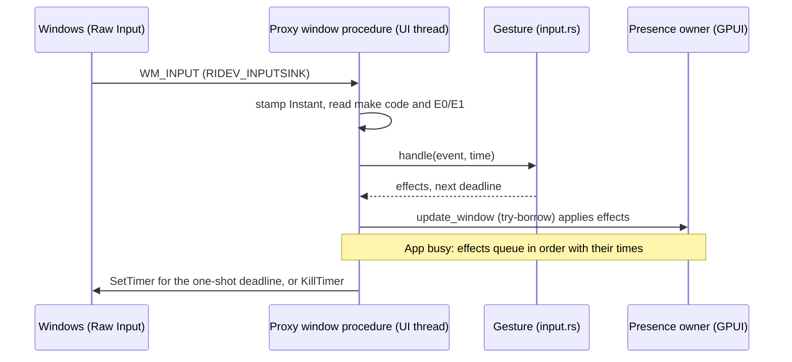

# Keyboard input and Esc

The shell recognizes one shortcut, left Ctrl plus left Alt, with Raw Input and no low-level
keyboard hook. It also decides locally what Esc does. Slice 1 has no microphone, screen capture,
runs or brain commands for either. Voice arrives in slice 7, capture in slice 6, and the run and
Stop protocol in slice 2.

## From key to Listening

- **Registration.** The hidden proxy window from the dock registers the keyboard with
  `RIDEV_INPUTSINK | RIDEV_DEVNOTIFY` before the brain link starts. The link thread used to start
  before GPUI; it now starts once the dock is open and the keyboard is armed (architecture §2.2).
- **Normalization.** Only make code 0x1D and 0x38 without a prefix are left Ctrl and left Alt.
  Right Ctrl (E0 0x1D) and AltGr's right Alt (E0 0x38) are other keys, so AltGr cancels instead of
  firing. AltGr's synthetic left Ctrl can't be told from a real one by its flags; the right Alt
  that follows still cancels. Pause (E1) resets, because it has no dependable key-up. A keyboard
  overrun resets. A key with no make code is named through `MapVirtualKeyW`.
- **Same callback.** The gesture lives in an `Rc<Cell<Gesture>>` shared by the native callback
  and the owner. The callback reduces it before anything else, so Listening is true by the time
  the callback returns. The dock's label then changes through `AsyncApp::update_window`, which
  only tries to borrow GPUI. If GPUI is already borrowed, because a nested message loop
  dispatched the callback, the effects wait in an ordered queue with their original times, and
  a foreground task retries them every millisecond until they apply or the owner is gone.
  Later effects queue behind them. Nothing panics and no key is lost.
- **Deadlines.** The gesture returns at most one deadline: the 300 ms hold or the double-tap
  window. The proxy arms it with `SetTimer` after delivery, for the time left from then, rounded
  up to whole milliseconds, so slow delivery never lengthens the hold, and disarms it
  when it's gone. There's no polling and no timer while nothing is pending. `KillTimer` can leave
  a WM_TIMER already queued; delivering it is harmless, because the gesture ignores a deadline it
  hasn't reached and returns the remaining one. Timer resolution is the system tick, about
  16 ms [guess, unmeasured on Rez].
- **Resets.** Device removal, any session change (lock or unlock), a desktop switch such as
  Ctrl+Alt+Del's secure desktop, suspend, an overrun and Pause all reset the gesture. Keys
  released while Capsula couldn't see them would otherwise stay held. A desktop switch arrives
  through an out-of-context WinEvent, not a keyboard hook. If the session or desktop watcher
  can't be registered, arming fails and undoes what it registered, rather than running without
  a reset source. Delivery isn't guaranteed in every
  case, so a missed key-up can still leave a modifier held until that key is pressed again.

## What each effect does

| Effect | Shell action in slice 1 |
|---|---|
| Listening | The dock shows Listening, overriding the link status until the gesture ends |
| Resting | The dock shows the link status again |
| HoldStarted | Every Capsula window gets `WDA_EXCLUDEFROMCAPTURE`, then the hold is logged. Slice 7 sends `HoldRecognized` only after this call returns |
| HoldEnded | Capture exclusion is removed |
| OpenInput | The typing panel opens and takes focus |

## The typing panel

A double tap opens a small panel where the hover panel would be, with one gpui-kit `Input`.
It's the only window Capsula activates. Windows allows the activation because the user just
pressed Alt. The panel remembers the window that was in front. Esc hides it and gives the
front back to that window, but only if Capsula still has the front and that window still exists.
The panel is hidden, not closed, so its draft survives. Hover never opens over it or dismisses it.
It has no Send, history or other controls yet.

## Esc

`escape.rs` decides each press: stop moving work first, clear an idle drawing second,
otherwise dismiss the topmost local panel, which in slice 1 is the typing panel. The local
effect always happens before any brain message. Slice 2 sends `Stop` and slice 4 sends
`ClearDrawing` after it.

Esc is held system-wide with `RegisterHotKey` only while Capsula speaks or shows a drawing.
Listening and an open hover panel never hold it. Slice 1 has neither speech nor drawings, so
global Esc stays unregistered. If registration is refused, the hover panel shows Stop instead,
and the refusal is logged without key or text content. An ignored fixture,
`cargo test -p capsula-shell -- --ignored escape_hold`, registers Esc on a hidden window, sees a
second registration refused with Stop shown, and sees Esc released. It holds the desktop's Esc
for milliseconds, so run it only in an approved session.

## Diagnostics for the input session

Two opt-in flags serve the approved input-session harness. A normal run uses neither, and
creates no file.

- `--input-diagnostics=<file>` writes one line per input milestone, flushed as it happens, as
  `qpc=<QueryPerformanceCounter> <event> key=value…`. Durations are in microseconds since the
  native callback's entry. Lines carry no keys and no text:
  - `listening applied_us=N start_qpc=Q` and `listening painted_us=N`: the dock's label change,
    with `Q` the counter read when the `WM_INPUT` callback began, before parsing, then the
    GPUI paint phase of the frame that shows it (a paint closure, not a present). Both appear
    only while the gesture is still Listening; a press that rests first logs neither.
  - `resting`
  - `hold excluded=true|false` and `hold ended restored=true|false`: whether every surface,
    the dock's native proxy included, took the capture affinity
  - `input opened focused=true|false` and `input dismissed`
  - `escape action=Stop|Clear|Dismiss|Ignore` and `escape wanted=true|false stop=true|false`
- `--esc-fixture` holds global Esc from startup until the first Esc arrives, without inventing
  speech or a drawing. The harness checks the hold, presses Esc once, and sees it released.
  It needs `--quit-after-ms` or `--smoke`, so a run can't keep Esc forever. If another process
  already holds Esc, `stop=true` and Stop shows at once: the hover panel opens and stays open,
  and an open typing panel shows its own Stop. They return to normal once Esc is held or no
  longer wanted.

A paint isn't a present. The Listening-on-screen gate needs that paint joined to its present
by PresentMon, and that join isn't built, so the endpoint stays unmeasured. The UI thread only
queues lines; `tracing-appender`'s worker thread writes and flushes them, and drops lines if
its queue ever fills rather than blocking. `main` creates the file and the worker before GPUI
starts, and Quit drains the worker off the UI thread, so the UI thread never touches the disk.

Unit tests cover the reducer's thresholds and sequences, scan-code naming and Esc ordering.
Real AltGr layouts, focus, hold feel and Listening on screen need the approved desktop session.
The separate-process fixture owns its window loop in `platform/input_session/fixture.rs`.
On Windows 8 and later, layout loading must run in the process that owns keyboard focus, so
the runner sends a bounded numeric request to the foreground fixture and verifies its active
layout acknowledgement before typing. The fixture tracks newly loaded handles and restores
its original layout on request and on exit, including after a lost acknowledgement. The
runner then checks the loaded-layout list. The approved session separately compares the
owner's persistent language registry settings before and after the layouts phase; a change
stops the session and is reported, never silently repaired with registry writes.
