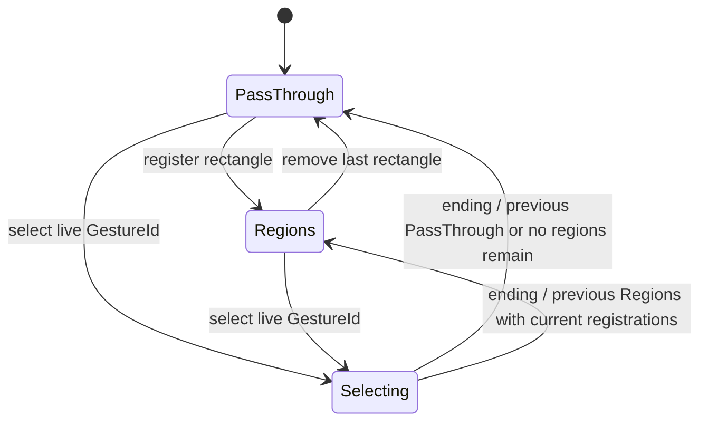
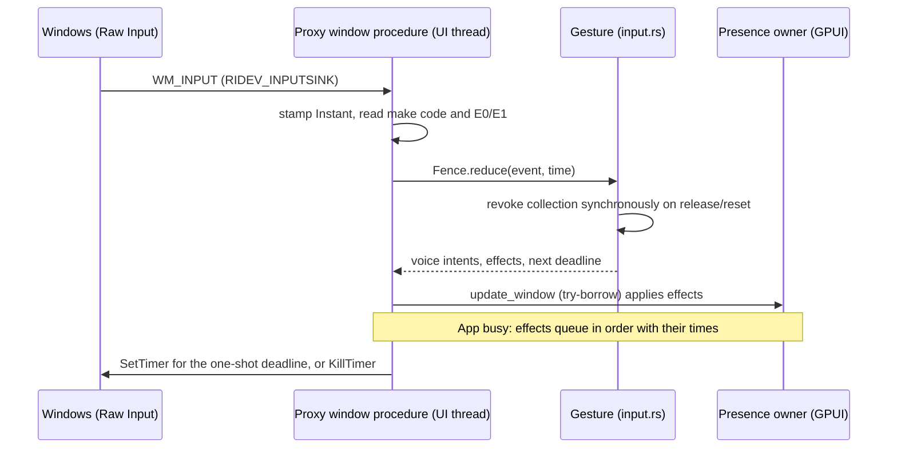
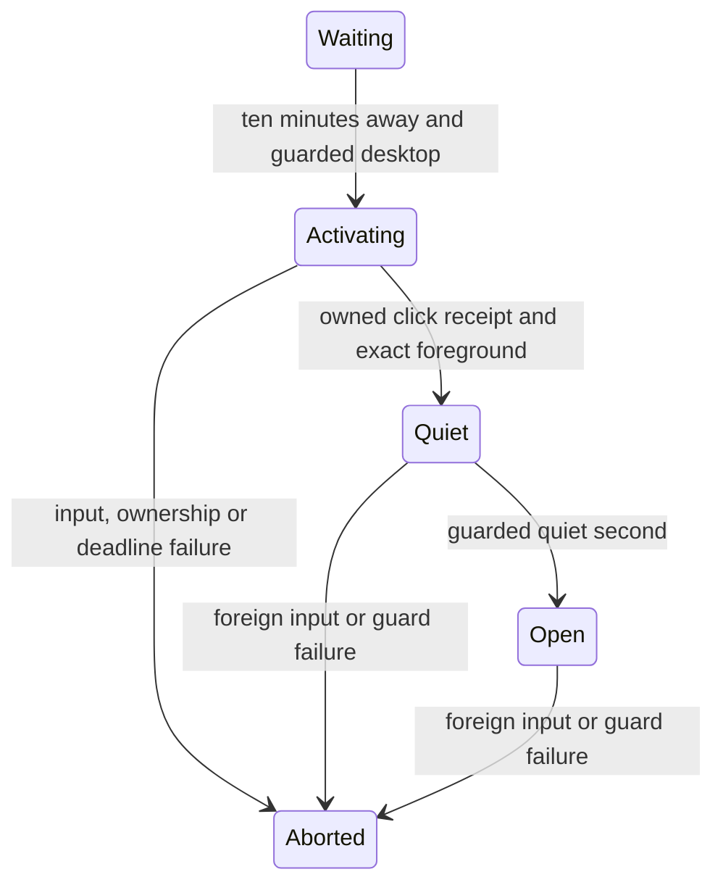

# Keyboard input and Esc

## Overlay pointer ownership

The presenter's `OverlayOwner` is the only overlay hit-test authority. Slice 5 registers
physical screen rectangles by `RegionId` and binds its input windows through `OverlayWindows`;
it never changes styles. Register/remove effects must be applied before the next input event.
Kumo requests a `DragLease` through the presence presenter on press, then returns it through
its terminal event. An orbit, a drag lease and a selection cannot own the pointer together.



Selection entry is two-phase. Apply orbit cancellation and Kumo's `Preempted` ending first,
then disable regions, raise the selection surface and take capture without activation.
Only after those effects return does `selected` start its separate `DragOwner`, with an input
stamp newer than the old capture loss. A failed raise/capture is fed back as `Err(())`:
it restores the previous mode, emits `Failed`, and never emits `SelectionStarted`.

Release, Esc, `GestureCancel`, brain loss, capture loss, window destruction, display change
and `HoldEnded` each restore once. Restoration uses today's registry, not a saved copy;
an empty registry restores PassThrough. A stale terminal event cannot end another gesture.
`HoldEnded` covers key-up and the 120-second hold clock: a rectangle at least 4×4 physical
pixels completes as a region; anything smaller cancels. B3a's low-level hook supplies Esc and
swallows it only while Selecting is live. B3a/B3b will produce selection entry; B0 sends no hold.
The pick stays on GPUI mouse events and the existing stamped capture-loss/reconcile bridge.

Native configuration always restacks, because placing or showing a presence window lifts it to
the top of the topmost band. It skips only the style changes when the mode and registry match the
last successful apply. That cache records what was last applied, not the windows' real state.
Binding changes invalidate it, and a failed partial apply invalidates it so restoration retries.
Restore errors don't drop selection notifications or Kumo's capture-loss/reconcile bridge:
all effects run, then the first error is reported. New bindings prune dead native handles and
skip duplicates within their layer.

The shell recognizes one shortcut, left Ctrl plus left Alt, with Raw Input and no low-level
keyboard hook. It also decides locally what Esc does, before the brain hears of it. Holding
the shortcut admits voice-only input; it grants no screen capture authority.

## From key to Listening



- **Registration.** The hidden proxy window from the dock registers the keyboard with
  `RIDEV_INPUTSINK | RIDEV_DEVNOTIFY` before the brain link starts. The link thread used to start
  before GPUI; it now starts once the dock is open and the keyboard is armed (architecture §2.2).
- **Normalization.** Only make code 0x1D and 0x38 without a prefix are left Ctrl and left Alt.
  Right Ctrl (E0 0x1D) and AltGr's right Alt (E0 0x38) are other keys, so AltGr cancels instead of
  firing. AltGr's synthetic left Ctrl can't be told from a real one by its flags; the right Alt
  that follows still cancels. Pause (E1) resets, because it has no dependable key-up. A keyboard
  overrun resets. A key with no make code is named through `MapVirtualKeyW`.
- **Same callback.** The gesture lives in an `Rc<Cell<Gesture>>` shared by the native callback
  and the owner. The callback installs the shared hold fence and revokes collection before
  deferring anything. Voice intents capture the target revision, session generation, choice
  revision and original QPC; double-tap effects retain their ordinary typing path.
  Both reach the owner through `AsyncApp::update_window`, which
  only tries to borrow GPUI. If GPUI is already borrowed, because a nested message loop
  dispatched the callback, the effects wait in an ordered queue with their original times, and
  a foreground task retries them every millisecond until they apply or the owner is gone.
  Later effects queue behind them. Nothing panics and no key is lost.
- **Deadlines.** The gesture returns at most one deadline: the 300 ms hold or the double-tap
  window. The proxy arms it with `SetTimer` after delivery, for the time left from then, rounded
  up to whole milliseconds, so slow delivery never lengthens the hold, and disarms it
  when it's gone. There's no polling and no timer while nothing is pending. `KillTimer` can leave
  a WM_TIMER already queued; delivering it is harmless, because the gesture ignores a deadline it
  hasn't reached and returns the remaining one. Timer resolution is the system tick, about
  16 ms [guess, unmeasured on Rez]. WM_TIMER is the lowest priority message, so a busy thread
  can delay it past the release. The shared delivery code also schedules each new deadline on
  GPUI's timer, which wakes the UI thread with a posted message that paint and timer messages
  can't starve. It reduces through the same path, and whichever timer arrives first wins; the
  other finds nothing due. A held chord key's auto-repeat also advances the gesture, a backstop
  that comes only after the keyboard's repeat delay. The recognition line logs whether the native
  deadline, the scheduled one, a repeat or the release reached the threshold, and a chord key
  more than 50 ms past an armed deadline logs the thread's message queue status once per gesture.
- **Resets.** Device removal, any session change (lock or unlock), a desktop switch such as
  Ctrl+Alt+Del's secure desktop, suspend, an overrun and Pause all reset the gesture. Keys
  released while Kumochi couldn't see them would otherwise stay held. A desktop switch arrives
  through an out-of-context WinEvent, not a keyboard hook. If the session or desktop watcher
  can't be registered, arming fails and undoes what it registered, rather than running without
  a reset source. Delivery isn't guaranteed in every
  case, so a missed key-up can still leave a modifier held until that key is pressed again.

## What each effect does

| Effect | Current shell action |
|---|---|
| Listening | Legacy effect ignored; only an admitted source's accepted Running receipt sets Listening |
| Resting | The dock's line returns to its resting fill |
| HoldStarted | Legacy effect ignored; recognized voice intent requests Brain admission, not screen authority |
| HoldEnded | Ignored; releasing a key is not capture retirement |
| OpenInput | The typing panel opens and takes focus (see [Taking the front](#taking-the-front)) |

The recognizer still measures short taps and rejects long presses as taps. Presence owns one
pending voice handoff: exact live Admitted permits source start; Loading never does. Running
is published before collection acceptance. Physical stop, successfully forwarded packet count
and native key-up rendezvous once before KeyUp is sent, regardless of UI delivery order.
Committed PCM may drain after native retirement; logical input/session/choice fences still
discard stale packets. Typed submissions remain text-only
(`ScreenChoice::None`). The separate [local exclusion transaction](screen.md#local-shell-exclusion)
has no production acquisition caller and never announces a lease.

## The typing panel

A double tap opens a small panel where the status panel would be, with one gpui-kit `Input`.
While the onboarding window shows, a double tap opens nothing, except at its shortcut step, where
it finishes onboarding and then opens this panel ([onboarding](onboarding.md)).
Like the [tasks panel](panels.md), it activates only on a user command, as described in
[Taking the front](#taking-the-front). The
panel remembers the window that was in front. Esc hides it and gives the
front back to that window, but only if Kumochi still has the front and that window still exists.
Switching to another window also hides it and keeps the draft, without restoring the old
foreground: the user has already chosen the new window. Hidden and stale deactivation events
do not normally dismiss a newly active panel, except for the rapid away/back cache limit in
[presence](presence.md). The panel is hidden, not closed, so its draft survives.
Hover never opens over it or dismisses it.
Opening the typing panel dismisses Tasks and Settings. Settings uses its normal dismissal
path, saving an active field edit as on blur. The chat header's **Tasks…** and a recovery
notice's Settings actions open their panel in its place once the click is handled, because
GPUI can't hide a window from inside that window's own click. A hide that fails leaves the panel open with its history, so Esc and its
close button still work.
Enter submits to the [captured input target](runs.md#the-shells-input-target). When the target
isn't Kumo, the panel names it and offers **Back to Kumo**. A settings update preserves the
draft and keyboard focus without changing that target.

### Taking the front

Windows lets a process call `SetForegroundWindow` only if one of a few conditions holds, among
them that it "received the last input event" ([SetForegroundWindow, Remarks][sfw]). Raw Input
with `RIDEV_INPUTSINK` gives Kumochi a copy of the shortcut's keys, but the keys themselves still
go to the app in front, so a plain activation fails (`focused=false` on c39d553). Pressing Alt
doesn't help: "the system automatically enables calls to SetForegroundWindow if the user presses
the ALT key" ([LockSetForegroundWindow, Remarks][lsfw]) only lifts a `LockSetForegroundWindow` lock.
It doesn't meet any of the conditions above.

So on each `OpenInput`, immediately before `SetForegroundWindow`, Kumochi sends exactly one
input: `INPUT_MOUSE` with no motion, no flags, no wheel or button data, and `dwExtraInfo` set to
`FOCUS_INPUT_MARKER`. That makes Kumochi the last input's sender. PowerToys Run uses the same
method ([microsoft/PowerToys#4362][ptr]). There's no retry and no fallback. If `SendInput` is
refused or the activation still fails, the panel stays open, unfocused and clickable, and the
log says `focused=false`.

Side effects:

- Other apps' low-level mouse hooks see the event with `LLMHF_INJECTED`. The gate harness accepts
  it only with the marker, zero motion and no buttons.
- It resets the idle timer (`GetLastInputInfo`), which the user's keypress just did anyway.
- UIPI drops it when the app in front is elevated, so the panel can't take focus over an admin
  app.
- It carries no key, so it can't open a menu in the app in front. The shell's Raw Input
  registration is keyboard-only, so the gesture never sees it, and the gate observer records
  only marked left presses.

Rejected alternatives:

- Activating at the second key-down while Alt is held relies on the Alt misreading above.
- A `RegisterHotKey` grant ([Raymond Chen][hotkey]) would take the Ctrl+Alt key-down from the app
  in front during the tap window, would fire on AltGr, and would have to activate before the tap
  completes.
- `AttachThreadInput` makes focus changes synchronous with the foreground thread
  ([Raymond Chen][attach]), so a hung app in front could block the UI thread, and it can't attach
  to an elevated app.
- An injected Alt can open a menu in the app in front.

[sfw]: https://learn.microsoft.com/en-us/windows/win32/api/winuser/nf-winuser-setforegroundwindow
[lsfw]: https://learn.microsoft.com/en-us/windows/win32/api/winuser/nf-winuser-locksetforegroundwindow
[ptr]: https://github.com/microsoft/PowerToys/pull/4362
[hotkey]: https://devblogs.microsoft.com/oldnewthing/20090226-00/?p=19013
[attach]: https://devblogs.microsoft.com/oldnewthing/20130607-00/?p=4143

## Esc

`escape.rs` decides each press: stop moving work first, clear an idle drawing second, cancel
an active inline rename, Settings field edit or onboarding name edit third, otherwise dismiss
the typing panel, the focused Tasks or Settings panel, or the onboarding window, which runs
Finish later ([onboarding](onboarding.md)). Stop and clear leave an edit intact;
cancelling an edit restores its saved value without sending it and doesn't dismiss its panel.
The local effect always happens first, and nothing waits on the brain:

- **Stop** fences the moving run off in `shell-core`'s `runs.rs`, keeping what's on screen, then queues `Stop`
  on the control pipe. The fence is checked when a message is applied, so the run's frames
  already queued in the shell are dropped too.
  - A run counts as moving until both its terminal `RunState` and its `RunEnd` have been
    applied, in either order, since the pipes aren't ordered with each other. An older run's
    ending never settles a newer one.
  - Turns sent and not yet answered by a `RunState` count as work too. Esc cancels every one
    sent before the press: when a cancelled turn's run is first named, it's fenced before any of
    its output is applied and gets its own `Stop`. A turn sent after the press isn't covered.
- **Clear**, the next Esc, removes the shown scenes, and any recovery under way, keeps the text,
  keeps the scenes' late steps out, and queues one `ClearDrawing` naming them. The brain records
  the clear, so they don't come back. See [the drawing](presence.md#the-drawing).
- With no brain connected, or a control queue the brain isn't reading, the local effect still
  happens and the unsent message is logged, without content.

Esc is held system-wide with `RegisterHotKey` while held voice is active or a drawing is shown:
the overlay is showing scene frames (`Presenter::drawn`), or run steps show in the open typing
panel. Mirrored, preparing and recovering scenes that aren't painted yet don't hold it, and an
open status panel alone never does. Spoken replies don't hold it yet; `Activity::speaking` is
always false.
Held voice additionally owns global Esc through preparation and pre-answer work. A raw Escape
revokes collection before deferred UI; its hotkey delivery consumes one marker so that the
same press cannot also dismiss typing. Cleanup debt alone does not capture Esc from newer
ordinary work. If registration is refused,
the status panel shows Stop instead, and the refusal is logged without key or text content.
An ignored fixture,
`cargo test -p kumochi-shell -- --ignored escape_hold`, registers Esc on a hidden window, sees a
second registration refused with Stop shown, and sees Esc released. It holds the desktop's Esc
for milliseconds, so run it only in an approved session.

## Diagnostics for the input session

Two opt-in flags serve the approved gate-session harness. A normal run uses neither, and
creates no file.

- `--input-diagnostics=<file>` writes one line per input milestone, flushed as it happens, as
  `qpc=<QueryPerformanceCounter> <event> key=value…`. Durations are in microseconds since the
  native callback's entry. Lines carry no keys and no text:
  - Legacy Listening and capture effects are inactive. The adapter retains gesture `Instant`
    and callback QPC for voice controls, but does not log a listening-paint timing join.
  - `input opened focused=true|false` and `input dismissed`
  - `input draft nonempty=true|false preserved=true|false`, after an `input opened` that follows
    a dismiss: whether the draft held at that dismiss was nonempty, and whether the input still
    holds exactly it. Only diagnostic runs keep that draft, in memory until the compare; no text,
    hash or length is logged, and an empty draft never counts as preserved. The first open logs
    no draft line.
  - `escape action=Stop|Clear|CancelEdit|Dismiss|Ignore` and `escape wanted=true|false stop=true|false`
  - status lines that no gate reads: `link state=`, `carry drop perch=`, `resting` (exactly),
    `run phase=`, `submit sent=`, `dock settled`, `dock paints settled=`, `kumo baked`,
    `kumo frame shade_us=` and `kumo reshades=`. The harness reads them as status and still
    refuses any other unknown event.
  - `kumo press at=<x>,<y> bounds=<x>,<y>,<w>,<h> grabbed=true|false`: every left press the
    peek's window sees, in window pixels against Kumo's square, and whether a pull is live after
    it. Numbers only; the harness reads it as status.
- `--esc-fixture` holds global Esc from startup until the first Esc arrives, without inventing
  speech or a drawing. The harness checks the hold, presses Esc once, and sees it released.
  It needs `--quit-after-ms` or `--smoke`, so a run can't keep Esc forever. If another process
  already holds Esc, `stop=true` and Stop shows at once: the status panel opens and stays open,
  and an open typing panel shows its own Stop. They return to normal once Esc is held or no
  longer wanted.

A paint isn't a present. The gate harness joins its exact Canvas QPC to the separately logged
posted-completion interval and a unique eligible PresentMon row on the validated dock swapchain.
Missing, dropped, reused or ambiguous joins remain unmeasured; a Canvas marker alone never
passes a present or display gate. Shortcut latency, from left Ctrl + left Alt to the dock's
first present, and AltGr for hold to talk are unmeasured for now: the session has no keyboard
or layouts phase. Hover gates the native pointer-entry QPC →
the peek's first present at p95 ≤8ms. That QPC is read
when the entering `WM_MOUSEMOVE` is dispatched to the proxy's window procedure. So it excludes
OS routing and the message's wait in the UI thread's Win32 message queue before dispatch, and
includes the wait from dispatch, through the presence event channel, to the presence handler. A change whose entry is missing or no later than the previous change
stays in the denominator as `MissingEntry`; SendInput → present and state entry → present are
reported beside it, not gated, so a build without entry counters still gives those two.
Both reports retain display latency separately: missing display feedback is unmeasured there,
not a fabricated zero or a failure of an otherwise valid present endpoint. Receipt body
coverage and motion pacing still require displayed frames. The UI thread only
queues lines; `tracing-appender`'s worker thread writes and flushes them, and drops lines if
its queue ever fills rather than blocking. `main` creates the file and the worker before GPUI
starts, and Quit drains the worker off the UI thread, so the UI thread never touches the disk.

Unit tests cover the reducer's thresholds and sequences, scan-code naming and Esc ordering.
Focus and double-tap feel need the approved desktop session. Its gate copy has no speech model,
so it can't show Listening or judge hold feel.
The separate-process fixture owns its window loop in `platform/input_session/fixture.rs`.
The approved session compares the owner's persistent language registry settings before and
after its automated phases; a change stops the session and is reported, never silently repaired
with registry writes.

## One approved final-main gate session

The separate `cold-start <path-session.txt>` task runs ten input-free cold launches in its own
approved quiet window before the owner session. Both run as the gate identity and build the
images they launch (see [the gate identity](gate-identity.md)). It uses the same create-new transcript and
adjacent evidence-directory contract below, but never arms Ready or enters the input phase
sequence. It is not an extra loop inside `gate-session`. Each launch in either task waits up to
3 s for the brain and both its workers (screen and speech) and holds all of them, and refuses any
other product process.

The cold trace starts before process launch with the product executable-name filter; all its
rows must later match that one owned PID. A completed PID-filtered warm capture identifies the
dock swapchain. PresentMon 2.6 swallows the first present of each swapchain as a seed. From that
chain's first CSV row, the harness derives seed present = `QPCTime − msBetweenPresents` and
seed displayed = `first row displayed − msBetweenDisplayChange`, in checked QPC arithmetic.
The derived seed must fit at least one recorded Dock paint/completion interval, and every
containing interval must have begun before the first harness repaint; its cutoff is retained
in `first-harness-repaint.txt`. Overlapping startup intervals are allowed because cold start
measures creation to the first present, not a particular frame.
The matching paint need not be the first recorded paint: only the first actual present is the
seed. Missing, invalid, post-repaint or dropped seed evidence is unmeasured; no later
ordinary row or warm-up repaint substitutes. `seed.txt` retains the first raw row and intervals.
The 400ms gate is creation → first eligible dock **present**, with
display latency reported beside it when available. The existing prelaunch name trace remains:
launching suspended was not adopted, so a name-filter miss fails explicitly rather than
changing the origin to resume. Process creation comes from `GetProcessTimes`, mapped from its UTC
FILETIME through a precise-UTC/QPC bracket of at most 1ms. The anchor estimate is not a physical
lower bound, because creation-timestamp granularity is outside that bracket. Ten conservative
upper bounds produce nearest-rank p50/p95/max against 400ms. These are fresh
processes, not a cache-flushed boot: binaries are hashed before each launch and OS caches are not
purged. No input, foreground transfer, elevation or fixture is involved. Launch 1 starts a
profile already marked onboarded, so onboarding's own start cost is unmeasured.

`gate-session` replaces the old per-phase `input-session` launcher. Preparation, a green build,
or a Good feel verdict does not authorize desktop input. Invoke it only after fresh owner
approval and the Captain's GO, with the gate xtask and its release images already built (see
[the gate identity](gate-identity.md)) and no builds or other heavy work running. It refuses existing product processes and never retries a failed
input phase.

The complete stdout **and** stderr transcript is required evidence. In Git Bash, choose a fresh
absolute filename outside the repository, whose name ends in `-session.txt`, then use create-new
redirection. Set `transcript` to that user-chosen path. Set `PRESENTMON_EXE` to the absolute path
of your existing `PresentMon-2.6.0-x64.exe`; `gate-session`, `hover-gate` and `cold-start` require
this explicit selection, with no PATH search or default executable. The pinned filename and 2.6
CSV validation do not authenticate the executable's contents: obtain it from a trusted source.
Do not run an unredirected session or reuse an old evidence directory:

```bash
set -o noclobber
: "${transcript:?set transcript to your chosen absolute outside-repo path ending in -session.txt}"
: "${PRESENTMON_EXE:?set PRESENTMON_EXE to your chosen absolute PresentMon-2.6.0-x64.exe path}"
export PRESENTMON_EXE
{ git rev-parse HEAD && git status --short &&
  ./target/release/xtask.exe gate-session "$transcript"; } >"$transcript" 2>&1
```

Run the release driver at normal priority; `nice -n 10` is only for builds and tests, never
the measurement command. The parent directory must already exist. The runner verifies that both actual disk output
handles resolve to the requested file before launching anything, then atomically creates its
adjacent directory named by removing `-session.txt`. The transcript retains every calibration
trial and every role's raw cycle/time row. Phase directories retain diagnostics, observer records, PresentMon
commands/CSVs/exit status, recipient receipts, totals, limits and failed samples. Nothing deletes
outliers or removes these files during cleanup. Binary SHA-256 identities and before/after
display/background-process metadata identify the measurement environment.

### Feel, Ready and the persistent fixture

One owned EDIT/Ready fixture remains alive throughout the session. Injection starts disabled.
The initial release shell is bounded to 120 seconds while the owner has about 90 seconds to try
the 300ms hold and double tap by hand and choose independent categorical feel verdicts.
The dock is a short line at top center by default, not a separate test window. The gate copy
has no speech model, so a hold is recognised but the line stays plain and nothing is recorded or
sent; hovering the line may show Not installed in the status panel. Hold feel can't be judged in
this copy, so Unrated is the right Hold verdict.
The test window is only for verdicts and Ready. Ready stays disabled until the owner explicitly
selects both verdicts, including Unrated if that is the owner's choice.
The feel product writes `feel/milestones.log`; after its graceful exit, `feel/summary.txt`
reports double-tap openings and focused/unfocused opens. The shell no longer logs holds, so
holds aren't counted. These contain no text or keys, are not present timings, and do not
replace the owner's verdicts or any automated gate.
Missing or truncated feel diagnostics are reported as `summary=unmeasured`, without blocking
otherwise authorized automated phases; failure to retain the summary itself still stops safely.
During feel the owner also presses Alt-Tab once and separately reports whether a product window
appears; this verdict may be an external owner reply, not a third GUI feel field. The nine
placements remain runtime-unmeasured; this session adds no placement sweep or flag.
The owner then physically clicks Ready, releases the button and stays hands-off until the
fixture window closes (allow about 10 minutes, at most one hour). The first quiet second
only opens injection; it is not permission to touch the mouse or keyboard again. Synthetic clicks,
posted messages and keyboard activation cannot arm Ready. The native fixture arms only after
button-up, then requires one guarded second with unchanged last-input time before injection
opens. There is no synthetic foreground transfer or replacement Ready click between phases.
Physical input or loss of fixture focus during that pre-injection second returns the fixture to
waiting for a fresh physical Ready. The original 90s feel deadline does not restart; neither
does the one-hour session limit. Once injection has opened, the existing sticky-abort rule
applies and no Ready can reopen it. API/guard failures and a session lock still stop safely.
The first native guard stop retains its cause (session lock, physical input, or raw-input read
failure), phase and milliseconds since injection opened. Input metadata is limited to keyboard,
mouse movement with signed deltas, button, wheel or other, and the extra-information marker
when that device provides one. No key codes, button identities, wheel values or text are logged.
The transcript and `session-result.txt` retain this snapshot before the fixture closes; later
events cannot overwrite the first cause. These diagnostics do not relax or retry a stopped gate.

Before an approved session, `cargo xtask input-quiet <seconds>` observes the same raw-input guard
on a hidden window for an explicit 1–120 seconds. It prints content-free event classification,
motion deltas and marker, including whether the guard would exempt a tagged event. Raw-input
read failures are reported, not mistaken for a quiet desktop. It sends no input, never activates
a window or launches the product, and removes its registrations when it ends. Running it on Rez
still needs the Captain's measurement window; building it does not start it.

The product's separate `FOCUS_INPUT_MARKER` is accepted only on a zero-motion relative mouse
event with no buttons or wheel; marked movement, absolute positioning and other devices remain
physical input. Post-open owned product focus is still required by the focus phase. Pre-open
quiet/foreground checks remain conservative if delayed focus work leaves the fixture unsettled.

Good, Off, Broken and Unrated remain separate human results, not approval tokens or substitutes
for measured gates. An Off or Unrated result needs owner disposition, but does not cancel already
authorized measurements after Ready. If Ready is absent, the session stops without injecting.

### Fixed automated order and bounds

A scratch profile needs `onboarded = true` in its `config.toml`, or the onboarding window
opens, takes focus and uses up the double-tap.

Each automated phase launches a fresh stable shell PID at normal priority under the same
fixture lease. Idle alone gets a 120-second product bound; every other phase gets 90 seconds,
with its input cutoff at least 13 seconds before cleanup (77 seconds for instrumented phases).
The whole session has a one-hour limit and reserves another 30 seconds for final
cleanup; a phase cannot begin without its complete budget.

1. The idle CPU row calibrates three saturated 2-second trials, settles for 30 seconds and
   samples for 60. It sends no motion or input and omits the gate observer. Calibrated cycles
   are the CPU gate, with GetProcessTimes alongside; the limit is 1% of one core. DWM and private
   bytes are retained too.
2. Resting receipts run for 20 seconds; the motion receipts return with the pull (C2a). The harmless EDIT covers the tested area. Only actual EDIT/proxy recipient counts,
   screen points and QPCs prove delivery; WindowFromPoint checks alone are not receipts.
   Every required category needs stable native and measured display coverage. Rest additionally
   needs displayed-body receipts at the line's center and edge. Dropped-only or otherwise unavailable display evidence makes the phase
   incomplete even when native routing succeeded.
   Hovering the body opens the peek; candidate points exclude its rectangle so that
   later receipt trials cannot target the panel instead of the proxy or covering EDIT.
3. Hover runs after the resting receipts: 100 pointer entries onto the dock. Before each entry,
   once the previous cycle has hidden the peek, it waits 1–8ms in a fixed jitter. After the entry
   it waits a fixed 100ms, checks that the peek is visible, then leaves and waits until it hides.
4. Focus requires a visible, foreground typing surface before typing a known draft. It dismisses
   through local Esc, reopens, double-taps again while active, then clicks a second top-level
   fixture window, distinct from the previous foreground. After the Dismissed mark, typing must
   be hidden and that second window must still be foreground 300ms later. A guarded EDIT click
   returns to the original fixture before closing the alternate. Both reopens use the non-content observation
   to check draft preservation. Normal Esc dismissal must return foreground to the fixture;
   there is no SetForegroundWindow workaround. Ordinary Esc must then reach the EDIT.
5. Free and fixture-contested global Esc use separate products but the same fixture. Contested
   fallback visibility must exist before pointer movement and persist after leave.
6. A separate bounded contested-Esc product exercises the rendered Stop button, using its
   observed rectangle and exact owned panel HWND rather than a guessed coordinate. After the
   guarded click, wanted/Stop visibility must clear. The fixture then releases its own Esc
   reservation so ordinary Escape can reach the EDIT
   with an EscapeIgnore acknowledgement. The idle fixture proves clearing this affordance,
   not cancellation of a nonexistent backend request.

Every instrumented phase also checks the observer's mask commits: each must own exactly its hit
proxy, except a Kumo pull's, which the shell records as an empty mask over an area grown from the
dock. No phase or cold start is meant to pull, so every reader of the observer refuses one, and
a phase fails with `Kumo pull during <phase>`. Each phase's `pulls.txt` holds its count and
whether the observer read completely.

There is no keyboard or layouts phase, so shortcut latency and AltGr for hold to talk are
unmeasured for now. Recursive read-only registry snapshots of the language settings, with
missing-key/read status, are compared after the phases even on failure; any difference stops
the session and is never repaired.

For instrumented phases, a PID-filtered warm trace has an 8-second fixed backstop. Three
input-free repaints and a guarded wait produce a completed CSV that must have zero loss and one
eligible dock swapchain before the main trace starts. The main trace is seeded with six repaints
100 ms apart, because a new trace records nothing for roughly its first 200 ms, sometimes longer.
A resting dock doesn't paint again, so the resting-receipts phase fails a main trace with no
present on the dock swapchain as a missed dock seed; the other phases don't check it.

Every main-trace swapchain has the same first-present seed rule, including the status panel.
The v1 CSV parser accepts a finite negative `msUntilRenderStart`: GPU work can start before
the Present call. Other timing columns, including `msUntilRenderComplete` and `msUntilDisplayed`,
remain nonnegative. The render-start offset does not change present/display endpoints or gate
budgets; those still use raw QPC and the validated display delay.
Joins consider that derived seed alongside raw rows, using the same uniqueness, drop and reuse
checks. Reports retain each sample's CSV/seed provenance and the seed derivation; raw CSV rows
stay unchanged. A seed is eligible only when the first emitted row is displayed, its
`msBetweenDisplayChange` is positive, and the reconstructed seed display is at or after the
seed present. PresentMon 2.6 initializes the swapchain's previous display timestamp to zero;
`SeedFromFirstPresent` updates it only for a displayed seed, and `DeltaUnsignedMilliSeconds`
returns zero when either timestamp is zero. Thus a positive first-row display interval proves
the suppressed seed was displayed. Zero, missing or inconsistent display evidence leaves the
seed ineligible even for present-only gates; raw present endpoints do not require this proof.
The first emitted row's `Dropped` bit belongs to that row, not its seed; a dropped row cannot
provide the display proof. Undisplayed-motion counts use raw rows only.

Main trace backstops are fixed per phase:

| Phase | Main backstop |
| --- | ---: |
| Hover, resting receipts | 30s |
| Focus | 20s |
| Free Esc, contested persistence, Stop button | 10s |

CPU rows have no main input trace. Normal completion stops only this harness's uniquely named
ETW session earlier. The trace is
finished and validated even if the trial fails, before the owned product exits and flushes its
observer close/end records. A fresh PID requires a fresh warm validation.
Immediately after the main trace starts, the input deadline is tightened to the earlier of the
product cutoff and two seconds before that phase's trace bound. Acknowledged downs are
released and the EDIT is uncovered before any potentially slow trace-finish wait, on both
success and failure.

After injection has opened, any physical input, lock/desktop change, foreign foreground/capture/menu/move loop,
or phase error stops the whole session. A foreign foreground stop names only its process id
(`foreground_pid=<n> owned=false`); the run's before and after process lists resolve the image.
An empty foreground (pid 0) is allowed for at most 100 ms from its first sample, because
activation handed to another process's window completes asynchronously. Only an owned window
in front ends that grace; a foreign pid still stops at once, and a longer NULL stops with
`foreground_pid=0` and its duration. Nothing is sent while the front is empty, except cleanup's
releases of acknowledged downs. Each phase records the graces it used and the longest in
`null-foreground.txt`, counting a grace still open at its end as its own.
Cleanup releases only acknowledged injected downs,
closes only owned windows/processes gracefully, and retains
all errors. It never force-kills another process or repairs language settings. Cursor restoration
is skipped after any abort, and otherwise remains guarded and confined to owned destinations.
Actual Alt-Tab into owner applications remains manual or unmeasured.

### The hover-only idle session

`hover-gate <path-session.txt>` runs the hover phase alone, with the same transcript, evidence
directory, fixture, guards and PresentMon bounds as `gate-session`. Only the opener differs.
Nobody presses Ready. The runner waits until `GetLastInputInfo` shows ten minutes away.
The fixture checks again during its single-use prepare; input between the runner's check and
prepare aborts the run rather than retrying. A successful prepare grants one mouse-only
activation admission and registers the native foreign-input guard before any injected event.
The ordinary keyboard gate remains closed.

The exact stdout line `activation_native_guard=armed` is flushed after native preparation
and before the first mouse event. This is the outside watchdog's handoff contract: only that
line transfers owner-input monitoring to the native tagged-input guard, before our own click
changes the last-input tick.

The runner temporarily raises only the fixture above other windows, without activating it.
It chooses a harmless point inside the fixture EDIT and checks both the exact window and its
process with `WindowFromPoint` immediately before moving the pointer and again before clicking.
A stale snapshot, wrong point, foreign capture/menu or interrupted admission stops the run.
Only tagged mouse input is allowed at this stage: no Alt-key trick, `AttachThreadInput`, or
message/input to another app is used. Finalization restores the fixture's prior topmost state.
If that request fails or cannot arrive, the run refuses and closes its owned fixture instead.

After the click's receipt, the runner waits up to 250 ms for the fixture's root to come to the
front, because activation completes asynchronously. An empty front or another window of the
fixture's own process keeps it waiting; a foreign foreground, any input or a moved pointer ends
the wait at once and refuses. `opener.txt` records the wait as `root_wait_ms`.

The native fixture must acknowledge the tagged click and be the exact foreground window with
its EDIT focused before publishing Ready. The click changes the last-input tick, so only its
acknowledged completion may establish the quiet-second stamp; foreign input never resets an
admission into validity. The unchanged quiet second then opens normal keyboard injection.
Foreign input, a lock, deadline or ownership mismatch ends the idle activation permanently.
Pointer restoration still skips destinations outside the owned windows.



Refusal diagnostics include the foreground PID and executable basename and whether the input
desktop is `Default`. Unavailable queries are reported as absent values, not treated as safe.
No window title, full executable path or desktop name is logged. A physical Ready press during
this task is refused. `gate-session` keeps its existing physical Ready path and feel verdicts;
this separate admission never opens its keyboard gate early.

### The unattended measured session

`measure-gate <path-session.txt>` runs every measured phase of `gate-session`, with the same
transcript, evidence directory, fixture, guards and PresentMon bounds, behind `hover-gate`'s
idle opener. It has no Ready and no feel verdicts: it prints that, and its `owner-feel.txt`
says `not_part_of_this_run`. The physical Ready in `gate-session` stays the only handoff for
the owner's feel verdicts; the measured phases may also run unattended after ten idle minutes.

## Voice hold authority

The shared hold fence gives each chord a checked, never-wrapping gesture number.
Recognition at 300 ms requests admission; chord make only warms speech input.
It never turns the legacy Listening effect into recording authority. Normal release
and cancellation are distinct intents. The native reducer closes the atomic collection
gate before queuing UI delivery, so a delayed recognition cannot reopen released input.
Reset also cancels released speech that has not yet become a run. While the onboarding window
shows, the fence drops a hold before it warms or arms anything, on every recognition path
([onboarding](onboarding.md#hold-to-talk)).

The microphone generation remains occupied until its matching stop/join receipt or
proof it was never started. Cancellation and startup/hold deadlines are not release
receipts. The shared gate, source lifecycle and fixed failures are in
`shell-core`'s `platform/microphone.rs`; device APIs stay behind its native adapter.
