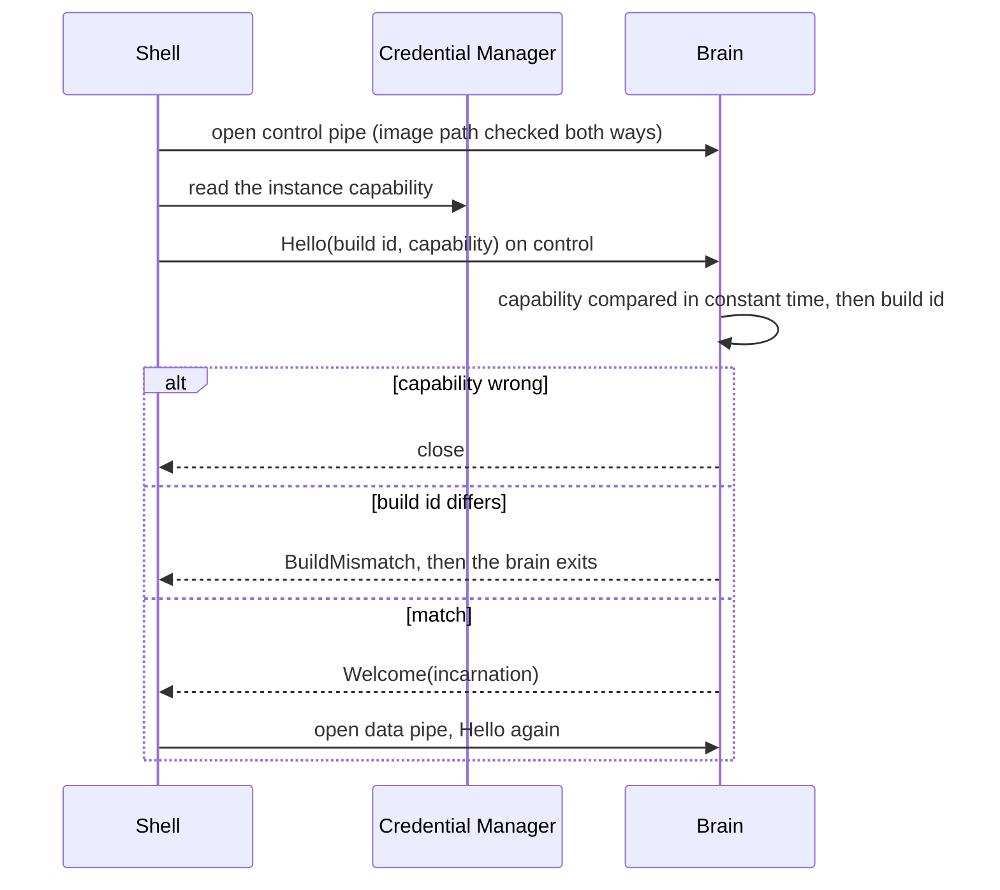

# The pipes and the handshake

The shell and the brain talk over two named pipes per Windows session: **control** for small,
urgent messages and **data** for everything that can grow. Frames are a `u32` little-endian
length followed by a `postcard` payload from the closed enums in `crates/protocol`. The length
is checked against the pipe's cap (64 KiB control, 256 KiB data) before anything is allocated.

## Who may connect

- The brain creates both pipes with a protected DACL that grants only the user who made them,
  reads the DACL back before listening, and refuses remote clients.
- Each pipe allows two instances: the one in use, and its replacement, created before the used
  one closes so another process can never take the name in between.
- The brain only talks to the `capsula.exe` beside its own executable, and the shell only to
  the `capsulad.exe` beside its own. Each side checks the other's image path through the pipe.
- On every start the brain writes a fresh random 32-byte **instance capability** to Windows
  Credential Manager. A shell proves it runs as the same user by reading it back. It's never on
  a command line, in a file, or in the environment.

## The handshake

The capability is checked before anything else, so a client without it learns nothing, not even
whether its build matches. A shell that meets a brain from another build waits for that brain to
exit and starts the one beside itself.

## Starting and reconnecting

A per-session mutex keeps one shell. If no brain pipe answers, the shell starts `capsulad.exe`
detached, outside its own job where the job allows it, and retries for up to ten seconds. A shell
started by hand finds a running brain the same way, so after a shell crash nothing needs
restarting.

## Debugging

A debug brain records every frame it sends and receives when `CAPSULA_PIPE_TAP` names a file,
with capabilities zeroed. `cargo xtask pipe-dump <file>` decodes the recording with the same
message types.
