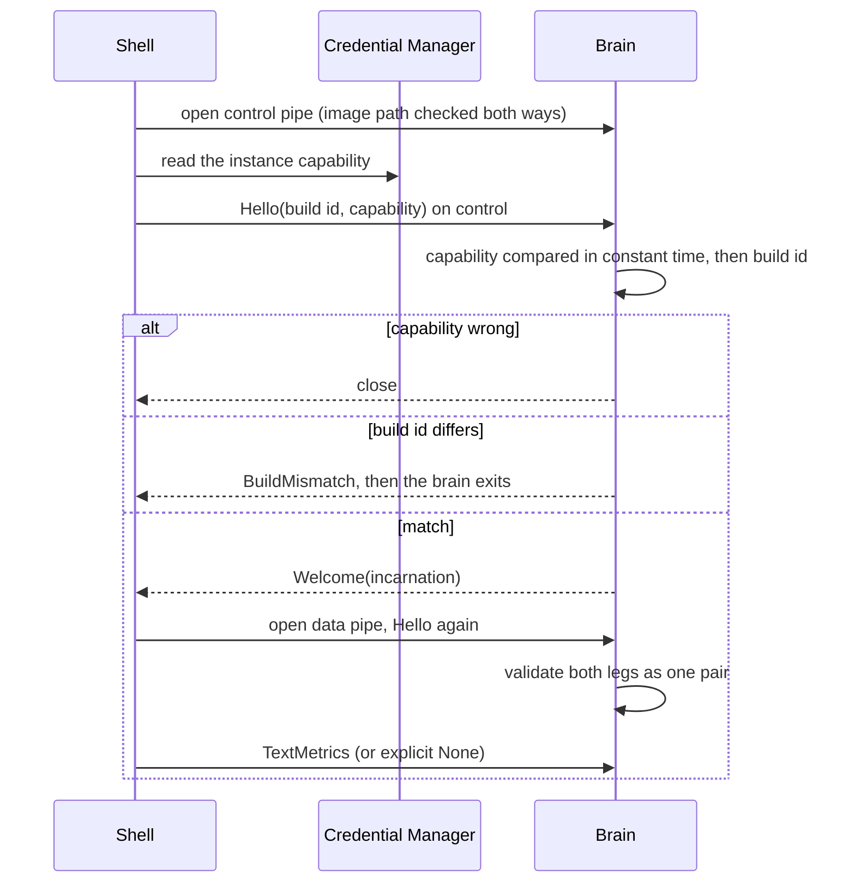
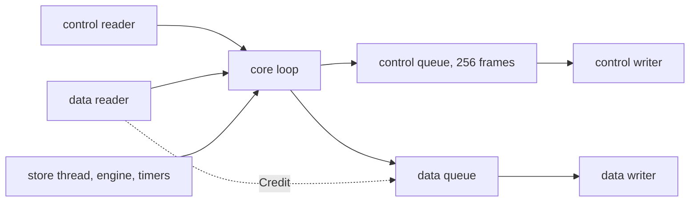
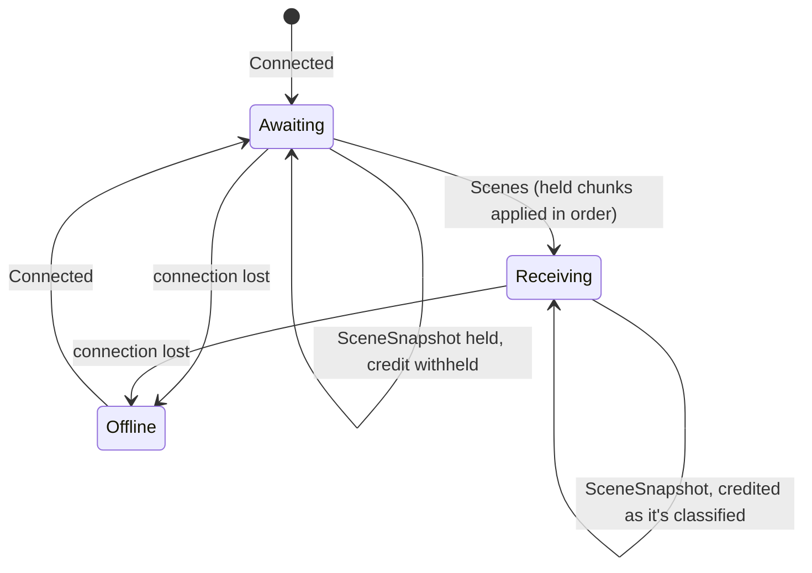
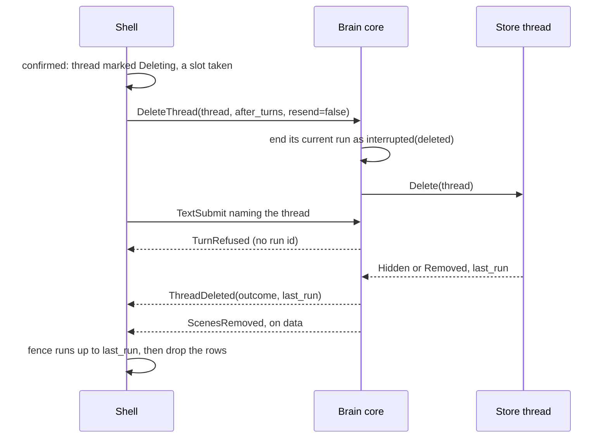

# The pipes and the handshake

## Greeting authorization

The existing pipe transport checks the capability in constant time before comparing the build,
on both control and data. A correct capability with a wrong control build still gets
`BuildMismatch`; any data greeting that fails either check is refused as a wrong capability.

`Hello::session` keeps the same field and tag layout but fills the capability field with 32
zero bytes. The local transport selects the authorization method; a session-bound greeting must
come from the authenticated pair's own reader, match the build, and carry only that zero
placeholder on either leg. A nonzero placeholder is refused without capability fallback.
The bound greeting type cannot be constructed on any platform yet, so neither shell startup
nor brain admission selects session authorization.

## Queued-required session mode (internal)

The shipped shell selects Legacy: control Hello, Welcome, then data Hello, with their
existing bytes. Both modes follow their data Hello with one drawing-font startup frame.
The internal queued-required selection instead sends the appended QueuedHello
on both pipes. Its data Hello echoes this Welcome's incarnation and issue epoch. The brain
checks the executable, matching build and capability on both legs and the existing same-process
pairing. It refuses a mixed mode or a data Hello from another session. The queued second leg
has one deadline for connecting and reading; refusal renews both pipe instances.

This negotiates a requirement, not an installed audio output. An authenticated queued pair
installs the exact reserved issue session. Both pipes return to regular I/O after their bounded
handshake. Ordinary launch still selects Legacy, with no queued-to-Legacy fallback.
The Brain starts each queued pair closed to turns. It sends
`QueuedAudioRegistered(output)` once, only after a valid `QueuedAudioOutput` installs the
exact logical output in Queued mode. It opens admission only if that receipt queues.
Early typed/Ask frames and new hold intent end the pair without buffering for later;
settings, recovery, and cleanup keep their existing paths. A duplicate registration,
Legacy announcement, current-output withdrawal, or failed receipt enqueue ends the pair.
A Legacy session that sends `QueuedAudioOutput` ends too, before anything is installed.
The receipt isn't proof of playback, silence, or the shell having received it.

The queued shell link registers its logical output after the first Settings, even with Talk-back
off. It accepts the exact registration receipt once, by the original startup deadline. A change
to Talk-back ends the pair rather than changing its audio contract in place; output failure
doesn't turn an audio-required pair into a text-only pair. Its data reader can wait on one charged Plain
announcement or PCM frame until the control reader names that run. Control stays available while
the data head waits, and the session owner wakes that head on binding, returned capacity, revocation
or close. The registration declares the pair's narration: `Conducted` only when a narration
bridge owns the pair, otherwise `Plain`. The brain sets its narration and its pump's first-PCM
timing from that accepted declaration, never from how its pump was created. In Plain mode,
Speech-start announcements and scene speech promises end the pair without credit, so the brain
sends a speech-start step's `say` there as a Plain segment with no promise. The changed
registration needs no version field: Hello already requires the exact same build on both sides,
so an older shell is refused before it can register.
Talk-back-off typed turns bind the same run identity but start no speaker worker. They owe
no audio receipts. Unexpected speech ends a silent pair without credit, before waiting for a
run to be named or draining a stopped or ended run.
Speaking runs use the existing per-run worker. A Stop fences that run's late PCM, and a replacement
cannot use closing a pipe or freeing a device permit as proof of quiet.
Esc fences the scene before offering Stop or StopScenes to its exact session's control mailbox.
A SceneFailed caused by host refusal follows in that same mailbox; neither offer takes the
outbox mutex. If the scene stream is broken or the mailbox or queued speaker refuses Stop,
admission closes on that session before background teardown aborts either pipe. A new pair
refused for unproved quiet waits for explicit Retry. A refused speech retirement aborts the
original pair immediately and seals wire reporting. The old worker has one bounded drain to
prove its callback quiet locally; only then does the link offer Retry. If it can't prove quiet,
the connection remains unavailable until restart. No old receipt goes to a replacement pair.

The queued shell checks fresh typed intent before changing the composer or its recovery state.
Enter while admission is closed does not submit; it keeps the draft and does not replay it when
the pair becomes ready. It checks the same owner again while offering the turn to the outbox.
A refused enqueue reserves no turn and does not discard older recovery. One accepted offer can
name one run, or be refused by its own turn number. Typed admission checks the outbox and output
under their short state locks, so contention alone doesn't drop Enter. The native eligibility probe
never waits for those locks: it refuses the press if it can't check eligibility. The owner checks saved
consent again before offering the Hold. The Plain path admits a Hold only once that registered pair knows
Show Screen, either way, and with Talk-back unchanged since the pair
opened: its first change in either direction ends the pair's Hold admission. A pending
change to either preference closes Hold admission; this includes settings and installer writes that can
change an inherited value. The brain cancels an in-flight Hold when it takes such a change
before submit. The shell keeps the recognized gesture and its release in the same ordered
outbox. Revocation closes capture and enqueue for that gesture. Before writing a queued PCM
frame the data writer rechecks its authority, so a normal release can send its tail. The
check and write are separate: a frame already captured can still cross the local pipe.
When cancellation wins before decode admission, the brain drops audio it has already received
and rejects late PCM for that gesture. If decode has already been admitted, cancellation
that wins before the Brain handles its result discards the words instead.
The mic Stop receipt clears microphone debt, not the reservation. Only the
matching Hold run after release consumes that reservation, or a matching terminal Hold status
clears it. A silent Hold starts no speaker. With Show Screen on, a queued Hold is a screen hold
exactly as [Screen release](#screen-release) and [Notice revision](#notice-revision) describe:
the outbox admits `ScreenHoldRecognized` under the voice recognition's rule, and `ScreenRelease`
only while that gesture is listening, ahead of its `KeyUp`. The picture is taken by the brain's
worker, so no frame crosses the pipe, and a cancel or consent change before submit discards it.
AskAbout and conducted Speech are still unsupported on Plain queued pairs.

The offline narrated fixture selects a separate internal adapter on the same authenticated
pair. Each attendance owns a fresh bridge; neither a reconnect nor a new run inherits the
old speaker's wake. The bridge matches the scene's durable speech promise to the ordered
announcement on that registered session before passing either authority or PCM to the queued
worker. It sends the existing decision only when the worker has applied the exact local
binding. The brain's decision-taken frame settles decision consumption; it never
authorizes local staging. A durable absent promise permits authored timing for that
step; a promised step stays unresolved until its announcement matches. The v1
drawing reducer chooses the presentation boundary. A replacement uses only
`ScenesReplaced`: it keeps the victim's last paint until the successor takes over.
A clear, scene failure, discarded replacement, or deletion uses `ScenesRemoved`,
even when no narration is queued. These markers precede any retained narration
metadata that hasn't entered the writer. A removed segment still owes its empty
retirement and an unbound live assignment sends an exact Discard. A replacement
fences the victim assignment at the data reader; a busy output owner defers the
Discard without lifting that fence. Stop alone revokes run output, not the scene
boundary. A durable `SceneCutApplied` to zero is terminal and stays after the
commits it names; a cut that keeps paint is not terminal.
An explicitly stopped run's commit can still reach the reader after the next run
has been named or stopped. The commit goes to the stopped scene mirror; a matching
announcement returns credit once without binding or sending a speech decision. The
pair keeps at most one stopped predecessor until the data reader sees that run's
`RunEnd` or the pair closes. A commit can arrive on its own if Stop revoked the
announcement before the writer started it. The next typed intent keeps its draft
while both slots are occupied; neither quiet nor a different run's marker releases
the predecessor. For a natural end, the exact data `RunEnd` and settled drawing binding
release the single narration slot for the next reply. That releases the audio binding, not an
already installed frame or its outstanding paint receipt. Decision receipts remain on the
control pipe. There is no production selector for the narrated adapter.

## Voice-only hold messages

`VoiceHoldRecognized` carries a connection-local gesture, exact thread/New target and
selection revision without screen authority. `VoiceHoldStatus::Admitted` grants input
preparation, not Listening: collection also needs the matching running/UI receipt.
`VoiceHoldStopped` means that source generation physically stopped and joined; KeyUp,
cancel, EOF and deadlines are not substitutes. These appended messages preserve old tags
and remain payload-redacted in the pipe tap. Existing `MicPcm` and KeyUp shapes stay unchanged.
The appended `VoiceHoldStopAccepted` acknowledges a processed receipt. The Shell retains
one reserved/completed receipt until acceptance of its gesture on the connection that last carried it,
replaying only completed metadata on reconnect, never audio or input. Brain device debt
keeps its authenticated process handle: a matching same-live-process receipt or confirmed
old-process exit can release it, not a timeout or connection replacement. A receipt whose
process can't be checked stays unanswered, and the connection's existing 500 ms tick checks it
again until it can answer, even with no run; it sends no ping and ends nothing while idle.
The provisional 10-second startup and 2-second final-PCM drain bounds are unmeasured;
expiry is terminal but never releases an unconfirmed device owner.

`EventsChanged { thread }` (data tag 24) says a thread's stored events changed with no run frame,
such as a held turn's picture marked sent. The brain sends it only on the hold's own connection,
after queuing the write, so any page read that follows it waits for that write attempt to finish,
which doesn't prove it succeeded. The shell gives it to
both the panel and the chat; each rereads its newest page only if that thread is open, replacing
its cached rows so older ones reload through pagination, and the frame's credit comes back once.

The appended data frames `HoldWords { gesture, words }` (tag 22) and
`HoldStored { gesture }` (tag 23) carry a held recognition's words, at most
`MAX_TRANSCRIPT_BYTES`, and the receipt that its turn is stored. Both travel on the data pipe so
the receipt follows the words in one FIFO. The shell takes them straight from the link, not
through the run-keyed buffer, and on the live session returns their credit whether it keeps
them or not; frames from an earlier connection are dropped without credit. Words
over the bound are refused without being echoed. `words` is `Content`, which prints only
its length, and the tap records the op name only. See
[Voice](voice.md#held-words-after-a-lost-brain).

## Screen holds

The appended `ScreenHolds` tells the shell whether a hold also sends the model a picture of the
screen ([screen release](#screen-release)): `On { model, connection, slug, revision }` with the model's display
name, the route and model a hold's picture goes to and the offer's
[revision](#notice-revision), or `Off` with `ModelCantSee`,
`NotReady` (the catalog isn't read, or no model is chosen), `Unsupported` (no window capture on
this platform, or the worker found at the session's first screen hold that this system can't
capture) or the appended `TurnedOff` (the user's switch, `show_screen`). It's for the standing
notice and for which hold message the shell sends: `ScreenHoldRecognized` only while it's `On`,
otherwise `VoiceHoldRecognized`. It spoke for `screen_holds` and the window under the pointer
until the shell began sending screen holds. Both changed in one commit, so the notice never spoke
for one setting while a hold sent what the other governs. `HoldRecognized` is that earlier hold,
which the shell no longer sends, and the brain takes it as a voice hold: it answers
`CaptureFailed`, which ends the lease, and starts no capture. It carries the gesture, the thread, the selection revision,
the pointer sampled once at recognition, the exclusion lease, the recognition time and the
appended `notice` ([notice revision](#notice-revision)). Its
fields changed in place, not by appending: `pointer_display`, the display that held the pointer,
was replaced by `selection` and a physical `pointer`, and its smallest encoding went from 9 bytes
to 8, then back to 9 with the appended `notice` (one byte when none). That was safe because nothing sent it then and the build-id handshake refuses mixed
binaries.

The appended `HoldScreen { gesture, outcome }` says what a screen hold carried into its turn,
once: `Attached` for the window's image when a send carrying it settles after attempting a
write, or, when its
run's first request starts, `NotIncluded` with one of seven fixed classes, the last of them, `ModelCantSee`, appended for a hold whose
thread is pinned to a model that can't be sent images. Nothing in it names a window. A history
page carries the same value on the turn's user event as the appended
`PageEventKind::HeldTurn { screen }` (tag 6), read from the run's stored `screen`
([store](store.md#tables)). The value is stored with the turn, before any request exists. A
picture is stored pending: a page reads it as no picture while its run is active and as sent once
the run has ended. A send that may have written it marks it sent, and the brain clears it when its
run ends before any write of a request carrying it was attempted
([engines](engines.md#the-bound)). The shell shows a `HeldTurn`
as a user turn with one thing under it. A turn whose picture is recorded (`Attached`, `Screen`)
gets an icon whose tooltip and accessible label say which picture may have been sent and that the
app doesn't save the image in chat history. The icon can appear only after history refreshes:
while a run is active a loaded turn stays plain until history is read again, so a missing icon
doesn't prove no picture was sent. It over-reports where the store does: a write that was
attempted but may not have been
accepted, Kumochi exiting before the send outcome is recorded, and a failed write of the mark or
of its clear. A late unsent settlement after the run ended leaves a loaded row saying sent until
a re-read. Any other turn gets one line saying why no
picture was included. Neither names a model, because nothing records which model a held turn
ran on. `HeldScreen::Withdrawn` (tag 2) is
appended for history only: a turn whose image the user withdrew by turning screen holds off
before any send carrying it attempted a write. No `HoldScreen` ever carries it, because that run fails
first.

`SettingsOp::SetScreenHolds` is appended, and `SettingsView` gains `screen_holds` (on when a
settings file has no key, off when it can't be read). A new struct field isn't append-only in
postcard, whose fields are positional; it's safe only because the build-id handshake refuses
mixed binaries.

The brain sends `ScreenHolds` for the default model once a connection opens, after `Welcome` and
the voice view, and again only when a saved settings change, a catalog read or an account
operation the shell sent (a sign-out clears the catalog at once) moves it, or when the route's
sign-in or Claude Code's generation changes under it. In the running phase
the shell keeps a connection's last `ScreenHolds` until that connection ends, and a
`HoldScreen` that refuses the current hold's picture sets that hold's line, once; either one
from another connection is dropped. Before `Welcome` the shell rejects either one and ends the connection.
All three are payload-redacted in the pipe tap.

`ScreenHolds` speaks for the default model, but a turn's image goes to its run's model, which is
the thread's own when it has one. So the shell sends `ScreenHoldRecognized` only when three
things hold at recognition, and a hold's line and the conversation's screen note
([presence](presence.md#the-line-and-hit-testing)) read the same check
(`Presence::screen_notice`), so neither names a model the image won't reach:

1. the stored state is `On { model }`;
2. the target is a new thread, or a thread whose stored choice is none or the default model at
   any effort. A thread whose row wasn't read on this connection is only a candidate: the brain
   proves its recipient before any capture ([notice revision](#notice-revision)), and a row read
   as pinned to another model makes the hold voice-only;
3. `model` is the display name of the shell's own newest default, queued before saved. Between
   a default change the shell sent and the brain's next `ScreenHolds`, the stored `On` still
   names the old model and counts as not ready.

The positive conversation note describes the offer at that point in the conversation,
not the next hold. It can stay after the default model changes or screen sharing is turned
off. A `ModelCantSee` refusal carries no model identity, so its note names no model even
when the shell already has a newer default.

Under that check the shell sends `ScreenHoldRecognized` and takes nothing of the screen. It asks
the same check once more for that gesture: when the keys come up, or as soon as the check stops
holding while they are down. Only a yes at release takes the
[exclusion lease](screen.md#local-shell-exclusion) and sends the release, and a no is final for
that gesture. The brain checks its own gate at admission and again at release, so an
out-of-date `On` costs at most the lease.

## Notice revision

`NoticeRevision` names one `On`. The brain counts it up on each connection, from 1, whenever what
the gate authorizes changes: a different route or model, the gate closing, a new sign-in on the
route, or, for a Claude Code offer only, a move of Claude Code's generation. A new display name
alone keeps it, and a new connection starts again from 1. A 0 doesn't decode.

`ScreenHoldRecognized` and `ScreenRelease` carry, as `notice`, the offer the hold's first input
was seen under. The user's show-screen setting is the choice; `notice` binds a gesture to the
offer that choice was under, not to anything drawn. The shell publishes its current offer for the
native callback whenever a link event, a target change or the show-screen box changes it: the
stored `On`'s revision, only while it names exactly the default model's route and slug, the box
is on, and the target is new or a thread not read on this connection as pinned elsewhere. A row
read on an earlier connection is no proof either way. Turning the box off ends the published
offer at once, before the save is sent, so a save that can't be queued or is refused never gives
a press seen under the old offer the screen. The offer is bound to the
connection, the choice revision and the target, and a local epoch counts every change, so an
offer that went and came back is another one. The native callback freezes the published offer at
the gesture's key-down, before any delivery is deferred, and keeps it only for that key-down's
connection, choice and target. Recognition sends it only while it is still the published offer,
else the hold is voice-only; release sends it only while it still is, else the hold goes on
without the picture. A later offer never upgrades a gesture seen under none.

A thread whose row wasn't read is a conditional candidate, not shell proof of the recipient or its
capability. The brain arms a screen hold only for the revision it last sent while that offer
still says what it would send now (route, slug and sign-in), and keeps that revision. A release
starts a capture only when its `notice` is the revision the hold was armed under, that offer
still holds, and the hold's own read recipient is exactly the armed route and slug. None, an
older or a newer revision, a new sign-in, an unread recipient or a different pin captures nothing.

## Screen release

A hold shows the model one picture of the screen, taken when the keys are released
([presence](presence.md#a-screen-holds-pointer-line) has the shell's side).

The appended `ScreenHoldRecognized { gesture, thread, selection, t_qpc, notice }` (tag 29) is a
recognized hold of that kind. It carries no lease and no pointer, because nothing of the screen
is taken while the keys are down. The appended
`ScreenRelease { gesture, lease, t_qpc, excluded_qpc, pointer, path, notice }` (tag 30) is its release:
the exclusion lease the shell took at release, the release time, the time the lease's last window
was excluded from capture (a frame drawn before it may still show the shell), the pointer, which
picks the display, the pointer's path over the hold, and the recognition's `notice`.

- `PointerPath` holds at most 2,048 `PhysicalPoint`s (`MAX_PATH_POINTS`), oldest first, and is
  empty when the pointer never moved. `PointerPath::check` refuses a longer one, and whoever
  receives a path calls it before using the points.
- A point is two varints of up to five bytes each, so the largest `ScreenRelease` is 20,534
  payload bytes. It's the largest control, and inside the 64 KiB control cap.
- Where the user pointed is theirs. `PointerPath`'s `Debug` prints only its count and
  `ReleasePointer`'s prints no numbers. Neither message is on the tap's content-free list, so a
  recording holds only their op and length.
- The brain admits a `ScreenHoldRecognized` as it would a voice hold and arms its screen part;
  the `ScreenRelease` starts the capture ([screen](screen.md)). A release that starts nothing is
  answered `CaptureFailed` with `Unavailable`, which ends its lease. One for a window hold, or for
  a screen hold whose capture is running, is dropped unanswered instead, because that answer
  would end the running capture's lease.

`HeldScreen::Screen` (tag 3) is appended for a turn that carried the screen's picture. The store
writes it as `screen` ([store](store.md#tables)), so a turn stored as `attached` still reads as
the window.

`SettingsOp::SetShowScreen` (tag 15) is appended and `SettingsView` gains `show_screen`, under
the same handshake rule as `screen_holds`. It's a separate choice: `DEFAULT_SHOW_SCREEN` is on,
a settings file without the key reads as that default unless it stores a refusal of
`screen_holds`, and it reads as off when the file can't be read ([settings](settings.md)). The
Privacy tab's checkbox sends the op, and nothing sends `SetScreenHolds` any more. The brain reads
the field to gate a screen hold's picture and to say `ScreenHolds`.

## Anthropic paste metadata

The build-id handshake rejects mixed binaries before decoding connection work.
`AnthropicKeyStaged` retains its variant index with a new plan-id field;
`BeginAnthropicKeyStage { request, len }` is appended. The brain alone mints
the write-once generation using the validated trimmed byte length (16–2048).
`AnthropicKeyStage { request, result }` and `AnthropicKeyStageDone { plan,
result }` are appended control replies. They carry metadata and closed errors,
never a key, target supplied by the shell or provider text. The tap keeps only
the staging operation's name: it drops the payload and its wire length, since
the encoded size can reveal the length's encoding width. Debug also omits the
trimmed length and plan identity. Authority layouts hide byte and chunk counts
in Debug, and a failed staged cleanup logs once without counting failed chunks.

The Connections snapshot pairs the Anthropic key's status with its non-secret
authority revision. Remove names that exact revision; the worker compares it
inside the removal transaction even on retry. A mismatch changes neither the
active key nor its pending plan, and the brain reloads the current key state.
The separate removal reply names the request on the same authenticated link.
A combined Connections snapshot is never a removal receipt, even if it says
Unconfirmed or Missing. A refused commit leaves the exact revision retryable.

After an unknown save, a recovery Check uses its own request number. The
credential worker reads the current key after already admitted adoptions. The
brain sends the local result (no key, the stored revision, or an unreadable
store) after the snapshot on the same link. Only a matching, successful local
read unlocks paste or removal. The catalog reports its own outcome separately.

The runtime binds Begin replies/admission to the authenticated shell epoch,
clears admission on disconnect and refuses staging controls in offline drain.
A current Begin whose plan races removal of its base gets Unavailable, not a
permit or a silent timeout.
The credential worker has no link epoch: its FIFO and one-use ids govern
durable work. A committed adoption updates the brain-wide key by generation
even after disconnect, while its paste reply cannot cross to a new shell.
Admission and failure preserve the working key and catalog; only a committed
replacement starts its catalog check. The shell link emits both replies as
generation-tagged KeyStage events for the separate Accounts paste consumer.

## Transport

The shell and the brain talk over two named pipes per Windows session: **control** for small,
urgent messages and **data** for everything that can grow. Frames are a `u32` little-endian
length followed by a `postcard` payload from the closed enums in `crates/protocol`. The length
is checked against the pipe's cap (64 KiB control, 256 KiB data) before anything is allocated.

The brain's platform module owns native pipe creation and peer process queries. Without the
Windows adapter, opening or creating a native pipe is unsupported. Shared frame and relay tests
can use in-memory streams, but those streams don't authenticate clients or serve as a runtime
transport.

## Who may connect

- The brain creates both pipes with a protected DACL that grants only the user who made them,
  reads the DACL back before listening, and refuses remote clients.
- Each pipe allows two instances: the one in use, and its replacement, created before the used
  one closes so another process can never take the name in between.
- The brain only talks to the `kumochi.exe` beside its own executable, and the shell only to
  the `kumochid.exe` beside its own. Each side checks the other's image path through the pipe.
  Rejection logs name the failed check, not the image path, DACL contents or peer build string.
- The control and data clients must be the same process. Once both hellos pass, the brain
  checks the control client's image again and holds its process handle for the whole connection.
  It registers the shell's pid so the screen walk excludes the shell, and clears it on disconnect.
- On every start the brain writes a fresh random 32-byte **instance capability** to Windows
  Credential Manager. A shell proves it runs as the same user by reading it back. It's never on
  a command line, in a file, or in the environment. Builds without a native credential adapter
  refuse to store or delete the capability; they don't use a fallback backend.

## The handshake

The capability is checked before anything else, so a client without it learns nothing, not even
whether its build matches. A shell that meets a brain from another build waits for that brain to
exit and starts the one beside itself.

After authenticating both legs as one process, the brain reads that pair's single
`TextMetrics` frame. Both Hello modes use one absolute deadline for connecting the data leg,
reading its Hello and accepting its metrics. A completed frame at or after the deadline
doesn't start the session. The brain rejects a declared payload
over 304 bytes before allocating or reading the body. The optional profile has 99 postcard
`u16` values in 1/1024 em: advances for U+0020–U+007E in order, line height, then the CJK,
remaining BMP and wide-exception maxima. An explicit `None` or a decoded profile with any
out-of-range value selects the complete built-in measure. Missing, malformed, repeated and
late frames are protocol failures. The Hello and mismatch bytes are unchanged; exact-build
checking happens before either peer uses the new frame. No font name or text is sent.

## After the handshake

Each pipe has its own reader and writer, all polled together in one task with the core loop
(`crates/brain/src/runtime/`). A reader never waits behind a write, so `Stop` reaches the
coordinator even while the data writer is blocked on a shell that stopped reading.

| Pipe | Carries | Bound | When it's full |
|---|---|---|---|
| Control | `RunState`, `Ping`, `Settings`, `Error`, `Scenes`, `ThreadDeleted`, `TurnRefused`, `ThreadsChanged`, `Focus` | 256 queued frames [guess] | The connection ends, a deliberate overload policy; store, engine and timer effects still apply |
| Data | `AssistantText`, `StepCommit`, `RunEnd`, `ThreadList`, `Page`, `PageFailed`, `SceneSnapshot`, `ScenesRemoved` | 512 KiB queued pauses the engine and new turns [guess]; credit limits bytes in flight to 512 KiB [guess] | Frames wait; 2 s with bytes waiting and no write finishing, on credit or on a shell that stopped reading, ends the run as `view_stalled` |

| Page message | Direction | Fields |
|---|---|---|
| `PageRequest` | Shell to brain, data | `request`, `PageOf::Threads { search, after }`, `PageOf::Events { thread, before }` or `PageOf::EventsAfter { thread, after }` |
| `ThreadList` | Brain to shell, data | `request`, thread rows (`id`, `title`, `updated_ms`, `kind`, optional `choice`, optional `task`), `next` |
| `Page` | Brain to shell, data | `request`, `thread`, events (`id`, `created_ms`, optional `run`, `kind`, `text`, `cut`), `next` |
| `PageFailed` | Brain to shell, data | `request`; the read failed and the brain logged its kind |

An event request walks from its exclusive id in the requested direction. The reply is
always newest first; `next` is the farthest id actually sent in that direction.
`created_ms` is the stored Unix time for display; ids still order every page. These
frames use the existing exact-build handshake, not mixed-build decoding.

The plain list and search attach the same read-only task fact from the page's store snapshot.
Kumo's chat has no task fact. A task carries its latest saved run ID and outcome, last real
activity and a state derived at read time. None of those fields changes the page's order or
cursor. A stored active run does not establish live Working status; a run failure or
interruption reads as Needs you.
After strictly more than five quiet days, the state is Sleeping without discarding the saved
outcome. A crash recovery timestamp does not count as activity. Done has no acknowledgement
write, and these facts add no GPUI presentation.

- **Credit.** The brain may send 512 KiB of data frames, headers included, before the shell
  grants more with `Credit`. That holds the largest frame the pipe allows, so no frame is too
  big to send, and several 64 KiB text frames. Grants never raise the credit past the window.
- **Stop drops the stopped run's unsent data**, and so does a new turn that replaces a run, so
  the replacement's first frame isn't stuck behind text nobody will show. Only a `Stop` or turn
  the coordinator accepts drops anything, and the run's `RunEnd` is queued after the drop, so it
  still arrives, as long as the shell keeps reading data.
- **Watchdog.** Only while a run is active, the brain sends `Ping` every 500 ms and ends the
  connection if one goes unanswered for 2 s (checked on the next tick, so 2 to 2.5 s). Outside
  runs there are no timers, and a run's deadline goes when the run does.
- **The tap** records control frames only; data frames carry what the user typed and the
  answer, so they're never written to it. Even on control it keeps only each frame's op and
  length unless the op is on its content-free list (see Debugging) or omits length as well
  (Anthropic staging).
- **Settings** go to the shell once per connection before `Scenes`, once for every
  `Settings` change the shell sends, in order, applied or refused (`answer: true`), and when a
  change an earlier connection sent is saved (`answer: false`). See
  [settings.md](settings.md).
- **Errors** the user should see travel as `Error(UserError)`: a closed `ErrorKey` into the
  shell's Fluent catalog, at most 4 typed arguments (`Seconds`, `Count`; never text) and at most
  3 actions. Both limits are checked when one is built and when it's decoded, so a frame over
  them breaks the connection like any malformed frame. The settings model retains the brain
  error and its setting attribution; Presence caches its localized presentation for the typing
  panel and tasks panel, with a short **Check settings** dock label for settings keys and
  **Needs attention** for any other brain error.
  It clears when a turn is successfully sent or a successful answer settles a retry of the
  setting kind that produced it. An unsolicited view, reconnect, or another setting's success
  cannot clear it. Only `SettingsRefused` and `ConfigUnreadable` are attributed to the settings
  FIFO's unanswered head operation. Other keys remain general brain errors and never fail a
  pending settings save.
  A failed submit leaves that error intact. Local submission refusals are separate, shown only
  in the typing panel in preference to the retained brain error. Reconnecting or accepting a
  `SettingsView` clears the local refusal; a successful submit clears both. A new key goes at
  the end of `ErrorKey`, and also in its feature's group in the catalog list,
  `error_id` in `shell-core`'s `strings.rs` (or `Text::id` for shell-only text), and
  `locales/en/shell.ftl`.
  Non-wire text entries go in their feature's section, never at the file's tail:
  keep `Text`, its catalog list and ID mapping in `crates/shell-core/src/strings.rs`,
  `ErrorKey`'s catalog list and mapping, and `locales/en/shell.ftl` grouped together.
  Catalog array lengths are derived from their lists. Wire enums, including `ErrorKey`,
  remain append-only because postcard tags are positional; concurrent error-key additions
  can still conflict at that enum's tail and are reconciled per batch.
  When two PRs in one batch add text to the same feature, insert one PR's additions at the
  head of that section rather than putting both at its tail.
- **Admission.** The core loop never awaits a pipe, the store or an engine, and it always takes
  control frames and store replies, so `Stop` is never queued behind data. The data reader never
  waits on the core either, so credit is always read. While the data queue holds 512 KiB,
  frames and their bookkeeping counted, engine events wait in a 16-event channel and the engine
  waits on it, and new turns wait too. While 16 ended runs wait on the store, new turns wait
  until it catches up [guess]. Memory stays bounded however slow the store or the shell is: the
  cap is checked before each event and each turn, and only a turn adds a run and so a `RunEnd`,
  so the queue can reach the cap plus one event, the text held behind a step, and one small
  `RunEnd` per run still ending. Drawing frames held for a pending thread delete have their
  own 64-slot bound; a run's owed end attaches to its last held run-bearing frame without
  taking another slot, and can outlive its stored outcome. Replaying or discarding that
  payload settles the end; revocation preserves it and connection loss retires old-session
  debt before a new connection can receive delete replies, even before recovery description.
  That bound excludes typed turns not yet taken: up to 64
  `TextSubmit`s of up to 256 KiB each wait ahead of the core, and one more ends the connection
  as broken. Separately, at most four page requests may remain unanswered [guess], counting
  replies waiting on credit or a blocked write; a fifth breaks the connection. Pages are at most
  50 rows and 32 KiB per encoded frame [guess]. Browse and chat share four identified admissions;
  only a complete terminal write releases one. Their frames use at most 128 KiB plus bounded
  queue metadata, so pages alone cannot
  stop turn admission. See [panels](panels.md) for continuations, repair, and stale replies.
- shortcut: the control queue reserves no slots for urgent frames and doesn't coalesce
  `RunState`, so a burst can fill it and end the connection even with a slow but healthy shell;
  both come with the first urgent brain-to-shell message.

## Thread ops

| Message | Pipe | Fields |
|---|---|---|
| `ThreadOp::Rename` | Control, shell to brain | `thread`, `title`: a `ThreadTitle`, trimmed, one line, 1–80 characters, checked on decode |
| `ThreadOp::SetModel` | Control, shell to brain | `thread`, `choice`: a `ModelSlug` (1–64 bytes of `[a-z0-9._-]`) and an `Effort` (`Low` to `Max`, the documented vocabulary) |
| `ThreadModelSet` | Control, brain to shell | `thread`, the unchanged requested `choice`, and `applied`: whether a live row matched and the write committed |

- Each thread op becomes one store write (see [store](store.md#the-main-thread-titles-and-model-choices)).
  A rename is stored as the user's title. A thread that's hidden or gone changes nothing.
  Every committed title, a rename or a model's (see [engines](engines.md#background-jobs)), sends
  `ThreadsChanged` on the control pipe. It carries nothing, so it's on the tap's content-free
  list, and the shell reads its list again.
  The shell confirms a task's displayed title by an authoritative page reread, not by sending
  the op or taking an older in-flight page. Kumo's name waits for `SettingsView` instead.
- A model write receives `ThreadModelSet` only after the store finishes, including `applied: false`
  for a missing or hidden thread, an unrepresentable id, a failed write, or rejected store admission.
  A successful result means the row matched, even when it already held the same choice. The tap
  records only the operation and length, never the choice. The shell currently accepts and drops
  this result: the 18b picker will match its pending `(thread, choice)` and reconcile its saved
  cache against older in-flight list replies. No optimistic cache or pending picker state exists yet.
- **The main thread's name isn't a title.** Generic `Rename` of the main thread is gone: the
  brain refuses it with no write, and logs that it did, never the title. The shell renames Kumo
  with `SettingsOp::SetAssistantName`, under the 24-character name rule. `SettingsView` carries
  `main_thread`, and each `ThreadRow` its `kind`, so the shell knows which row is Kumo's.
- **The plain list pins the main thread.** The first page of `PageOf::Threads` without search
  starts with it and counts it toward the 50 rows; continuations leave it out, and the cursor is
  always a task's, so the main thread never repeats and its own updates never move a cursor. A
  first page keeps the main thread and at least one task whenever a task exists, shortening that
  task's title if it alone overflows the frame. A search ranks the main thread like any other.
- `ThreadOp` isn't on the tap's content-free list, since a rename carries the user's title.
  Titles and model slugs also print only their lengths in `Debug`, including inside rows and ops.
- Typed text and the assistant's answer travel as `Content`, a plain string on the wire whose
  `Debug` prints only its length, so `TextSubmit`, `AssistantText` and the brain's inputs, effects
  and store writes that carry them never print it.

## Account

| Message | Pipe | Fields |
|---|---|---|
| `AccountOp` | Control, shell to brain | `SignIn`, `CancelSignIn`, `SignOut`, `EnablePlan` or `Retry`; no fields |
| `Account` | Control, brain to shell | an `AccountView`: `SignedOut`, `SigningIn`, `SigningOut` (cleanup progress), `Busy` or `SignedIn` (an optional `AccountEmail`, a `PlanState` and an optional `AccountRecovery`) |
| `Models` | Data, brain to shell | the `ConnectionKind` the list belongs to, then at most 200 `ModelInfo`s in catalog order: a `ModelSlug`, a `ModelName` (one line, 1–80 characters) and optional `EffortSet`. A present set is one byte, a nonzero mask using only the five known effort bits. Absent means unknown, not all efforts. The largest postcard payload is 77,804 bytes before the frame header, under the data frame cap. This wire change requires the existing exact `BUILD_ID` match |

- No token, code or account identifier crosses the pipe. The only identity is the display
  email: one line, 1–254 bytes, checked on decode, and its `Debug` prints only its length.
- `AccountOp` is on the tap's content-free list. `Account` isn't, because it carries the email.
- `Models` goes out after a connection's account view, and again whenever the list changes; an
  empty one means the account no longer has one. Claude Code's is its reviewed row's while a
  launch would be admitted ([claude-code](claude-code.md#a-question)). Nothing revokes it.
- The view is authoritative: every op is answered by one `Account`, a refused one included, and
  the shell never moves the account on its own. See [accounts](accounts.md).
- The shell retains the current connection's Account view for Settings → Accounts. Views and
  errors are fenced by the reading connection's generation; disconnect clears the account UI.

## Claude connections

| Message | Pipe | Fields |
|---|---|---|
| `Connection` | Control, shell to brain | a `ConnectionOp`: `BeginAnthropicKeyStage { request, len }`, `AnthropicKeyStaged { plan }`, or fieldless `CheckAnthropicKey`, `RemoveAnthropicKey`, `ConnectClaudeCode`, `CancelClaudeSignIn`, `DisconnectClaudeCode`, `FindClaudeCode` |
| `Warm` | Control, shell to brain | the `ThreadId` the user is about to type into |
| `Connections` | Control, brain to shell | a `ConnectionsView`: the key's `KeyView` and Claude Code's `ClaudeCodeView` |
| `AnthropicKeyStage` | Control, brain to shell | the request number and a one-use plan or closed refusal |
| `AnthropicKeyStageDone` | Control, brain to shell | the plan id and committed-adoption outcome; success does not imply the key is still current after a later Remove |

- No key, token or anything Claude Code printed crosses the pipe. The shell stages a pasted key
  in Credential Manager using a brain-issued plan, then sends its id in
  `AnthropicKeyStaged`; the brain validates and adopts it at fresh names.
- Every reason is a closed enum: a refused key's `KeyRejection`, an `Unsupported` install, the
  audit check that failed (`AuditFailed`, never what it saw) and the `PolicyFailed` that closed
  the route. A `ClaudeVersion` is three 16-bit numbers.
- `Warm`, `Connections` and the fieldless connection ops are on the tap's
  content-free list. Staging ops and both paste replies redact their payloads.
- A `ModelChoice` names its `ConnectionKind`; one saved before Claude existed reads as `ChatGpt`.
- The staging writer and link reply seam are available; the Settings paste
  caller and its clipboard lifecycle land separately.

## Scenes and recovery

A drawing is a **scene**, named by a `SceneId`: the id of the store event that began it. At most
four scenes are visible; [processes](processes.md) has the rule that keeps that set durable. Each
`StepCommit` names its scene and its index in it.

| Message | Pipe | Fields |
|---|---|---|
| `Scenes` | Control, brain to shell, once per connection | up to four `SceneDescriptor`s: `scene`, `revision` (every step committed, never goes back), `committed` (the steps kept after any Stop) |
| `SceneSnapshot` | Data, brain to shell | `scene`, `revision`, `chunk` of whole steps, `last` |
| `ClearDrawing` | Control, shell to brain | `scene_ids`, at most four; five or more end the connection as broken |

- **The connect barrier.** Each connection starts awaiting `Scenes`. The brain serves `Stop`,
  `ClearDrawing` and `Pong` but takes no turn, and sends `Scenes` only once the visible set has
  settled: no earlier connection's run still ending and no clear still being written. If it
  hasn't settled within 2 s [guess], the brain ends the connection as unavailable and the shell
  reconnects; it never sends a partial list.
- **Snapshots.** After `Scenes`, each scene's kept steps go out in chunks of whole steps packed up
  to 32 KiB [guess], one at a time whenever the data queue has room, ahead of engine events. A
  step bigger than the target goes alone. Turns are taken only after `Scenes`, so no live step
  belongs to a scene in recovery. A `ClearDrawing` stops the cleared scenes' chunks that haven't
  started writing, queued ones included. Snapshot frames are data, so the tap never records them.
- **Clears.** A cleared scene leaves the visible set at once, so no later `Scenes` lists it, and
  counts as cleared once its write commits. A failed write, a clear's or a late Stop's kept
  selection, is retried with the next store operation, at the next connect barrier, and on a
  timer that waits 0.5 s and doubles up to 30 s while the writes keep failing [guess]. The
  timer is armed only while an owed write has none in flight, doubles only when it fires, and
  goes back to 0.5 s when any owed write commits, replacing a longer deadline. So a store that
  recovers lets typing go on without the user doing anything, and one that keeps failing is
  tried rarely, not constantly. An id that isn't visible changes nothing.
- **Owed writes hold back turns.** While eight scenes [guess] have a clear or a kept selection
  owed, new turns wait; Stop, `ClearDrawing` and `Pong` are still served, and nothing owed is
  ever dropped. A scene counts once even when both are owed, as when it's cleared while its
  selection is being written. Eight is a watermark, not a cap: after turns stop, debt can come
  only from scenes that already exist, the four visible ones and one for each admitted run, the
  current one and up to 16 ending. So at most 7 + 4 + 17 scenes are owed, each at most twice.

The shell's [`Drawing`](presence.md#the-drawing) follows each connection's recovery:

- **`Scenes` is authoritative.** A shown scene it doesn't name goes at once. A named one stays
  until its snapshot installs and then is replaced, even at the same revision.
- **Install.** A scene's `last` chunk installs it only on the connection that described it, with
  no clear since, the descriptor's revision on every chunk, and exactly `committed` steps. A
  chunk at any other revision spoils its scene's snapshot, so none of it installs. Installed steps show
  as already activated, and installing sends nothing.
- **Esc during recovery.** While awaiting, Esc drops the held chunks, granting their credit, and
  keeps a clear intent through disconnects and Retry: the next complete `Scenes` clears every id
  it names in one `ClearDrawing`. Once `Scenes` has arrived, Esc clears the shown and recovering
  scenes at once and leaves no intent, so a later scene is never cleared by it.
- **Cleared ids.** The shell remembers the newest 64 cleared ids [guess]. One that `Scenes` lists
  again, after a clear the brain never got, is sent again and never shown.
- **Validation.** More than four descriptors, a repeated id, counts outside `committed ≤
  revision ≤ 64`, a label over 256 bytes, or more steps than `committed` end the connection as
  broken input. Counts are checked before a step is kept, and errors name sizes, never labels.

## Deleting a thread

| Message | Pipe | Fields |
|---|---|---|
| `DeleteThread` | Control, shell to brain | `thread`, `after_turns` (the `TextSubmit`s this connection queued before it), `resend` |
| `ThreadDeleted` | Control, brain to shell | `thread`, `outcome` (`NotHidden`, `Hidden` or `Removed`), `last_run` |
| `TurnRefused` | Control, brain to shell | `turn` and the `thread` the refused submit named |
| `ScenesRemoved` | Data, brain to shell | the deleted thread's visible scenes |

- **The main thread** is never deleted: a `DeleteThread` naming it is answered `NotHidden` at
  once, before any run is interrupted or any fence is added, with no store operation.
- **Admission.** A delete ends the thread's current run and queues one store operation. One
  for a thread already being deleted only moves its watermark. The brain keeps at most eight
  in flight, twice the shell's four slots [guess], because deletes outlive the connection that
  sent them and a restarted shell can't know about them. A ninth is answered `NotHidden` at once
  with no store operation; the accepted ones stay.
- **Refused turns.** Until the answer, a turn naming the thread gets `TurnRefused` before it
  gets a run id. After `Hidden` or `Removed`, so does any of the first `after_turns` turns this
  connection reads, since the shell sent them before the delete. A blank turn is refused the
  same way. The shell counts a refusal as one answered turn, and as one cancelled turn and one
  turn sent before the latest selection when it has any. Nothing is stopped, fenced or
  retargeted, and a refusal says nothing about whether a thread is stored.
- **The answer.** `last_run` is the thread's newest run, stored or still ending. The shell
  fences every run up to it, so the thread's frames still queued, or held for a `RunState`, are
  dropped, and their credit is granted once. The thread's scenes leave the visible set, and
  `ScenesRemoved` takes them off the drawing on the data pipe. `NotHidden` changes nothing: the
  panel says the delete failed, and the user can try again. Because the brain sends no
  `EventsChanged` for a thread while it is deleting, the shell treats the answer as one for that
  thread, so an open page of it is read again.
- **Across connections.** The shell keeps each confirmed delete until it's answered, and sends
  it once per connection, after that connection's `Scenes`. A full control queue is retried
  every 250 ms [guess]. A delete that reached an earlier connection goes with `resend: true`,
  through every failed enqueue; a delete the user confirms goes with `false`. A new connection
  drops the old connection's watermarks and fences. An answer the brain gives on a later
  connection than the one that sent the delete covers that connection's resend: the resend is
  consumed with no store operation and no second answer. A resend that arrives before the
  answer moves the watermark to this connection. When the answer arrives, the shell drops a
  resend it hasn't queued yet. A brain that restarted knows nothing of a delete and runs it
  again, and a thread that's already gone answers `Removed` with no `last_run`.
- **Quit.** The connected shutdown owner queues the active gesture's cancellation, held deletes
  in order, then `Quitting`. A failed cancellation aborts the control pipe. Any locally
  aborted control pipe refuses shutdown even if its mailbox has room again. Local queue
  acceptance otherwise doesn't guarantee that the brain read the frames. The brain's quit
  waits for deletes in flight as it does for ending runs. A delete that hid nothing, or a ninth
  refused on that connection, makes the quit incomplete. A delete read with the control pipe's end is still applied.

## The shell's side

`crates/shell-core/src/link.rs` connects and reads control on the link thread, because pipe reads
block. Once connected, each pipe gets a writer thread and data gets a reader thread. The UI
thread sends on bounded channels and never waits: with no connection or a full channel the send
fails at once, so a typed turn shows it wasn't sent, and `Stop` or `ClearDrawing` is logged as
unsent after its local effect already happened.

Each connection reaches the UI as `Connected` with a session that carries the shell's own
connection generation, not the brain's incarnation, since the same brain may be reconnected to.
Sends and grants go through that session, and data events carry its generation, so a turn,
page request, `Stop` or grant meant for a connection that has ended does nothing on the next one.

| Channel | Bound | When it's full |
|---|---|---|
| Control out | 64 messages [guess] | The send fails; the shell sends only `Stop`, `ClearDrawing`, `Pong`, `DeleteThread` and `Quitting`; a delete is tried again |
| Data out | 64 turns plus 8 for pages and credit | Not reached: the shell refuses a turn first and keeps at most four page requests unanswered |
| Brain to UI | unbounded, one channel in arrival order | The link thread never waits on the UI |

- **Credit** for a data frame is granted once the UI thread has taken it, applied or dropped by
  the fence, so a UI that stops taking frames stops the brain within its window. Grants add up
  in the connection's own counter, without a lock, and the data writer sends them after each
  wake-up, so a grant waits at most for one data write.
- **Data before its run is named.** A frame for a run no `RunState` has named yet is held, and its
  credit withheld, until the state arrives: dropped if Esc cancelled that run's turn, applied
  otherwise. Since withheld credit stops the brain, its credit window bounds what's held.
- **Pages.** Each list has one request in flight. A superseded query or closed thread drops its
  reply when applied, but still earns credit. Page frames are never held for a RunState.
  Both thread models share one checked request-id allocator and four pending target slots.
  Superseding a view retains its slot until its matching terminal; old-session frames cannot
  release current slots. Exhaustion or a failed send ends the actual connection. Brain admission
  rejects active id collisions and retains one cancellation owner and absolute two-second end
  through the reader, held output, credit wait and write. No phase renews the budget. Cancellation
  or expiry is checked before every resumed write poll, with the timer waking stalled writes;
  this cannot interrupt an executing write syscall. It closes the connection if delivery cannot
  finish; a partial frame is never abandoned while continuing the stream. Session teardown cancels
  every remaining admitted read. Correlated `IssueCardsRequest` batches use the same allocator,
  cap and budget. `IssueCardRead` never releases admission; only its matching `IssueCardsDone`
  does. Deleting unsent cards preserves that terminal even when none remain. Old uncorrelated
  `IssueCards` is a protocol error; appended variants preserve all earlier enum indices.
  Displayed issue ids schedule those real card reads through the same four-slot registry.
  Session-fenced ActionState notifications update the one shared version watermark; unknown
  ids only coalesce an owner-page reread. Equal-version state contradictions end the connection.
- **Turns.** The shell keeps at most 63 turns unanswered; a 64th is refused until a new run's
  first `RunState` answers one. The brain's queue holds 64, so the shell never sends the turn
  that would end the connection. It refuses blank turns, which the brain would refuse too, and turns
  too long for a data frame.
- **Broken input.** A malformed frame on either pipe, a repeated `Welcome`, or scenes or
  chunks that break the rules above end the connection, and the link reconnects as after any
  loss. A lost brain fences every run it knew and forgets the unanswered turns. A reconnect to
  a new incarnation lifts that fence: a brain that crashed before storing a turn hands its run
  id out again, and the answer and scenes still shown belong to none of the new brain's runs.
  A non-durable input target returns to Kumo; a stored task target stays. Disconnect clears
  the main id, and submits wait for the new connection's `SettingsView.main_thread`. Opening
  a row only views it: explicit switches and per-turn selection revisions govern targeting,
  as described in [runs](runs.md#the-shells-input-target).

## Hold and screen-choice wire contract

The hold variants are appended to the control enums, and `Listening` is appended to `Phase`.
Existing handshake bytes stay unchanged; the build-id check still rejects mixed binaries.
`GestureId(u32)` and `LeaseGeneration(u32)` are shell-owned counters scoped to a connection;
there is no hold sender yet. A display is a `DisplayRef(PhysicalRect)`, with an `[i32; 2]`
physical desktop origin and `[u32; 2]` pixel size. Negative origins support displays left of
or above the primary display. `WindowRef(u64)` is an opaque HWND on Windows or CGWindowID on macOS.

| Direction | Control message | Fields |
| --- | --- | --- |
| Shell to brain | `HoldRecognized` | `gesture`, optional `thread`, `selection`, `pointer`, `lease`, `t_qpc`, optional `notice` |
| Shell to brain | `KeyDown` | `gesture`, `t_qpc`; it only warms speech input, never starts a run |
| Shell to brain | `KeyUp` | `gesture`, `t_qpc`, `chunks`: the `MicPcm` chunks the hold sent |
| Shell to brain | `GestureCancel` | `gesture` |
| Shell to brain | `FocusHint` | `gesture`, `hint`: `Region(PhysicalRect)` or `Window(WindowRef)` |
| Shell to brain | `ExclusionLapsed` | `lease` |
| Brain to shell | `CaptureDone` | `capture_for`: `Gesture(GestureId)` or `Turn(u32)` |
| Brain to shell | `CaptureFailed` | `capture_for`, `reason`: `ExclusionUnavailable`, `Cancelled` or `Unavailable` |

These controls are staged: the brain ignores hold controls and logs only their operation
names until B2a supplies admission and capture tickets; the shell releases a matching
exclusion lease on a capture result. The tap records only these controls' operation and payload
length, never coordinates or native window references, even when dumping a forged payload.
The largest of these is 52 payload bytes, below the 64 KiB control cap. `t_qpc` is the
shell's performance-counter reading when the key moved, for latency checks only.

Each `TextSubmit` now carries `turn: u32`, counted from one per connection, and
`screen: ScreenChoice`. The shell advances the count only after a successful enqueue and
currently always sends `None`; `Include { lease }` is reserved for B3a's setting. The brain
preserves FIFO admission and copies that submit's `turn` into `TurnRefused` or the admitted
run's first `RunState.origin: Some(RunOrigin::Typed { turn })`. Later states have `origin: None`.
`RunOrigin::Hold { gesture }` and `Phase::Listening` are reserved for hold admission. The shell
still settles pending turns in FIFO order; B2a replaces that with keyed correlation.
Slice 7 appended `t_qpc`, `chunks`, `KeyDown`, `MicPcm` and `Transcribing` without renaming these
types or allocating another run.

An ask about a clicked part, `DataToBrain::AskAbout { turn, scene, element }`, is the last data
tag. It carries only its turn count, a `SceneId` and a `Handle`, all varints, so at most 19 bytes
with the tag. It counts as a turn like `TextSubmit`, shares its 64-turn bound, and is answered by
`TurnRefused` or the run's first `RunState`, and then a `Focus` (see
[runs](runs.md#asking-about-a-part)). The tap records only its operation and length.

## Voice wire contract

Voice is appended at the end of each enum, so earlier tags keep their bytes. The bounds live
once, in `crates/protocol/src/message/voice.rs`, and every one is a guess until slice 7's
gate measures it. Audio and transcripts print only their lengths in `Debug`, and the tap
records only their operation and length.

| Direction | Pipe | Message | Fields |
| --- | --- | --- | --- |
| Shell to brain | data | `MicPcm` | `gesture`, `seq`, `rate`, `last`, `samples` (i16) |
| Brain to shell | data | `Transcript` | `run`, `text` |
| Brain to shell | data | `SegmentQueued` | `run`, `segment`, optional `step` (`StepRef { scene, index }`), `start` (`Plain` or `Speech`), `output_generation` |
| Brain to shell | data | `SpeechPcm` | `run`, `segment`, `output_generation`, `seq`, `samples`, `last` |
| Shell to brain | control | `SpeechProgress` | `run`, `segment`, `sample`, `t_qpc` |
| Shell to brain | control | `SegmentPlayed` | `run`, `segment`, `samples` |
| Shell to brain | control | `SpeechStopped` | `run`, optional `cursor` (`Cursor { segment, sample }`) |
| Shell to brain | control | `SpeechRetired` (internal queued output) | `run`, logical `output`, `segment`, cumulative `retired`, `heard`, `final_segment` |
| Shell to brain | control | `AudioOutput` | `rate`, `generation` |
| Shell to brain | control | `QueuedAudioOutput` (internal) | `rate`, `generation`, narration (`Plain` or `Conducted`); selects retirement receipts before a run is admitted |
| Shell to brain | control | `SpeechDecision` (dormant) | `run`, logical `output`, `segment`, Allow or Discard |
| Brain to shell | control | `SpeechDecisionTaken` (dormant) | the same run, output and segment, after consumption or terminal |
| Shell to brain | control | `AudioOutputUnavailable` | `generation` |
| Brain to shell | control | `SpeechRevoked` | `run` |

- **Microphone.** A `MicPcm` holds exactly `rate / 50` samples (20 ms) unless `last` is set,
  when it holds 1 to `rate / 50`. `seq` counts from 0 below `MAX_HOLD_CHUNKS` (3,000, 60 s), and
  the hold's `KeyUp` says how many chunks it sent. Rates are 8,000 to 192,000 Hz.
- **Speech.** A `SpeechPcm` holds 1 to `rate / 10` samples (100 ms) at the rate of the output
  generation it names; PCM for an older generation is dropped. Every queued segment ends with
  exactly one chunk whose `last` carries its total samples, at most `MAX_SEGMENT_SECONDS` (30 s)
  of them. That chunk may be empty, so audio goes out as it's made, and a segment that made no
  audio or was cut still ends. The announcement is run-owned, like PCM; a scene clear can
  remove its scene-owned commit from the shared FIFO without removing the announcement. The
  stored start class is therefore independent of whether the shell receives that commit.
- **Legacy wire compatibility.** The brain still accepts the legacy output controls below;
  the stock shell never sends them.
- **Withdrawal.** `AudioOutputUnavailable` (a fault, or talk-back turned off) withdraws the
  output of its `generation` without ending the connection; a withdrawal of any other
  generation changes nothing. Until an `AudioOutput` of a strictly newer generation, no run gets a reply: the brain ignores one at or below the
  withdrawn generation.
- **Progress.** `SpeechProgress` goes out at most every 250 ms. `SpeechStopped` confirms that
  output for the run is quiet; `cursor` is `None` when nothing of it played.
- **Out of bounds.** A `MicPcm` or an `AudioOutput` rate out of bounds ends the connection as
  broken. A stock Legacy connection announces no audio output; unexpected speech PCM is
  wiped, credited and dropped. On a registered queued pair the worker handles PCM and revoke
  ([speaker.md](speaker.md)).

## GitHub and issue wire contract

These variants are appended, so existing postcard tags and handshake bytes stay unchanged.
Mixed binaries still fail the build-id check. Protocol values carry no credentials: the brain
owns account binding, content hashes, approval revisions and monotonic state versions; the
shell will own presentation and pending edits.

Current connection controls route to the configured [GitHub account owner](github.md).
The unset public client ID refuses Connect without starting account work. Saved issue cards
activate explicit review/rearm followed by File consent, Dismiss and Unknown-only GET-only Check again; IssueEdit,
FileAnyway and ThisIsTheIssue remain refused. Cards use the bounded history/card reader
described in [issue actions](issues.md). None of those reads grants consent.
`GitHubView::NotVerified { login }` is appended at tag 6. It carries only the saved
display identity and grants no authority; Check again reuses RefreshRepos for GET-only verification.

| Pipe and direction | Message | Fields |
| --- | --- | --- |
| Control, shell to brain | `GitHub(GitHubOp)` | Connect, cancel, sign out, retry cleanup, set default repository or refresh repositories |
| Control, shell to brain | `Issue { session, request, op }` | Originating `IssueSession { incarnation, epoch }`, strictly increasing nonwrapping per-session `u64` request; consent (`draft`, `hash`, `approval`, `decision`), discard, check again, rearm (`draft`, `version`, `hash`) or cancel review (`draft`, original rearm request) |
| Control, brain to shell | `GitHub(GitHubView)` | Connection state; a connected view has a login, at most 200 repositories, truncation flag and optional default |
| Control, brain to shell | `ActionState` | Optional final-ack `request`, `draft`, `version`, `state`, optional `approval` |
| Control, brain to shell | `IssueRefused` | Original `request`, `draft`, authoritative `version` and optional `approval`, content-free `reason`; no stage/content change |
| Control, brain to shell | `IssueUnavailable` | Original `request`, `draft` and closed `kind`; no authoritative stored answer is available |
| Data, shell to brain | `IssueEdit` | `draft`, checked `title`, normalized `body`, optional `repo` |
| Data, shell to brain | `IssueCards` | At most 16 draft ids; empty is valid |
| Data, brain to shell | `IssueCard` | `draft`, `thread`, optional `repo` and `account`, `title`, `body`, `hash`, optional `approval`, `version`, `state` |
| Data, brain to shell | `IssueReview` | Original `u64` rearm request and authoritative full card; only this correlated live reply may open confirmation |

Titles preserve 1–256 Unicode scalar values, refuse blank or multiline text and controls, and
are never silently trimmed. Bodies allow empty text, LF and tab, up to 32 KiB of UTF-8 after
CRLF normalization; wire decoding refuses CR. Issue URLs allow only canonical
`https://github.com/{owner}/{repo}/issues/{number}` URLs with a positive number. Checked
repository and login values compare byte for byte. A card fits the 256 KiB data cap and the
bounded repository view fits the 64 KiB control cap.

The correlated Issue, ActionState and IssueRefused shapes retain their existing enum tags
(25, 18 and 19). This is a paired-build wire change: the exact `BUILD_ID` handshake rejects
mixed binaries, as for earlier shape changes; there is no independent protocol number.
Welcome keeps tag 0 and now advertises `issue_epoch` after the brain incarnation. One
`IssueEpochs` counter lives for the Detached brain process. After the control capability and
build checks, both modes reserve an epoch before Welcome, even if the data leg later fails.
Legacy installs it immediately; Queued installs it only after the data leg passes its checks.
The shell copies this pair into newly created issue frames; it never rewrites an old frame for
a new connection. Missing, stale or foreign provenance ends the connection before SQL, client
construction, request-watermark updates or HTTP work. It sends no old correlation into the
replacement. Transport provenance is constant-size state; it does not prove a human click.
`Rearm`, `CancelReview` and `IssueReview` are appended variants under the same paired-build rule.

The largest correlated consent is 89 bytes including its frame header; the largest
ActionState is 249 bytes and IssueRefused is 57 bytes. `Some(request)` on ActionState
acknowledges the final outcome, including an unchanged GET result. Progress, initial lookup
reads and unsolicited updates use `None`. Before a refusal, the brain sends authoritative
ActionState with the same final request; the shell retains that request after acknowledgement
to accept only the matching reason/version/approval. These metadata fields carry no issue
content and stay off the tap payload allow-list.

The brain records the session's request high-water mark before SQL or job admission, even if
storage later fails. Equal or older identities receive only `IssueUnavailable`: no SQL read or
write, renewed deadline or HTTP work. Before that watermark or any other non-transport refusal,
Consent synchronously looks up and removes its approval from the brain's outstanding offers.
Absent means invalid even when SQLite says unused; a different request or connection label
never restores permission. Only a committed live rearm can register a new offer, bound to its
session/request and immutable draft/version/hash. Its pending reservation plus outstanding
offers share `MAX_ISSUE_REVIEWS = 16`; cancelled pending SQL retains its slot until acknowledgement.
Both cancellation and expiry are rechecked before registration. Restart starts with no offers;
saved cards, state notifications and history reads never register any.
Successfully read or committed state from an old session still reaches a replacement as
unsolicited `ActionState` with `request: None`; its old request/refusal/error never does.

`IssueUnavailable` is appended at tag 29 under the same exact `BUILD_ID` pairing.
Its maximum complete frame is 26 bytes: the four-byte header, one-byte tag,
two ten-byte `u64` identities and one-byte kind. The brain sends it when SQL cannot provide a
terminal authoritative answer or a request identity is already spent; it carries no version,
approval, state or foreign error. The shell generation-fences it and releases only the matching currently
pending request/draft in the shared history cache. Retained provenance after a
final acknowledgement does not make a late error current; duplicates and stale
errors are ignored. A matching error preserves the held card and watermark. Action is generic;
ReviewNotSaved says the review sent nothing and needs storage repair; ReviewCapacity asks the
user to finish/cancel another review. AttemptNotSaved is reserved for a confirmed job whose POST
may have been handed off and warns against filing again. None promises readable details when
storage cannot read them. No kind schedules a read, rearm, retry or network request.

Successful rearm returns only the full IssueReview data frame, not a preceding ActionState that
could invalidate its own pending intent. Late committed rearms may publish unsolicited saved
state but never permission or a preview. Review frames include queue-entry overhead in the
existing 512-KiB data queue cap; failed enqueue ends the link and retires its reviews. Cancellation
can name the original rearm request before the shell knows the minted revision.

P1 originally staged these messages without senders or action handlers. That staging baseline
is superseded by the current account and saved-card paths above: it logged only the operation
kind and dropped GitHub/issue requests, including edits and card reads, without a reply.
The shell ignored the new controls and cards, returning data credit for each dropped card
without waiting for a run state. A history event can carry
`PageEventKind::Issue { draft }`; its existing text supplies the localized one-line
`Issue draft: {title}` placeholder, not a card or a consent surface. The tap records the new
controls only as operation and payload length, never content; data frames are not tapped.

P8 adds the card reducer and its version-merge tests. Its contract is:

- State changes only for a strictly newer version.
- Card content is accepted only when `card.version >= held_version`, so an equal-version card
  can fill content after its control state arrived first.
- An older card cannot fill missing content. If no content is held, request the current card
  again with `IssueCards`.

For example, Draft A v3, edited Draft B v4, Sending v5 and Filed v6 followed by delayed card A
v3 must never show Filed with A's content. Request the current card and accept B at v6 without
regressing the state. Approval revisions bind consent separately from presentation versions;
Sending is presentation-only, with durable send phases left to the brain.

Screenshot fields wait for slice 6's real `AssetId`. Client id and app slug wait for P3's app
registration; P1 invents neither.

## Scene v1 wire contract

Production drawing uses the v1 messages: drawing calls commit typed steps through the
reducer and send `SceneBegin` and `SceneStepCommit` ([tools](tools.md), "`draw`"). Only the
trusted debug fixture's newline-label route still uses the labelled placeholder messages
above. The brain accepts
`StopScenes`, `StepShown`, `StepReady` and `StepFailed`; the shell consumes v1 data and `ScenesV1` through
its presenter. The legacy run-only `NoVisual` control is an authenticated no-op: it never
clears a scene, adds a call result or ends the connection. Before Welcome it remains invalid.
These variants are appended; the handshake
tags and bytes do not change. Mixed builds still fail their build-id handshake.

| Pipe | Messages | Meaning |
| --- | --- | --- |
| Control, shell to brain | `StopScenes { run, cuts }` | Fence the run and apply each scene's activated revision and finished handles. A scene can span runs. |
| Control, shell to brain | `StepShown`, `StepReady`, `StepFailed` | First paint containing a lifetime step index, the step's preparation succeeding and queueing it to activate, or a content-free preparation failure with its scene-wide cut; the appended `PaintWork` reason marks a step past the shell's paint-work cap, which the brain reports to the model as `drawing.TooMuchToPaint` while the step's draw call is open or its result is held for the shell ([tools](tools.md), "`draw`"), with the paint budget the draw prompt states (the shell sends no counts, so the refusal can't say how far over the step was). The brain refuses most such steps at admission, before writing them (scene.md, "The brain's count"); this is the late residual. A draw call's result waits until the shell has prepared or refused its last step, so the model hears a refusal made while preparing; a step refused when it activates (Residency or Validation), or a screen scene skipped after its steps were prepared, is not reported to the model, and the person sees the existing notice when nothing is left on screen. Control order keeps these observations ahead of later Stop cuts. |
| Control, brain to shell | `ScenesV1` | Authoritative visible membership and each scene's lifetime revision, retained count and full log-entry count. |
| Control, brain to shell | `NoVisual` | Legacy run-level advisory, consumed without changing state. |
| Data, brain to shell | `SceneBegin`, `SceneStepCommit` | An immutable typed header/layout version, then original typed steps after durable commit, with an optional live speech promise (`output_generation`, `segment`). |
| Data, brain to shell | `SceneSnapshotV1` | Complete ordered original steps and effective cuts, packed as whole events. Chunk zero alone carries the header. |
| Data, brain to shell | `SceneCutApplied` | Authoritative cut, after every step committed before it; the last committed revision is included for a cheap consistency check. |
| Data, brain to shell | `SceneEnd` | A call completed or ended incomplete; already committed history remains. |
| Data, brain to shell | `ScenesReplaced` | One to four unique removed ids and a distinct successor, before its begin/first step; a bounded presentation bridge, not a transaction acknowledgement. |
| Control, brain to shell | `DrawingReplacementFailed` | Fixed localized loss feedback for the original thread/run, including after its tool result ended. |
| Control, brain to shell | `DrawingNotReturned` | A run whose `done` outcome is stored called `draw`, and the shell refused every step it committed, if any; fixed localized feedback for its thread/run. |
| Control, shell to brain | `SceneFailed` | A terminal whole-scene refusal, distinct from a user clear; the brain already owns its originating run/thread. |
| Control, shell to brain | `SceneSkipped { scene }` | The shell skipped a screen scene because the user's screen may have changed since its picture, so nothing of it was shown. Appended as tag 31, after `ScreenRelease`; it carries only the id. |

`SceneFailed` reports a cause to the brain, including a header refused before the shell knows
its run. `DrawingReplacementFailed` returns fixed localized feedback to the original conversation
after the brain resolves that identity; it can arrive after the tool result ended. One cannot
serve for the other: they travel in opposite directions and only the brain owns the original
binding. Both appended controls carry identifiers only, are not persisted, and expose only a
closed kind to diagnostics. Neither changes the first-step commit as the replacement boundary.

History does not reconstruct typed visuals. A stored step with usable bounded scene metadata
is returned in its ordinary `Page` as `PageEventKind::NoVisual { scene }`, with its original
event/run identity, text and cursor. Missing or unusable visual metadata stays an ungrouped
legacy `SceneStep`; either kind gets a **Drawing step** label, not a claim that the step
appeared on screen. The body-size guard runs before JSON inspection; no geometry
or scene log is loaded. Only actual query/read failures and unknown event kinds fail the page.
Raw 50-row/32 KiB page limits, continuation and credit accounting are unchanged.

The new page kind is appended at tag 5; existing kind tags and the control's tag 10 are
unchanged. Old readers cannot decode the new kind. The capability-first exact `BUILD_ID`
handshake rejects mixed committed builds; this is paired-build compatibility, not negotiation.
The live speech metadata also requires that exact build match. A received live commit's
`None` means no live speech promise; a missing commit is not an absence signal. Snapshot log
events have no live speech metadata.

`SceneStepCommit` and `StepShown` indices are zero-based lifetime indices; scene revisions and `StopCut.activated`
are one-based bounds. They are not dense indices into the kept steps. The per-run 64-step
budget and scene's 64 lifetime committed-step cap are distinct. A recovery log contains every
original committed step, even one dropped by a cut, and every effective cut, with at most 128
entries. Descriptors advertise log length separately from retained count. The consumer checks
unique membership, consecutive chunk ordinals, matching revision, exact log/kept counts and
semantic replay, and installs only on `last` from the describing connection, provided no clear
generation changed. A wrong index, bad cut acknowledgement or rejected cut ends the connection;
ordinary reconnect recovery rebuilds all four scenes together, not one against a new budget.
If a stored scene cannot replay or the brain builds an invalid descriptor, chunk or encoded
frame, that whole scene is omitted and cleared durably before membership is sent. Other scenes
recover against one shared budget; the failure does not force a reconnect loop. A recovered
scene that the shell cannot prepare is refused through `SceneFailed` and cleared, retaining its stored history,
not cut through a stale run's `StepFailed` observation.

The data FIFO orders removal of an evicted scene before the next scene's header and first
step. Live scene headers, steps, snapshot chunks, cut acknowledgements and call-end frames are
scene-owned, not run-owned: Stop never revokes them. A durable step whose store acknowledgement
arrives after Stop still travels before the cut acknowledgement. `ScenesRemoved` remains the
non-revocable FIFO removal marker, so clearing the scene cannot discard the removal itself.
`ScenesReplaced` is also non-revocable and appended to the data enum. It replaces the removal
marker only when the successor will be delivered; fenced, cleared or deletion-held successors
use immediate `ScenesRemoved`. The shell validates the victim count, uniqueness, distinct
successor and connection generation. Retaining a frozen picture never retains semantic membership.
In the narrated path, a same-run replacement drops unsent victim drawing frames
but keeps the victim's exact speech-promise commit and announcement if they are
still queued. The marker precedes whichever of those frames are still queued,
without overtaking earlier removal or replacement markers or a frame already
writing. The speech final follows the announcement. The shell drains the retained
commit without recreating the removed scene.
The shell drains fenced commits into its semantic mirror without preparing or activating them,
then applies the acknowledged cut. While any cut is outstanding, no run activates more work in
that scene. A cut for an already removed scene is stale. The shell sends at most one cut per
scene between commits. A replaced run alone does not cut its committed scenes.
`StopScenes` names every visible v1 scene the shell knows, even if the stopped run has not
committed there yet. Incomplete recovery scenes are cleared through the existing clear path
before Stop is sent. The brain cuts an unseen, never-activated scene to zero after any held
first-step transaction commits. This scene-wide policy relies on D1 having one current run;
OSC-56's concurrent runs must replace it with per-run revocation so Stop cannot discard
another run's in-flight work.
Every accepted cut receives `SceneCutApplied`, including a cut that changes nothing and adds
no recovery-log entry, so the shell can release its outstanding-cut hold.

A cut applies the scene's current activation (zero for a fresh scene, or the recovered
bound); pending removals stay conservatively charged. Only v1 scenes send v1 cuts. Live
activation and `StepShown` follow [scene](scene.md), "Serialized activation and first-paint
acknowledgement". Drawings are intended to remain until Esc; a fifth overlay
scene retires the oldest first and leaves it in history. That is the recommended default while
the owner's retention question remains open.

The 32 KiB chunk packing target is not a cap on a legal step's binary form: number-dense JSON
expands in postcard. One whole event may travel alone up to the 256 KiB data-payload cap.
Bounded sequence decoding limits entries before extending a list. Return data credit per staged
chunk, not only on final install; a log may exceed the 512 KiB credit window. Chunks received
before membership withhold credit and are thereby bounded by that window. Encoded staging is
limited to 32 MiB per scene and 128 MiB across four, including frame headers, independently of
the 64 MiB prepared-geometry residency budget. B4 enforces accumulated counts/bytes and measures
a process-memory staging proxy; these wire-policy caps are not a measured heap bound.

Every new scene message is excluded from the tap's content-free allow-list. The tap records
only its operation and byte count, never headers, steps, speech, model ids or parser diagnostics.
Even a forged recording's payload flag does not authorize contentful fields in `pipe-dump`.

The 32 KiB JSON cap applies to original model records, not to persisted typed JSON. Numeric
values such as `0` can reserialize as `0.0`, expanding a legal record. Store typed steps in
the event body (never the FTS text column), then deserialize the bounded typed log on reload;
do not feed reserialized storage JSON back through the model-record byte cap in `parse_record`.

## Starting and reconnecting

When no brain transport is admitted, the disconnected link entry sends `Failed` on the
same event channel without starting a worker or acquiring a session. It refuses text and
voice admission. Retry reports unavailable and cannot start an attempt, and Quit uses
the shared one-shot guard without waiting for a worker. The Windows connection entry
does not use this mode.

One shell runs per Windows session. It holds an exclusive `std::fs::File::try_lock` on the empty
file `<SHELL_LOCK>-<session id>.lock` in the data folder for its whole life, and a second shell
that finds it held exits. The OS releases the lock when the shell exits, even after a crash, and
a shell that can't resolve the data folder or open the lock refuses to start. If no brain pipe
answers, the shell starts `kumochid.exe` detached, outside its own job where the job allows it,
and retries for up to ten seconds. A shell started by hand finds a running brain the same way, so
after a shell crash nothing needs restarting.

If a closed session still owns a bound microphone, queued connection startup waits on the
link thread for that exact inhibit to retire, using the time left in the ten-second
connection attempt. Opens and peer checks are bracketed by that deadline. Each queued
handshake pipe transfer takes the smaller of its existing timeout and the remaining attempt
budget. A retry or successful handshake can't extend the budget. Cancellation is not
retirement; a different inhibit or unresolved output debt still refuses admission.

The final deadline and Quit checks decide admission before the link publishes the outbox or
offers Connected. The UI can consume that event later; this isn't a real-time delivery
guarantee. A timely admission starts a separate five-second registration budget and allows the
existing metadata-only Stop replay on the authenticated pair.

If the user quits before publication, a fully authenticated queued pair sends held deletes in
order (with no turns on that pair), then Quitting. It starts no session or playback, and it
doesn't replay or settle microphone Stop debt. A partial or unauthenticated pair never carries
these shutdown frames. Stock selection remains Legacy.

## How a connection ends

An accepted `Quitting` ends the connection as Quit. The brain applies controls accepted
before Quit in order, even if a fatal cause arrives later. EOF is Lost, never Quit: the brain
still reads control for the existing grace period so a Quit already in flight can be accepted.

When the runtime observes a fatal cause before accepting Quit, it stops accepting work and
discards queued controls. This also ends an in-progress grace period or drain; effects already
applied do not roll back. An effect admitted just before a cause arrives can finish, but the
next acceptance check stops dispatch. The core and grace loop check the retained values on
every poll, so a stored cause wins even if its wake is delayed. One connection-scoped waiter
relays watch notifications through a one-slot channel so unrelated input doesn't re-poll the
watch waiters. Detached connections do not supply fatal causes or allocate a waiter.

## Debugging

Two Windows diagnostics changed in shared code. The shell's `brain from another build`
warning keeps only its own `shell_build`; it no longer logs the peer's `brain_build`.
The brain's `brain stopped` error records a fixed `kind` and a numeric `os_code` when
available, without formatting the error or its source. The handshake, wire bytes and errors
reported to the shell are unchanged.

A debug brain records the control frames it sends and receives, and both handshakes, when
`KUMOCHI_PIPE_TAP` names a file that doesn't exist yet; an existing file is left alone and
nothing is recorded. The tap fails closed. Each record holds the frame's op name and length, and
its fields only when the op is on the content-free list in `crates/protocol/src/tap.rs`
(`Quitting`, `Stop`, `Pong`, `ClearDrawing` and `DeleteThread` from the shell; `Welcome`,
`RunState`, `Ping`, `Scenes`, `ThreadDeleted`, `TurnRefused` and `Error` from the brain). Anything
else, `Hello`, `Settings` and `ThreadOp` included, is never serialized for the tap, and a new op stays
redacted until someone lists it. `cargo xtask pipe-dump <file>` prints one line per frame: the
fields of a listed op, otherwise `Op (n bytes)`.
