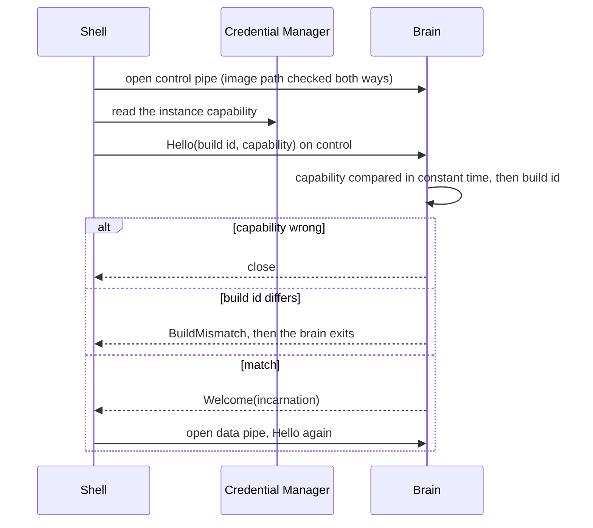
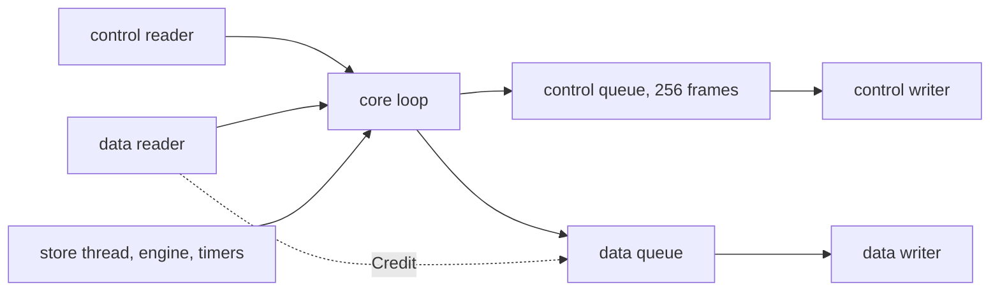

# The pipes and the handshake

The shell and the brain talk over two named pipes per Windows session: **control** for small,
urgent messages and **data** for everything that can grow. Frames are a `u32` little-endian
length followed by a `postcard` payload from the closed enums in `crates/protocol`. The length
is checked against the pipe's cap (64 KiB control, 256 KiB data) before anything is allocated.

## Who may connect

- The brain creates both pipes with a protected DACL that grants only the user who made them,
  reads the DACL back before listening, and refuses remote clients.
- Each pipe allows two instances: the one in use, and its replacement, created before the used
  one closes so another process can never take the name in between.
- The brain only talks to the `capsula.exe` beside its own executable, and the shell only to
  the `capsulad.exe` beside its own. Each side checks the other's image path through the pipe.
- On every start the brain writes a fresh random 32-byte **instance capability** to Windows
  Credential Manager. A shell proves it runs as the same user by reading it back. It's never on
  a command line, in a file, or in the environment.

## The handshake

The capability is checked before anything else, so a client without it learns nothing, not even
whether its build matches. A shell that meets a brain from another build waits for that brain to
exit and starts the one beside itself.

## After the handshake

Each pipe has its own reader and writer, all polled together in one task with the core loop
(`crates/brain/src/runtime/`). A reader never waits behind a write, so `Stop` reaches the
coordinator even while the data writer is blocked on a shell that stopped reading.

| Pipe | Carries | Bound | When it's full |
|---|---|---|---|
| Control | `RunState`, `Ping` | 256 queued frames [guess] | The connection ends, a deliberate overload policy; store, engine and timer effects still apply |
| Data | `AssistantText`, `StepCommit`, `RunEnd` | 512 KiB queued pauses the engine and new turns [guess]; credit limits bytes in flight to 512 KiB [guess] | Frames wait; 2 s with bytes waiting and no write finishing, on credit or on a shell that stopped reading, ends the run as `view_stalled` |

- **Credit.** The brain may send 512 KiB of data frames, headers included, before the shell
  grants more with `Credit`. That holds the largest frame the pipe allows, so no frame is too
  big to send, and several 64 KiB text frames. Grants never raise the credit past the window.
- **Stop drops the stopped run's unsent data**, and so does a new turn that replaces a run, so
  the replacement's first frame isn't stuck behind text nobody will show. Only a `Stop` or turn
  the coordinator accepts drops anything, and the run's `RunEnd` is queued after the drop, so it
  still arrives, as long as the shell keeps reading data.
- **Watchdog.** Only while a run is active, the brain sends `Ping` every 500 ms and ends the
  connection if one goes unanswered for 2 s (checked on the next tick, so 2 to 2.5 s). Outside
  runs there are no timers, and a run's deadline goes when the run does.
- **The tap** records control frames only; data frames carry what the user typed and the
  answer, so they're never written to it.
- **Admission.** The core loop never awaits a pipe, the store or an engine, and it always takes
  control frames and store replies, so `Stop` is never queued behind data. The data reader never
  waits on the core either, so credit is always read. While the data queue holds 512 KiB,
  frames and their bookkeeping counted, engine events wait in a 16-event channel and the engine
  waits on it, and new turns wait too. While 16 ended runs wait on the store, new turns wait
  until it catches up [guess]. Memory stays bounded however slow the store or the shell is: the
  cap is checked before each event and each turn, and only a turn adds a run and so a `RunEnd`,
  so the queue can reach the cap plus one event, the text held behind a step, and one small
  `RunEnd` per run still ending. That bound excludes typed turns not yet taken: up to 64
  `TextSubmit`s of up to 256 KiB each wait ahead of the core, and one more ends the connection
  as broken.
- shortcut: the control queue reserves no slots for urgent frames and doesn't coalesce
  `RunState`, so a burst can fill it and end the connection even with a slow but healthy shell;
  both come with the first urgent brain-to-shell message.

## The shell's side

`crates/shell/src/link.rs` connects and reads control on the link thread, because pipe reads
block. Once connected, each pipe gets a writer thread and data gets a reader thread. The UI
thread sends on bounded channels and never waits: with no connection or a full channel the send
fails at once, so a typed turn shows it wasn't sent, and `Stop` or `ClearDrawing` is logged as
unsent after its local effect already happened.

| Channel | Bound | When it's full |
|---|---|---|
| Control out | 64 messages [guess] | The send fails; the shell sends only `Stop`, `ClearDrawing`, `Pong` and `Quitting` |
| Data out | 64 turns plus 8 for credit | Not reached: the shell refuses a turn first, below |
| Brain to UI | unbounded, one channel in arrival order | The link thread never waits on the UI |

- **Credit** for a data frame is granted once the UI thread has taken it, applied or dropped by
  the fence, so a UI that stops taking frames stops the brain within its window. Grants add up
  in a counter the data writer sends after each wake-up, so credit never queues behind turns.
- **Turns.** The shell keeps at most 64 turns unanswered, the brain's own cap, counting each new
  run's `RunState` as an answer, so it never sends the turn that would end the connection. It
  refuses blank turns, which the brain ignores, and turns too long for a data frame.
- **Broken input.** A malformed frame on either pipe, or a repeated `Welcome`, ends the
  connection, and the link reconnects as after any loss. A lost brain fences every run it knew
  and forgets the unanswered turns.

## Starting and reconnecting

A per-session mutex keeps one shell. If no brain pipe answers, the shell starts `capsulad.exe`
detached, outside its own job where the job allows it, and retries for up to ten seconds. A shell
started by hand finds a running brain the same way, so after a shell crash nothing needs
restarting.

## Debugging

A debug brain records the control frames it sends and receives, and the handshake with
capabilities zeroed, when `CAPSULA_PIPE_TAP` names a file. `cargo xtask pipe-dump <file>`
decodes the recording with the same message types.
