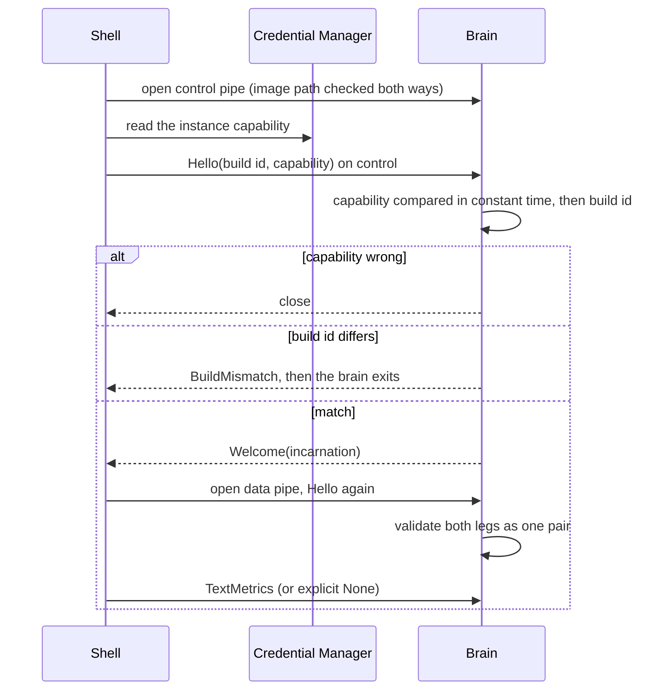
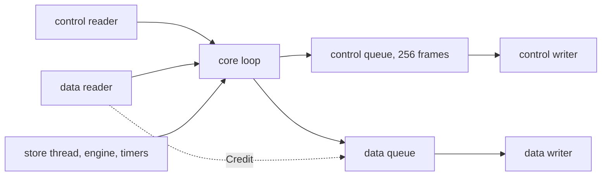

# The pipes and the handshake

The shell link resolves the sibling brain executable at preparation. On its background thread,
`platform::connect_brain` then tries the Windows control pipe before starting the detached brain.
A missing pipe can start the brain once, and a build mismatch lets it try starting again after
that server exits. A busy pipe is retried and a foreign server is refused. The connector checks
the server image before sending a greeting on either leg, opens the data leg only after Welcome,
and writes the drawing-font startup frame before returning both pipes with their ordinary I/O
timeouts restored. Those writes are not an acknowledgement that the brain accepted the data leg.
The link retains parked Quit, reconnect state, and the decision to publish Connected. On Linux,
link preparation still reports Unsupported without opening a transport or starting a process.

## Greeting authorization

The existing pipe transport checks the capability in constant time before comparing the build,
on both control and data. A correct capability with a wrong control build still gets
`BuildMismatch`; any data greeting that fails either check is refused as a wrong capability.

`Hello::session` keeps the same field and tag layout but fills the capability field with 32
zero bytes. The local transport selects the authorization method; a session-bound greeting must
come from the authenticated pair's own reader, match the build, and carry only that zero
placeholder on either leg. A nonzero placeholder is refused without capability fallback.
Only the macOS pair's greeting reads construct a bound greeting, from a frame they opened
themselves; on other platforms the type has no values. Neither shell startup nor brain
admission selects session authorization yet.

## Queued-required session mode (internal)

The shipped shell selects Legacy: control Hello, Welcome, then data Hello, with their
existing bytes. Both modes follow their data Hello with one drawing-font startup frame.
The internal queued-required selection instead sends the appended QueuedHello
on both pipes. Its data Hello echoes this Welcome's incarnation and issue epoch. The brain
checks the executable, matching build and capability on both legs and the existing same-process
pairing. It refuses a mixed mode or a data Hello from another session. The queued second leg
has one deadline for connecting and reading; refusal renews both pipe instances.

After a deliberate Talk-back switch, the replacement's control greeting names the previous
pair in `QueuedAudioReconnect`. Its data greeting still echoes the new Welcome. Only a match
with the last authenticated queued pair makes the replacement replay ChatGPT account state
without reloading the vault or retrying the catalog; an old pair, a restarted brain, or a genuine
loss uses normal connection behavior. Pipe authentication and output registration are unchanged.

This negotiates a requirement, not an installed audio output. An authenticated queued pair
installs the exact reserved issue session. Both pipes return to regular I/O after their bounded
handshake. Ordinary launch still selects Legacy, with no queued-to-Legacy fallback.
The Brain starts each queued pair closed to turns. It sends
`QueuedAudioRegistered(output)` once, only after a valid `QueuedAudioOutput` installs the
exact logical output in Queued mode. It opens admission only if that receipt queues.
Early typed/Ask frames and new hold intent end the pair without buffering for later;
settings, recovery, and cleanup keep their existing paths. A duplicate registration,
Legacy announcement, current-output withdrawal, or failed receipt enqueue ends the pair.
A Legacy session that sends `QueuedAudioOutput` ends too, before anything is installed.
The receipt isn't proof of playback, silence, or the shell having received it.

The queued shell link registers its logical output after the first Settings, even with Talk-back
off. It accepts the exact registration receipt once, by the original startup deadline. A change
to Talk-back ends the pair rather than changing its audio contract in place; output failure
doesn't turn an audio-required pair into a text-only pair. Its data reader can wait on one charged Plain
announcement or PCM frame until the control reader names that run. Control stays available while
the data head waits, and the session owner wakes that head on binding, returned capacity, revocation
or close. The registration declares the pair's narration: `Conducted` only when a narration
bridge owns the pair, otherwise `Plain`. The brain sets its narration and its pump's first-PCM
timing from that accepted declaration, never from how its pump was created. In Plain mode,
Speech-start announcements and scene speech promises end the pair without credit, so the brain
sends a speech-start step's `say` there as a Plain segment with no promise. The changed
registration needs no version field: Hello already requires the exact same build on both sides,
so an older shell is refused before it can register.
Talk-back-off typed turns bind the same run identity but start no speaker worker. They owe
no audio receipts. Unexpected speech ends a silent pair without credit, before waiting for a
run to be named or draining a stopped or ended run.
Speaking runs use the existing per-run worker. A Stop fences that run's late PCM, and a replacement
cannot use closing a pipe or freeing a device permit as proof of quiet.
Esc fences the scene before offering Stop or StopScenes to its exact session's control mailbox.
A SceneFailed caused by host refusal follows in that same mailbox; neither offer takes the
outbox mutex. If the scene stream is broken or the mailbox or queued speaker refuses Stop,
admission closes on that session before background teardown aborts either pipe. A new pair
refused for unproved quiet waits for explicit Retry. A refused speech retirement aborts the
original pair immediately and seals wire reporting. The old worker has one bounded drain to
prove its callback quiet locally; only then does the link offer Retry. If it can't prove quiet,
the connection remains unavailable until restart. No old receipt goes to a replacement pair.

The queued shell checks fresh typed intent before changing the composer or its recovery state.
Enter while admission is closed does not submit; it keeps the draft and does not replay it when
the pair becomes ready. It checks the same owner again while offering the turn to the outbox.
A refused enqueue reserves no turn and does not discard older recovery. One accepted offer can
name one run, or be refused by its own turn number. Typed admission checks the outbox and output
under their short state locks, so contention alone doesn't drop Enter. The native eligibility probe
never waits for those locks: it refuses the press if it can't check eligibility. The owner checks saved
consent again before offering the Hold. The Plain path admits a Hold only once that registered pair knows
Show Screen, either way, and with Talk-back unchanged since the pair
opened: its first change in either direction ends the pair's Hold admission. A pending
change to either preference closes Hold admission; this includes settings and installer writes that can
change an inherited value. The brain cancels an in-flight Hold when it takes such a change
before submit. The shell keeps the recognized gesture and its release in the same ordered
outbox. Revocation closes capture and enqueue for that gesture. Before writing a queued PCM
frame the data writer rechecks its authority, so a normal release can send its tail. The
check and write are separate: a frame already captured can still cross the local pipe.
When cancellation wins before decode admission, the brain drops audio it has already received
and rejects late PCM for that gesture. If decode has already been admitted, cancellation
that wins before the Brain handles its result discards the words instead.
The mic Stop receipt clears microphone debt, not the reservation. Only the
matching Hold run after release consumes that reservation, or a matching terminal Hold status
clears it. A silent Hold starts no speaker. With Show Screen on, a queued Hold is a screen hold
exactly as [Screen release](#screen-release) and [Notice revision](#notice-revision) describe:
the outbox admits `ScreenHoldRecognized` under the voice recognition's rule, and `ScreenRelease`
only while that gesture is listening, ahead of its `KeyUp`. The picture is taken by the brain's
worker, so no frame crosses the pipe, and a cancel or consent change before submit discards it.
AskAbout and conducted Speech are still unsupported on Plain queued pairs.

The offline narrated fixture selects a separate internal adapter on the same authenticated
pair. Each attendance owns a fresh bridge; neither a reconnect nor a new run inherits the
old speaker's wake. The bridge matches the scene's durable speech promise to the ordered
announcement on that registered session before passing either authority or PCM to the queued
worker. It sends the existing decision only when the worker has applied the exact local
binding. The brain's decision-taken frame settles decision consumption; it never
authorizes local staging. A durable absent promise permits authored timing for that
step; a promised step stays unresolved until its announcement matches. The v1
drawing reducer chooses the presentation boundary. A replacement uses only
`ScenesReplaced`: it keeps the victim's last paint until the successor takes over.
A clear, scene failure, discarded replacement, or deletion uses `ScenesRemoved`,
even when no narration is queued. These markers precede any retained narration
metadata that hasn't entered the writer. A removed segment still owes its empty
retirement and an unbound live assignment sends an exact Discard. A replacement
fences the victim assignment at the data reader; a busy output owner defers the
Discard without lifting that fence. Stop alone revokes run output, not the scene
boundary. A durable `SceneCutApplied` to zero is terminal and stays after the
commits it names; a cut that keeps paint is not terminal.
An explicitly stopped run's commit can still reach the reader after the next run
has been named or stopped. The commit goes to the stopped scene mirror; a matching
announcement returns credit once without binding or sending a speech decision. The
pair keeps at most one stopped predecessor until the data reader sees that run's
`RunEnd` or the pair closes. A commit can arrive on its own if Stop revoked the
announcement before the writer started it. The next typed intent keeps its draft
while both slots are occupied; neither quiet nor a different run's marker releases
the predecessor. For a natural end, the exact data `RunEnd` and settled drawing binding
release the single narration slot for the next reply. That releases the audio binding, not an
already installed frame or its outstanding paint receipt. Decision receipts remain on the
control pipe. There is no production selector for the narrated adapter.

## Voice-only hold messages

`VoiceHoldRecognized` carries a connection-local gesture, exact thread/New target and
selection revision without screen authority. `VoiceHoldStatus::Admitted` grants input
preparation, not Listening: collection also needs the matching running/UI receipt.
`VoiceHoldStopped` means that source generation physically stopped and joined; KeyUp,
cancel, EOF and deadlines are not substitutes. These appended messages preserve old tags
and remain payload-redacted in the pipe tap. Existing `MicPcm` and KeyUp shapes stay unchanged.
The appended `VoiceHoldStopAccepted` acknowledges a processed receipt. The Shell retains
one reserved/completed receipt until acceptance of its gesture on the connection that last carried it,
replaying only completed metadata on reconnect, never audio or input. Brain device debt
keeps its authenticated process handle: a matching same-live-process receipt or confirmed
old-process exit can release it, not a timeout or connection replacement. A receipt whose
process can't be checked stays unanswered, and the connection's existing 500 ms tick checks it
again until it can answer, even with no run; it sends no ping and ends nothing while idle.
The provisional 10-second startup and 2-second final-PCM drain bounds are unmeasured;
expiry is terminal but never releases an unconfirmed device owner.

`EventsChanged { thread }` (data tag 24) says a thread's stored events changed with no run frame,
such as a held turn's picture marked sent. The brain sends it only on the hold's own connection,
after queuing the write, so any page read that follows it waits for that write attempt to finish,
which doesn't prove it succeeded. The shell gives it to
both the panel and the chat; each rereads its newest page only if that thread is open, replacing
its cached rows so older ones reload through pagination, and the frame's credit comes back once.

The appended data frames `HoldWords { gesture, words }` (tag 22) and
`HoldStored { gesture }` (tag 23) carry a held recognition's words, at most
`MAX_TRANSCRIPT_BYTES`, and the receipt that its turn is stored. Both travel on the data pipe so
the receipt follows the words in one FIFO. The shell takes them straight from the link, not
through the run-keyed buffer, and on the live session returns their credit whether it keeps
them or not; frames from an earlier connection are dropped without credit. Words
over the bound are refused without being echoed. `words` is `Content`, which prints only
its length, and the tap records the op name only. See
[Voice](voice.md#held-words-after-a-lost-brain).

## Screen holds

The appended `ScreenHolds` tells the shell whether a hold also sends the model a picture of the
screen ([screen release](#screen-release)): `On { model, connection, slug, revision }` with the model's display
name, the route and model a hold's picture goes to and the offer's
[revision](#notice-revision), or `Off` with `ModelCantSee`,
`NotReady` (the catalog isn't read, or no model is chosen), `Unsupported` (no window capture on
this platform, or the worker found at the session's first screen hold that this system can't
capture) or the appended `TurnedOff` (the user's switch, `show_screen`). It's for the standing
notice and for which hold message the shell sends: `ScreenHoldRecognized` only while it's `On`,
otherwise `VoiceHoldRecognized`. It spoke for `screen_holds` and the window under the pointer
until the shell began sending screen holds. Both changed in one commit, so the notice never spoke
for one setting while a hold sent what the other governs. `HoldRecognized` is that earlier hold,
which the shell no longer sends, and the brain takes it as a voice hold: it answers
`CaptureFailed`, which ends the lease, and starts no capture. It carries the gesture, the thread, the selection revision,
the pointer sampled once at recognition, the exclusion lease, the recognition time and the
appended `notice` ([notice revision](#notice-revision)). Its
fields changed in place, not by appending: `pointer_display`, the display that held the pointer,
was replaced by `selection` and a physical `pointer`, and its smallest encoding went from 9 bytes
to 8, then back to 9 with the appended `notice` (one byte when none). That was safe because nothing sent it then and the build-id handshake refuses mixed
binaries.

The appended `HoldScreen { gesture, outcome }` says what a screen hold carried into its turn,
once: `Attached` for the window's image when a send carrying it settles after attempting a
write, or, when its
run's first request starts, `NotIncluded` with one of seven fixed classes, the last of them, `ModelCantSee`, appended for a hold whose
thread is pinned to a model that can't be sent images. Nothing in it names a window. A history
page carries the same value on the turn's user event as the appended
`PageEventKind::HeldTurn { screen }` (tag 6), read from the run's stored `screen`
([store](store.md#tables)). The value is stored with the turn, before any request exists. A
picture is stored pending: a page reads it as no picture while its run is active and as sent once
the run has ended. A send that may have written it marks it sent, and the brain clears it when its
run ends before any write of a request carrying it was attempted
([engines](engines.md#the-bound)). The shell shows a `HeldTurn`
as a user turn with one thing under it. A turn whose picture is recorded (`Attached`, `Screen`)
gets an icon whose tooltip and accessible label say which picture may have been sent and that the
app doesn't save the image in chat history. The icon can appear only after history refreshes:
while a run is active a loaded turn stays plain until history is read again, so a missing icon
doesn't prove no picture was sent. It over-reports where the store does: a write that was
attempted but may not have been
accepted, Kumochi exiting before the send outcome is recorded, and a failed write of the mark or
of its clear. A late unsent settlement after the run ended leaves a loaded row saying sent until
a re-read. Any other turn gets one line saying why no
picture was included. Neither names a model, because nothing records which model a held turn
ran on. `HeldScreen::Withdrawn` (tag 2) is
appended for history only: a turn whose image the user withdrew by turning screen holds off
before any send carrying it attempted a write. No `HoldScreen` ever carries it, because that run fails
first.

`SettingsOp::SetScreenHolds` is appended, and `SettingsView` gains `screen_holds` (on when a
settings file has no key, off when it can't be read). A new struct field isn't append-only in
postcard, whose fields are positional; it's safe only because the build-id handshake refuses
mixed binaries.

The brain sends `ScreenHolds` for the default model once a connection opens, after `Welcome` and
the voice view, and again only when a saved settings change, a catalog read or an account
operation the shell sent (a sign-out clears the catalog at once) moves it, or when the route's
sign-in or Claude Code's generation changes under it. In the running phase
the shell keeps a connection's last `ScreenHolds` until that connection ends, and a
`HoldScreen` that refuses the current hold's picture sets that hold's line, once; either one
from another connection is dropped. Before `Welcome` the shell rejects either one and ends the connection.
All three are payload-redacted in the pipe tap.

`ScreenHolds` speaks for the default model, but a turn's image goes to its run's model, which is
the thread's own when it has one. So the shell sends `ScreenHoldRecognized` only when three
things hold at recognition, and a hold's line and the conversation's screen note
([presence](presence.md#the-line-and-hit-testing)) read the same check
(`Presence::screen_notice`), so neither names a model the image won't reach:

1. the stored state is `On { model }`;
2. the target is a new thread, or a thread whose stored choice is none or the default model at
   any effort. A thread whose row wasn't read on this connection is only a candidate: the brain
   proves its recipient before any capture ([notice revision](#notice-revision)), and a row read
   as pinned to another model makes the hold voice-only;
3. `model` is the display name of the shell's own newest default, queued before saved. Between
   a default change the shell sent and the brain's next `ScreenHolds`, the stored `On` still
   names the old model and counts as not ready.

The positive conversation note describes the offer at that point in the conversation,
not the next hold. It can stay after the default model changes or screen sharing is turned
off. A `ModelCantSee` refusal carries no model identity, so its note names no model even
when the shell already has a newer default.

Under that check the shell sends `ScreenHoldRecognized` and takes nothing of the screen. It asks
the same check once more for that gesture: when the keys come up, or as soon as the check stops
holding while they are down. Only a yes at release takes the
[exclusion lease](screen.md#local-shell-exclusion) and sends the release, and a no is final for
that gesture. The brain checks its own gate at admission and again at release, so an
out-of-date `On` costs at most the lease.

## Notice revision

`NoticeRevision` names one `On`. The brain counts it up on each connection, from 1, whenever what
the gate authorizes changes: a different route or model, the gate closing, a new sign-in on the
route, or, for a Claude Code offer only, a move of Claude Code's generation. A new display name
alone keeps it, and a new connection starts again from 1. A 0 doesn't decode.

`ScreenHoldRecognized` and `ScreenRelease` carry, as `notice`, the offer the hold's first input
was seen under. The user's show-screen setting is the choice; `notice` binds a gesture to the
offer that choice was under, not to anything drawn. The shell publishes its current offer for the
native callback whenever a link event, a target change or the show-screen box changes it: the
stored `On`'s revision, only while it names exactly the default model's route and slug, the box
is on, and the target is new or a thread not read on this connection as pinned elsewhere. A row
read on an earlier connection is no proof either way. Turning the box off ends the published
offer at once, before the save is sent, so a save that can't be queued or is refused never gives
a press seen under the old offer the screen. The offer is bound to the
connection, the choice revision and the target, and a local epoch counts every change, so an
offer that went and came back is another one. The native callback freezes the published offer at
the gesture's key-down, before any delivery is deferred, and keeps it only for that key-down's
connection, choice and target. Recognition sends it only while it is still the published offer,
else the hold is voice-only; release sends it only while it still is, else the hold goes on
without the picture. A later offer never upgrades a gesture seen under none.

A thread whose row wasn't read is a conditional candidate, not shell proof of the recipient or its
capability. The brain arms a screen hold only for the revision it last sent while that offer
still says what it would send now (route, slug and sign-in), and keeps that revision. A release
starts a capture only when its `notice` is the revision the hold was armed under, that offer
still holds, and the hold's own read recipient is exactly the armed route and slug. None, an
older or a newer revision, a new sign-in, an unread recipient or a different pin captures nothing.

## Screen release

A hold shows the model one picture of the screen, taken when the keys are released
([presence](presence.md#a-screen-holds-pointer-line) has the shell's side).

The appended `ScreenHoldRecognized { gesture, thread, selection, t_qpc, notice }` (tag 29) is a
recognized hold of that kind. It carries no lease and no pointer, because nothing of the screen
is taken while the keys are down. The appended
`ScreenRelease { gesture, lease, t_qpc, excluded_qpc, pointer, path, notice }` (tag 30) is its release:
the exclusion lease the shell took at release, the release time, the time the lease's last window
was excluded from capture (a frame drawn before it may still show the shell), the pointer, which
picks the display, the pointer's path over the hold, and the recognition's `notice`.

- `PointerPath` holds at most 2,048 `PhysicalPoint`s (`MAX_PATH_POINTS`), oldest first, and is
  empty when the pointer never moved. `PointerPath::check` refuses a longer one, and whoever
  receives a path calls it before using the points.
- A point is two varints of up to five bytes each, so the largest `ScreenRelease` is 20,534
  payload bytes. It's the largest control, and inside the 64 KiB control cap.
- Where the user pointed is theirs. `PointerPath`'s `Debug` prints only its count and
  `ReleasePointer`'s prints no numbers. Neither message is on the tap's content-free list, so a
  recording holds only their op and length.
- The brain admits a `ScreenHoldRecognized` as it would a voice hold and arms its screen part;
  the `ScreenRelease` starts the capture ([screen](screen.md)). A release that starts nothing is
  answered `CaptureFailed` with `Unavailable`, which ends its lease. One for a window hold, or for
  a screen hold whose capture is running, is dropped unanswered instead, because that answer
  would end the running capture's lease.

`HeldScreen::Screen` (tag 3) is appended for a turn that carried the screen's picture. The store
writes it as `screen` ([store](store.md#tables)), so a turn stored as `attached` still reads as
the window.

`SettingsOp::SetShowScreen` (tag 15) is appended and `SettingsView` gains `show_screen`, under
the same handshake rule as `screen_holds`. It's a separate choice: `DEFAULT_SHOW_SCREEN` is on,
a settings file without the key reads as that default unless it stores a refusal of
`screen_holds`, and it reads as off when the file can't be read ([settings](settings.md)). The
Privacy tab's checkbox sends the op, and nothing sends `SetScreenHolds` any more. The brain reads
the field to gate a screen hold's picture and to say `ScreenHolds`.

## Anthropic paste metadata

The build-id handshake rejects mixed binaries before decoding connection work.
`AnthropicKeyStaged` retains its variant index with a new plan-id field;
`BeginAnthropicKeyStage { request, len }` is appended. The brain alone mints
the write-once generation using the validated trimmed byte length (16–2048).
`AnthropicKeyStage { request, result }` and `AnthropicKeyStageDone { plan,
result }` are appended control replies. They carry metadata and closed errors,
never a key, target supplied by the shell or provider text. The tap keeps only
the staging operation's name: it drops the payload and its wire length, since
the encoded size can reveal the length's encoding width. Debug also omits the
trimmed length and plan identity. Authority layouts hide byte and chunk counts
in Debug, and a failed staged cleanup logs once without counting failed chunks.

The Connections snapshot pairs the Anthropic key's status with its non-secret
authority revision. Remove names that exact revision; the worker compares it
inside the removal transaction even on retry. A mismatch changes neither the
active key nor its pending plan, and the brain reloads the current key state.
The separate removal reply names the request on the same authenticated link.
A combined Connections snapshot is never a removal receipt, even if it says
Unconfirmed or Missing. A refused commit leaves the exact revision retryable.

After an unknown save, a recovery Check uses its own request number. The
credential worker reads the current key after already admitted adoptions. The
brain sends the local result (no key, the stored revision, or an unreadable
store) after the snapshot on the same link. Only a matching, successful local
read unlocks paste or removal. The catalog reports its own outcome separately.

The runtime binds Begin replies/admission to the authenticated shell epoch,
clears admission on disconnect and refuses staging controls in offline drain.
A current Begin whose plan races removal of its base gets Unavailable, not a
permit or a silent timeout.
The credential worker has no link epoch: its FIFO and one-use ids govern
durable work. A committed adoption updates the brain-wide key by generation
even after disconnect, while its paste reply cannot cross to a new shell.
Admission and failure preserve the working key and catalog; only a committed
replacement starts its catalog check. The shell link emits both replies as
generation-tagged KeyStage events for the separate Accounts paste consumer.

## Transport

The shell and the brain talk over two named pipes per Windows session: **control** for small,
urgent messages and **data** for everything that can grow. Frames are a `u32` little-endian
length followed by a `postcard` payload from the closed enums in `crates/protocol`. The length
is checked against the pipe's cap (64 KiB control, 256 KiB data) before anything is allocated.

The brain's platform module owns native pipe creation and peer process queries. Without the
Windows adapter, opening or creating a native pipe is unsupported. Shared frame and relay tests
can use in-memory streams, but those streams don't authenticate clients or serve as a runtime
transport.

On macOS a parent-bound brain will use two connected Unix stream pairs instead of the pipes
(dormant: nothing starts one yet). The shell makes both pairs, sets `SO_NOSIGPIPE` on all four
ends, keeps one end of each and starts the brain with `--parent-bound` and the other ends on
its descriptors 3 (control) and 4 (data); see [processes.md](processes.md), "The shell's brain
child". The sockets prove only that the two ends are connected; the session handshake on top of
them authenticates.

The brain's side lives in `platform/macos/pair.rs`, still dormant. `adopt` takes the two
inherited descriptors and needs no runtime. It refuses unless each is a connected `AF_UNIX`
stream with `SO_NOSIGPIPE` set and a stable identity: two `fstat` samples that agree and have a
nonzero inode, because Darwin numbers a socket's inode lazily from zero. The two identities must
differ, so one socket can't pose as both legs. Darwin doesn't answer `SO_ACCEPTCONN` for a Unix
socket, so a listener is refused because it has no peer, and a TCP stream because its peer isn't
`AF_UNIX`. `adopt` then sets close-on-exec and non-blocking. `respond` takes that checked pair
and a session state the caller made before its first await, so the caller can wipe its copy of
the secret. It hands both ends to tokio and runs the responder handshake by one deadline: control
init and Finished, then data init and Finished, then Bind. It writes `BindAck` before it
returns an `AuthenticatedPair`, and it refuses a proof that doesn't name both of the pair's own
openers. Each greeting is read once, control first, through that leg's record reader. Each of
these sets the pair cell, so the whole pair stays refused: a read out of order, a second read, a
frame that isn't the greeting, a data greeting in the other mode, a missed deadline (checked
again after ready I/O completes), or a greeting read that's dropped part way.

## Who may connect

- The brain creates both pipes with a protected DACL that grants only the user who made them,
  reads the DACL back before listening, and refuses remote clients.
- Each pipe allows two instances: the one in use, and its replacement, created before the used
  one closes so another process can never take the name in between.
- The brain only talks to the `kumochi.exe` beside its own executable, and the shell only to
  the `kumochid.exe` beside its own. Each side checks the other's image path through the pipe.
  Rejection logs name the failed check, not the image path, DACL contents or peer build string.
- The control and data clients must be the same process. Once both hellos pass, the brain
  checks the control client's image again and holds its process handle for the whole connection.
  It registers the shell's pid so the screen walk excludes the shell, and clears it on disconnect.
- On every start the brain writes a fresh random 32-byte **instance capability** to Windows
  Credential Manager. A shell proves it runs as the same user by reading it back. It's never on
  a command line, in a file, or in the environment. Builds without a native credential adapter
  refuse to store or delete the capability; they don't use a fallback backend.

## The handshake

The capability is checked before anything else, so a client without it learns nothing, not even
whether its build matches. A shell that meets a brain from another build waits for that brain to
exit and starts the one beside itself.

After authenticating both legs as one process, the brain reads that pair's single
`TextMetrics` frame. Both Hello modes use one absolute deadline for connecting the data leg,
reading its Hello and accepting its metrics. A completed frame at or after the deadline
doesn't start the session. The brain rejects a declared payload
over 304 bytes before allocating or reading the body. The optional profile has 99 postcard
`u16` values in 1/1024 em: advances for U+0020–U+007E in order, line height, then the CJK,
remaining BMP and wide-exception maxima. An explicit `None` or a decoded profile with any
out-of-range value selects the complete built-in measure. Missing, malformed, repeated and
late frames are protocol failures. The Hello and mismatch bytes are unchanged; exact-build
checking happens before either peer uses the new frame. No font name or text is sent.

## After the handshake

Each pipe has its own reader and writer, all polled together in one task with the core loop
(`crates/brain/src/runtime/`). A reader never waits behind a write, so `Stop` reaches the
coordinator even while the data writer is blocked on a shell that stopped reading.

| Pipe | Carries | Bound | When it's full |
|---|---|---|---|
| Control | `RunState`, `Ping`, `Settings`, `Error`, `Scenes`, `ThreadDeleted`, `TurnRefused`, `ThreadsChanged`, `Focus` | 256 queued frames [guess] | The connection ends, a deliberate overload policy; store, engine and timer effects still apply |
| Data | `AssistantText`, `StepCommit`, `RunEnd`, `ThreadList`, `Page`, `PageFailed`, `SceneSnapshot`, `ScenesRemoved` | 512 KiB queued pauses the engine and new turns [guess]; credit limits bytes in flight to 512 KiB [guess] | Frames wait; 2 s with bytes waiting and no write finishing, on credit or on a shell that stopped reading, ends the run as `view_stalled` |

| Page message | Direction | Fields |
|---|---|---|
| `PageRequest` | Shell to brain, data | `request`, `PageOf::Threads { search, after }`, `PageOf::Events { thread, before }` or `PageOf::EventsAfter { thread, after }` |
| `ThreadList` | Brain to shell, data | `request`, thread rows (`id`, `title`, `updated_ms`, `kind`, optional `choice`, optional `task`), `next` |
| `Page` | Brain to shell, data | `request`, `thread`, events (`id`, `created_ms`, optional `run`, `kind`, `text`, `cut`), `next` |
| `PageFailed` | Brain to shell, data | `request`; the read failed and the brain logged its kind |

An event request walks from its exclusive id in the requested direction. The reply is
always newest first; `next` is the farthest id actually sent in that direction.
`created_ms` is the stored Unix time for display; ids still order every page. These
frames use the existing exact-build handshake, not mixed-build decoding.

The plain list and search attach the same read-only task fact from the page's store snapshot.
Kumo's chat has no task fact. A task carries its latest saved run ID and outcome, last real
activity and a state derived at read time. None of those fields changes the page's order or
cursor. A stored active run does not establish live Working status; a run failure or
interruption reads as Needs you.
After strictly more than five quiet days, the state is Sleeping without discarding the saved
outcome. A crash recovery timestamp does not count as activity. Done has no acknowledgement
write, and these facts add no GPUI presentation.

- **Credit.** The brain may send 512 KiB of data frames, headers included, before the shell
  grants more with `Credit`. That holds the largest frame the pipe allows, so no frame is too
  big to send, and several 64 KiB text frames. Grants never raise the credit past the window.
- **Stop drops the stopped run's unsent data**, and so does a new turn that replaces a run, so
  the replacement's first frame isn't stuck behind text nobody will show. Only a `Stop` or turn
  the coordinator accepts drops anything, and the run's `RunEnd` is queued after the drop, so it
  still arrives, as long as the shell keeps reading data.
- **Watchdog.** Only while a run is active, the brain sends `Ping` every 500 ms and ends the
  connection if one goes unanswered for 2 s (checked on the next tick, so 2 to 2.5 s). Outside
  runs there are no timers, and a run's deadline goes when the run does.
- **The tap** records control frames only; data frames carry what the user typed and the
  answer, so they're never written to it. Even on control it keeps only each frame's op and
  length unless the op is on its content-free list (see Debugging) or omits length as well
  (Anthropic staging).
- **Settings** go to the shell once per connection before `Scenes`, once for every
  `Settings` change the shell sends, in order, applied or refused (`answer: true`), and when a
  change an earlier connection sent is saved (`answer: false`). See
  [settings.md](settings.md).
- **Errors** the user should see travel as `Error(UserError)`: a closed `ErrorKey` into the
  shell's Fluent catalog, at most 4 typed arguments (`Seconds`, `Count`; never text) and at most
  3 actions. Both limits are checked when one is built and when it's decoded, so a frame over
  them breaks the connection like any malformed frame. The settings model retains the brain