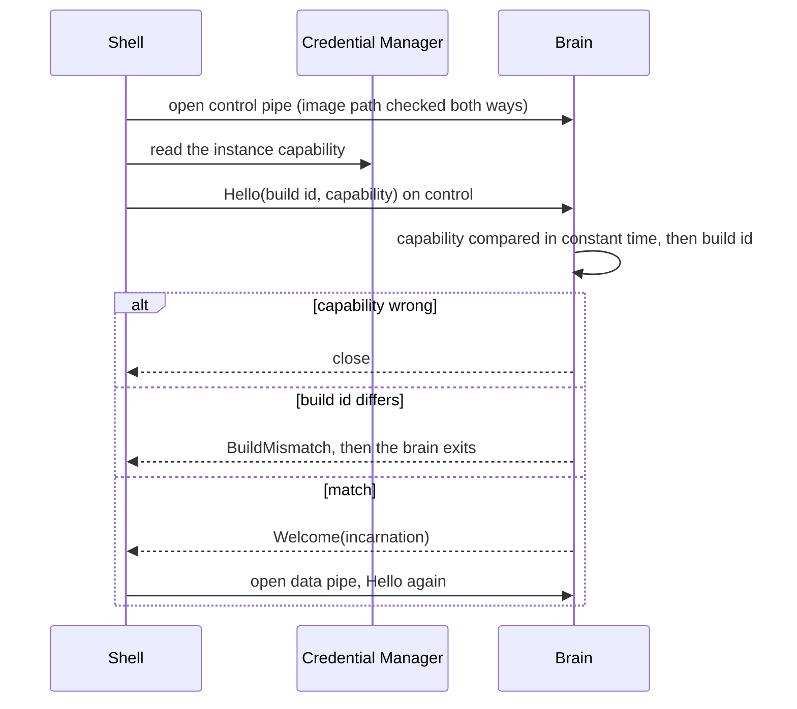
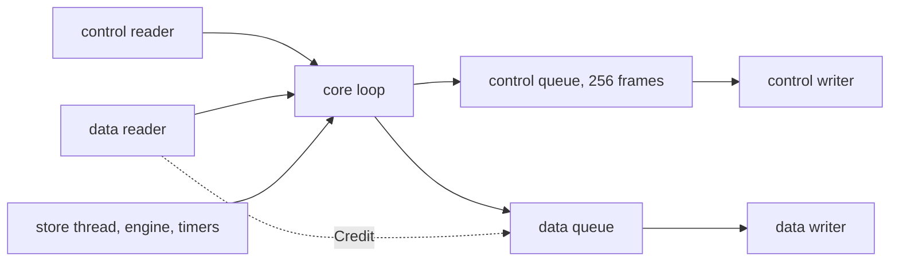
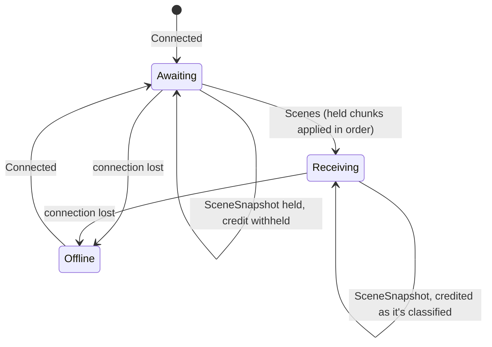
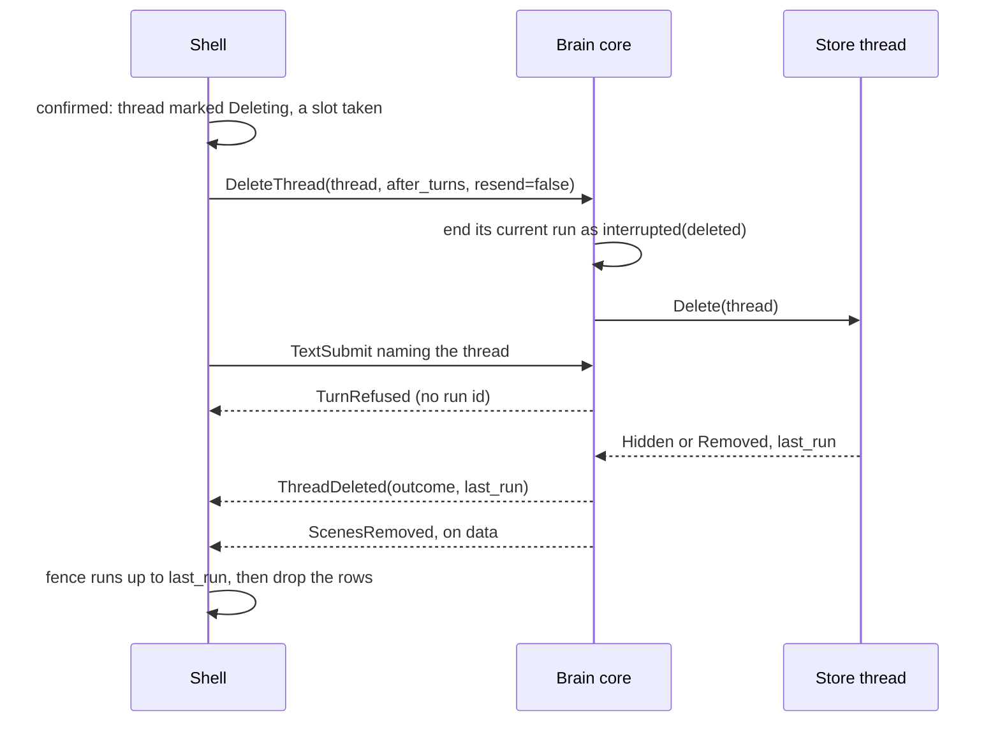

# The pipes and the handshake

The shell and the brain talk over two named pipes per Windows session: **control** for small,
urgent messages and **data** for everything that can grow. Frames are a `u32` little-endian
length followed by a `postcard` payload from the closed enums in `crates/protocol`. The length
is checked against the pipe's cap (64 KiB control, 256 KiB data) before anything is allocated.

## Who may connect

- The brain creates both pipes with a protected DACL that grants only the user who made them,
  reads the DACL back before listening, and refuses remote clients.
- Each pipe allows two instances: the one in use, and its replacement, created before the used
  one closes so another process can never take the name in between.
- The brain only talks to the `kumochi.exe` beside its own executable, and the shell only to
  the `kumochid.exe` beside its own. Each side checks the other's image path through the pipe.
- On every start the brain writes a fresh random 32-byte **instance capability** to Windows
  Credential Manager. A shell proves it runs as the same user by reading it back. It's never on
  a command line, in a file, or in the environment.

## The handshake

The capability is checked before anything else, so a client without it learns nothing, not even
whether its build matches. A shell that meets a brain from another build waits for that brain to
exit and starts the one beside itself.

## After the handshake

Each pipe has its own reader and writer, all polled together in one task with the core loop
(`crates/brain/src/runtime/`). A reader never waits behind a write, so `Stop` reaches the
coordinator even while the data writer is blocked on a shell that stopped reading.

| Pipe | Carries | Bound | When it's full |
|---|---|---|---|
| Control | `RunState`, `Ping`, `Settings`, `Error`, `Scenes`, `ThreadDeleted`, `TurnRefused`, `ThreadsChanged` | 256 queued frames [guess] | The connection ends, a deliberate overload policy; store, engine and timer effects still apply |
| Data | `AssistantText`, `StepCommit`, `RunEnd`, `ThreadList`, `Page`, `PageFailed`, `SceneSnapshot`, `ScenesRemoved` | 512 KiB queued pauses the engine and new turns [guess]; credit limits bytes in flight to 512 KiB [guess] | Frames wait; 2 s with bytes waiting and no write finishing, on credit or on a shell that stopped reading, ends the run as `view_stalled` |

| Page message | Direction | Fields |
|---|---|---|
| `PageRequest` | Shell to brain, data | `request`, `PageOf::Threads { search, after }` or `PageOf::Events { thread, before }` |
| `ThreadList` | Brain to shell, data | `request`, thread rows (`id`, `title`, `updated_ms`, `kind`, optional `choice`), `next` |
| `Page` | Brain to shell, data | `request`, `thread`, events (`id`, optional `run`, `kind`, `text`, `cut`), `before` |
| `PageFailed` | Brain to shell, data | `request`; the read failed and the brain logged its kind |

- **Credit.** The brain may send 512 KiB of data frames, headers included, before the shell
  grants more with `Credit`. That holds the largest frame the pipe allows, so no frame is too
  big to send, and several 64 KiB text frames. Grants never raise the credit past the window.
- **Stop drops the stopped run's unsent data**, and so does a new turn that replaces a run, so
  the replacement's first frame isn't stuck behind text nobody will show. Only a `Stop` or turn
  the coordinator accepts drops anything, and the run's `RunEnd` is queued after the drop, so it
  still arrives, as long as the shell keeps reading data.
- **Watchdog.** Only while a run is active, the brain sends `Ping` every 500 ms and ends the
  connection if one goes unanswered for 2 s (checked on the next tick, so 2 to 2.5 s). Outside
  runs there are no timers, and a run's deadline goes when the run does.
- **The tap** records control frames only; data frames carry what the user typed and the
  answer, so they're never written to it. Even on control it keeps only each frame's op and
  length unless the op is on its content-free list (see Debugging).
- **Settings** go to the shell once per connection before `Scenes`, once for every
  `Settings` change the shell sends, in order, applied or refused (`answer: true`), and when a
  change an earlier connection sent is saved (`answer: false`). See
  [settings.md](settings.md).
- **Errors** the user should see travel as `Error(UserError)`: a closed `ErrorKey` into the
  shell's Fluent catalog, at most 4 typed arguments (`Seconds`, `Count`; never text) and at most
  3 actions. Both limits are checked when one is built and when it's decoded, so a frame over
  them breaks the connection like any malformed frame. The settings model retains the brain
  error and its field attribution; Presence caches its localized presentation for the typing
  panel and tasks panel, with a short **Check settings** dock label for settings keys and
  **Needs attention** for any other brain error.
  It clears when a turn is successfully sent or a successful answer settles a retry of the
  settings field that produced it. An unsolicited view, reconnect, or another field's success
  cannot clear it. Only `SettingsRefused` and `ConfigUnreadable` are attributed to the settings
  FIFO's unanswered head operation. Other keys remain general brain errors and never fail a
  pending settings save.
  A failed submit leaves that error intact. Local submission refusals are separate, shown only
  in the typing panel in preference to the retained brain error. Reconnecting or accepting a
  `SettingsView` clears the local refusal; a successful submit clears both. A new key goes at
  the end of `ErrorKey` and gets its catalog id in `strings.rs`'s `error_id`.
- **Admission.** The core loop never awaits a pipe, the store or an engine, and it always takes
  control frames and store replies, so `Stop` is never queued behind data. The data reader never
  waits on the core either, so credit is always read. While the data queue holds 512 KiB,
  frames and their bookkeeping counted, engine events wait in a 16-event channel and the engine
  waits on it, and new turns wait too. While 16 ended runs wait on the store, new turns wait
  until it catches up [guess]. Memory stays bounded however slow the store or the shell is: the
  cap is checked before each event and each turn, and only a turn adds a run and so a `RunEnd`,
  so the queue can reach the cap plus one event, the text held behind a step, and one small
  `RunEnd` per run still ending. That bound excludes typed turns not yet taken: up to 64
  `TextSubmit`s of up to 256 KiB each wait ahead of the core, and one more ends the connection
  as broken. Separately, at most four page requests may remain unanswered [guess], counting
  replies waiting on credit or a blocked write; a fifth breaks the connection. Pages are at most
  50 rows and 32 KiB per encoded frame [guess]. The shell keeps only one request per list, two
  total. Their frames use at most 64 KiB plus bounded queue metadata, so pages alone cannot
  stop turn admission. See [panels](panels.md) for continuations, repair, and stale replies.
- shortcut: the control queue reserves no slots for urgent frames and doesn't coalesce
  `RunState`, so a burst can fill it and end the connection even with a slow but healthy shell;
  both come with the first urgent brain-to-shell message.

## Thread ops

| Message | Pipe | Fields |
|---|---|---|
| `ThreadOp::Rename` | Control, shell to brain | `thread`, `title`: a `ThreadTitle`, trimmed, one line, 1–80 characters, checked on decode |
| `ThreadOp::SetModel` | Control, shell to brain | `thread`, `choice`: a `ModelSlug` (1–64 bytes of `[a-z0-9._-]`) and an `Effort` (`Low` to `Max`, the documented vocabulary) |

- Nothing answers a thread op; each becomes one store write (see [store](store.md#the-main-thread-titles-and-model-choices)).
  A rename is stored as the user's title. A thread that's hidden or gone changes nothing.
  Every committed title, a rename or a model's (see [engines](engines.md#background-jobs)), sends
  `ThreadsChanged` on the control pipe. It carries nothing, so it's on the tap's content-free
  list, and the shell reads its list again.
  The shell confirms a task's displayed title by an authoritative page reread, not by sending
  the op or taking an older in-flight page. Kumo's name waits for `SettingsView` instead.
- **The main thread's name isn't a title.** Generic `Rename` of the main thread is gone: the
  brain refuses it with no write, and logs that it did, never the title. The shell renames Kumo
  with `SettingsOp::SetAssistantName`, under the 24-character name rule. `SettingsView` carries
  `main_thread`, and each `ThreadRow` its `kind`, so the shell knows which row is Kumo's.
- **The plain list pins the main thread.** The first page of `PageOf::Threads` without search
  starts with it and counts it toward the 50 rows; continuations leave it out, and the cursor is
  always a task's, so the main thread never repeats and its own updates never move a cursor. A
  first page keeps the main thread and at least one task whenever a task exists, shortening that
  task's title if it alone overflows the frame. A search ranks the main thread like any other.
- `ThreadOp` isn't on the tap's content-free list, since a rename carries the user's title.
  Titles and model slugs also print only their lengths in `Debug`, including inside rows and ops.
- Typed text and the assistant's answer travel as `Content`, a plain string on the wire whose
  `Debug` prints only its length, so `TextSubmit`, `AssistantText` and the brain's inputs, effects
  and store writes that carry them never print it.

## Account

| Message | Pipe | Fields |
|---|---|---|
| `AccountOp` | Control, shell to brain | `SignIn`, `CancelSignIn`, `SignOut`, `EnablePlan` or `Retry`; no fields |
| `Account` | Control, brain to shell | an `AccountView`: `SignedOut`, `SigningIn`, `SigningOut` (cleanup progress), `Busy` or `SignedIn` (an optional `AccountEmail`, a `PlanState` and an optional `AccountRecovery`) |
| `Models` | Data, brain to shell | the `ConnectionKind` the list belongs to, then at most 200 `ModelInfo`s, in the catalog's order: a `ModelSlug` and a `ModelName` (one line, 1–80 characters). The longest list, with four-byte characters, is 77,404 bytes, under the data frame cap |

- No token, code or account identifier crosses the pipe. The only identity is the display
  email: one line, 1–254 bytes, checked on decode, and its `Debug` prints only its length.
- `AccountOp` is on the tap's content-free list. `Account` isn't, because it carries the email.
- `Models` goes out after a connection's account view, and again whenever the list changes; an
  empty one means the account no longer has one. Nothing revokes it. shortcut: the shell drops it
  until PR 18b's picker shows it.
- The view is authoritative: every op is answered by one `Account`, a refused one included, and
  the shell never moves the account on its own. See [accounts](accounts.md).
- The shell retains the current connection's Account view for Settings → Accounts. Views and
  errors are fenced by the reading connection's generation; disconnect clears the account UI.

## Claude connections

| Message | Pipe | Fields |
|---|---|---|
| `Connection` | Control, shell to brain | a `ConnectionOp`: `AnthropicKeyStaged`, `CheckAnthropicKey`, `RemoveAnthropicKey`, `ConnectClaudeCode`, `CancelClaudeSignIn`, `DisconnectClaudeCode` or `FindClaudeCode`; no fields |
| `Warm` | Control, shell to brain | the `ThreadId` the user is about to type into |
| `Connections` | Control, brain to shell | a `ConnectionsView`: the key's `KeyView` and Claude Code's `ClaudeCodeView` |

- No key, token or anything Claude Code printed crosses the pipe. The shell stages a pasted key
  in Credential Manager and sends only `AnthropicKeyStaged`; the brain checks it and moves it.
- Every reason is a closed enum: a refused key's `KeyRejection`, an `Unsupported` install, the
  audit check that failed (`AuditFailed`, never what it saw) and the `PolicyFailed` that closed
  the route. A `ClaudeVersion` is three 16-bit numbers.
- All three messages are on the tap's content-free list.
- A `ModelChoice` names its `ConnectionKind`; one saved before Claude existed reads as `ChatGpt`.
- shortcut: nothing sends or answers these until A1, C2 and C5b, and the shell ignores
  `Connections` until its Connect screen reads it.

## Scenes and recovery

A drawing is a **scene**, named by a `SceneId`: the id of the store event that began it. At most
four scenes are visible; [processes](processes.md) has the rule that keeps that set durable. Each
`StepCommit` names its scene and its index in it.

| Message | Pipe | Fields |
|---|---|---|
| `Scenes` | Control, brain to shell, once per connection | up to four `SceneDescriptor`s: `scene`, `revision` (every step committed, never goes back), `committed` (the steps kept after any Stop) |
| `SceneSnapshot` | Data, brain to shell | `scene`, `revision`, `chunk` of whole steps, `last` |
| `ClearDrawing` | Control, shell to brain | `scene_ids`, at most four; five or more end the connection as broken |

- **The connect barrier.** Each connection starts awaiting `Scenes`. The brain serves `Stop`,
  `ClearDrawing` and `Pong` but takes no turn, and sends `Scenes` only once the visible set has
  settled: no earlier connection's run still ending and no clear still being written. If it
  hasn't settled within 2 s [guess], the brain ends the connection as unavailable and the shell
  reconnects; it never sends a partial list.
- **Snapshots.** After `Scenes`, each scene's kept steps go out in chunks of whole steps packed up
  to 32 KiB [guess], one at a time whenever the data queue has room, ahead of engine events. A
  step bigger than the target goes alone. Turns are taken only after `Scenes`, so no live step
  belongs to a scene in recovery. A `ClearDrawing` stops the cleared scenes' chunks that haven't
  started writing, queued ones included. Snapshot frames are data, so the tap never records them.
- **Clears.** A cleared scene leaves the visible set at once, so no later `Scenes` lists it, and
  counts as cleared once its write commits. A failed write, a clear's or a late Stop's kept
  selection, is retried with the next store operation, at the next connect barrier, and on a
  timer that waits 0.5 s and doubles up to 30 s while the writes keep failing [guess]. The
  timer is armed only while an owed write has none in flight, doubles only when it fires, and
  goes back to 0.5 s when any owed write commits, replacing a longer deadline. So a store that
  recovers lets typing go on without the user doing anything, and one that keeps failing is
  tried rarely, not constantly. An id that isn't visible changes nothing.
- **Owed writes hold back turns.** While eight scenes [guess] have a clear or a kept selection
  owed, new turns wait; Stop, `ClearDrawing` and `Pong` are still served, and nothing owed is
  ever dropped. A scene counts once even when both are owed, as when it's cleared while its
  selection is being written. Eight is a watermark, not a cap: after turns stop, debt can come
  only from scenes that already exist, the four visible ones and one for each admitted run, the
  current one and up to 16 ending. So at most 7 + 4 + 17 scenes are owed, each at most twice.

The shell's [`Drawing`](presence.md#the-drawing) follows each connection's recovery:

- **`Scenes` is authoritative.** A shown scene it doesn't name goes at once. A named one stays
  until its snapshot installs and then is replaced, even at the same revision.
- **Install.** A scene's `last` chunk installs it only on the connection that described it, with
  no clear since, the descriptor's revision on every chunk, and exactly `committed` steps. A
  chunk at any other revision spoils its scene's snapshot, so none of it installs. Installed steps show
  as already activated, and installing sends nothing.
- **Esc during recovery.** While awaiting, Esc drops the held chunks, granting their credit, and
  keeps a clear intent through disconnects and Retry: the next complete `Scenes` clears every id
  it names in one `ClearDrawing`. Once `Scenes` has arrived, Esc clears the shown and recovering
  scenes at once and leaves no intent, so a later scene is never cleared by it.
- **Cleared ids.** The shell remembers the newest 64 cleared ids [guess]. One that `Scenes` lists
  again, after a clear the brain never got, is sent again and never shown.
- **Validation.** More than four descriptors, a repeated id, counts outside `committed ≤
  revision ≤ 64`, a label over 256 bytes, or more steps than `committed` end the connection as
  broken input. Counts are checked before a step is kept, and errors name sizes, never labels.

## Deleting a thread

| Message | Pipe | Fields |
|---|---|---|
| `DeleteThread` | Control, shell to brain | `thread`, `after_turns` (the `TextSubmit`s this connection queued before it), `resend` |
| `ThreadDeleted` | Control, brain to shell | `thread`, `outcome` (`NotHidden`, `Hidden` or `Removed`), `last_run` |
| `TurnRefused` | Control, brain to shell | `turn` and the `thread` the refused submit named |
| `ScenesRemoved` | Data, brain to shell | the deleted thread's visible scenes |

- **The main thread** is never deleted: a `DeleteThread` naming it is answered `NotHidden` at
  once, before any run is interrupted or any fence is added, with no store operation.
- **Admission.** A delete ends the thread's current run and queues one store operation. One
  for a thread already being deleted only moves its watermark. The brain keeps at most eight
  in flight, twice the shell's four slots [guess], because deletes outlive the connection that
  sent them and a restarted shell can't know about them. A ninth is answered `NotHidden` at once
  with no store operation; the accepted ones stay.
- **Refused turns.** Until the answer, a turn naming the thread gets `TurnRefused` before it
  gets a run id. After `Hidden` or `Removed`, so does any of the first `after_turns` turns this
  connection reads, since the shell sent them before the delete. A blank turn is refused the
  same way. The shell counts a refusal as one answered turn, and as one cancelled turn and one
  turn sent before the latest selection when it has any. Nothing is stopped, fenced or
  retargeted, and a refusal says nothing about whether a thread is stored.
- **The answer.** `last_run` is the thread's newest run, stored or still ending. The shell
  fences every run up to it, so the thread's frames still queued, or held for a `RunState`, are
  dropped, and their credit is granted once. The thread's scenes leave the visible set, and
  `ScenesRemoved` takes them off the drawing on the data pipe. `NotHidden` changes nothing: the
  panel says the delete failed, and the user can try again.
- **Across connections.** The shell keeps each confirmed delete until it's answered, and sends
  it once per connection, after that connection's `Scenes`. A full control queue is retried
  every 250 ms [guess]. A delete that reached an earlier connection goes with `resend: true`,
  through every failed enqueue; a delete the user confirms goes with `false`. A new connection
  drops the old connection's watermarks and fences. An answer the brain gives on a later
  connection than the one that sent the delete covers that connection's resend: the resend is
  consumed with no store operation and no second answer. A resend that arrives before the
  answer moves the watermark to this connection. When the answer arrives, the shell drops a
  resend it hasn't queued yet. A brain that restarted knows nothing of a delete and runs it
  again, and a thread that's already gone answers `Removed` with no `last_run`.
- **Quit.** The shell queues every held delete before `Quitting`, and the brain's quit waits
  for deletes in flight as it does for ending runs. A delete that hid nothing, or a ninth
  refused on that connection, makes the quit incomplete. A delete read with the control pipe's end is still applied.

## The shell's side

`crates/shell/src/link.rs` connects and reads control on the link thread, because pipe reads
block. Once connected, each pipe gets a writer thread and data gets a reader thread. The UI
thread sends on bounded channels and never waits: with no connection or a full channel the send
fails at once, so a typed turn shows it wasn't sent, and `Stop` or `ClearDrawing` is logged as
unsent after its local effect already happened.

Each connection reaches the UI as `Connected` with a session that carries the shell's own
connection generation, not the brain's incarnation, since the same brain may be reconnected to.
Sends and grants go through that session, and data events carry its generation, so a turn,
page request, `Stop` or grant meant for a connection that has ended does nothing on the next one.

| Channel | Bound | When it's full |
|---|---|---|
| Control out | 64 messages [guess] | The send fails; the shell sends only `Stop`, `ClearDrawing`, `Pong`, `DeleteThread` and `Quitting`; a delete is tried again |
| Data out | 64 turns plus 8 for pages and credit | Not reached: the shell refuses a turn first and keeps at most two page requests unanswered |
| Brain to UI | unbounded, one channel in arrival order | The link thread never waits on the UI |

- **Credit** for a data frame is granted once the UI thread has taken it, applied or dropped by
  the fence, so a UI that stops taking frames stops the brain within its window. Grants add up
  in the connection's own counter, without a lock, and the data writer sends them after each
  wake-up, so a grant waits at most for one data write.
- **Data before its run is named.** A frame for a run no `RunState` has named yet is held, and its
  credit withheld, until the state arrives: dropped if Esc cancelled that run's turn, applied
  otherwise. Since withheld credit stops the brain, its credit window bounds what's held.
- **Pages.** Each list has one request in flight. A superseded query or closed thread drops its
  reply when applied, but still earns credit. Page frames are never held for a RunState.
- **Turns.** The shell keeps at most 63 turns unanswered; a 64th is refused until a new run's
  first `RunState` answers one. The brain's queue holds 64, so the shell never sends the turn
  that would end the connection. It refuses blank turns, which the brain would refuse too, and turns
  too long for a data frame.
- **Broken input.** A malformed frame on either pipe, a repeated `Welcome`, or scenes or
  chunks that break the rules above end the connection, and the link reconnects as after any
  loss. A lost brain fences every run it knew and forgets the unanswered turns. A reconnect to
  a new incarnation lifts that fence: a brain that crashed before storing a turn hands its run
  id out again, and the answer and scenes still shown belong to none of the new brain's runs.
  A non-durable input target returns to Kumo; a stored task target stays. Disconnect clears
  the main id, and submits wait for the new connection's `SettingsView.main_thread`. Opening
  a row only views it: explicit switches and per-turn selection revisions govern targeting,
  as described in [runs](runs.md#the-shells-input-target).

## Hold and screen-choice wire contract

The hold variants are appended to the control enums, and `Listening` is appended to `Phase`.
Existing handshake bytes stay unchanged; the build-id check still rejects mixed binaries.
`GestureId(u32)` and `LeaseGeneration(u32)` are shell-owned counters scoped to a connection;
there is no hold sender yet. A display is a `DisplayRef(PhysicalRect)`, with an `[i32; 2]`
physical desktop origin and `[u32; 2]` pixel size. Negative origins support displays left of
or above the primary display. `WindowRef(u64)` is an opaque HWND on Windows or CGWindowID on macOS.

| Direction | Control message | Fields |
| --- | --- | --- |
| Shell to brain | `HoldRecognized` | `gesture`, `pointer_display`, optional `thread`, `lease` |
| Shell to brain | `KeyUp`, `GestureCancel` | `gesture` |
| Shell to brain | `FocusHint` | `gesture`, `hint`: `Region(PhysicalRect)` or `Window(WindowRef)` |
| Shell to brain | `ExclusionLapsed` | `lease` |
| Brain to shell | `CaptureDone` | `capture_for`: `Gesture(GestureId)` or `Turn(u32)` |
| Brain to shell | `CaptureFailed` | `capture_for`, `reason`: `ExclusionUnavailable`, `Cancelled` or `Unavailable` |

These controls are staged: the brain ignores hold controls and logs only their operation
names until B2a supplies admission and capture tickets; the shell ignores capture results
until it owns exclusion leases. The tap records only these controls' operation and payload
length, never coordinates or native window references, even when dumping a forged payload.
The largest hold control is 42 payload bytes, below the 64 KiB control cap.

Each `TextSubmit` now carries `turn: u32`, counted from one per connection, and
`screen: ScreenChoice`. The shell advances the count only after a successful enqueue and
currently always sends `None`; `Include { lease }` is reserved for B3a's setting. The brain
preserves FIFO admission and copies that submit's `turn` into `TurnRefused` or the admitted
run's first `RunState.origin: Some(RunOrigin::Typed { turn })`. Later states have `origin: None`.
`RunOrigin::Hold { gesture }` and `Phase::Listening` are reserved for hold admission. The shell
still settles pending turns in FIFO order; B2a replaces that with keyed correlation.
Slice 7 will append `t_qpc` to `HoldRecognized` and `KeyUp`, append `chunks` to `KeyUp`, and
add `KeyDown`, `MicPcm` and `Transcribing` without renaming these types or allocating another run.

## Scene v1 wire contract

The v1 messages are staged alongside the labelled placeholder protocol. B2 builds the brain
path and B4 the shell path with direct test inputs; B3 switches production fixtures, removes
the placeholder at both ends and deletes its development-only store rows. The brain accepts
`StopScenes`, `StepShown` and `StepFailed`; the shell consumes v1 data and `ScenesV1` through
its presenter. `NoVisual` still ends the connection until B8 supplies its consumer.
These variants are appended; the handshake
tags and bytes do not change. Mixed builds still fail their build-id handshake.

| Pipe | Messages | Meaning |
| --- | --- | --- |
| Control, shell to brain | `StopScenes { run, cuts }` | Fence the run and apply each scene's activated revision and finished handles. A scene can span runs. |
| Control, shell to brain | `StepShown`, `StepFailed` | First paint containing a lifetime step index, or a content-free preparation failure with its scene-wide cut. Control order keeps these observations ahead of later Stop cuts. |
| Control, brain to shell | `ScenesV1` | Authoritative visible membership and each scene's lifetime revision, retained count and full log-entry count. |
| Control, brain to shell | `NoVisual` | The requested drawing had no visual outcome; preparation errors are reported separately. |
| Data, brain to shell | `SceneBegin`, `SceneStepCommit` | An immutable typed header/layout version, then original typed steps after durable commit. |
| Data, brain to shell | `SceneSnapshotV1` | Complete ordered original steps and effective cuts, packed as whole events. Chunk zero alone carries the header. |
| Data, brain to shell | `SceneCutApplied` | Authoritative cut, after every step committed before it; the last committed revision is included for a cheap consistency check. |
| Data, brain to shell | `SceneEnd` | A call completed or ended incomplete; already committed history remains. |

`SceneStepCommit` and `StepShown` indices are zero-based lifetime indices; scene revisions and `StopCut.activated`
are one-based bounds. They are not dense indices into the kept steps. The per-run 64-step
budget and scene's 64 lifetime committed-step cap are distinct. A recovery log contains every
original committed step, even one dropped by a cut, and every effective cut, with at most 128
entries. Descriptors advertise log length separately from retained count. The consumer checks
unique membership, consecutive chunk ordinals, matching revision, exact log/kept counts and
semantic replay, and installs only on `last` from the describing connection, provided no clear
generation changed. A wrong index, bad cut acknowledgement or rejected cut ends the connection;
ordinary reconnect recovery rebuilds all four scenes together, not one against a new budget.
If a stored scene cannot replay or the brain builds an invalid descriptor, chunk or encoded
frame, that whole scene is omitted and cleared durably before membership is sent. Other scenes
recover against one shared budget; the failure does not force a reconnect loop. A recovered
scene that B4 cannot prepare is cleared through `ClearDrawing`, retaining its stored history,
not cut through a stale run's `StepFailed` observation.

The data FIFO orders removal of an evicted scene before the next scene's header and first
step. Live scene headers, steps, snapshot chunks, cut acknowledgements and call-end frames are
scene-owned, not run-owned: Stop never revokes them. A durable step whose store acknowledgement
arrives after Stop still travels before the cut acknowledgement. `ScenesRemoved` remains the
non-revocable FIFO removal marker, so clearing the scene cannot discard the removal itself.
The shell drains fenced commits into its semantic mirror without preparing or activating them,
then applies the acknowledged cut. While any cut is outstanding, no run activates more work in
that scene. A cut for an already removed scene is stale. The shell sends at most one cut per
scene between commits. A replaced run alone does not cut its committed scenes.
`StopScenes` names every visible v1 scene the shell knows, even if the stopped run has not
committed there yet. Incomplete recovery scenes are cleared through the existing clear path
before Stop is sent. The brain cuts an unseen, never-activated scene to zero after any held
first-step transaction commits. This scene-wide policy relies on D1 having one current run;
OSC-56's concurrent runs must replace it with per-run revocation so Stop cannot discard
another run's in-flight work.
Every accepted cut receives `SceneCutApplied`, including a cut that changes nothing and adds
no recovery-log entry, so the shell can release its outstanding-cut hold.

Before B6 supplies a conductor, B4 can cut only at its current activation (zero for a fresh
scene, or the recovered bound) and sends no `StepShown`; pending removals stay conservatively
charged. Only v1 scenes send v1 cuts during staging. After B3 and before B5/B6 paints, development
builds have no visible drawings. Drawings are intended to remain until Esc; a fifth overlay
scene retires the oldest first and leaves it in history. That is the recommended default while
the owner's retention question remains open.

The 32 KiB chunk packing target is not a cap on a legal step's binary form: number-dense JSON
expands in postcard. One whole event may travel alone up to the 256 KiB data-payload cap.
Bounded sequence decoding limits entries before extending a list. Return data credit per staged
chunk, not only on final install; a log may exceed the 512 KiB credit window. Chunks received
before membership withhold credit and are thereby bounded by that window. Encoded staging is
limited to 32 MiB per scene and 128 MiB across four, including frame headers, independently of
the 64 MiB prepared-geometry residency budget. B4 enforces accumulated counts/bytes and measures
a process-memory staging proxy; these wire-policy caps are not a measured heap bound.

Every new scene message is excluded from the tap's content-free allow-list. The tap records
only its operation and byte count, never headers, steps, speech, model ids or parser diagnostics.
Even a forged recording's payload flag does not authorize contentful fields in `pipe-dump`.

The 32 KiB JSON cap applies to original model records, not to persisted typed JSON. Numeric
values such as `0` can reserialize as `0.0`, expanding a legal record. Store typed steps in
the event body (never the FTS text column), then deserialize the bounded typed log on reload;
do not feed reserialized storage JSON back through the model-record byte cap in `parse_record`.

## Starting and reconnecting

One shell runs per Windows session. It holds an exclusive `std::fs::File::try_lock` on the empty
file `<SHELL_LOCK>-<session id>.lock` in the data folder for its whole life, and a second shell
that finds it held exits. The OS releases the lock when the shell exits, even after a crash, and
a shell that can't resolve the data folder or open the lock refuses to start. If no brain pipe
answers, the shell starts `kumochid.exe` detached, outside its own job where the job allows it,
and retries for up to ten seconds. A shell started by hand finds a running brain the same way, so
after a shell crash nothing needs restarting.

## Debugging

A debug brain records the control frames it sends and receives, and both handshakes, when
`KUMOCHI_PIPE_TAP` names a file that doesn't exist yet; an existing file is left alone and
nothing is recorded. The tap fails closed. Each record holds the frame's op name and length, and
its fields only when the op is on the content-free list in `crates/protocol/src/tap.rs`
(`Quitting`, `Stop`, `Pong`, `ClearDrawing` and `DeleteThread` from the shell; `Welcome`,
`RunState`, `Ping`, `Scenes`, `ThreadDeleted`, `TurnRefused` and `Error` from the brain). Anything
else, `Hello`, `Settings` and `ThreadOp` included, is never serialized for the tap, and a new op stays
redacted until someone lists it. `cargo xtask pipe-dump <file>` prints one line per frame: the
fields of a listed op, otherwise `Op (n bytes)`.
