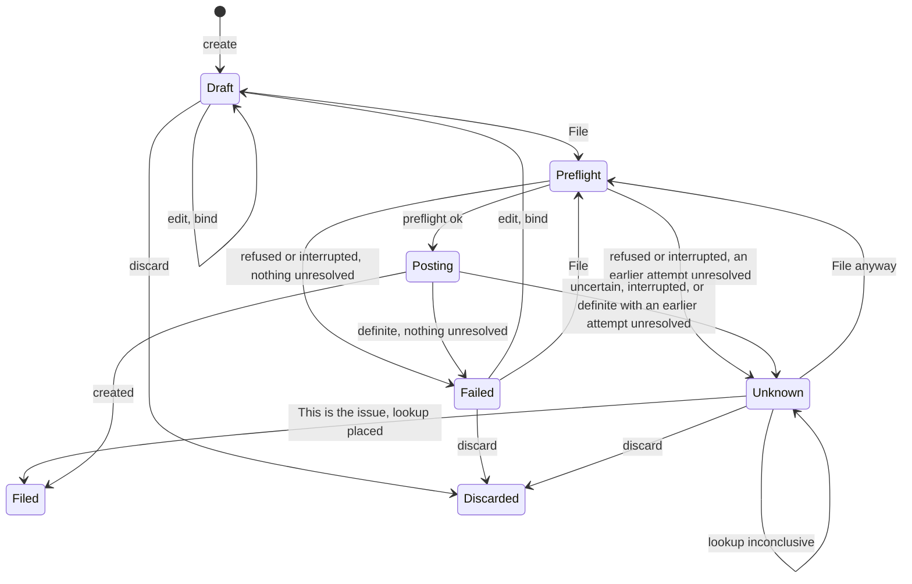

# Issue actions

The model's `draft_issue` tool creates a local draft for user review. Its checked arguments
contain only a title, body and optional repository; the dispatcher supplies the caller's
conversation and any account metadata. There is no model-supplied thread, account or approval,
and MCP drafting is not enabled. Creating a draft grants no consent and sends no HTTP request.

Before the store write, the account owner supplies binding metadata only while its verified
numeric user, access lifetime and complete repository listing remain current. An explicit
repository must exactly match that listing or the call receives a fixed refusal; it is never
replaced with a default. Without complete authority, its proposal remains unbound and no default
is applied. Otherwise, a missing repository uses only the committed configuration default for
that same numeric account, still present in the listing. A pending or merely displayed default
cannot select the destination. These metadata do not grant later sending authority.

The store inserts the draft, its first approval, its `draft` event and the tool-call ledger result
in one transaction. Admission requires the call's run to remain active in the same live thread.
Missing, ended, mismatched or deleting owners return `Committed::Failed` without writes. A
duplicate ledger key, oversized output or any other write failure rolls back the action, event
and approval too. The dispatcher answers replays with the original result, without another draft;
only a committed call notifies the real history path to refresh its card.

The dispatcher retains its 16-KiB whole-argument limit, including JSON keys, escaping and
whitespace, even though `IssueBody` separately permits 32 KiB. New authoring rejects Unicode
17.0 format and default-ignorable characters in either title or body, including bidi
overrides/isolates, zero-width joiners, fillers, variation selectors and hidden tags. Refusal is
fixed and content-free; nothing is silently stripped or changed after consent. Ordinary
non-ASCII letters, combining accents and visible symbols remain allowed. The Unicode data
notice is in `THIRD-PARTY-NOTICES.md`.

The preview stays literal text. GitHub will interpret visible mentions, links and Markdown
if the user later files it; there is no screenshot, attachment or hidden body addition. Local
storage is not sending authority. The confirmation and remote filing handoff below remain
dormant until their runtime and shell activation is implemented.

An issue the model drafts becomes a durable action: a row in the store's `actions` table that
only the user's consent may move toward GitHub. The stages and what a card shows are in
`crates/brain/src/issues.rs`, the rows in `crates/brain/src/store/actions.rs`. Neither sends a
request.

## Dormant confirmation handoff

Production history stays read-only: File is not a button, action or keyboard
command while the runtime ignores Issue controls. The offline fixture alone
exercises the dormant opener. It uses the shared Cancel-first confirmation with
plain semantic text and a focusable, keyboard-scrollable full-content preview.
The preview comes from the current full card, including its bound account and
repository, never from the repository default or the abbreviated history row.

Each owned history surface holds one transient attempt. Its current Session,
connection origin, displayed thread/draft, full version/hash/approval, account,
repository membership and Draft/Failed state must match again at activation.
Hide, selection, deletion, disconnect, scope turnover and a new hydration retire
the attempt; hydration invalidates either surface's attempt through the existing
shared read state. Only weak invalidation flags are shared, not consent or content.
The callback consumes the attempt before checking or queueing. Cancel, dismissal,
stale state and a full queue cannot replay it on a later valid snapshot.

An explicit confirmation emits only the existing File consent operation. It does
not mark Sending or Filed, certify numeric account identity, admit a send or
resolve Unknown. The store still owns numeric-account/hash/approval admission and
durable single-use consumption, including refusals. Two surfaces may independently
hand off the same revision; that is not two remote admissions or exactly-once
delivery. Native rendering, input and accessibility remain separate gates.

## Authoritative card batches

`IssueCardsRequest` shares the page allocator and four outstanding-read slots. Its sixteen-id
wire bound applies before duplicates are coalesced in first-requested order. The snapshot reader
reconstructs content, hash, approval, version and state together. Missing/deleted ids are skipped.
Each `IssueCardRead` carries the request id; exactly one `IssueCardsDone(Complete|Failed)` ends
the batch, including empty, all-missing and all-pruned batches. Individual card frames never
release a slot. Legacy `IssueCards` keeps its wire index but is refused by the negotiated build.

Registration precedes the reader's accepted-write stamp. The store's existing deletion
transaction cancels matching registered card sources, including those not read yet; a later
registration instead waits behind that delete before taking its snapshot. At most four batches
of sixteen source identities are registered. Sources retain their snapshot thread/generation
and use children of the existing admission Control, not a second cancellation framework.
Deletion cannot revive a source, even if the deletion transaction subsequently fails; a fresh
read may reconstruct the still-live row. No title/body is read just to invalidate a source.

Completion, held-output admission and queue selection discard invalid sources. A queued batch
terminal belongs to its batch, not its last surviving thread. An invalidated active frame closes
the connection rather than splicing another frame onto its prefix. The original two-second
admission end covers barrier, Side, SQL, output credit and terminal delivery; no stage renews it.
Only issue ids returned on displayed pages enter the shell's shared card cache. Paging and
cache hydration never grant consent or send to GitHub.

## Events and displayed cards

Creation inserts one `draft` event; every durable action/approval change inserts one `action`
event in the same transaction. Replays, Gone, stale completions and semantic no-ops insert none.
Recovery copies titles inside SQL and retains whole-send-batch rollback without decoding bodies.
Event text is only the title; metadata is the closed positive-id object `{"draft":1}`. The page
reader fetches at most 33 metadata bytes, admits at most 32 UTF-8 bytes, and rejects duplicate,
unknown, mistyped or missing fields with a fixed read failure. No issue body enters an event.

The browsed and focused histories share one cache, bounded by their currently displayed issue
ids. Full cards are correlated to an outstanding read and the current displayed ownership.
State notifications advance a watermark, discard obsolete full content and schedule a bounded
read. Older cards cannot replace it; equal-version cards hydrate missing content while keeping
the authoritative state/approval. Conflicting state at the same version fails the connection
and cannot be repaired by later valid frames. Card frames do not release the four-read budget.

Duplicate reads coalesce. A newer watermark arriving during a read can request one successor
after its terminal; failure alone never retries. Unknown notifications retain no draft entry
and coalesce a reread of the open owner pages. Hiding, selection, eviction or deletion removes
unowned cards and watermarks; outstanding tickets remain until their terminal. Late cards cannot
recreate them. Reconnect clears the session cache and re-pages before registering ids again.
P8 consumes this same model; there is no second presentation cache or automatic File action.

## Read-only history presentation

Browse and chat use the same virtualized message rows to show saved issue cards.
The view borrows only ids owned by its displayed pages from the shared cache;
it does not retain a second card or approval model. Rows show the saved title,
repository, bound account and body, with the authoritative state and any duplicate
warning. A newer state can be shown while its full details are still loading.
Failed or missing reads show unavailable details, not an empty draft or a retry
loop. Disconnect, eviction and protocol failure remove access to cached content.

Unknown lookup candidates stay unconfirmed, absence is not proof of no issue,
and a definite failure means this attempt created no issue, not that nothing was
sent. Filed confirmation and duplicate warnings remain independent. Saved URLs
are plain text; the rows contain no editing, consent, File, resend or browser
action. Every issue row identifies the view as read-only. This presentation
does not connect the dormant write coordinator or turn saved approval into consent.

Card data and matching terminals notify both histories, while only the request
owner applies the frame and returns credit. Retained row text is derived on model
notification, not per frame; changed content invalidates that row's measured height
without changing its event identity or adding another scrolling region.
Surviving prefix/suffix rows are compared by event identity and their old indexes
are invalidated before splicing, so a batched prepend cannot hide a card's resize.
Issue status, title, warning and details use identified semantic Text children;
their stable field ids sit under the event row without adding focus targets.

## Stages

| Stage | Meaning | Offers a decision |
|---|---|---|
| `draft` | Editable, waiting for consent | Yes |
| `preflight` | Admitted; the pre-send lookup runs and nothing has been sent | No |
| `posting` | The create request may have been sent | No |
| `filed` | The issue exists | No |
| `failed` | No issue was created; a retry needs fresh consent | Yes |
| `unknown` | An attempt may have created an issue, so only File anyway sends again | Yes |
| `discarded` | Dismissed | No |

A mark records when an attempt's preflight began and up to 200 matching issue numbers that
already existed. Preflight and Posting carry the earliest mark of an earlier attempt that may
have created an issue (`unresolved`), and Unknown keeps that earliest mark: a later mark's list
can already hold the earlier attempt's issue and would hide it from the lookup. `uncertain`
counts the attempts that may have created an issue. It is 0 in Draft and Failed, which a CHECK
enforces, and at least 1 in Unknown. The card shows `maybe_duplicate` from 2, and a discarded
action's `maybe_filed` from 1.

Filed separately retains `maybe_duplicate`: a known Created uses `uncertain >= 1`, while lookup
placement or user confirmation uses `uncertain >= 2`. Confirmation and duplicate warning are
independent and survive persistence. Legacy Filed JSON defaults the missing flag to false
without changing `uncertain` or `confirmed`; the reader still warns when the retained count is
at least 2. An old count of 1 cannot distinguish Created from placement, so false is not an
exactly-once guarantee or proof that old ambiguous sends created nothing. False flags stay
omitted from JSON so the legacy representation remains readable and round-trips unchanged.

A restart follows the interrupted edges. Nothing here sends: the runtime runs the preflight and
the create and reports their outcomes through the completions below. That wiring and the network
are separate work.

## Approvals and versions

Every commit raises the action's `version`. A commit into Draft, Failed or Unknown takes a fresh
approval revision from `approval_mark` in the same transaction; other stages hold none, and a
rolled-back op issues nothing. The mark is one row that deletion and purges never touch, so no
revision is issued twice, and `AUTOINCREMENT` does the same for draft ids. A mark or version at
`i64::MAX`, or an exhausted `uncertain`, fails the op with `StoreError::Issue` and changes
nothing.

## Ops

Each op loads the row joined to a live thread, applies a pure transition to a copy, writes
nothing when the copy is unchanged, and otherwise commits it with a new version and approval. A
hidden or missing row answers `Gone`. Edit or discard in a stage that doesn't take it answers
`Refused(NotAllowedNow)` and writes nothing. Errors never carry SQLite's text, which can quote
content.

- `create_draft` stores a Draft in a live thread.
- `action` reads one while its thread is live.
- `edit_draft` replaces title, body and repository together in Draft or Failed; a change makes
  it a Draft.
- `discard_draft` dismisses a Draft, Failed or Unknown action.
- `consent`, `bind_drafts` and the completions follow.

## Consent

`consent` takes the hash the card showed, its approval revision, a decision, and `Live`: the
verified user from the device machine's `user()` and the listed repositories. The revision
decides first:

| Revision | Answer | Written |
|---|---|---|
| The last one used up | `Unchanged` | nothing |
| Any other but the current one | `Refused(StaleApproval)` | nothing |
| Current, a check fails | `Refused(reason)` with a fresh revision | `consumed`, `version`, `approval` |
| Current, every check passes | `Changed` into Preflight, or Filed for a confirmed candidate | `consumed`, `stage`, `version`, `approval` |

The checks run in order:
1. The runtime reserved the one operation slot. Otherwise `NotAllowedNow`, with the current
   revision consumed in the same transaction and no unowned Preflight.
2. The stage takes the decision: File needs Draft or Failed, File anyway needs Unknown, and This
   is the issue needs Unknown with an unplaced candidate. Otherwise `NotAllowedNow`.
3. The hash matches. Otherwise `ContentChanged`.
4. The action has an account, and `Live` has a user with a nonzero id. Otherwise `NotConnected`.
5. Their numeric ids are equal; logins don't count. Otherwise `OtherAccount`.
6. The bound repository is listed. Otherwise `RepoNotListed`.
7. File has no different retained draft with the same numeric account, repository, exact
   title and normalized body in Preflight, Posting or Unknown, or dismissed with retained
   uncertainty. Otherwise `UnresolvedDraft` names that earlier draft. This check runs in the
   same transaction as approval consumption, not just when the new draft is created.

A refusal never changes stage, content or binding. Because the refused revision is used up, a
stale click can't file once its cause is fixed, and a double click on a sending card is a no-op.
An unresolved-draft refusal leaves the earlier action untouched and gives the refused draft a
fresh revision/version. Dismissal does not erase uncertainty or let a new call key bypass it.
Hiding a thread for deletion does not bypass the guard while its rows remain. Completing
history deletion removes those rows, including this local evidence; no separate fingerprint
or content survives deletion for duplicate detection.
Every return to Draft, Failed or Unknown offers a new revision, so each send that could duplicate
an issue needs a fresh File anyway.

The hash is SHA-256 of `{"repo":…,"account":…,"title":…,"body":…}` in that order, with the
account as its numeric id. It covers no screenshot, since the card shows none.

`bind_drafts(account, repo)` sets the account and, where none is chosen, the repository on every
Draft and Failed action in every live thread. A change makes a Failed action a Draft with a fresh
revision. Unresolved actions are skipped, and bind never files.

## Sending

Admission, recovery reads and the transition to Posting share the operation's original
cancellation and deadline on the ordered store writer. A scoped SQLite progress handler
interrupts long statements; lock waits are disabled and cancellation is checked again before
COMMIT. The handler and busy timeout are restored afterward. A successful COMMIT remains an
acknowledged success even if cancellation arrives at completion. A restoration failure retires
the connection for reopening without erasing that durable answer. Result and compensation writes
do not reuse the canceled admission scope: they settle an already admitted phase and cannot
start another request.

The runtime calls each completion with the version of the answer that entered its phase, never a
version read later. At any other version, earlier or later, or in another stage, a completion
answers `Refused(NotAllowedNow)` and writes nothing.

- `preflighted(at, result)`: a mark enters Posting, and a refusal means nothing was sent.
- `posted(at, outcome)` takes P3b's `CreateOutcome` unchanged. Created files; Definite means
  nothing was sent; Uncertain, or Created with number 0, adds an uncertain attempt.
- `interrupted(at)` ends a send the runtime gave up on, by the recovery rule. Whichever of it and
  the send's own completion commits first wins, so a late Created leaves the action Unknown.

An attempt that sent nothing fails a first attempt, and leaves a File anyway attempt Unknown with
the earliest mark. `looked_up(episode, lookup)` applies only while Unknown with `uncertain ==
episode`: Placed files, and anything else stays Unknown with the new result. The fence is the
count, not the version, because a refused File anyway moves the version without ending the
uncertainty.

## Recovery

At start, after pending deletions finish, `recover` ends each send that a crash cut short in a
live thread. It reads only the stage, never the content:
- a Preflight with nothing unresolved becomes `Failed(Interrupted)`, since nothing was sent;
- a Preflight carrying an unresolved mark becomes Unknown with that mark;
- a Posting becomes Unknown with the earliest mark and one more uncertain attempt.

Each gets a fresh revision, and `consumed` stays, so a revision used before the crash can't
file after it. Settled actions aren't touched. The "store recovered" log line adds
`failed_sends` and `unknown_sends`.

The sends are one transaction. If any sending row's stage doesn't decode, `recover` fails with
`StoreError::Issue`, the whole batch rolls back, and the brain doesn't start; the next start
fails the same way. `Store::open` still succeeds, and the steps before it, finished deletions
and crashed runs, have committed. This is deliberate: skipping the row could hide an attempt
that may have created an issue, and guessing its outcome could resend one. Starting again needs
the row repaired or a backup restored.

## Schema and privacy

`actions` arrives in version 7 ([the store](store.md#tables)). `stage` is JSON tagged by `kind`,
and SQL reads only the kind: a CHECK refuses a missing, null or unknown kind, and every stage but
Draft, Failed and Discarded needs a repository and an account. GitHub's account ids are unsigned
64-bit, so one is canonical decimal text (1 to 20 digits, no leading zero). Reads check it again,
since SQLite doesn't recheck stored rows: zero, any other form and one past `u64::MAX` fail. Reads
also refuse an id without a login or a login without an id, and a stage other than Draft, Failed
or Discarded without a repository and an account, so every action that loads can render.

Debug of `Action`, `Stage` and `Answer` prints kinds, ids, versions, counts and the redacted
Debug of titles, bodies, repositories and accounts. It never prints an unplaced candidate's URL,
which names the repository. A thread's actions go in deletion's second transaction, and the
purge clears their old copies, edited-away text included, as it does events'.

The lookup that resolves Unknown is a heuristic: another client, or a second draft under the same
account, can create a matching issue after the mark. Nothing here proves which request created
an issue.
