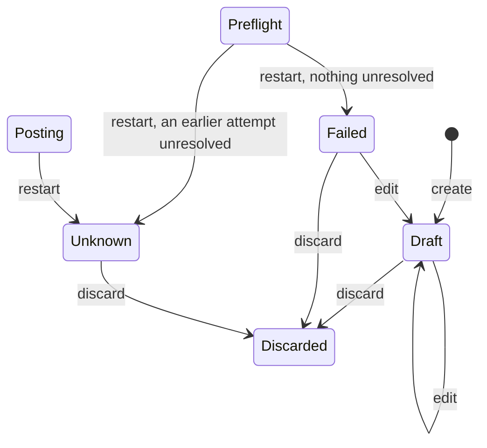

# Issue actions

An issue the model drafts becomes a durable action: a row in the store's `actions` table that
only the user's consent may move toward GitHub. The stages and what a card shows are in
`crates/brain/src/issues.rs`, the rows in `crates/brain/src/store/actions.rs`. Neither sends a
request.

## Stages

| Stage | Meaning | Offers a decision |
|---|---|---|
| `draft` | Editable, waiting for consent | Yes |
| `preflight` | Admitted; the pre-send lookup runs and nothing has been sent | No |
| `posting` | The create request may have been sent | No |
| `filed` | The issue exists | No |
| `failed` | No issue was created; a retry needs fresh consent | Yes |
| `unknown` | An attempt may have created an issue, so only File anyway sends again | Yes |
| `discarded` | Dismissed | No |

A mark records when an attempt's preflight began and up to 200 matching issue numbers that
already existed. Preflight and Posting carry the earliest mark of an earlier attempt that may
have created an issue (`unresolved`), and Unknown keeps that earliest mark: a later mark's list
can already hold the earlier attempt's issue and would hide it from the lookup. `uncertain`
counts the attempts that may have created an issue. It is 0 in Draft and Failed, which a CHECK
enforces, and at least 1 in Unknown. The card shows `maybe_duplicate` from 2, and a discarded
action's `maybe_filed` from 1.

The transitions that exist so far:

Nothing here admits a send, so no product path enters Preflight or Posting. The runtime and
network wiring that sends an issue is separate.

## Approvals and versions

Every commit raises the action's `version`. A commit into Draft, Failed or Unknown takes a fresh
approval revision from `approval_mark` in the same transaction; other stages hold none, and a
rolled-back op issues nothing. The mark is one row that deletion and purges never touch, so no
revision is issued twice, and `AUTOINCREMENT` does the same for draft ids. A mark or version at
`i64::MAX`, or an exhausted `uncertain`, fails the op with `StoreError::Issue` and changes
nothing.

## Ops

Each op loads the row joined to a live thread, applies a pure transition to a copy, writes
nothing when the copy is unchanged, and otherwise commits it with a new version and approval. A
hidden or missing row answers `Gone`. Edit or discard in a stage that doesn't take it answers
`Refused(NotAllowedNow)` and writes nothing. Errors never carry SQLite's text, which can quote
content.

- `create_draft` stores a Draft in a live thread.
- `action` reads one while its thread is live.
- `edit_draft` replaces title, body and repository together in Draft or Failed; a change makes
  it a Draft.
- `discard_draft` dismisses a Draft, Failed or Unknown action.

## Recovery

At start, after pending deletions finish, `recover` ends each send that a crash cut short in a
live thread. It reads only the stage, never the content:
- a Preflight with nothing unresolved becomes `Failed(Interrupted)`, since nothing was sent;
- a Preflight carrying an unresolved mark becomes Unknown with that mark;
- a Posting becomes Unknown with the earliest mark and one more uncertain attempt.

Each gets a fresh revision. The "store recovered" log line adds `failed_sends` and
`unknown_sends`.

## Schema and privacy

`actions` arrives in version 7 ([the store](store.md#tables)). `stage` is JSON tagged by `kind`,
and SQL reads only the kind: a CHECK refuses a missing, null or unknown kind, and every stage but
Draft, Failed and Discarded needs a repository and an account. GitHub's account ids are unsigned
64-bit, so one is canonical decimal text (1 to 20 digits, no leading zero). Reads check it again,
since SQLite doesn't recheck stored rows: zero, any other form and one past `u64::MAX` fail.

Debug of `Action`, `Stage` and `Answer` prints kinds, ids, versions, counts and the redacted
Debug of titles, bodies, repositories and accounts. It never prints an unplaced candidate's URL,
which names the repository. A thread's actions go in deletion's second transaction, and the
purge clears their old copies, edited-away text included, as it does events'.

The lookup that resolves Unknown is a heuristic: another client, or a second draft under the same
account, can create a matching issue after the mark. Nothing here proves which request created
an issue.
