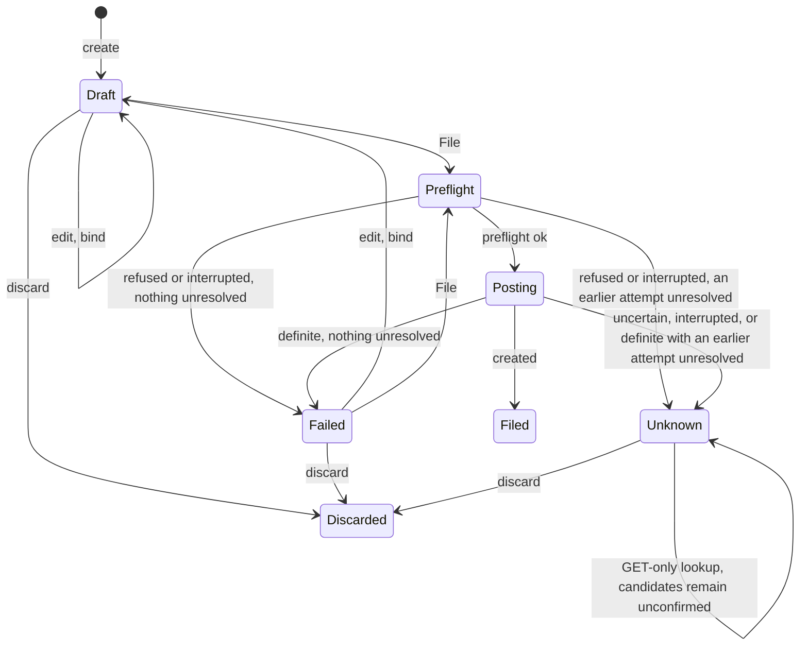

# Issue actions

The model's `draft_issue` tool creates a local draft for user review. Its checked arguments
contain only a title, body and optional repository; the dispatcher supplies the caller's
conversation and any account metadata. There is no model-supplied thread, account or approval,
and creating a draft grants no consent and sends no HTTP request.
The instructions tell a model that has the tool to call it when asked to file an issue.

An admitted Claude Code foreground build can offer `draft_issue` over MCP. Its parser accepts
only title and body, even on a retry. The caller cannot probe a repository by proposing it or
supply a draft identity or approval. It can use only the user's committed same-account default;
with no usable default the draft stays unbound. Nothing about a draft's launch authorizes the
separate human review.

Before the store write, the account owner supplies binding metadata only while its verified
numeric user, access lifetime and complete repository listing remain current. An explicit
repository must exactly match that listing or the call receives a fixed refusal; it is never
replaced with a default. Without complete authority, its proposal remains unbound and no default
is applied. Otherwise, a missing repository uses only the committed configuration default for
that same numeric account, still present in the listing. A pending or merely displayed default
cannot select the destination. These metadata do not grant later sending authority.

The store inserts the draft, its first approval, its `draft` event and the tool-call ledger result
in one transaction. Admission requires the call's run to remain active in the same live thread.
Missing, ended, mismatched or deleting owners return `Committed::Failed` without writes. A
duplicate ledger key, oversized output or any other write failure rolls back the action, event
and approval too. The dispatcher answers replays with the original result, without another draft;
only a committed call notifies the real history path to refresh its card.

The dispatcher retains its 16-KiB whole-argument limit, including JSON keys, escaping and
whitespace, even though `IssueBody` separately permits 32 KiB. New authoring rejects Unicode
17.0 format and default-ignorable characters in either title or body, including bidi
overrides/isolates, zero-width joiners, fillers, variation selectors and hidden tags. Refusal is
fixed and content-free; nothing is silently stripped or changed after consent. Ordinary
non-ASCII letters, combining accents and visible symbols remain allowed. The Unicode data
notice is in `THIRD-PARTY-NOTICES.md`.

The preview stays literal text. GitHub will interpret visible mentions, links and Markdown
if the user later files it; there is no screenshot, attachment or hidden body addition. Local
storage is not sending authority. Only the explicit confirmation below may start remote filing.

An issue the model drafts becomes a durable action: a row in the store's `actions` table that
only the user's consent may move toward GitHub. The stages and what a card shows are in
`crates/brain/src/issues.rs`, the rows in `crates/brain/src/store/actions.rs`. Neither sends a
request.

## Confirmation handoff

Draft and Failed cards with a usable bound connection offer Review to file. The opener sends
`Rearm { draft, version, hash }`, not File. Ordered SQL checks the live editable row and
atomically advances its version and durable approval without changing content, stage,
consumed revision or uncertainty. The first rearm that finds the bound name listed also stores
GitHub's id for it (`repo_id`, V10); later rearms of the same draft keep it, and choosing another
repository clears it. Only the matching live committed reply returns
`IssueReview { request, card }` on the data pipe. Its authoritative full card opens the shared
Cancel-first, keyboard-scrollable literal preview, including the bound account and repository.
An ordinary saved card or state notification can never open it.

Each owned history surface holds one pending review intent or confirmation. Its current Session,
connection origin, displayed thread/draft, full version/hash/approval, account,
repository membership and Draft/Failed state must match again at activation.
Hide, selection, deletion, disconnect, scope turnover and a new hydration retire
the attempt; hydration invalidates either surface's attempt through the existing
shared read state. Only weak invalidation flags are shared, not consent or content.
The callback consumes the attempt before checking or queueing. Cancellation references the
original rearm request, even before a revision is known. Cancel, dismissal, failed dialog/window
creation, stale state and a full queue retire that intent; failed retirement enqueue ends the
session. A late reply cannot open a replacement window or resurrect the confirmation.

An explicit confirmation emits only the existing File consent operation. It does
not mark Sending or Filed, certify numeric account identity, admit a send or
resolve Unknown. The brain owns ephemeral single-use permission; the store still owns
version/numeric-account/hash/approval admission and durable consumption, including refusals.
Both histories share pending-operation
feedback, admitted only after the control queues successfully. App-lifetime request identities
increase without wrapping and correlate final acknowledgements and refusals even when the
state/version is unchanged. Welcome advertises the brain incarnation and a connection epoch
reserved before the rest of the handshake. Every issue frame retains that originating pair.
The brain checks it before SQL, request-watermark updates or job admission; stale provenance
ends the connection without sending old request feedback into the replacement. A failed
handshake also consumes its reserved epoch. A restarted shell can begin its request counter
again only with the newly advertised provenance. Provenance rejects stale transport; it does not
prove a physical click or turn saved approval metadata into permission. Before SQL or job admission,
the brain records a per-session in-memory high-water mark. An equal or older request receives only `IssueUnavailable`, without
SQL, client construction, HTTP or a new deadline. Failed writes and terminal delivery cannot
clear that fence. A different request or connection label alone is not fresh consent.
Progress never finishes an attempt; stale session/request/version/approval feedback cannot
replace its result. This is not an exactly-once delivery guarantee.

### Review lifetime

`runtime/issues/reviews.rs` owns pending rearm reservations and outstanding Offered bindings.
Their combined cap is `MAX_ISSUE_REVIEWS = 16`. Each reservation retains its originating
session/request, immutable draft/version/hash, absolute 60-second deadline and cancellable SQL
scope. Cancellation, supersession or disconnect invalidates it immediately, but it occupies its
slot until acknowledgement. Registration checks liveness and the deadline again at acknowledgement,
even if the timer event has not run. A late committed reply may publish saved state, never permission.
At capacity, new rearms receive ReviewCapacity without SQL or HTTP; there is no automatic retry.
The deadline applies to the pending rearm, not to a preview already open. An open preview has
no independent timeout; cancellation, editing, supersession, disconnect and the final binding
and authority checks still apply.

Only a live matching committed rearm registers an offer. Immediately after validating transport,
`Brain::issue_op` synchronously looks up and removes a Consent's ApprovalRev, before the request
watermark, reply limit, capacity, decision, binding, authority or SQL checks. Missing means invalid,
regardless of its numeric value. Wrong binding, unsupported decision, busy admission and old request
all consume a located offer. Unknown revisions allocate nothing. The winner passes the registered
version/hash binding to both Consent and its compensation. Removal frees capacity but never
restores permission or cancels an admitted job.

Restart begins with an empty offer set. Creation, binding, recovery, settlement, card/history reads,
state/refusal publication and cached/reconnected cards never register permission. The durable
`approval_mark` is the only nonreusing allocator; there are no lifetime tombstones or startup rewrite.
Each new preview is charged, including queue-entry overhead, against the existing 512-KiB data
queue cap. If it cannot be queued, the link closes and retires its offers and pending intents.

## Authoritative card batches

`IssueCardsRequest` shares the page allocator and four outstanding-read slots. Its sixteen-id
wire bound applies before duplicates are coalesced in first-requested order. The snapshot reader
reconstructs content, hash, approval, version and state together. Missing/deleted ids are skipped.
Each `IssueCardRead` carries the request id; exactly one `IssueCardsDone(Complete|Failed)` ends
the batch, including empty, all-missing and all-pruned batches. Individual card frames never
release a slot. Legacy `IssueCards` keeps its wire index but is refused by the negotiated build.

Registration precedes the reader's accepted-write stamp. The store's existing deletion
transaction cancels matching registered card sources, including those not read yet; a later
registration instead waits behind that delete before taking its snapshot. At most four batches
of sixteen source identities are registered. Sources retain their snapshot thread/generation
and use children of the existing admission Control, not a second cancellation framework.
Deletion cannot revive a source, even if the deletion transaction subsequently fails; a fresh
read may reconstruct the still-live row. No title/body is read just to invalidate a source.

Completion, held-output admission and queue selection discard invalid sources. A queued batch
terminal belongs to its batch, not its last surviving thread. An invalidated active frame closes
the connection rather than splicing another frame onto its prefix. The original two-second
admission end covers barrier, Side, SQL, output credit and terminal delivery; no stage renews it.
Only issue ids returned on displayed pages enter the shell's shared card cache. Paging and
cache hydration never grant consent or send to GitHub.

## Events and displayed cards

Creation inserts one `draft` event; every durable action/approval change inserts one `action`
event in the same transaction. Replays, Gone, stale completions and semantic no-ops insert none.
Recovery copies titles inside SQL and retains whole-send-batch rollback without decoding bodies.
Event text is only the title; metadata is the closed positive-id object `{"draft":1}`. The page
reader fetches at most 33 metadata bytes, admits at most 32 UTF-8 bytes, and rejects duplicate,
unknown, mistyped or missing fields with a fixed read failure. No issue body enters an event.

The browsed and focused histories share one cache, bounded by their currently displayed issue
ids. Full cards are correlated to an outstanding read and the current displayed ownership.
State notifications advance a watermark, discard obsolete full content and schedule a bounded
read. Older cards cannot replace it; equal-version cards hydrate missing content while keeping
the authoritative state/approval. Conflicting state at the same version fails the connection
and cannot be repaired by later valid frames. Card frames do not release the four-read budget.

Duplicate reads coalesce. A newer watermark arriving during a read can request one successor
after its terminal; failure alone never retries. Unknown notifications retain no draft entry
and coalesce a reread of the open owner pages. Hiding, selection, eviction or deletion removes
unowned cards and watermarks; outstanding tickets remain until their terminal. Late cards cannot
recreate them. Reconnect clears the session cache and re-pages before registering ids again.
P8 consumes this same model; there is no second presentation cache or automatic File action.

## Saved-card presentation

Browse and chat use the same virtualized message rows to show saved issue cards.
The view borrows only ids owned by its displayed pages from the shared cache;
it does not retain a second card or approval model. Rows show the saved title,
repository, bound account and body, with the authoritative state and any duplicate
warning. A newer state can be shown while its full details are still loading.
Failed or missing reads show unavailable details, not an empty draft or a retry
loop. Disconnect, eviction and protocol failure remove access to cached content.

Unknown lookup candidates stay unconfirmed, absence is not proof of no issue,
and a definite failure means this attempt created no issue, not that nothing was
sent. Filed confirmation and duplicate warnings remain independent. Saved URLs
are plain text and do not open a browser. Saved content remains read-only. Draft and Failed
offer the confirmation above; Unknown offers only GET-only Check again. Dismiss is available
for all three states and preserves uncertainty. Unusable bindings offer replacement guidance,
never retargeting. File anyway, candidate confirmation and IssueEdit are refused at ingress.

Card data and matching terminals notify both histories, while only the request
owner applies the frame and returns credit. Retained row text is derived on model
notification, not per frame; changed content invalidates that row's measured height
without changing its event identity or adding another scrolling region.
Surviving prefix/suffix rows are compared by event identity and their old indexes
are invalidated before splicing, so a batched prepend cannot hide a card's resize.
Issue status, title, warning and details use identified semantic Text children;
their stable field ids sit under the event row without adding focus targets.

## Stages

| Stage | Meaning | Available action |
|---|---|---|
| `draft` | Saved locally, waiting for consent | Review to file or Dismiss |
| `preflight` | Admitted; the pre-send lookup runs and nothing has been sent | No |
| `posting` | The create request may have been sent | No |
| `filed` | The issue exists | No |
| `failed` | No issue was created; a retry needs fresh consent | Review to file or Dismiss |
| `unknown` | An attempt may have created an issue; Check again never resends | Check again or Dismiss |
| `discarded` | Dismissed | No |

A mark records when an attempt's preflight began and up to 200 matching issue numbers that
already existed. Preflight and Posting carry the earliest mark of an earlier attempt that may
have created an issue (`unresolved`), and Unknown keeps that earliest mark: a later mark's list
can already hold the earlier attempt's issue and would hide it from the lookup. `uncertain`
counts the attempts that may have created an issue. It is 0 in Draft and Failed, which a CHECK
enforces, and at least 1 in Unknown. The card shows `maybe_duplicate` from 2, and a discarded
action's `maybe_filed` from 1.

Filed separately retains `maybe_duplicate`: a known Created uses `uncertain >= 1`, while lookup
placement or user confirmation uses `uncertain >= 2`. Confirmation and duplicate warning are
independent and survive persistence. Legacy Filed JSON defaults the missing flag to false
without changing `uncertain` or `confirmed`; the reader still warns when the retained count is
at least 2. An old count of 1 cannot distinguish Created from placement, so false is not an
exactly-once guarantee or proof that old ambiguous sends created nothing. False flags stay
omitted from JSON so the legacy representation remains readable and round-trips unchanged.

A restart follows the interrupted edges. The runtime owns preflight and the single create
request and reports their outcomes through the completions below. The component state machine
also supports legacy File anyway and candidate confirmation transitions, but this runtime
does not admit them and never turns a lookup candidate into Filed.

## Approvals and versions

Every commit raises the action's `version`. A commit into Draft, Failed or Unknown stores fresh
approval metadata from `approval_mark` in the same transaction; other stages hold none, and a
rolled-back op issues nothing. The mark is one row that deletion and purges never touch, so no
revision is issued twice, and `AUTOINCREMENT` does the same for draft ids. A mark or version at
`i64::MAX`, or an exhausted `uncertain`, fails the op with `StoreError::Issue` and changes
nothing. Saved approval metadata alone never grants filing permission.

## Ops

Each op loads the row joined to a live thread, applies a pure transition to a copy, writes
nothing when the copy is unchanged, and otherwise commits it with a new version and approval. A
hidden or missing row answers `Gone`. Edit or discard in a stage that doesn't take it answers
`Refused(NotAllowedNow)` and writes nothing. Errors never carry SQLite's text, which can quote
content.

- `create_draft` stores a Draft in a live thread.
- `action` reads one while its thread is live.
- `edit_draft` replaces title, body and repository together in Draft or Failed; a change makes
  it a Draft.
- `discard_draft` dismisses a Draft, Failed or Unknown action.
- `consent`, `bind_drafts` and the completions follow.

## Consent

The internal Consent and CancelledConsent writers first require the immutable registered
version; a mismatch writes nothing. The public legacy `consent` API is unchanged. It takes
the hash the card showed, its approval revision, a decision, and `Live`: the
verified user from the device machine's `user()` and the listed repositories. The revision
decides first:

| Revision | Answer | Written |
|---|---|---|
| The last one used up | `Unchanged` | nothing |
| Any other but the current one | `Refused(StaleApproval)` | nothing |
| Current, a check fails | `Refused(reason)` with a fresh revision | `consumed`, `version`, `approval` |
| Current, every check passes | `Changed` into Preflight, or Filed for a confirmed candidate | `consumed`, `stage`, `version`, `approval` |

The checks run in order:
1. The runtime reserved the one operation slot. Otherwise `NotAllowedNow`, with the current
   revision consumed in the same transaction and no unowned Preflight.
2. The stage takes the decision: File needs Draft or Failed, File anyway needs Unknown, and This
   is the issue needs Unknown with an unplaced candidate. Otherwise `NotAllowedNow`.
3. The hash matches. Otherwise `ContentChanged`.
4. The action has an account, and `Live` has a user with a nonzero id. Otherwise `NotConnected`.
5. Their numeric ids are equal; logins don't count. Otherwise `OtherAccount`.
6. The bound repository is listed. Otherwise `RepoNotListed`. A decision that starts a send
   also needs the id listed for that name now to equal the id the draft's preview bound;
   consent never stores one. Otherwise `RepoNotListed`, so a repository recreated under the name
   gets nothing, and only a new draft, with a new preview, can bind it. A draft with no id bound,
   such as one not reviewed since V10, is refused the same way, and its next review binds one.
   After a genuine rename the card no longer offers Review to file, because the bound name isn't
   listed; the user files a new draft under the new name (an accepted limit).
7. File has no different retained draft with the same numeric account, repository, exact
   title and normalized body in Preflight, Posting or Unknown, or dismissed with retained
   uncertainty. Otherwise `UnresolvedDraft` names that earlier draft. This check runs in the
   same transaction as approval consumption, not just when the new draft is created.

The duplicate check compares repository ids, so a renamed or transferred repository is still the
same one and a new repository under an old name isn't. The draft being filed always has an id;
an earlier attempt without one (pending across V10) can't be told apart, so it blocks by name
under SQLite `NOCASE`. Cards,
content hashes and current-membership checks keep the literal spelling, and the id isn't part of
the content hash. Existing bindings are never silently retargeted.

A refusal never changes stage, content or binding. Because the refused revision is used up, a
stale click can't file once its cause is fixed, and a double click on a sending card is a no-op.
An unresolved-draft refusal leaves the earlier action untouched and gives the refused draft a
fresh revision/version. Dismissal does not erase uncertainty or let a new call key bypass it.
Hiding a thread for deletion does not bypass the guard while its rows remain. Completing
history deletion removes those rows, including this local evidence; no separate fingerprint
or content survives deletion for duplicate detection.
Every return to Draft, Failed or Unknown stores a new revision but registers no permission.
Only Draft and Failed can undergo explicit rearm and then another File confirmation;
Unknown never resends.

The hash is SHA-256 of `{"repo":…,"account":…,"title":…,"body":…}` in that order, with the
account as its numeric id. It covers no screenshot, since the card shows none.

`bind_drafts(account, repo)` sets the account and, where none is chosen, the repository on every
Draft and Failed action in every live thread. A change makes a Failed action a Draft with a fresh
revision. Unresolved actions are skipped, and bind never files.

## Sending

One reserved owner covers consent, client construction, authority/preflight GETs, durable
Posting, a fresh account-owner permit, the single POST and its durable result. The provisional
60-second absolute deadline and 16-request cap cover all phases without renewal or refunds.
Preflight and each recovery lookup refuse with `NotFound`, before anything is sent, when the
name now lists a different repository id from the one stored at review, or when the row has
no id (an attempt pending across V10): nothing is sent and the lookup reports it couldn't
check. The final permit checks the current numeric identity, expiry, complete
repository authority and exact destination again. Only a real matching-generation 401 invalidates the account.

Admission, recovery reads and the transition to Posting share the operation's original
cancellation and deadline on the ordered store writer. A scoped SQLite progress handler
interrupts long statements; lock waits are disabled and cancellation is checked again before
COMMIT. The handler and busy timeout are restored afterward. A successful COMMIT remains an
acknowledged success even if cancellation arrives at completion. A restoration failure retires
the connection for reopening without erasing that durable answer. Result and compensation writes
do not reuse the canceled admission scope: they settle an already admitted phase and cannot
start another request.

`IssueUnavailable { request, draft, kind }` ends an attempt when its SQL operation cannot provide an
authoritative answer, including a requested action that is gone, or when the request identity
has already been used in this session. The latter does not run another SQL operation. The
shared reply site covers Discard, unoffered or unsupported File and Check again; admitted reads
and failed cleanup use the same terminal. It carries no state, version, approval or diagnostic.
Only the matching pending session/request/draft is released. The shell preserves its last card
and watermark and schedules no read, rearm, consent or HTTP retry. ReviewNotSaved says this review
sent nothing and requires storage repair before explicit review. ReviewCapacity asks the user to
finish/cancel another review. AttemptNotSaved is reserved for a job whose atomic handoff fence
says GitHub may have received its POST; it warns against filing again. Other known-unsent or
non-filing failures use Action. None promises readable saved details when storage cannot read them.
Late and duplicate terminals cannot replace a completed or newer attempt's feedback.

If initial Consent was interrupted before its transaction committed, the retained admission
is revalidated by unscoped CancelledConsent with the original registered version. It shares normal validation, single-use approval
consumption and the unresolved-draft guard, then records known-unsent Failed in the same
transaction for a newly admitted Preflight. It constructs no client. A refusal or replay does
not become a new send.

If the approval write and this compensation both fail, neither transaction spends the approval:
the saved Draft and its revision remain unchanged, but the in-memory offer is already gone.
Neither exact nor relabelled replay can file, in this session, after reconnect or after restart.
When storage is available, a new explicit rearm must commit a different revision before another
preview and confirmation. If compensation commits, its new saved approval is likewise unarmed.
The terminal itself grants no consent in either case.

A successfully read or committed action remains authoritative after its originating session
ends. If a replacement has already hydrated Sending, the old owner's later settlement reaches
it as unsolicited `ActionState { request: None }`. The old request, refusal and unavailable
feedback stay fenced out of the replacement session.

Cancellation and POST handoff share an atomic fence. For File, expiry or loss before handoff is
known-unsent Failed; afterward it is Unknown. Recovery uses GitHub's Date and presend exclusions,
not a local-clock substitute or hidden reference in the issue body. Matches stay candidates.

After POST handoff, result-save failure still attempts to persist Unknown. If that cleanup also
fails, the durable Posting row remains unresolved and blocks an identical filing; startup
recovery records Unknown when storage is writable. An unavailable terminal never restores
approval on Posting, removes that guard, or dispatches a second POST.

Shutdown cancels filing before closing the store writer, then drains its SQL acknowledgements
and joins its network or client-construction owner. Missing the original quit deadline makes
quit incomplete. An unabortable constructor or admitted settlement remains owned until it
finishes, as credential work does; shutdown never detaches it or starts a replacement request.

The runtime calls each completion with the version of the answer that entered its phase, never a
version read later. At any other version, earlier or later, or in another stage, a completion
answers `Refused(NotAllowedNow)` and writes nothing.

- `preflighted(at, result)`: a mark enters Posting, and a refusal means nothing was sent.
- `posted(at, outcome)` takes `CreateOutcome` unchanged. Created files; Definite means
  this attempt created no issue, not that nothing was sent. Uncertain, or Created with number 0,
  adds an uncertain attempt.
- `interrupted(at)` ends a send the runtime gave up on, by the recovery rule. Whichever of it and
  the send's own completion commits first wins, so a late Created leaves the action Unknown.

An attempt that sent nothing fails a first attempt, and leaves a File anyway attempt Unknown with
the earliest mark. `looked_up(episode, lookup)` applies only while Unknown with `uncertain ==
episode`: Placed files, and anything else stays Unknown with the new result. The fence is the
count, not the version, because a refused File anyway moves the version without ending the
uncertainty.

## Recovery

At start, after pending deletions finish, `recover` ends each send that a crash cut short in a
live thread. It reads only the stage, never the content:
- a Preflight with nothing unresolved becomes `Failed(Interrupted)`, since nothing was sent;
- a Preflight carrying an unresolved mark becomes Unknown with that mark;
- a Posting becomes Unknown with the earliest mark and one more uncertain attempt.

Each gets a fresh revision, and `consumed` stays, so a revision used before the crash can't
file after it. Settled actions aren't touched. The "store recovered" log line adds
`failed_sends` and `unknown_sends`.

The sends are one transaction. If any sending row's stage doesn't decode, `recover` fails with
`StoreError::Issue`, the whole batch rolls back, and the brain doesn't start; the next start
fails the same way. `Store::open` still succeeds, and the steps before it, finished deletions
and crashed runs, have committed. This is deliberate: skipping the row could hide an attempt
that may have created an issue, and guessing its outcome could resend one. Starting again needs
the row repaired or a backup restored.

## Schema and privacy

`actions` arrives in version 7 ([the store](store.md#tables)). `stage` is JSON tagged by `kind`,
and SQL reads only the kind: a CHECK refuses a missing, null or unknown kind, and every stage but
Draft, Failed and Discarded needs a repository and an account. GitHub's account ids are unsigned
64-bit, so one is canonical decimal text (1 to 20 digits, no leading zero). Reads check it again,
since SQLite doesn't recheck stored rows: zero, any other form and one past `u64::MAX` fail. Reads
also refuse an id without a login or a login without an id, and a stage other than Draft, Failed
or Discarded without a repository and an account, so every action that loads can render.

Debug of `Action`, `Stage` and `Answer` prints kinds, ids, versions, counts and the redacted
Debug of titles, bodies, repositories and accounts. It never prints an unplaced candidate's URL,
which names the repository. A thread's actions go in deletion's second transaction, and the
purge clears their old copies, edited-away text included, as it does events'.

The lookup that resolves Unknown is a heuristic: another client, or a second draft under the same
account, can create a matching issue after the mark. Nothing here proves which request created
an issue.

## Dev acceptance filing block

When the fresh Debug brain starts with `KUMOCHI_LIVE_NO_FILING` present in its own environment,
it denies File and Check again before either can reserve a job, get an issue token or construct
an HTTP client. This blocks filing-worker GETs as well as POSTs. The value is ignored, including
empty or non-Unicode values; release has no flag. Don't put the flag in global settings or a
child's environment.

A matching blocked File still consumes the approval and saves a new revision, without changing
the card's destination, content or stage. A blocked Check again leaves the lookup unchanged.
Drafting, Rearm and Cancel are still local. Ordinary account verification and repository-list
refresh aren't filing traffic and aren't blocked.

For a separately authorized acceptance session, verify the exact executable and the armed
indication's build, PID, incarnation and issue epoch before the question. The first attempted
File or Check again latches a content-free indication, even when refused before admission.
An attempt or a replaced connection fails the check. The indication contains no card content
or authorization data, and an armed flag does not authorize a live question.
