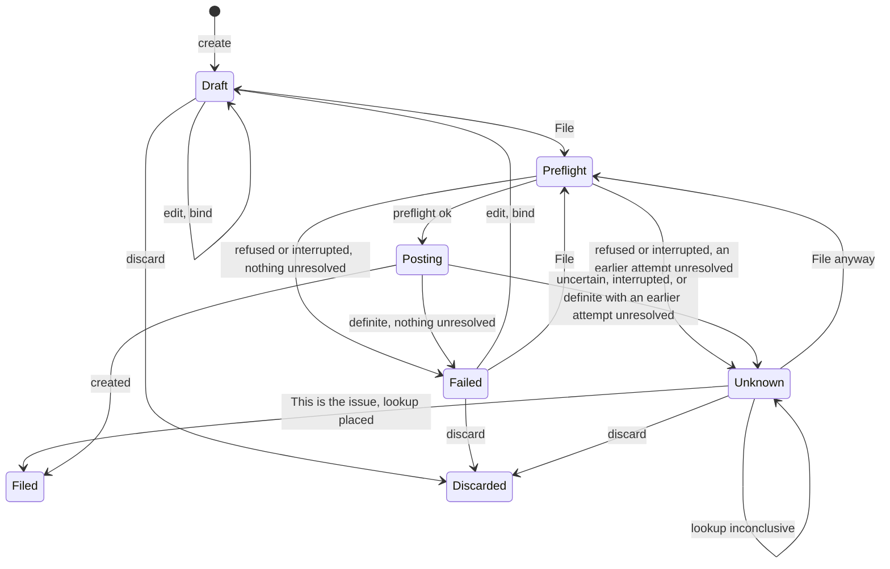

# Issue actions

An issue the model drafts becomes a durable action: a row in the store's `actions` table that
only the user's consent may move toward GitHub. The stages and what a card shows are in
`crates/brain/src/issues.rs`, the rows in `crates/brain/src/store/actions.rs`. Neither sends a
request.

## Stages

| Stage | Meaning | Offers a decision |
|---|---|---|
| `draft` | Editable, waiting for consent | Yes |
| `preflight` | Admitted; the pre-send lookup runs and nothing has been sent | No |
| `posting` | The create request may have been sent | No |
| `filed` | The issue exists | No |
| `failed` | No issue was created; a retry needs fresh consent | Yes |
| `unknown` | An attempt may have created an issue, so only File anyway sends again | Yes |
| `discarded` | Dismissed | No |

A mark records when an attempt's preflight began and up to 200 matching issue numbers that
already existed. Preflight and Posting carry the earliest mark of an earlier attempt that may
have created an issue (`unresolved`), and Unknown keeps that earliest mark: a later mark's list
can already hold the earlier attempt's issue and would hide it from the lookup. `uncertain`
counts the attempts that may have created an issue. It is 0 in Draft and Failed, which a CHECK
enforces, and at least 1 in Unknown. The card shows `maybe_duplicate` from 2, and a discarded
action's `maybe_filed` from 1.

A restart follows the interrupted edges. Nothing here sends: the runtime runs the preflight and
the create and reports their outcomes through the completions below. That wiring and the network
are separate work.

## Approvals and versions

Every commit raises the action's `version`. A commit into Draft, Failed or Unknown takes a fresh
approval revision from `approval_mark` in the same transaction; other stages hold none, and a
rolled-back op issues nothing. The mark is one row that deletion and purges never touch, so no
revision is issued twice, and `AUTOINCREMENT` does the same for draft ids. A mark or version at
`i64::MAX`, or an exhausted `uncertain`, fails the op with `StoreError::Issue` and changes
nothing.

## Ops

Each op loads the row joined to a live thread, applies a pure transition to a copy, writes
nothing when the copy is unchanged, and otherwise commits it with a new version and approval. A
hidden or missing row answers `Gone`. Edit or discard in a stage that doesn't take it answers
`Refused(NotAllowedNow)` and writes nothing. Errors never carry SQLite's text, which can quote
content.

- `create_draft` stores a Draft in a live thread.
- `action` reads one while its thread is live.
- `edit_draft` replaces title, body and repository together in Draft or Failed; a change makes
  it a Draft.
- `discard_draft` dismisses a Draft, Failed or Unknown action.
- `consent`, `bind_drafts` and the completions follow.

## Consent

`consent` takes the hash the card showed, its approval revision, a decision, and `Live`: the
verified user from the device machine's `user()` and the listed repositories. The revision
decides first:

| Revision | Answer | Written |
|---|---|---|
| The last one used up | `Unchanged` | nothing |
| Any other but the current one | `Refused(StaleApproval)` | nothing |
| Current, a check fails | `Refused(reason)` with a fresh revision | `consumed`, `version`, `approval` |
| Current, every check passes | `Changed` into Preflight, or Filed for a confirmed candidate | `consumed`, `stage`, `version`, `approval` |

The checks run in order:
1. The stage takes the decision: File needs Draft or Failed, File anyway needs Unknown, and This
   is the issue needs Unknown with an unplaced candidate. Otherwise `NotAllowedNow`.
2. The hash matches. Otherwise `ContentChanged`.
3. The action has an account, and `Live` has a user with a nonzero id. Otherwise `NotConnected`.
4. Their numeric ids are equal; logins don't count. Otherwise `OtherAccount`.
5. The bound repository is listed. Otherwise `RepoNotListed`.

A refusal never changes stage, content or binding. Because the refused revision is used up, a
stale click can't file once its cause is fixed, and a double click on a sending card is a no-op.
Every return to Draft, Failed or Unknown offers a new revision, so each send that could duplicate
an issue needs a fresh File anyway.

The hash is SHA-256 of `{"repo":…,"account":…,"title":…,"body":…}` in that order, with the
account as its numeric id. It covers no screenshot, since the card shows none.

`bind_drafts(account, repo)` sets the account and, where none is chosen, the repository on every
Draft and Failed action in every live thread. A change makes a Failed action a Draft with a fresh
revision. Unresolved actions are skipped, and bind never files.

## Sending

The runtime calls each completion with the version of the answer that entered its phase, never a
version read later. At any other version, earlier or later, or in another stage, a completion
answers `Refused(NotAllowedNow)` and writes nothing.

- `preflighted(at, result)`: a mark enters Posting, and a refusal means nothing was sent.
- `posted(at, outcome)` takes P3b's `CreateOutcome` unchanged. Created files; Definite means
  nothing was sent; Uncertain, or Created with number 0, adds an uncertain attempt.
- `interrupted(at)` ends a send the runtime gave up on, by the recovery rule. Whichever of it and
  the send's own completion commits first wins, so a late Created leaves the action Unknown.

An attempt that sent nothing fails a first attempt, and leaves a File anyway attempt Unknown with
the earliest mark. `looked_up(episode, lookup)` applies only while Unknown with `uncertain ==
episode`: Placed files, and anything else stays Unknown with the new result. The fence is the
count, not the version, because a refused File anyway moves the version without ending the
uncertainty.

## Recovery

At start, after pending deletions finish, `recover` ends each send that a crash cut short in a
live thread. It reads only the stage, never the content:
- a Preflight with nothing unresolved becomes `Failed(Interrupted)`, since nothing was sent;
- a Preflight carrying an unresolved mark becomes Unknown with that mark;
- a Posting becomes Unknown with the earliest mark and one more uncertain attempt.

Each gets a fresh revision, and `consumed` stays, so a revision used before the crash can't
file after it. Settled actions aren't touched. The "store recovered" log line adds
`failed_sends` and `unknown_sends`.

The sends are one transaction. If any sending row's stage doesn't decode, `recover` fails with
`StoreError::Issue`, the whole batch rolls back, and the brain doesn't start; the next start
fails the same way. `Store::open` still succeeds, and the steps before it, finished deletions
and crashed runs, have committed. This is deliberate: skipping the row could hide an attempt
that may have created an issue, and guessing its outcome could resend one. Starting again needs
the row repaired or a backup restored.

## Schema and privacy

`actions` arrives in version 7 ([the store](store.md#tables)). `stage` is JSON tagged by `kind`,
and SQL reads only the kind: a CHECK refuses a missing, null or unknown kind, and every stage but
Draft, Failed and Discarded needs a repository and an account. GitHub's account ids are unsigned
64-bit, so one is canonical decimal text (1 to 20 digits, no leading zero). Reads check it again,
since SQLite doesn't recheck stored rows: zero, any other form and one past `u64::MAX` fail. Reads
also refuse an id without a login or a login without an id, and a stage other than Draft, Failed
or Discarded without a repository and an account, so every action that loads can render.

Debug of `Action`, `Stage` and `Answer` prints kinds, ids, versions, counts and the redacted
Debug of titles, bodies, repositories and accounts. It never prints an unplaced candidate's URL,
which names the repository. A thread's actions go in deletion's second transaction, and the
purge clears their old copies, edited-away text included, as it does events'.

The lookup that resolves Unknown is a heuristic: another client, or a second draft under the same
account, can create a matching issue after the mark. Nothing here proves which request created
an issue.
