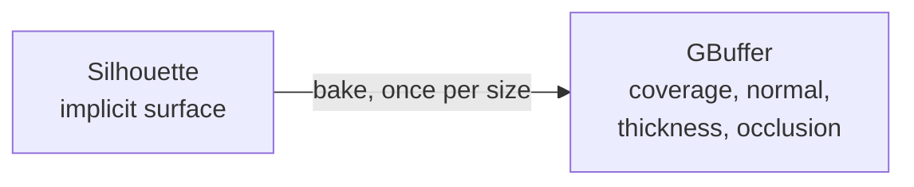

# Kumo

Kumo is the presence's character: a soft 3D cloud with eyes, shaded live on the CPU and drawn by
GPUI as straight-alpha images. It lives in `crates/shell/src/presence/kumo/`: plain Rust,
with no GPUI, no platform code and no dependencies, so it runs the same on Windows and macOS.

## The shape and the bake

`shape.rs` describes the body as a signed distance field in cloud units: a rounded base slab
smooth-unioned (`smin`) with five lobes, two of them soft bellies underneath, cut by a softly flat
floor, with a little noise on the front face only so the silhouette at z = 0 stays exact.

`GBuffer::bake` ray-marches that field once per covered pixel of a square (up to 96 steps
each) and keeps, per pixel, the antialiased coverage, the surface normal, the depth as a
thickness, and ambient occlusion. A `Framing` places the cloud in the square; `CARD` leaves
room for the shadow and gives the edge a soft vapour band about a pixel wide. The bake's cost
grows with the size squared, so it runs when the size or display scale changes, never per frame
and never inside GPUI's paint.

Tests cover the field's sign inside and outside, the framing's centre and corner, the bake's
empty corners and covered middle, the soft band against a crisp one, determinism, and the empty
and single-pixel sizes.
