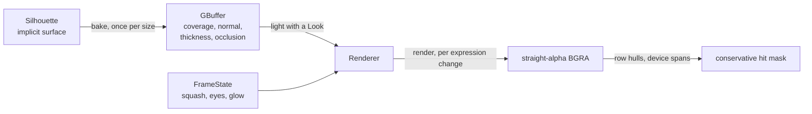

# Kumo

Kumo is the presence's character: a soft 3D cloud with eyes, shaded live on the CPU and drawn by
GPUI as straight-alpha images. It lives in `crates/shell/src/presence/kumo/`: plain Rust,
with no GPUI, no platform code and no dependencies, so it runs the same on Windows and macOS.

## The shape and the bake

`shape.rs` describes the body as a signed distance field in cloud units: a rounded base slab
smooth-unioned (`smin`) with five lobes, two of them soft bellies underneath, cut by a softly flat
floor, with a little noise on the front face only so the silhouette at z = 0 stays exact.

`GBuffer::bake` ray-marches that field once per covered pixel of a square (up to 96 steps
each) and keeps, per pixel, the antialiased coverage, the surface normal, the depth as a
thickness, and ambient occlusion. A `Framing` places the cloud in the square; `CARD` leaves
room for the shadow and gives the edge a soft vapour band about a pixel wide. The bake's cost
grows with the size squared, so it runs when the size or display scale changes, never per frame
and never inside GPUI's paint.

Tests cover the field's sign inside and outside, the framing's centre and corner, the bake's
empty corners and covered middle, the soft band against a crisp one, determinism, and the empty
and single-pixel sizes.

## Shading

`raster.rs`'s `Renderer::new` bakes the body at one square size and lights each covered texel
once with a `Look` (`look.rs`: the approved `Material::SOFT` and `Theme::LAVENDER`, and a
contact shadow). Lighting is a wrapped key light with sky fill, crease occlusion toward a
saturated shade colour, a silver lining where thin vapour scatters the key light, and a static
accent glow from one side.

`Renderer::render` shades one frame from a `FrameState` (`frame.rs`): the body's squash and
lift about its bottom centre, the two eyes, blush, and the mood's inner light and rim.
`FrameState::IDLE` is the still pose a resting Kumo shows. It writes straight-alpha BGRA into
a buffer the caller owns, allocates nothing, and returns a typed error for a buffer of the wrong
size. The soft edge drifts with the frame's time, so it reads as vapour; at time 0 a frame is
the same bytes every time.

GPUI filters straight-alpha colour when it scales an image, so a black clear pixel beside the
body would darken the edge. `bleed_clear` gives every clear pixel the colour of a covered
4-neighbour, keeping its alpha at 0. Every image Kumo hands GPUI goes through it.

Measured on Rez (release, best of 5 bakes and 20 frames, 2026-11-03):

| Square, px | Bake, ms | One frame, µs |
|---|---|---|
| 48 | 2.1 | 81 |
| 72 | 4.7 | 175 |
| 84 | 6.3 | 239 |
| 96 | 8.2 | 304 |
| 126 | 14.1 | 512 |
| 168 | 25.0 | 897 |

So a bake is too slow for GPUI's paint at high display scales: it runs before the image is
first shown, or on a background executor. A frame is shaded only when the expression changes.

## Hit mask

`coverage.rs` decides which device pixels of a drawn image take the pointer. It's conservative:
it never lets a click through a visible pixel. GPUI samples a scaled image bilinearly, so a
device pixel reads the texels within one texel of its centre. `row_hulls` takes each source
row's hull of texels at or above 75/255 alpha, and `device_spans` maps those through the
image's snapped `Placement`, reaching half a texel further on each side plus one device pixel
for the snap, clipped to the drawn quad. The cutoff is 75 because two layers each under 75
composite to under 128, so a pixel visible after compositing body and neck is owned by one of
them. One hull per row owns the gaps between lobes; that errs toward owning.

Tests check the renderer's wrong-size error, determinism, clear corners and an opaque middle,
the eye ink, the bleed rule, and a rendered edge with no dark fringe. The mask tests
compare against an independent reference compositor: it snaps each edge of a logical square
the way GPUI's `snap_bounds` does (half toward zero), so a fractional origin can draw a quad a
pixel wider than tall, samples each layer bilinearly and composites them source-over. Every
pixel at 128 or more after compositing must be owned: the rendered body at 48, 84 and a 168 px
high-DPI bake, drawn at 1.0 to 2.0 scale from four origins, at 66 px while growing, two bodies a
frame apart, and two flat layers at the 74 + 74 and 75 + 75 boundary and at 40% each.

Over-ownership is bounded per axis. A span's end lies within `(d + 1) × scale + 3` device
pixels, in rows and columns, of a visible pixel, where `d` is the material's soft edge: the
source distance from the alpha-75 to the alpha-128 crossing, 0.29 texels at 48 px, 0.34 at 84
and 0.46 at 168. The extra texel is the bilinear footprint and the 3 pixels are rounding, the
next pixel centre and the snap pixel. Pixels between a span's ends are hull gaps, allowed and
not measured. The tests also cover the inclusive cutoff, a zero-size source, empty images and
placements, and a single texel.

## Expressions

`expression.rs`'s `Animator` turns a `Mood` (idle, listening, thinking, speaking) into frames.
Each mood is a target pose, a set of eye, lid, gaze and inner-light numbers, and a mood change
eases every number toward it, so any mood can follow any other.

Kumo is still unless something engages it. `engage` (hover, listening or speaking beginning)
starts one blink, and `disengage` cuts a blink under way. Listening and speaking move
continuously while they last: the body breathes and squashes with the voice level, the light
orbits, and blinks recur on a seeded schedule. Idle and thinking hold their pose. There's no
idle timer: `is_animating` says whether the next frame differs, and the owner asks GPUI for a
frame only while it's true, so a settled Kumo costs nothing. `set_motion(Motion::Reduced)`
follows the operating system's reduced-motion setting: each mood shows its static pose, a blink
under way stops at once, and nothing moves.

Tests cover a minute of idle asking for no frame, exactly one blink per engagement,
disengaging mid-blink, reduced motion with and without a voice, turning it on mid-blink and off
again, a voice mood moving and blinking over a long turn, and a mood change easing and then
settling.
