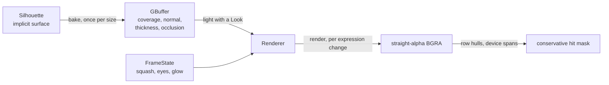

# Kumo

Kumo is the presence's character: a soft 3D cloud with eyes, shaded live on the CPU and drawn by
GPUI as straight-alpha images. It lives in `crates/shell/src/presence/kumo/`: plain Rust,
with no GPUI, no platform code and no dependencies, so it runs the same on Windows and macOS.

## The shape and the bake

`shape.rs` describes the body as a signed distance field in cloud units: a rounded base slab
smooth-unioned (`smin`) with five lobes, two of them soft bellies underneath, cut by a softly flat
floor, with a little noise on the front face only so the silhouette at z = 0 stays exact.

`GBuffer::bake` ray-marches that field once per covered pixel of a square (up to 96 steps
each) and keeps, per pixel, the antialiased coverage, the surface normal, the depth as a
thickness, and ambient occlusion. A `Framing` places the cloud in the square; `CARD` leaves
room for the shadow and gives the edge a soft vapour band about a pixel wide. The bake's cost
grows with the size squared, so it runs when the size or display scale changes, never per frame
and never inside GPUI's paint.

Tests cover the field's sign inside and outside, the framing's centre and corner, the bake's
empty corners and covered middle, the soft band against a crisp one, determinism, and the empty
and single-pixel sizes.

## Shading

`raster.rs`'s `Renderer::new` bakes the body at one square size and lights each covered texel
once with a `Look` (`look.rs`: the approved `Material::SOFT` and `Theme::LAVENDER`, and a
contact shadow). Lighting is a wrapped key light with sky fill, crease occlusion toward a
saturated shade colour, a silver lining where thin vapour scatters the key light, and a static
accent glow from one side.

`Renderer::render` shades one frame from a `FrameState` (`frame.rs`): the body's squash and
lift about its bottom centre, the two eyes, blush, and the mood's inner light and rim.
`FrameState::IDLE` is the still pose a resting Kumo shows. It writes straight-alpha BGRA into
a buffer the caller owns, allocates nothing, and returns a typed error for a buffer of the wrong
size. The soft edge drifts with the frame's time, so it reads as vapour; at time 0 a frame is
the same bytes every time.

GPUI filters straight-alpha colour when it scales an image, so a black clear pixel beside the
body would darken the edge. `bleed_clear` gives every clear pixel the colour of a covered
4-neighbour, keeping its alpha at 0. Every image Kumo hands GPUI goes through it.

Measured on Rez (release, best of 5 bakes and 20 frames, 2026-11-03):

| Square, px | Bake, ms | One frame, µs |
|---|---|---|
| 48 | 2.1 | 81 |
| 72 | 4.7 | 175 |
| 84 | 6.3 | 239 |
| 96 | 8.2 | 304 |
| 126 | 14.1 | 512 |
| 168 | 25.0 | 897 |

So a bake is too slow for GPUI's paint at high display scales: it runs before the image is
first shown, or on a background executor. A frame is shaded only when the expression changes.

A squashed, lifted or stretched frame samples the bake between texels. So at bake time, each empty texel beside the body takes the lit surface of its most covered neighbour, with coverage kept at 0. Its colour and rim then carry into the soft edge instead of black. A test squashes a frame and compares every soft-edge pixel against the matching still pixel, asserting that more than 50 of each kind were compared. Where the still pixel is covered, the black pulled in used to put them 108/255 apart, and now they're at most 8 apart. Where it's clear, it carries a covered neighbour's colour from `bleed_clear`. That's the outermost fringe, where empty texels weigh most: those pixels used to be up to 251 apart, and now they're at most 12. A 4 × 4 fixture checks the rule itself: an empty texel takes its most covered neighbour's surface with coverage kept at 0, a texel with no covered neighbour is left alone, and a sample halfway between a covered texel and a bled one keeps the covered colour at half coverage.

## Hit mask

`coverage.rs` decides which device pixels of a drawn image take the pointer. It's conservative:
it never lets a click through a visible pixel. GPUI samples a scaled image bilinearly, so a
device pixel reads the texels within one texel of its centre. `row_hulls` takes each source
row's hull of texels at or above 75/255 alpha, and `device_spans` maps those through the
image's snapped `Placement`, reaching half a texel further on each side plus one device pixel
for the snap, clipped to the drawn quad. The cutoff is 75 because two layers each under 75
composite to under 128, so a pixel visible after compositing body and neck is owned by one of
them. One hull per row owns the gaps between lobes; that errs toward owning.

Tests check the renderer's wrong-size error, determinism, clear corners and an opaque middle,
the eye ink, the bleed rule, and a rendered edge with no dark fringe. The mask tests
compare against an independent reference compositor: it snaps each edge of a logical square
the way GPUI's `snap_bounds` does (half toward zero), so a fractional origin can draw a quad a
pixel wider than tall, samples each layer bilinearly and composites them source-over. Every
pixel at 128 or more after compositing must be owned: the rendered body at 48, 84 and a 168 px
high-DPI bake, drawn at 1.0 to 2.0 scale from four origins, at 66 px while growing, two bodies a
frame apart, and two flat layers at the 74 + 74 and 75 + 75 boundary and at 40% each.

Over-ownership is bounded per axis. A span's end lies within `(d + 1) × scale + 3` device
pixels, in rows and columns, of a visible pixel, where `d` is the material's soft edge: the
source distance from the alpha-75 to the alpha-128 crossing, 0.29 texels at 48 px, 0.34 at 84
and 0.46 at 168. The extra texel is the bilinear footprint and the 3 pixels are rounding, the
next pixel centre and the snap pixel. Pixels between a span's ends are hull gaps, allowed and
not measured. The tests also cover the inclusive cutoff, a zero-size source, empty images and
placements, and a single texel.

The reference compositor takes each source's width and height on their own, so the neck's
rectangles are checked the same way: a neck pulled 60 and 140 px straight down, one curved
mid-swing, and a short sideways pull whose region is wider than tall. Each is drawn at 1.0 to 2.0
display scale and shaded at half that scale and at `MAX_SCALE`, 1.0, which is full resolution only
at 1.0. Each runs with and without a fractional window offset, alone and over the body, with the
body drawn from the same frame as the goo, so it's drawn out as the neck stretches. Every visible pixel is owned. For the neck, `d` is the furthest any texel at 75
or more lies from one at 128 or more, as a chessboard distance in whole texels; it's at most 6.
Each span end lies within the band of that `d`, and over the body within the larger of the
neck's and the body's bands.

## Neck

`neck.rs` shades the goo that joins a pulled Kumo to the dock line. `Neck` is the pull's state, in logical pixels of the pull surface, y down.
- **The curve.** It runs from the dock to a point just under the crown, as a quadratic curve. Its control point follows the curve's middle on a damped spring, so a sideways drag bends it. The spring takes 24 fixed substeps per update, a step longer than 0.1 s counts as 0.1 s, and a negative or non-finite step counts as none.
- **Its shape.** The neck is ten tapered capsules: narrow under the line, swelling into the cloud, and thinning as it stretches. A soft fillet grows it out of the line. While attached, the body is drawn out toward the dock by up to 7% in width and 14% in height.
- **The break.** Once the dock-to-attachment distance passes `SNAP_LEN` (144), the neck breaks: still attached at exactly 144, broken past it. The curve is frozen as it was at the break. However far that one step jumped, the frozen end is pulled back along its direction onto the 144 circle, so no later move can stretch what's left.
- **The recoil.** For 0.32 s after the break, two pieces are drawn, and nothing between them:
  - **The drip** is the frozen curve from the dock to 0.16 along it. It hangs from the line, ends in a bulb, and retracts into the line. Its root fillet shrinks with it. It stays where it broke, whatever the body does, and doesn't join the body.
  - **The stub** is the frozen curve from 0.21 to the attachment. It travels with the live body, keeps its frozen shape, and melts up into the cloud within 0.12 s.
  - The body springs back to round with a damped wobble. After the recoil, nothing of the neck is drawn.
- **Reduced motion.** The neck still breaks at the same point, so the snap and drop decisions don't change, but no goo is drawn, the body stays round, and there's no recoil. Turning it on mid-recoil ends the recoil.
- **Pieces.** `Piece::Neck`, `Drip` and `Stub` are shaded separately, each into the image of its own `bounds`. A region covers the piece's capsule ends, padded, and its root fillet's ellipse, 2.2 times as wide as it is tall. The drip never meets the body and pads by a tenth of it. The shader blends the body in wherever the piece's field is within 1.5 fillets (0.135 of the body). The stub's field is its capsules, so it pads by that. The neck's is the capsules' smooth union with the root ellipse, which is never more than a quarter of the blend (0.05 of the body) below the nearer of the two. So the neck pads its capsules and its root ellipse, in the ellipse's own wide metric, by 0.1475 of the body, and the root's part is cut to the disc around the body's centre where the shader joins at all. For an 84 px body at 1.0, against capsule-only bounds at 1.5 fillets, the neck grows from 61 × 61 to 92 × 63 at the dock, 61 × 81 to 90 × 83 at 30 px down, 61 × 91 to 80 × 93 at 40, and by 2–3 px each way from 50 px down (61 × 189 to 63 × 191 at 140). A test shades every piece, over pull lengths, sideways offsets, the breaking step and recoil frames, into a region 40 px wider and finds nothing outside its own.
- **Caps.** Each piece's curve lies in the hull of its own control points, so its region has a fixed cap for a body size:
  - the neck within 144 of the dock;
  - the drip within (2u − u²) × 144 = 42.39 of the dock at u = 0.16. With the control and the end perpendicular, the point at 0.16 is (38.7072, 3.6864), and 42.3936 is the collinear bound;
  - the stub within (1 − 0.21²) × 288 = 275.3 of the attachment.

  Its widest capsule, fillet and pad go around that, rounded outward. Tests put each piece inside its cap after a 3,000 px jump on the crossing step, with extremal controls, and after far moves on the first recoil frame and mid-recoil. They also check that a short sideways pull, and every piece over the sweep above, loses nothing outside its region.

`GooShader` shades a piece into a straight-alpha BGRA image of its region at a caller-chosen scale, half the display's for D1, up to `MAX_SCALE`, 1.0.
- **Scratch.** `GooShader::neck` serves the attached neck and the drip, which never coexist. `GooShader::stub` serves the stub. Each one's tile table and distance rows are sized once, from its pieces' caps at `MAX_SCALE` (352 and 613 pixels a side for an 84 px body), and reused, so shading allocates nothing. Tests check the exact limit and one pixel over on each axis.
- **Skipping work.** Each 8-pixel tile keeps a mask of the capsules, and the root ellipse, that can matter in it, and a tile with none takes the clear colour without shading. Near the body a capsule counts within the join's reach. Away from it, a field only matters within a pixel and a half of the goo's edge, where a pixel is drawn or feeds a drawn neighbour's normal, so a capsule counts within 0.9 of a tile plus two pixels of the tile's centre. The root ellipse counts only in tiles it can reach. Every pixel is written once.
- **Colour.** Near the body the neck and the stub melt into the crown through a smooth minimum. They're lit with the body's surface and finish functions, so they're the same material. Clear pixels carry the theme's top colour, or the blended surface colour where they're shaded, and none is black.
- **Errors.** A wrong buffer, or a region or scale past the scratch, returns `GooMismatch`.

`coverage::device_spans` takes a source width plus one row hull per source row, so the goo's rectangles map to device spans as the body's square does.

Measured on Rez, release build, under the measuring lock (05:46:01–05:46:48Z), main against this cull, alternated three times. Each frame is timed on its own, 140 frames per case, with the output black-boxed and checksummed and the shape built outside the loop. The goo belongs to an 84 px body. Medians are the middle of the three runs. The 95th percentile and the slowest frame are ranges over the three:

| Piece, scale | Region, px | Median, µs | 95th percentile, µs | Slowest frame, µs |
|---|---|---|---|---|
| neck, attachment at the dock, 0.5 | 46 × 32 | 233 | 273–325 | 318–368 |
| neck, 30 px down, 0.5 | 45 × 42 | 297 | 387–465 | 419–498 |
| neck, 40 px down, 0.5 | 40 × 47 | 300 | 387–429 | 434–621 |
| neck, 60 px down, 0.5 | 32 × 57 | 298 | 341–417 | 415–476 |
| neck, 140 px down, 0.5 | 32 × 96 | 348 | 364–478 | 432–518 |
| neck, at the dock, 1.0 | 92 × 63 | 860 | 914–1,103 | 984–1,376 |
| neck, 40 px down, 1.0 | 80 × 93 | 1,071 | 1,270–1,549 | 1,496–2,383 |
| neck, 60 px down, 1.0 | 63 × 113 | 1,058 | 1,214–1,283 | 1,429–2,015 |
| neck, 140 px down, 1.0 | 63 × 191 | 1,206 | 1,356–1,591 | 1,597–1,846 |
| drip at the break, 0.5 | 22 × 29 | 76 | 111–114 | 119–134 |
| stub at the break, 0.5 | 31 × 79 | 288 | 328–418 | 385–641 |

The cost per pixel is about 110 to 160 ns, highest in the smallest regions, mostly lighting and the body's signed distance near the crown. The goo's budget for D1 is a median of 400 µs at the worst pull at 0.5, which the 140 px pull meets at 348 µs. A single frame's maximum isn't pass or fail: Rez's scheduling jitter puts the slowest of 140 frames 90–250 µs above the median whatever the code, more than the margin. What a user feels is the frame-level gate, steady presentation at the display's rate with no dropped frames during a pull, measured once C2 wires the pull.

## Expressions

`expression.rs`'s `Animator` turns a `Mood` (idle, listening, thinking, speaking) into frames.
Each mood is a target pose, a set of eye, lid, gaze and inner-light numbers, and a mood change
eases every number toward it, so any mood can follow any other.

Kumo is still unless something engages it. `engage` (hover, listening or speaking beginning)
starts one blink, and `disengage` cuts a blink under way. Listening and speaking move
continuously while they last: the body breathes and squashes with the voice level, the light
orbits, and blinks recur on a seeded schedule. Idle and thinking hold their pose. There's no
idle timer: the owner asks GPUI for a frame only while `is_animating` is true, and draws every
frame it asks for. A change that the next frame must show (a cut blink, a reduced-motion switch,
a mood change) keeps it true for exactly that frame, and an ease snaps to its target pose on its
last frame, so once it's false every later frame is the same and a settled Kumo costs nothing.
Blinks count their own age and countdown, and motion phases wrap per turn on an f64 clock, so
a long run or a huge step can't stall a blink; a negative or non-finite step counts as none. `set_motion(Motion::Reduced)`
follows the operating system's reduced-motion setting: each mood shows its static pose, a blink
under way stops at once, and nothing moves.

Tests drive the animator the way its owner will, drawing only while `is_animating` is true.
They cover each mood's still pose against the spike's numbers, a minute of idle asking for no
frame, exactly one 13-frame blink per engagement, disengaging and re-engaging, reduced motion
switched on mid-blink and during a mood change, a voice mood's squash, orbit and blinks, a late
switch between voice moods waiting a whole gap, an ease's halfway value and exact landing, a
mood change mid-blink, and a huge, zero, negative and non-finite step.
