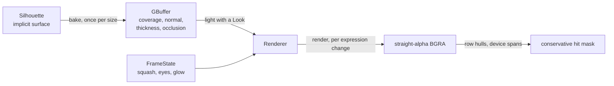
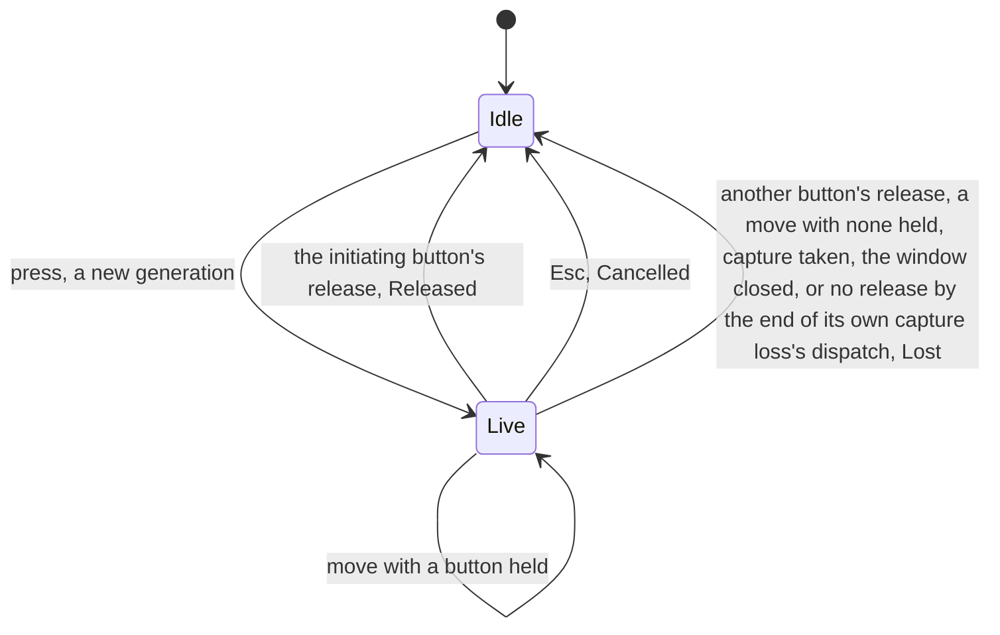

# Kumo

Kumo is the presence's character: a soft 3D cloud with eyes, shaded live on the CPU and drawn by
GPUI as straight-alpha images. It lives in `crates/shell/src/presence/kumo/`: plain Rust,
with no GPUI, no platform code and no dependencies, so it runs the same on Windows and macOS.

## The shape and the bake

`shape.rs` describes the body as a signed distance field in cloud units: a rounded base slab
smooth-unioned (`smin`) with five lobes, two of them soft bellies underneath, cut by a softly flat
floor, with a little noise on the front face only so the silhouette at z = 0 stays exact.

`GBuffer::bake` ray-marches that field once per covered pixel of a square (up to 96 steps
each) and keeps, per pixel, the antialiased coverage, the surface normal, the depth as a
thickness, and ambient occlusion. A `Framing` places the cloud in the square; `CARD` leaves
room for the shadow and gives the edge a soft vapour band about a pixel wide. The bake's cost
grows with the size squared, so it runs when the size or display scale changes, never per frame
and never inside GPUI's paint. `kumo_view::still` bakes once and shades the still pose for a window
that shows Kumo without animating it, such as onboarding's welcome.

Tests cover the field's sign inside and outside, the framing's centre and corner, the bake's
empty corners and covered middle, the soft band against a crisp one, determinism, and the empty
and single-pixel sizes.

## Shading

`raster.rs`'s `Renderer::new` bakes the body at one square size and lights each covered texel
once with a `Look` (`look.rs`: the approved `Material::SOFT` and `Theme::LAVENDER`, and a
contact shadow). Lighting is a wrapped key light with sky fill, crease occlusion toward a
saturated shade colour, a silver lining where thin vapour scatters the key light, and a static
accent glow from one side.

`Renderer::render` shades one frame from a `FrameState` (`frame.rs`): the body's squash and
lift about its bottom centre, the two eyes, blush, and the mood's inner light and rim.
`FrameState::IDLE` is the still pose a resting Kumo shows. It writes straight-alpha BGRA into
a buffer the caller owns, allocates nothing, and returns a typed error for a buffer of the wrong
size. The soft edge drifts with the frame's time, so it reads as vapour; at time 0 a frame is
the same bytes every time.

GPUI filters straight-alpha colour when it scales an image, so a black clear pixel beside the
body would darken the edge. `bleed_clear` gives every clear pixel the colour of a covered
4-neighbour, keeping its alpha at 0. Every image Kumo hands GPUI goes through it.

Measured on Rez (release, best of 5 bakes and 20 frames, 2026-11-03):

| Square, px | Bake, ms | One frame, µs |
|---|---|---|
| 48 | 2.1 | 81 |
| 72 | 4.7 | 175 |
| 84 | 6.3 | 239 |
| 96 | 8.2 | 304 |
| 126 | 14.1 | 512 |
| 168 | 25.0 | 897 |

So a bake is too slow for GPUI's paint at high display scales: it runs before the image is
first shown, or on a background executor. A frame is shaded only when the expression changes.

A squashed, lifted or stretched frame samples the bake between texels. So at bake time, each empty texel beside the body takes the lit surface of its most covered neighbour, with coverage kept at 0. Its colour and rim then carry into the soft edge instead of black. A test squashes a frame and compares every soft-edge pixel against the matching still pixel, asserting that more than 50 of each kind were compared. Where the still pixel is covered, the black pulled in used to put them 108/255 apart, and now they're at most 8 apart. Where it's clear, it carries a covered neighbour's colour from `bleed_clear`. That's the outermost fringe, where empty texels weigh most: those pixels used to be up to 251 apart, and now they're at most 12. A 4 × 4 fixture checks the rule itself: an empty texel takes its most covered neighbour's surface with coverage kept at 0, a texel with no covered neighbour is left alone, and a sample halfway between a covered texel and a bled one keeps the covered colour at half coverage.

## Hit mask

`coverage.rs` decides which device pixels of a drawn image take the pointer. It's conservative:
it never lets a click through a visible pixel. GPUI samples a scaled image bilinearly, so a
device pixel reads the texels within one texel of its centre. `row_hulls` takes each source
row's hull of texels at or above 75/255 alpha, and `device_spans` maps those through the
image's snapped `Placement`, reaching half a texel further on each side plus one device pixel
for the snap, clipped to the drawn quad. The cutoff is 75 because two layers each under 75
composite to under 128, so a pixel visible after compositing body and neck is owned by one of
them. One hull per row owns the gaps between lobes; that errs toward owning.

Tests check the renderer's wrong-size error, determinism, clear corners and an opaque middle,
the eye ink, the bleed rule, and a rendered edge with no dark fringe. The mask tests
compare against an independent reference compositor: it snaps each edge of a logical square
the way GPUI's `snap_bounds` does (half toward zero), so a fractional origin can draw a quad a
pixel wider than tall, samples each layer bilinearly and composites them source-over. Every
pixel at 128 or more after compositing must be owned: the rendered body at 48, 84 and a 168 px
high-DPI bake, drawn at 1.0 to 2.0 scale from four origins, at 66 px while growing, two bodies a
frame apart, and two flat layers at the 74 + 74 and 75 + 75 boundary and at 40% each.

Over-ownership is bounded per axis. A span's end lies within `(d + 1) × scale + 3` device
pixels, in rows and columns, of a visible pixel, where `d` is the material's soft edge: the
source distance from the alpha-75 to the alpha-128 crossing, 0.29 texels at 48 px, 0.34 at 84
and 0.46 at 168. The extra texel is the bilinear footprint and the 3 pixels are rounding, the
next pixel centre and the snap pixel. Pixels between a span's ends are hull gaps, allowed and
not measured. The tests also cover the inclusive cutoff, a zero-size source, empty images and
placements, and a single texel.

The reference compositor takes each source's width and height on their own, so the neck's
rectangles are checked the same way: a neck pulled 60 and 140 px straight down, one curved
mid-swing, and a short sideways pull whose region is wider than tall. Each is drawn at 1.0 to 2.0
display scale and shaded at half that scale and at `MAX_SCALE`, 1.0, which is full resolution only
at 1.0. Each runs with and without a fractional window offset, alone and over the body, with the
body drawn from the same frame as the goo, so it's drawn out as the neck stretches. Every visible pixel is owned. For the neck, `d` is the furthest any texel at 75
or more lies from one at 128 or more, as a chessboard distance in whole texels; it's at most 6.
Each span end lies within the band of that `d`, and over the body within the larger of the
neck's and the body's bands.

## Neck

`neck.rs` shades the goo that joins a pulled Kumo to the dock line. `Neck` is the pull's state, in logical pixels of the pull surface, y down.
- **The curve.** It runs from the dock to a point just under the crown, as a quadratic curve. Its control point follows the curve's middle on a damped spring, so a sideways drag bends it. The spring takes 24 fixed substeps per update, a step longer than 0.1 s counts as 0.1 s, and a negative or non-finite step counts as none.
- **Its shape.** The neck is ten tapered capsules: narrow under the line, swelling into the cloud, and thinning as it stretches. A soft fillet grows it out of the line. While attached, the body is drawn out toward the dock by up to 7% in width and 14% in height.
- **The break.** Once the dock-to-attachment distance passes `SNAP_LEN` (144), the neck breaks: still attached at exactly 144, broken past it. The curve is frozen as it was at the break. However far that one step jumped, the frozen end is pulled back along its direction onto the 144 circle, so no later move can stretch what's left.
- **The recoil.** For 0.32 s after the break, two pieces are drawn, and nothing between them:
  - **The drip** is the frozen curve from the dock to 0.16 along it. It hangs from the line, ends in a bulb, and retracts into the line. Its root fillet shrinks with it. It stays where it broke, whatever the body does, and doesn't join the body.
  - **The stub** is the frozen curve from 0.21 to the attachment. It travels with the live body, keeps its frozen shape, and melts up into the cloud within 0.12 s.
  - The body springs back to round with a damped wobble. After the recoil, nothing of the neck is drawn.
- **Reduced motion.** The neck still breaks at the same point, so the snap and drop decisions don't change, but no goo is drawn, the body stays round, and there's no recoil. Turning it on mid-recoil ends the recoil.
- **Pieces.** `Piece::Neck`, `Drip` and `Stub` are shaded separately, each into the image of its own `bounds`. A region covers the piece's capsule ends, padded, and its root fillet's ellipse, 2.2 times as wide as it is tall. The drip never meets the body and pads by a tenth of it. The shader blends the body in wherever the piece's field is within 1.5 fillets (0.135 of the body). The stub's field is its capsules, so it pads by that. The neck's is the capsules' smooth union with the root ellipse, which is never more than a quarter of the blend (0.05 of the body) below the nearer of the two. So the neck pads its capsules and its root ellipse, in the ellipse's own wide metric, by 0.1475 of the body, and the root's part is cut to the disc around the body's centre where the shader joins at all. For an 84 px body at 1.0, against capsule-only bounds at 1.5 fillets, the neck grows from 61 × 61 to 92 × 63 at the dock, 61 × 81 to 90 × 83 at 30 px down, 61 × 91 to 80 × 93 at 40, and by 2–3 px each way from 50 px down (61 × 189 to 63 × 191 at 140). A test shades every piece, over pull lengths, sideways offsets, the breaking step and recoil frames, into a region 40 px wider and finds nothing outside its own.
- **Caps.** Each piece's curve lies in the hull of its own control points, so its region has a fixed cap for a body size:
  - the neck within 144 of the dock;
  - the drip within (2u − u²) × 144 = 42.39 of the dock at u = 0.16. With the control and the end perpendicular, the point at 0.16 is (38.7072, 3.6864), and 42.3936 is the collinear bound;
  - the stub within (1 − 0.21²) × 288 = 275.3 of the attachment.

  Its widest capsule, fillet and pad go around that, rounded outward. Tests put each piece inside its cap after a 3,000 px jump on the crossing step, with extremal controls, and after far moves on the first recoil frame and mid-recoil. They also check that a short sideways pull, and every piece over the sweep above, loses nothing outside its region.

`GooShader` shades a piece into a straight-alpha BGRA image of its region at a caller-chosen scale, half the display's for D1, up to `MAX_SCALE`, 1.0.
- **Scratch.** `GooShader::neck` serves the attached neck and the drip, which never coexist. `GooShader::stub` serves the stub. Each one's tile table and distance rows are sized once, from its pieces' caps at `MAX_SCALE` (352 and 613 pixels a side for an 84 px body), and reused, so shading allocates nothing. Tests check the exact limit and one pixel over on each axis.
- **Skipping work.** Tiles that no capsule, fillet or body can reach take the clear colour without shading. Every pixel is written once.
- **Colour.** Near the body the neck and the stub melt into the crown through a smooth minimum. They're lit with the body's surface and finish functions, so they're the same material. Clear pixels carry the theme's top colour, or the blended surface colour where they're shaded, and none is black.
- **Errors.** A wrong buffer, or a region or scale past the scratch, returns `GooMismatch`.

`coverage::device_spans` takes a source width plus one row hull per source row, so the goo's rectangles map to device spans as the body's square does.

Measured on Rez, release build, under the measuring lock (04:20:50–04:21:33Z), at this head. Each frame is timed on its own, 140 frames per case, two runs, with the output black-boxed and checksummed and the shape built outside the loop. The goo belongs to an 84 px body:

| Piece, scale | Region, px | Median, µs | Slowest frame, µs |
|---|---|---|---|
| neck, attachment at the dock, 0.5 | 46 × 32 | 231 | 273 |
| neck, 30 px down, 0.5 | 45 × 42 | 293 | 407 |
| neck, 40 px down, 0.5 | 40 × 47 | 294 | 343 |
| neck, 60 px down, 0.5 | 32 × 57 | 302 | 394 |
| neck, 140 px down, 0.5 | 32 × 96 | 375 | 473 |
| neck, at the dock, 1.0 | 92 × 63 | 855 | 1,085 |
| neck, 40 px down, 1.0 | 80 × 93 | 1,050 | 1,373 |
| neck, 60 px down, 1.0 | 63 × 113 | 1,064 | 1,400 |
| neck, 140 px down, 1.0 | 63 × 191 | 1,317 | 1,441 |
| drip at the break, 0.5 | 22 × 29 | 83 | 130 |
| stub at the break, 0.5 | 31 × 79 | 305 | 340 |

The cost per pixel is about 110 to 160 ns, highest in the smallest regions, likely mostly the body's signed distance near the crown. The z = 0 slice no longer evaluates the surface noise it multiplies by zero, and every pixel is written once. Together that cut the neck's median by 16–20%, with matching aggregate byte sums before and after (a consistency check, not a proof of identical images). The join padding then gave back up to about 7%. At half scale the medians are under C2a's 400 µs goo gate, but single frames reach 473 µs here and 775 µs in an earlier session. The gate is a maximum, so C2a tunes the goo before claiming it.

## The pull

`pull.rs`'s `Pull` is what a drag does to Kumo, frame by frame. `DragOwner`, in `crates/shell-core/src/presence/drag.rs`, decides when the drag ends. Both are pure, and C2a wires them to the peek and the dock overlay.

- **The body.** It follows the pointer on a critically damped spring (28 per second, 24 substeps an update), keeping the offset at which it was pressed, so it doesn't jump to the pointer. It's integrated relative to home, so near home its small steps aren't rounded away against screen coordinates. A negative or non-finite step counts as none, and one longer than 0.1 s as 0.1 s, as the neck's does.
- **Its width** goes from the peek's 64 px at home to the 84 px carry width at `SNAP_LEN` away, smoothly with distance, so it shrinks back the same way.
- **The neck** is a `Neck` for the 84 px body, stepped after the body each update, so the snap is the neck's own decision. Once the neck breaks, the free body stays inside the dock overlay, including on the step that breaks it. The snap is decided on the body's unclamped path, and then the neck takes the clamped body without another step, so the stub stays on the body it's drawn against. An overlay narrower or shorter than the body can't hold it: on that axis the body's corner sits at the overlay's origin and it overhangs the far edge.
- **The end.** `release` sends the body home, whatever ended the drag. Before the snap, that's the spring back into the peek. After it, that's the invalid drop until C2b has drop targets. Once the released body is within 0.05 px of home and slower than 0.05 px a second, it lands exactly home with no velocity, and `settled` says so, so the pull can go idle.
- **Reduced motion.** The body is wherever the pointer puts it, with no spring, and goes home in one step. The neck still breaks, so the snap and the cancellation behave the same.

The drag owner turns GPUI's mouse events, Esc and the native bridge's capture losses into one ending per drag. Each press that starts a drag gets a new generation. While a drag is live, another press starts nothing.

- **A capture loss** applies only to a drag whose press came before the loss was emitted. Both are stamped from one UI-thread input sequence where they're produced, never when they're drained, and no two stamps are equal, so one queued during an earlier drag can't end the next. A loss caused by the initiating button's own release is held, because the release that follows in the same dispatch is the ending. The caller calls `reconcile` at the end of the dispatch that delivered a loss: if that release never came, the drag ends there as `Lost`, so the next press starts a new generation instead of finding a drag still live.
- **After the ending,** every event is ignored until the next press: a late release after Esc, a second Esc, or a loss after a release.
- **Only `Released`** may have effects, and the caller still validates the drop. `Cancelled` and `Lost` never do.

Tests cover releasing outside the peek, Esc followed by a late release, a second button's press and release, the voluntary capture change with and without its release, losses from outside and by another button, a loss emitted during the current drag, between two drags, and during an earlier drag but drained in a later one, a missed release, the window closing, and events with no drag. For the pull, they cover following from the press point, springing home before and after the snap, landing exactly home at screen coordinates near 1280 and 2400 at 72 and 144 frames a second (down, sideways, and past the snap), the stub staying on the clamped body from the breaking step, staying inside the overlay, the exact widths at home, halfway and past the snap, reduced motion, bad and long steps, and the same motion at 72 and 144 frames a second. Coming to rest is tested at exactly 0.05 px and 0.05 px a second and at the next f32 above each, for a vector whose parts are under but whose length is over, for a fast pass through home, which keeps moving, and for a held pull, which never rests.

`presence/pulling.rs`'s `Pulling` holds the drag owner and the pull together, and its `Phase` is what the presence keys on:

- **`Live`** is the drag: Esc cancels it, and the peek stays open. **`Returning`** is the body going home after the ending. **`Idle`** comes only from `rested`, which the caller calls once the picture showing the body at rest is accepted, so physics settling alone never gives the peek its body back or shrinks the overlay, and a failed upload keeps the return going.
- **Pull space** is logical pixels from the work area's origin, at the work area and scale fixed at the grab. GPUI's peek points are converted at the boundary through the peek's physical client origin, so the overlay's own origin never enters, and growing or moving it can't shift the grip. Any change to the scale or to the work area's rectangle mid-drag, an edge alone included, ends the drag as `Lost`.
- **The grab** pulls toward the centre of the line as drawn, and the free body stays inside the pull area: the dock's slot grown on every side by `SNAP_LEN` plus the carry width, cut to the work area.
- **The start point** is just off the line, half the carry width from the dock toward the peek's side of it, so the neck begins well inside `SNAP_LEN` wherever the peek rests. The body starts there and holds there until the pointer moves, keeping the pointer's offset from that point, and home stays Kumo's place in the peek, so the return lands there.
- **A press** while any pull exists, returning included, starts nothing.

Its tests cover the three orders of a release and its capture loss (the release first, the loss first, and the loss with no release), a duplicate loss, holding still where the body was pressed, the exact mapping on a work area at (−1280, 0) at 125%, the grab's dock and pull area there, the return ending only at `rested`, a press during the return, a new scale, work area origin or work area edge mid-drag, and a grab from the default peek layout, whose body holds at the start point until the pointer moves. Kumo's tests cover a release in the grab's space, a release after the work area or scale changed with no move between, a release whose work area can't be read, and quit losing a live drag once and refusing a grab once the return has settled.

The peek's Kumo owns the `Pulling` (`presence/kumo_view/pull.rs`), since its window takes the drag's input:

- **The press** is a left press on Kumo, read while the native bridge forwards it, so it carries that forward's stamp. A press nothing stamped starts nothing. The line and the slot come from the placement Windows last accepted.
- **Moves and releases** are window listeners, not Kumo's own: capture keeps them in the peek for the whole drag, but GPUI's element listeners hear only the pointer over their hitbox. Each move and the release while the drag is live re-read the work area, since Windows posts nothing the peek follows when it changes, so a release after a change with no move in between is lost too, as is one whose work area can't be read. Hiding the peek loses the drag.
- **The presence follows.** Kumo emits `PullChanged` as a drag is grabbed and as it ends. While it's live, Esc is held system-wide and cancels the pull before it stops work, clears a drawing or dismisses a panel, and the peek's owner is `Owner::Pull`, which keeps it open wherever the pointer goes. The 80 ms grace reads the owner when it fires, so one already queued at the grab keeps the peek open too. Quit ends a live drag as lost and gives back its Esc before any shutdown work waits, and no grab starts after it.

## The pulled picture

While a pull exists, the dock draws Kumo and the peek's slot is empty (`presence/pull_picture.rs`, `presence/pull_dock.rs`, `presence/kumo_view/picture.rs`).

- **The art** is made once per bake, off the UI thread, beside the peek's bake: the body rendered at the carry width (84 px at the display's scale) in its still pose, its row hulls, and the goo's scratch.
- **Each frame** of the dock's own frame loop, paced by the frame-rate setting, steps the pull and makes the next picture, so the pull keeps its frames while the peek is hidden: the goo pieces the neck has now, shaded at half the display's scale, and the body's image stretched by the neck's `body_scale` about its bottom centre. Each image's device quad is snapped as GPUI snaps it, and the pixels it can show come from its row hulls through `device_spans`.
- **The mask** owns the line's band, the next picture's pixels and the shown picture's pixels, since the shown picture stays on screen until the next one is drawn. Each row holds at most four spans; spans that touch merge, and a fifth is refused, never truncated, so that frame isn't shown. The hit mask is allocated once at the largest pull area, the slot grown on every side by `SNAP_LEN` plus the carry width.
- **The overlay** grows to the pull area at the first picture and moves with it, so the line keeps its place in it. Once the dock has given the pull's mask to Windows, failing closed empties the whole pull area, not only the line's band.
- **Allocation.** The pull's own scratch doesn't grow in a frame: the mask, the next picture's rows and the goo's scratch are sized at the bake for the largest pull area, and the dock's retired images have room for a whole picture (drip, stub and body). What it does allocate per frame is each goo piece's pixels and image wrapper, two per piece. While the dock draws the body, the peek shades nothing, so a blink or Listening allocates no image for an empty slot. GPUI's own per-frame work (the boxed frame callback, rendering and its atlas) is outside these counts.
- **Accepted pictures only.** The dock draws a picture only once Windows has accepted its mask; a failed upload keeps the picture it shows, and the peek's slot empties only once the dock has drawn the body. While an accepted picture isn't drawn yet, no new mask is uploaded, so the mask never stops owning pixels that are still on screen. Who shows the body is kept apart from whether the pull has settled. The images a picture no longer draws leave GPUI's atlas a frame later; the body's, the same in every frame of a pull, stays.
- **Rest.** Once the released body is home and still, Kumo wants no more frames. The dock first stops drawing the body and the peek gets it back; only once the dock has drawn a frame without it does the line ask for the dock back, its mask and overlay alone, so the line's band never replaces the mask under a body still on screen. Once that's accepted, `rested` ends the pull. A failed upload keeps it returning, the overlay grown, until a retry is accepted; a dock that fails closed then ends it too.
- **The line waits.** From the accepted grab until that hand-back, the pull uses the line's coordinates and the line takes no attempt, so a position chosen during a pull is placed once the pull lets go, and the line can't fail closed under a pull still going.
- shortcut: the observer records a pull's commits without their geometry, and a pull area taller than its 512 rows, as a full-height pull area is from 110% scale up, would overflow it. The measurement layer gives it the line, the body and their owned spans.

Tests cover four disjoint spans in order and a fifth refused, spans that bridge a gap merging, spans outside the rows dropped, the largest area, a reduced-motion frame whose body is inside the pull area with every owned pixel within its quad and a snap pixel, a full-motion frame drawing the neck under the body without growing its scratch, a return that settles on the dock's frames while the peek is hidden, an accepted picture holding back the next mask until it's drawn, a failed reclaim emptying the pull's area when the proxy won't hide, a body whose first upload failed staying in the peek, a resting body that stays out of the peek until the dock lets go of it and then rests once, a resting pull that gives the line the dock only after a frame without the body, a position chosen after a grab and before any pull frame that touches no surface and can't close the dock until then, one chosen once the pull holds the mask that changes nothing until then and, with its overlay shrink refused, leaves the band under the line on screen, a shown peek that shades nothing while the dock draws the body, and letting go of a three-image picture without growing the retired list.

## The carry

Past the snap the pull is a carry: the body follows the pointer within the pull area, and Presence (`presence/carry.rs`) looks for an app to drop it on.

- **The candidate** is read on a pull frame only when the watched host changed, or when the pointer has moved and `READ_INTERVAL` (50 ms) has passed since the last read. A move the interval holds back sets a deadline at the interval's end, and if no frame reads by then, one trailing read runs at it, so the label settles on the window under a resting pointer within one interval. Each read is `host_at` under the pointer, then `perch::caption::drop_target`, which accepts the point only inside the host's half-open caption, so left of every caption button. A frame or client-area hit is no candidate. The release reads at once, whatever the interval, and its checks read through the same function. `perch::target::Targeting` says when that's a new candidate, and Presence then drops the old watch before arming `watch_host` on the new one, so at most one is live. A watch that can't be armed ends that generation. `HostChanged` from the channel goes to `Targeting`, and a stale generation changes nothing. Presence keeps a watch only for the generation `Targeting` still watches. A `HostChanged` for that generation makes the next frame read again under a still pointer, so a host that moves away or closes clears or replaces the candidate; a stale generation's event, or a late one for a candidate the pointer has left, reads nothing.
- **The drop label** sits under the carried body while a candidate is watched: "Drop on" and the app's window title, from `locales/en/`. It's rebuilt only when the watched window's title changes, on the same watch and generation, and an empty or unreadable title shows the fixed "Drop on this app". The title is screen text: it's drawn, never logged and never sent to the brain, and `Carry` has no `Debug`. It clears at every ending.
- **The drop.** On `Released` after the snap, `decide` runs §10.4's sequence once: the first check against a fresh read under the release point, a drain of the presence channel, the second check, which places the perch, a second drain, and `publish`. Each drain handles every queued event through its usual handler, and an Esc or a Quit in it ends the drop. shortcut: a published placement still returns Kumo to the line until C2b-3's perch takes it, so every ending creates nothing.
- **Endings.** Every end of the drag, and Quit, ends the carry: `Targeting` forgets the drag, the watch unhooks and the label clears.

Tests drive `decide` with a host gone in the first drain and in the final one, a stale generation in the final drain, and an Esc and a Quit in each drain. Each mutation fails one: skipping either drain, publishing before the final drain, and ignoring the Esc or the Quit. `drop_target` is tested at 150% on a monitor at negative coordinates: the caption's interior, corner and last pixel are drops, and the client area, the right and bottom edges, a caption button and a point left of the frame aren't. The candidate reads are tested with a title going from one to another to empty on one watch, and with a still pointer whose host moves away, closes with another window beneath, or gets a stale generation's event. The interval is tested with a move inside it and then rest, which reads exactly once, at the deadline, and with a release-style stale read inside it, which reads at once.

## The native bridge

A pull needs to tell its own button's release from capture being taken away, and GPUI reports only the release. So the presence windows' subclass (`platform/windows/presence.rs`) adds what Windows knows, through `Input` in `crates/shell-core/src/platform/input.rs`, which is plain state with no operating-system calls, so macOS's event handling can make the same calls later.

- **One sequence.** Each forwarded button press is stamped with the next value of one UI-thread sequence, and so is each capture loss, where it's produced and never when it's drained. The press handler reads the press's stamp with `pressed` while the press is being forwarded. A press forwarded inside another gets its own stamp and gives the outer one back when it returns.
- **Releases have a scope.** Each `WM_*BUTTONUP` is forwarded inside `release`, which names its button for that forward only, as a depth so nesting is safe. A `WM_CAPTURECHANGED` during it is `CaptureLost { released: Some(button) }`; at any other time it's `None`. `WM_CANCELMODE` is always `None`, so always involuntary, and it's still forwarded to the default handling.
- **Reconcile after the release returns.** The presence drains a loss into the peek's `Pulling`, then asks `reconcile_after_release`. With no release being forwarded, it defers one reconcile at once. Otherwise the loss waits, and the outermost release, as it returns, sends one `PresenceEvent::Reconcile`. Nothing reschedules itself, so a nested forward can't spin GPUI's effect loop, and an inner release never reconciles early.

Tests cover stamps that never repeat across presses, losses and cancel modes, a nested press giving the outer stamp back, a capture change naming the button only during its release, a cancel mode naming none, a loss with no release running, and a loss drained inside nested releases, which is due exactly once, when the outermost returns. Through the real subclass, on a hidden window with a stub beneath it, they cover a loss drained inside a nested release: each loss names the release it came in, the outer button is restored after the inner release, and one `Reconcile` follows, including when the window is destroyed during the release, which frees the subclass's data. A `WM_CANCELMODE` carries no button, even during a release. Through the presence channel and `bridge`, the adapter the presence drains with, a loss is drained inside a forward nested in the left button's release: nothing ends before the outer forward returns, the outer button is restored after the inner one, and one `Reconcile` follows. With the release reaching GPUI first the drag ends once, `Released`; without it, it ends `Lost` only at the reconcile.

## Expressions

`expression.rs`'s `Animator` turns a `Mood` (idle, listening, thinking, speaking) into frames.
Each mood is a target pose, a set of eye, lid, gaze and inner-light numbers, and a mood change
eases every number toward it, so any mood can follow any other.

Kumo is still unless something engages it. `engage` (hover, listening or speaking beginning)
starts one blink, and `disengage` cuts a blink under way. Listening and speaking move
continuously while they last: the body breathes and squashes with the voice level, the light
orbits, and blinks recur on a seeded schedule. Idle and thinking hold their pose. There's no
idle timer: the owner asks GPUI for a frame only while `is_animating` is true, and draws every
frame it asks for. A change that the next frame must show (a cut blink, a reduced-motion switch,
a mood change) keeps it true for exactly that frame, and an ease snaps to its target pose on its
last frame, so once it's false every later frame is the same and a settled Kumo costs nothing.
Blinks count their own age and countdown, and motion phases wrap per turn on an f64 clock, so
a long run or a huge step can't stall a blink; a negative or non-finite step counts as none. `set_motion(Motion::Reduced)`
follows the operating system's reduced-motion setting: each mood shows its static pose, a blink
under way stops at once, and nothing moves.

Tests drive the animator the way its owner will, drawing only while `is_animating` is true.
They cover each mood's still pose against the spike's numbers, a minute of idle asking for no
frame, exactly one 13-frame blink per engagement, disengaging and re-engaging, reduced motion
switched on mid-blink and during a mood change, a voice mood's squash, orbit and blinks, a late
switch between voice moods waiting a whole gap, an ease's halfway value and exact landing, a
mood change mid-blink, and a huge, zero, negative and non-finite step.
