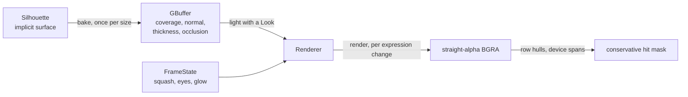

# Kumo

Kumo is the presence's character: a soft 3D cloud with eyes, shaded live on the CPU and drawn by
GPUI as straight-alpha images. It lives in `crates/shell/src/presence/kumo/`: plain Rust,
with no GPUI, no platform code and no dependencies, so it runs the same on Windows and macOS.

## The shape and the bake

`shape.rs` describes the body as a signed distance field in cloud units: a rounded base slab
smooth-unioned (`smin`) with five lobes, two of them soft bellies underneath, cut by a softly flat
floor, with a little noise on the front face only so the silhouette at z = 0 stays exact.

`GBuffer::bake` ray-marches that field once per covered pixel of a square (up to 96 steps
each) and keeps, per pixel, the antialiased coverage, the surface normal, the depth as a
thickness, and ambient occlusion. A `Framing` places the cloud in the square; `CARD` leaves
room for the shadow and gives the edge a soft vapour band about a pixel wide. The bake's cost
grows with the size squared, so it runs when the size or display scale changes, never per frame
and never inside GPUI's paint.

Tests cover the field's sign inside and outside, the framing's centre and corner, the bake's
empty corners and covered middle, the soft band against a crisp one, determinism, and the empty
and single-pixel sizes.

## Shading

`raster.rs`'s `Renderer::new` bakes the body at one square size and lights each covered texel
once with a `Look` (`look.rs`: the approved `Material::SOFT` and `Theme::LAVENDER`, and a
contact shadow). Lighting is a wrapped key light with sky fill, crease occlusion toward a
saturated shade colour, a silver lining where thin vapour scatters the key light, and a static
accent glow from one side.

`Renderer::render` shades one frame from a `FrameState` (`frame.rs`): the body's squash and
lift about its bottom centre, the two eyes, blush, and the mood's inner light and rim.
`FrameState::IDLE` is the still pose a resting Kumo shows. It writes straight-alpha BGRA into
a buffer the caller owns, allocates nothing, and returns a typed error for a buffer of the wrong
size. The soft edge drifts with the frame's time, so it reads as vapour; at time 0 a frame is
the same bytes every time.

GPUI filters straight-alpha colour when it scales an image, so a black clear pixel beside the
body would darken the edge. `bleed_clear` gives every clear pixel the colour of a covered
4-neighbour, keeping its alpha at 0. Every image Kumo hands GPUI goes through it.

Measured on Rez (release, best of 5 bakes and 20 frames, 2026-11-03):

| Square, px | Bake, ms | One frame, µs |
|---|---|---|
| 48 | 2.1 | 81 |
| 72 | 4.7 | 175 |
| 84 | 6.3 | 239 |
| 96 | 8.2 | 304 |
| 126 | 14.1 | 512 |
| 168 | 25.0 | 897 |

So a bake is too slow for GPUI's paint at high display scales: it runs before the image is
first shown, or on a background executor. A frame is shaded only when the expression changes.

A squashed, lifted or stretched frame samples the bake between texels. So at bake time, each empty texel beside the body takes the lit surface of its most covered neighbour, with coverage kept at 0. Its colour and rim then carry into the soft edge instead of black. A test squashes a frame and checks every soft-edge pixel against the matching still pixel: the black pulled in used to put them 108/255 apart, and now they're at most 8 apart.

## Hit mask

`coverage.rs` decides which device pixels of a drawn image take the pointer. It's conservative:
it never lets a click through a visible pixel. GPUI samples a scaled image bilinearly, so a
device pixel reads the texels within one texel of its centre. `row_hulls` takes each source
row's hull of texels at or above 75/255 alpha, and `device_spans` maps those through the
image's snapped `Placement`, reaching half a texel further on each side plus one device pixel
for the snap, clipped to the drawn quad. The cutoff is 75 because two layers each under 75
composite to under 128, so a pixel visible after compositing body and neck is owned by one of
them. One hull per row owns the gaps between lobes; that errs toward owning.

Tests check the renderer's wrong-size error, determinism, clear corners and an opaque middle,
the eye ink, the bleed rule, and a rendered edge with no dark fringe. The mask tests
compare against an independent reference compositor: it snaps each edge of a logical square
the way GPUI's `snap_bounds` does (half toward zero), so a fractional origin can draw a quad a
pixel wider than tall, samples each layer bilinearly and composites them source-over. Every
pixel at 128 or more after compositing must be owned: the rendered body at 48, 84 and a 168 px
high-DPI bake, drawn at 1.0 to 2.0 scale from four origins, at 66 px while growing, two bodies a
frame apart, and two flat layers at the 74 + 74 and 75 + 75 boundary and at 40% each.

Over-ownership is bounded per axis. A span's end lies within `(d + 1) × scale + 3` device
pixels, in rows and columns, of a visible pixel, where `d` is the material's soft edge: the
source distance from the alpha-75 to the alpha-128 crossing, 0.29 texels at 48 px, 0.34 at 84
and 0.46 at 168. The extra texel is the bilinear footprint and the 3 pixels are rounding, the
next pixel centre and the snap pixel. Pixels between a span's ends are hull gaps, allowed and
not measured. The tests also cover the inclusive cutoff, a zero-size source, empty images and
placements, and a single texel.

## Neck

`neck.rs` shades the goo that joins a pulled Kumo to the dock line. `Neck` is the pull's state, in logical pixels of the pull surface, y down.
- **The curve.** It runs from the dock to a point just under the crown, as a quadratic curve. Its control point follows the curve's middle on a damped spring, so a sideways drag bends it. The spring takes 24 fixed substeps per update, a step longer than 0.1 s counts as 0.1 s, and a negative or non-finite step counts as none.
- **Its shape.** The neck is ten tapered capsules: narrow under the line, swelling into the cloud, and thinning as it stretches. A soft fillet grows it out of the line. While attached, the body is drawn out toward the dock by up to 7% in width and 14% in height.
- **The break.** Once the dock-to-attachment distance passes `SNAP_LEN` (144), the neck breaks and nothing of it is drawn. The recoil, drip and stub come in C1b.
- **Its bounds.** The control point is held within `SNAP_LEN` of the dock, so the goo region never passes a fixed cap for a body size.

`GooShader` shades the neck into a straight-alpha BGRA image of the region at a caller-chosen scale, half the display's for D1.
- **Scratch.** Its tile table and distance rows are sized once, from the cap at `MAX_SCALE`, and reused, so shading allocates nothing.
- **Skipping work.** Tiles that no capsule, fillet or body can reach are cleared without shading.
- **Colour.** Near the body the neck melts into the crown through a smooth minimum. It's lit with the body's surface and finish functions, so it's the same material. Clear pixels carry the theme's top colour.
- **Errors.** A wrong buffer, or a region or scale past the scratch, returns `GooMismatch`.

`coverage::device_spans` takes a source width plus one row hull per source row, so the neck's rectangle maps to device spans as the body's square does.

Measured on Rez, release build, under the measuring lock, best of 7 × 20 frames. The goo is an 84 px body's neck:

| Goo, scale | Region, px | One frame, µs |
|---|---|---|
| attachment 60 px down, 0.5 | 28 × 53 | 344 |
| 140 px down, 0.5 | 28 × 92 | 414 |
| 60 px down, 1.0 | 55 × 105 | 1,272 |
| 140 px down, 1.0 | 55 × 183 | 1,508 |

The cost per pixel is about 150 ns, mostly the body's signed distance near the crown. C2a's 400 µs goo gate isn't met near the snap at half scale, so C2a tunes it before claiming that gate.
