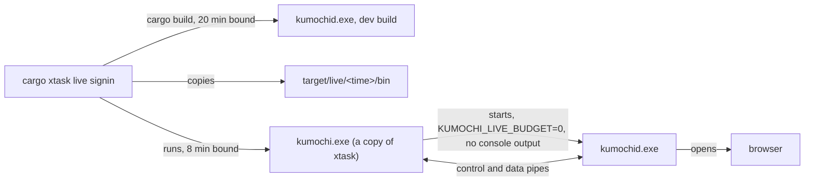

# Live checks

`cargo xtask live <check>` runs the real dev brain on the developer's own dev account and drives it
over its real pipes with the slice 2 gate's client (see [the slice 2 gate](slice2-gate.md)). Live
checks run on Rez, never in CI, and only with the owner present or in a session the Captain
approved. The only check so far is `signin`.

## How it runs



- The brain serves only the `kumochi.exe` beside it, so an outer xtask builds the brain and copies
  it and itself, renamed `kumochi.exe`, into a fresh folder, then runs that copy. Unlike the slice 2
  gate, the brain uses the developer's real `%LOCALAPPDATA%` and the dev credential service, since
  the point is a signed-in dev account that later checks and the dev shell use. Debug names keep it
  away from an installed Kumochi, and a release xtask refuses to run.
- It refuses to start while any `kumochi.exe` or `kumochid.exe` runs: a dev brain holds the
  session's pipes and the account's session lock.
- The harness reads no account credential and takes none as an argument. Its one Credential
  Manager read is the per-session instance capability the dev brain has just written, which
  authenticates the pipe exactly as the shell does. It never reads another service: no spike's,
  and nothing Claude Code, Codex, gh or a browser holds.
- `KUMOCHI_LIVE_BUDGET` is set on the brain's environment only. `signin` sets it to 0, since it
  dispatches no model request. shortcut: the brain ignores it until slice 3 PR 11 enforces it.

## `signin`

It reads the account's first view. Signed in with nothing to recover, it stops there, so a rerun
never opens the browser. Signed out, or signed in but needing to sign in again, it sends
`AccountOp::SignIn`, the brain opens the browser, and it waits for the view to leave `SigningIn`.
It never sends `EnablePlan`: plan consent is Settings' job. Any other first view (busy, signing out,
needing Retry) is printed and refused.

It succeeds only when the account ends `SignedIn` with no recovery; a declined or unavailable plan
still counts as signed in. Every path then sends `Quitting`.

```
live signin: building the dev brain (at most 1200s)
live signin: running in <repo>\target\live\<time>
account: signed out
signing in: finish in the browser; waiting at most 330s
account: signed in, plan enabled
```

**What it prints.** Only state words, built from the view's enums: the email is never formatted,
not even whether there is one. Errors are the harness's own sentences with durations, pids and
those words. No frame, no client error and no client tail (which holds a `Debug` of recent frames)
reaches stdout or stderr, and the brain's own stdout and stderr are discarded. Tests plant an email
in the account views, names and titles in the frames around them, and a token in the client's
failures, and check the exact output of every path.

## Bounds

| Wait | Bound | Then |
|---|---|---|
| Building the brain | 20 min [guess] | cargo and its children are ended |
| The copied harness | 8 min, the final bound on everything below | it and the brain it started are ended |
| The client connecting | the gate client's own retries and per-operation pipe timeouts | fails |
| The first view, and each op's answer | 10 s | fails |
| The sign-in settling | 330 s from the answer, one deadline however many views arrive: the brain ends its attempt at 5 min | sends `CancelSignIn`, waits 10 s for its answer, fails |
| The brain exiting after `Quitting` | 15 s | it's ended |
| Each `taskkill /T /F` | 10 s, then 10 s for the process to go | names every process that may still run |

Ending a process tree is the platform's job (`platform::kill_tree`): std can end one child, not
what it started. A kill that fails is reported with the pid and the command to end it, beside the
failure that caused it, and never hidden by it. A brain dropped on an early return is ended the
same way, with any failure written to stderr.

## Known limits

- Ctrl-C reaches every process on the console. The brain treats it as a crash; an exchange already
  sent is the account machine's outcome-unknown case.
- If the copied harness dies without `Quitting`, the brain relaunches `bin/kumochi.exe`, which prints
  usage and exits, and the brain exits after 30 s with no shell. The 8-minute bound ends it sooner.
- Run folders under `target/live/` stay, as the slice 2 gate's do; `cargo clean` removes them.
