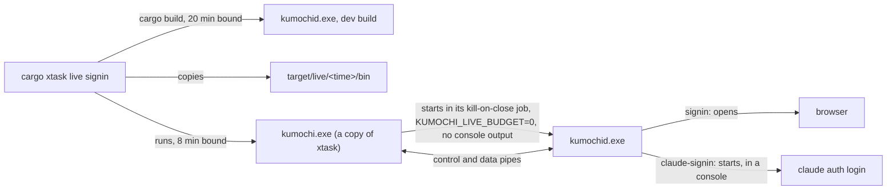

# Live checks

`cargo xtask live <check>` runs the real dev brain on the developer's own dev account and drives it
over its real pipes with the slice 2 gate's client (see [the slice 2 gate](slice2-gate.md)). Live
checks run on Rez, never in CI, and only with the owner present or in a session the Captain
approved. The checks are `signin` and `claude-signin`.

## How it runs



- The brain serves only the `kumochi.exe` beside it, so an outer xtask builds the brain and copies
  it and itself, renamed `kumochi.exe`, into a fresh folder, then runs that copy. Unlike the slice 2
  gate, the brain uses the developer's real `%LOCALAPPDATA%` and the dev credential service, since
  the point is a signed-in dev account that later checks and the dev shell use. Debug names keep it
  away from an installed Kumochi, and a release xtask refuses to run.
- Both sides refuse a release build, and the copied harness takes no folder: it runs only the
  brain beside its own executable. It refuses to start while any `kumochi.exe` or `kumochid.exe`
  runs, and the copy checks again, leaving out itself, right before it starts the brain, since a
  dev brain holds the session's pipes and the account's session lock.
- The copy puts itself in a kill-on-close Job Object (`platform::Job`) before it starts the brain,
  so the brain and anything it starts end with the copy, however it ends: an error, Ctrl-C, Task
  Manager or the watchdog's `taskkill`.
- The harness reads no account credential and takes none as an argument. Its one Credential
  Manager read is the per-session instance capability the dev brain has just written, which
  authenticates the pipe exactly as the shell does. It never reads another service: no spike's,
  and nothing Claude Code, Codex, gh or a browser holds.
- `KUMOCHI_LIVE_BUDGET` is set on the brain's environment only. Both checks set it to 0, since
  neither dispatches a model request. shortcut: the brain ignores it until slice 3 PR 11 enforces it.

## `signin`

It reads the account's first view. Signed in with nothing to recover, it stops there, so a rerun
never opens the browser. Signed out, or signed in but needing to sign in again, it sends
`AccountOp::SignIn`, the brain opens the browser, and it waits for the view to leave `SigningIn`.
It never sends `EnablePlan`: plan consent is Settings' job. Any other first view (busy, signing out,
needing Retry) is printed and refused.

It succeeds only when the account ends `SignedIn` with no recovery; a declined or unavailable plan
still counts as signed in. Every path then sends `Quitting`.

```
live signin: building the dev brain (at most 1200s)
live signin: running in <repo>\target\live\<time>
account: signed out
signing in: finish in the browser; waiting at most 330s
account: signed in, plan enabled
```

**What it prints.** Only state words, built from the view's enums: the email is never formatted,
not even whether there is one. Errors are the harness's own sentences with durations, pids and
those words. No frame, no client error and no client tail (which holds a `Debug` of recent frames)
reaches stdout or stderr, and the brain's own stdout and stderr are discarded. Tests plant an email
in the account views, names and titles in the frames around them, and a token in the client's
failures, and check the exact output of every path.

## `claude-signin`

`cargo xtask live claude-signin` is the early Claude Code sign-in (OSC-122). The dev brain runs
Claude Code's own login in a console the owner answers, and its sign-in file lands in Kumochi's
Claude Code folder, under the one exception in `AGENTS.md`. `--disconnect` undoes it: the brain
signs Claude Code out and deletes that folder.

It reads the first Connections view and waits for the brain's own discovery to replace the
placeholder `NotFound`; still `NotFound` at the deadline, that's the answer. It sends no
`FindClaudeCode`: discovery already runs as the brain starts, and a Find that lands meanwhile
queues a second round, during which the brain drops a Connect.

- **Ready:** it stops there, so a rerun never opens a console.
- **Signed out:** it sends `ConnectClaudeCode` and waits for the view to leave `SigningIn`. It
  succeeds only on `Ready`. The op's answer is the first view that differs from the one before
  the op: the brain also sends Connections snapshots for its own reasons, such as the Anthropic
  key's checks, and one queued before the op still shows the old view.
- **Anything else** (unsupported, turned off, in use, unavailable, a failed audit or policy, a
  cleanup pending) is printed and refused at once, with no op sent. A main that ships
  `SIGN_IN = Undecided` ends discovery at `unsupported: sign-in store`, so it stops there.
- **`--disconnect`** sends `DisconnectClaudeCode` after discovery, so the logout has an install to
  run. Only `CleanupPending` answers it, within 10 s: a discovery view that lands late is skipped.
  Found already `CleanupPending` (a cleanup that failed, which the op retries), that's the answer.
  It then waits for the view to leave `CleanupPending`. It succeeds on signed out or not found. A
  deletion that fails also stays `CleanupPending`, so it shows as the deadline, and the brain
  retries it as it next starts.

It never sends `CancelClaudeSignIn`: at the deadline it sends `Quitting`, and the brain's quit ends
its lane, and the login with it. Every path sends `Quitting`.

```
live claude-signin: building the dev brain (at most 1200s)
live claude-signin: running in <repo>\target\live\<time>
claude code: signed out
signing in: finish in Claude Code's console; waiting at most 330s
claude code: ready
```

**What it prints.** As for `signin`: state words built from the view's enums, never a version, a
path, a frame or a client error. Whatever `claude` prints stays in its own console or in the
brain's discarded output. Tests plant an email, a path and a token in the frames around the views
and in the client's failures, and a version in the views, and check the exact output of every
path.

**The owner session it serves.** After the flip (OSC-122) merges, with the owner at the desk:

1. Close every `kumochi.exe` and `kumochid.exe`.
2. Run `cargo xtask live claude-signin` from a debug xtask on Rez.
3. Answer Claude Code's sign-in in the console it opens. The run ends at `claude code: ready`.
4. To undo it, run `cargo xtask live claude-signin --disconnect`, which ends at
   `claude code: signed out`.

## Bounds

| Wait | Bound | Then |
|---|---|---|
| Building the brain | 20 min [guess] | cargo and its children are ended |
| The copied harness | 8 min, the final bound on everything below while it runs | it's ended, and its job ends the brain with it |
| The client connecting | the gate client's own retries and per-operation pipe timeouts | fails |
| The first view, and each op's answer | 10 s | fails |
| The sign-in settling | 330 s from the answer, one deadline however many views arrive: the brain ends its attempt at 5 min | sends `CancelSignIn`, waits 10 s for its answer, fails |
| Claude Code's discovery | 30 s from the first view [guess]: the harness's budget for `--version` and the status call, not derived from the lane's 10 s root-run bound, since teardown and folder checks come on top | `NotFound` is the answer |
| Claude Code's sign-in settling | 330 s from the answer, one deadline: the lane ends the login at 5 min, then reads the status | sends `Quitting`, which ends the login, and fails |
| Claude Code's op answers | 10 s from the op, one deadline: Connect's answer is the first view unlike the one before it, so stale snapshots such as the Anthropic key's are skipped; Disconnect's is `CleanupPending`, which a pending cleanup already is | fails, naming the last view |
| Disconnect's cleanup | 45 s from the answer [guess]: the harness's budget for the logout, the deletion and discovery again; the lane bounds root runs, not teardown or deletion | fails; the brain retries the deletion as it starts |
| The brain exiting after `Quitting` | 15 s | it's ended |
| Each `taskkill /T /F` | 10 s, then 10 s for the process to go | names every process that may still run |

Ending a process tree is the platform's job (`platform::kill_tree`): std can end one child, not
what it started. A kill that fails or hangs is reported with the pid and the command to end it,
and the hung `taskkill`'s own pid, beside the failure that caused it, and never hidden by it. That
holds even if the root exits meanwhile, since its descendants may not have. A brain dropped on an early return is ended the
same way, with any failure written to stderr.

## Known limits

- Ctrl-C reaches every process on the console, and the job ends the brain in any case. The brain
  treats either as a crash; an exchange already sent is the account machine's outcome-unknown case.
- The watchdog only runs while the copied harness does. Once the copy exits, however it exits, its
  job has already ended the brain, so nothing is left to watch.
- Run folders under `target/live/` stay, as the slice 2 gate's do; `cargo clean` removes them.
