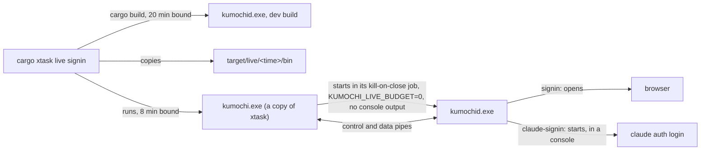

# Live checks

`cargo xtask live <check>` runs the real dev brain on the developer's own dev account and drives it
over its real pipes with the slice 2 gate's client (see [the slice 2 gate](slice2-gate.md)). Live
checks run on Rez, never in CI, and only with the owner present or in a session the Captain
approved. The checks are `account`, `signin`, `claude-signin`, `claude-question`,
`catalog-provenance` and `image`. The last two run the brain alone, with no client (see their
sections).

## How it runs



- The brain serves only the `kumochi.exe` beside it, so an outer xtask builds the brain and copies
  it and itself, renamed `kumochi.exe`, into a fresh folder, then runs that copy. Unlike the slice 2
  gate, the brain uses the developer's real `%LOCALAPPDATA%` and the dev credential service, since
  the point is a signed-in dev account that later checks and the dev shell use. Debug names keep it
  away from an installed Kumochi, and a release or gate xtask refuses to run.
- Both sides refuse anything but the dev identity: a release build uses the installed product's
  names, and the [gate identity](gate-identity.md) never signs in, since its runs delete what
  they leave in Credential Manager. The copied harness takes no folder: it runs only the
  brain beside its own executable. It refuses to start while any `kumochi.exe` or `kumochid.exe`
  runs, and the copy checks again, leaving out itself, right before it starts the brain, since a
  dev brain holds the session's pipes and the account's session lock.
- The copy puts itself in a kill-on-close Job Object (`platform::Job`) before it starts the brain,
  so the brain and anything it starts end with the copy, however it ends: an error, Ctrl-C, Task
  Manager or the watchdog's `taskkill`.
- The harness reads no account credential and takes none as an argument. Its one Credential
  Manager read is the per-session instance capability the dev brain has just written, which
  authenticates the pipe exactly as the shell does. It never reads another service: no spike's,
  and nothing Claude Code, Codex, gh or a browser holds.
- These checks run xtask as the client, so no onboarding window shows. A scratch profile that
  runs the dev shell needs `onboarded = true` in its `config.toml`, or the onboarding window
  opens, takes focus and uses up the double-tap.
- `KUMOCHI_LIVE_BUDGET` and `KUMOCHI_CLAUDE_QUESTIONS` are set on the brain's environment only.
  The client checks set both to 0, except that `claude-question` sets the second to the questions
  its plan asks; each budget refuses its requests once its cap is spent.

## `account`

`cargo xtask live account` reads only the first non-secret account view, prints its
state words and sends `Quitting`. It never sends an account operation, opens a sign-in
window or sends an inference request. Signed-out, busy and recovery states are reported
without changing them. It uses the same ten-second view deadline and cleanup as `signin`;
only Kumochi Dev's own connections and authenticated pipes are involved.

## `signin`

It reads the account's first view. Signed in with nothing to recover, it stops there, so a rerun
never opens the browser. Signed out, or signed in but needing to sign in again, it sends
`AccountOp::SignIn`, the brain opens the browser, and it waits for the view to leave `SigningIn`.
It never sends `EnablePlan`: plan consent is Settings' job. Any other first view (busy, signing out,
needing Retry) is printed and refused.

It succeeds only when the account ends `SignedIn` with no recovery; a declined or unavailable plan
still counts as signed in. Every path then sends `Quitting`.

```
live signin: building the dev brain (at most 1200s)
live signin: running in <repo>\target\live\<time>
account: signed out
signing in: finish in the browser; waiting at most 330s
account: signed in, plan enabled
```

**What it prints.** Only state words, built from the view's enums: the email is never formatted,
not even whether there is one. Errors are the harness's own sentences with durations, pids and
those words. No frame, no client error and no client tail (which holds a `Debug` of recent frames)
reaches stdout or stderr, and the brain's own stdout and stderr are discarded. Tests plant an email
in the account views, names and titles in the frames around them, and a token in the client's
failures, and check the exact output of every path.

## `claude-signin`

`cargo xtask live claude-signin` is the early Claude Code sign-in (OSC-122). The dev brain runs
Claude Code's own login in a console the owner answers, and its sign-in file lands in Kumochi's
Claude Code folder, under the one exception in `AGENTS.md`. `--disconnect` undoes it: the brain
signs Claude Code out and deletes that folder.

It reads the first Connections view and waits through both the placeholder `NotFound` and the
authoritative `Finding` until discovery settles. If neither is replaced before the discovery
deadline, it reports `NotFound`. It sends no `FindClaudeCode`: discovery already runs as the
brain starts, and a Find that lands meanwhile queues a second round, during which the brain
drops a Connect.

- **Ready:** it stops there, so a rerun never opens a console.
- **Signed out:** it sends `ConnectClaudeCode` and waits for the view to leave `SigningIn`. It
  succeeds only on `Ready`. The op's answer is the first view that differs from the one before
  the op: the brain also sends Connections snapshots for its own reasons, such as the Anthropic
  key's checks, and one queued before the op still shows the old view.
- **Anything else** (unsupported, turned off, in use, unavailable, a failed audit or policy, a
  cleanup pending) is printed and refused at once, with no op sent. A main that ships
  `SIGN_IN = Undecided` ends discovery at `unsupported: sign-in store`, so it stops there.
- **`--disconnect`** sends `DisconnectClaudeCode` after discovery, so the logout has an install to
  run. Only `CleanupPending` answers it, within 10 s: a discovery view that lands late is skipped.
  Found already `CleanupPending` (a cleanup that failed, which the op retries), that's the answer.
  It then waits for the view to leave `CleanupPending`. It succeeds on signed out or not found. A
  deletion that fails also stays `CleanupPending`, so it shows as the deadline, and the brain
  retries it as it next starts.

It never sends `CancelClaudeSignIn`: at the deadline it sends `Quitting`, and the brain's quit ends
its lane, and the login with it. Every path sends `Quitting`.

```
live claude-signin: building the dev brain (at most 1200s)
live claude-signin: running in <repo>\target\live\<time>
claude code: signed out
signing in: finish in Claude Code's console; waiting at most 330s
claude code: ready
```

**What it prints.** As for `signin`: state words built from the view's enums, never a version, a
path, a frame or a client error. Whatever `claude` prints stays in its own console or in the
brain's discarded output. Tests plant an email, a path and a token in the frames around the views
and in the client's failures, and a version in the views, and check the exact output of every
path.

**The owner session it serves.** After the flip (OSC-122) merges, with the owner at the desk:

1. Close every `kumochi.exe` and `kumochid.exe`.
2. Run `cargo xtask live claude-signin` from a debug xtask on Rez.
3. Answer Claude Code's sign-in in the console it opens. The run ends at `claude code: ready`.
4. To undo it, run `cargo xtask live claude-signin --disconnect`, which ends at
   `claude code: signed out`.

## `claude-question`

`cargo xtask live claude-question` asks Kumochi's own Claude Code three questions. It runs only when
the Captain starts it, after its pull request is reviewed. It uses only the sign-in
`claude-signin` made under `%LOCALAPPDATA%\Kumochi Dev\claude-code`, never another app's, and it
refuses to start while any `kumochi.exe` or `kumochid.exe` runs, as the other checks do.

**The budget is in code.** Before it builds anything, xtask adds up the questions its plan asks and
refuses a plan over 3 (`CAP` in `xtask/src/live/claude_question.rs`). The copied harness starts the
brain with `KUMOCHI_CLAUDE_QUESTIONS` set to exactly what the plan asks, 3, and
`KUMOCHI_LIVE_BUDGET=0`, so no `ChatGPT` or Anthropic key model request can go out and a fourth
Claude Code question would be refused as `ClaudeCodeBudget`. The first step that fails stops the
rest. The owner's cap counts across runs; the Captain keeps that count.

**The steps, in order:**

1. **Request 0, discovery alone.** It waits through `NotFound` and `Finding` for at most 30 s, then
   prints Claude Code's state, the milliseconds since the brain's first view, and whether it's
   ready at 2.1.306. Anything else stops the run with nothing asked. It then lists the Claude Code
   folder's entries by name and size, from metadata only: no file is opened.
2. **The default.** It refuses while talk-back is on, since it plays no speech. If
   `target\live\claude-question.restore` exists, an earlier run stopped before putting the default
   back: it puts that one back first and deletes the file. Then it writes the current default to
   the file and sets Claude Code's haiku at Low with `SettingsOp::SetDefaultModel`, the op Settings
   uses, unless the default already is that. Its line names the default it replaced, so the log
   keeps it. If setting haiku fails after the file is written, it puts the old default back before
   the harness quits.
3. **Request 1, question 1.** A fixed one-line question on a new thread. It passes when text
   arrives, no tool frame does (a step or a focus move), and the run ends `Done`. The launch passes
   `--effort low` and `--tools ""`, so this is the first proof that 2.1.306 takes `--effort` and that
   a launch with no tools passes the real audit.
4. **The title, question 2.** That `Done` starts the title job on the thread's connection, at Low.
   It waits at most 150 s for `ThreadsChanged`, which the brain sends only when it commits a title,
   and it commits one only from an answer within the job's 4 KiB cap that `clean_title` turned into
   a line. Then it reads the thread list and prints the title's length.
5. **Request 3, question 3.** A fixed question asking for a long answer, on the same thread. After
   its first text it sends `Stop`, and `SpeechStopped` as a quiet shell would. It passes when the
   run ends `Interrupted` and, within 15 s, no `claude.exe` runs under the brain at any depth and
   `engine\` holds no launch folder. An interrupted run starts no job, and the thread already has
   its title, so nothing asks a fourth question.
6. **The cleanup**, after any step past the default: it deletes the run's thread, puts the default
   back and deletes the restore file, and lists the Claude Code folder again, printing what was
   added, changed or removed, with sizes.

The prompts are fixed strings in the check, with no user data, screen or file content. Request 2 of
the PR 3 note, a second turn answered from the first, is covered offline instead.

**What it prints.** Counts, lengths, milliseconds, yes or no, and the brain's state words and
error keys: never a prompt, an answer, a title, a version or a frame. Folder entries are printed by
their path under the Claude Code folder, with their sizes. A step that fails from request 1 on also
prints Claude Code's state, so a failed audit shows as `audit failed: <check>`. The brain then
quarantines 2.1.306 in the dev profile, and removing the marker waits for the Captain's word.

```
live claude-question: building the dev brain (at most 1200s)
live claude-question: running in <repo>\target\live\<time>
claude code: ready
discovery: <n> ms
at the reviewed version 2.1.306: yes
default: claude code's haiku at low for this run, replacing <model> <effort> <connection>
question: done, text <n> characters in <n> chunks, tool frames 0, <n> ms
claude code took --effort, and a launch with no tools passed its audit: yes
title: set, <n> characters, <n> ms
title within the job's output cap and through clean_title: yes
stop: interrupted after <n> characters, <n> ms; claude processes left 0, launch folders left 0
thread: deleted
default: put back
claude code folder: <n> entries before, <n> after
claude question: done (questions: 3)
```

The outer xtask prints the last line from the copied harness's exit code alone, so it counts the
questions a run can have asked even when the run printed nothing else, and it prints it when the
harness timed out too, as no exit code. A failed step counts its own question, since it may have
gone out before the step failed. A failed request 1 also counts the title: the brain starts the
title job in the same step that reports `Done`, and request 1 can fail after that.

Then, however the harness ended, if the restore file is still there, it prints:

```
default: may still be claude code's haiku at low; the next run from this checkout puts back <model> <effort> <connection> first
```

**The restore file belongs to one checkout.** It sits in that checkout's `target\live\`, so a run
from another clone, or one after `cargo clean`, can't put the old default back; set it in Settings
from the logged `replacing` line. Ctrl+C ends the harness and the brain with it, so it prints
nothing more and leaves the default as Claude Code's haiku at low until the next run from this
checkout.

| Exit | Step that failed | Questions |
|---|---|---|
| 0 | none | 3 |
| 10 | starting: the budget, the folders, the brain or the pipe | 0 |
| 11 | finding Claude Code | 0 |
| 12 | setting the default | 0 |
| 13 | request 1 | at most 2 |
| 14 | the title | at most 2 |
| 15 | request 3 | at most 3 |
| 16 | the cleanup, after every proof passed | 3 |
| other, or none | the harness was killed or panicked | at most 3 |

When request 1 fails Claude Code's audit, the harness waits up to 10 s for the `AuditFailed` view,
which the brain sends after the run's failure, so the failure line names the failed check. The
view doesn't carry the phase, before stdin or after the seed; the brain's log does, so exit 13
still counts at most 2.

**Tests.** Offline tests cover what needs no request: the plan's budget and the refusal of a plan
over it, the refusal while a product process runs, the argument table, the exit-code table, the
restore file and the line about one left behind, the verdict after a timeout, the walk that finds
`claude.exe` under the brain, the folder listing's changes, and when a failed audit waits for its
view. The drive itself runs only live, including the put-back after a failed default, which needs
a brain that refuses it.

**Known limits.**

- Starting the dev brain makes the reads any launch makes on the owner's own Kumochi connections:
  `ChatGPT`'s model list, the GitHub sign-in check, and an Anthropic key's model list when one is
  saved. None of them is a model request.
- A turn the brain takes but names no run for within 10 s leaves its thread in the dev profile,
  since the check never learns its id.

## `catalog-provenance`

`cargo xtask live catalog-provenance` records which fields the account's model list carries,
without keeping what they say. Starting the dev brain can't do that within a request budget: it
reads the catalog on every connection, refreshes a due bearer first (three or four auth requests),
and revokes listed entries as it loads the account. Run it only in a live turn the Captain
assigned, from the reviewed head.

- xtask copies only `kumochid.exe` into `target\live\<time>\bin` and runs
  `kumochid.exe --catalog-provenance` itself, in its kill-on-close job, with stdin, stdout and
  stderr null, for at most 180 s. No log, store, pipe, tap or scene thread starts.
- The mode is built into debug brains only. A brain without it still recognizes the flag and exits
  10 before logging, so the flag never reaches a normal start. The mode refuses unless the
  credential service and data folder are the dev names.
- The brain checks that it runs as `...\live\<digits>\bin\kumochid.exe` and that the output doesn't
  exist yet. It opens the vault once (no retry when busy), reads the account, and builds the async
  runtime and the account client. It checks the saved set, sends one `Endpoint::Models` GET,
  scrubs a 200 body in memory, writes `target\live\<time>\catalog-provenance.json` with
  `create_new` and exits. The vault and its session lock drop last, so no other dev brain can
  renew the session meanwhile.
- It never renews the session. With no account or tokens, a plan that isn't enabled, a refresh sent
  and never answered, an identity check pending, no wall clock, or a bearer that expires within
  180 s (refresh's 60 s margin plus the client's 120 s limit), it exits before any request. Nothing
  in the mode can start a sign-in, refresh, exchange or revocation.

**Requests.** The brain's only `Http` is a counting wrapper. It lets one `Models` request through,
refuses every auth endpoint (token, discovery, JWKS, revocation) and every non-account one, and
counts a request before sending it, so a failed attempt still counts. The client follows no
redirects and never retries. xtask prints one line, built only from the exit code:

```
catalog provenance: written: <repo>\target\live\<time>\catalog-provenance.json (requests: auth 0, catalog 1)
catalog provenance: not written, exit 16 (requests: auth 0, catalog 0)
catalog provenance: no exit code (requests: auth 0, counted as catalog 1)
```

The last line is any run xtask couldn't see end: the 180 s bound or a failed wait. A run that
printed no line, because xtask itself was killed, counts as one catalog request; a brain that never
started counts none. The live turn's ledger is one line per run, and its total stays at two
requests or fewer. After a run that spent its request and failed, stop: a second run needs the
Captain's word, and xtask never reruns.

| Exit | Meaning | Requests (auth, catalog) |
|---|---|---|
| 0 | written | 0, 1 |
| 10 | not the dev names, not in a `live\<digits>\bin` folder, the output exists, or the mode isn't built in | 0, 0 |
| 11 | another brain holds the session lock | 0, 0 |
| 12 | the vault couldn't be opened or read | 0, 0 |
| 13 | no account or no tokens (a pending sign-out reads as none) | 0, 0 |
| 14 | the plan isn't enabled | 0, 0 |
| 15 | a refresh was sent and never answered, or an identity check is pending | 0, 0 |
| 16 | no wall clock, or the bearer expires within 180 s | 0, 0 |
| 17 | no async runtime or account client (trust store or configuration) | 0, 0 |
| 20 | the request failed, a body over 1 MiB included | 0, 1 |
| 21–25 | 401, 403, 429, 5xx, any other status but 200 | 0, 1 |
| 26 | a 200 that isn't a JSON object | 0, 1 |
| 27 | over a scrub or output bound | 0, 1 |
| 28 | the file wasn't written; a failed write is removed, but if that fails too a partial scrubbed file stays | 0, 1 |
| 29 | the wrapper refused the request (can't happen) | 0, 1 |

Any other exit, a panic's 101 included, counts as one catalog request, and every exit but 0 fails
the command.

**What the file holds.** One pretty-printed JSON object of at most 1 MiB: `format`
(`catalog-provenance/1`), `captured_utc_date` (no time of day), `requests` (the wrapper's two
counters), `body_bytes` (the raw body's length), `scrubbed` (how many `models` entries were
renamed, and how many keys, strings and numbers were replaced) and `body`. No request id, header,
account fact or product name is written. In `body`:

- A key stays only on an exact, case-sensitive match with one of 15 approved observation keys:
  `models`, `slug`, `display_name`, `visibility`, `supported_reasoning_levels`,
  `supported_reasoning_efforts`, `supported_efforts`, `reasoning_levels`, `reasoning_efforts`,
  `default_reasoning_level`, `default_reasoning_effort`, `default_effort`, `reasoning_effort`,
  `effort` and `input_modalities`. Any other becomes `<key-n>`, its index within its own object in serde_json's map
  order, so `<key-2>` in two entries needn't be the same key. Its value is still scrubbed and kept.
- A string stays, in its own case, only if it equals `list`, `none`, `minimal`, `low`, `medium`,
  `high`, `xhigh`, `x-high`, `x_high`, `extra-high`, `extra_high`, `max`, `maximum`, `text` or `image` without
  ASCII case. Any other becomes `<string:N>`, N its byte length.
- Integers 0–16, booleans and null stay; any other number becomes `-1`.
- In each object of the top-level `models` array, a string `slug` becomes `m-<k>` when it's a valid
  slug (k numbers the distinct valid slugs in order, so duplicates stay duplicates) and `<invalid>`
  when it isn't. A string `display_name` becomes `Model <i>`, i the entry's index, when it's a valid
  name and `""` when it isn't. A `slug` or `display_name` that isn't a string keeps its type under
  the rules above, so the reader still rejects it. So the scrubbed body admits the same models at
  the same positions through `catalog::read`.
- More than 32 levels of nesting or 65,536 values exits 27.

The approved keys and words decide only what's visible, never what the core decodes. A field
under a key the list doesn't hold shows as `<key-n>` with its effort-shaped values; naming it
needs a newly approved key and another live turn. The parsed body's strings aren't zeroized, as
in `catalog::read`; the bearer and the raw bytes are.

**What opening the vault does.** The capture saves no record, marker, refresh mark or revocation,
but `Vault::open` does what it does on every dev brain start. It creates the dev data folder and
`session.lock` if missing, opens or creates `credentials.db` (in WAL mode, so `-wal` and `-shm`
files appear), migrates its schema if needed, adds one to `control.lifetime` and retires every
pending generation. Then it sweeps: up to 262 legacy Credential Manager names while that sweep is
owed (otherwise the legacy Anthropic staging name), and the names of up to 16 removed
generations. It reads each swept dev name back to record in `credentials.db` whether it's gone.

**From the file to a fixture.** Only an exit-0 file can become a fixture: a file left beside exit 28
is partial and must be deleted, never adopted. On exit 0, read the whole file before it leaves
`target/`. If a kept key looks like data rather than a field name, stop. Otherwise it becomes
`crates/brain/fixtures/catalog/models-<date>.json` in the decode PR's first commit. A README
beside it names the command, this check's PR and the exact head it ran at (a squash merge leaves
that commit off main), the date and the counters. The fixture's walk test carries its own literal
lists of the approved keys, words and placeholder forms rather than importing this module's.

## `image`

`cargo xtask live image` checks that the account's model accepts an image the way the product sends
it, and reads it. `cargo xtask live image --diagnostic` sends two other images instead, to tell
why one wasn't read (below). Run either only in a live turn the Captain assigned, from the
reviewed head.

- xtask copies only `kumochid.exe` into `target\live\<time>\bin` and runs
  `kumochid.exe --image-check` (`--image-diagnostic` for the diagnostic) itself, in its kill-on-close job, with stdin and stderr null and
  stdout piped, for at most 6 minutes. No log, store, pipe, tap or scene thread starts.
- The mode is built into debug brains only. A brain without it still recognizes the flag and exits
  10 before logging. Its preflight is the catalog capture's: the dev names, the
  `...\live\<digits>\bin` folder, one vault open, and a settled session that outlives the request.
  It never renews the session, and it checks that again before each request.
- Before anything is sent, it builds three requests through the product's own path
  (`ModelRequest::attach`, then the Responses body), on the default model at low effort. Each
  user message asks for the colours of the image's left and right halves, and the image follows it
  as `input_image` with a `data:image/jpeg;base64` URL and `detail: "high"`. The images are
  built in memory: a 256×256 JPEG, red on the left and blue on the right; the same halves with
  noise at the screen worker's 2 MiB JPEG cap; and the same at the largest size whose body stays
  under the 4 MiB body ceiling. The two noisy images are 2048 wide, with their height searched up
  to 4096, so they stay between square and 3:2 rather than becoming strips. If either comes out
  more than 2% under its target, the brain exits 18 before the vault opens. No screen, file or
  other app is read.
- The diagnostic builds two requests the same way: the 256×256 halves with the same noise as the
  large images (`small-noisy`), then the flat halves at 1024×1024 (`flat-large`). The small flat
  image came back unmatched in two runs while the large noisy ones matched; these separate "too
  small" from "too flat".
- The requests go out in that order. The first one that doesn't complete, or a session that's no
  longer fresh, stops the run with the rest unspent.

**Requests.** The mode's `Budget` is fixed at five, so within one run a sixth send can't happen,
retries and renewals included; it never retries or renews, so a check sends at most three and a
diagnostic at most two. Nothing counts across runs: a run happens only in a live turn the Captain
assigned, and that assignment states how many image requests earlier runs have sent. The brain
prints one line per request, from counts and fixed words only: the image's kind, width and height,
JPEG and body bytes, the status (`2xx` on success), the provider's error code and the request part
it names when it gave known ones, the result, the completed response's input token count
(`input_tokens`, `-` when there's none), the milliseconds and `content_match`, which is true when
the answer's words are exactly `red` then `blue`. The answer itself is kept only in memory for
that match and zeroed. xtask prints only the brain's lines that start with `request=`, then one
line from the exit code:

```
request=1 image=small size=256x256 jpeg_bytes=<n> body_bytes=<n> status=2xx code=- param=- result=completed input_tokens=<n> ms=<n> content_match=true
image check: done (requests: 3)
image check: nothing sent, exit 16 (requests: 0)
image check: stopped, exit 20 (requests: at most 3)
image check: no exit code (requests: at most 3)
```

Exits 10–17 mean the same as the catalog capture's and send nothing; 18 means an image or body
couldn't be built, so nothing was sent; 20 means a request didn't complete or the session went
stale. A run that stopped or has no exit code may have sent one more request than it printed,
for example when printing a line failed, so its count is an upper bound.

No run sends a text-only request, so read `input_tokens` by comparing a run's lines with each
other. Every request carries the same text, so counts that barely differ between the small image
and the large ones mean the images weren't counted. In one diagnostic run, the whole small noisy
request came to 115 input tokens and the flat 1024×1024 one to 1,267.

## `marks`

`cargo xtask live marks` measures how closely the model marks things in a picture of a screen
through the screen surface, before `draw` offers it. `KUMOCHI_LIVE_BUDGET=0 cargo xtask live marks`
is its dry run. Run the real one only in a live turn the Captain assigned, from the reviewed head.

- xtask runs `kumochid.exe --marks-check` the way it runs the image check: only the copied brain,
  in its kill-on-close job, stdout piped, for at most 30 minutes. A thread reads stdout while it
  waits, so the brain never blocks on a full pipe. The mode is built into debug
  brains only, and a brain without it exits 10. Its preflight is the image check's, and it never
  renews the session.
- Before anything is sent, it draws six made-up layouts at 2560×1440 in memory: three buttons, a
  field, a panel, three rows and two lines of text 11 to 16 pixels tall, labelled in a built-in
  5×7 capital font, light and dark in turn. Each is shrunk by area average, as the screen
  worker does, to 1280×720, 1600×900 and the full size, and encoded as JPEG at quality 85.
- Each request goes through the product's request path on the default model at low effort: the
  user asks where five named things are, the picture follows with `detail: "high"` and a developer
  line giving its size, and the only tool is `draw` with `screen_draw_schema()`, its surface
  narrowed to overlay and screen, and the marking paragraph after the draw prompt. So the
  provider may shrink the full-size picture; the summary says so.
- 36 requests, size-major: the first layout's first version at each size goes first. A refusal
  of the request skips the rest at that size; a refusal of the account (a usage limit, the plan,
  the route or the sign-in: 401, 403, 429 or one of those codes) stops the run. Then the replay: request 1's call as the store
  keeps it, every box replaced by `PLACEHOLDER_BOX`, a fixed result and a fixed follow-up, with no
  picture. Nothing is retried.

**Requests.** The mode's `Budget` is 45, pinned by a compile-time assert, and
`KUMOCHI_LIVE_BUDGET` can only lower it; a value that isn't a count allows none. At 0 the vault is
never opened: the brain prints its header, every request's line with `result=dry` and the
summary. The brain prints numbers and fixed words only: a header with the model, effort, detail,
date, planned count and budget; one line per request with its layout, size, version, JPEG and body
bytes, status, provider code and part, result, whether the call was accepted or the error code and
field that refused it, the mark count, `found` (how many of the five named things a mark overlaps
by at least a half), input tokens and network milliseconds; one line per box mark with the named
thing it was paired with, by its place in the question and its kind, the mark's style, its signed
edge errors in picture pixels and in display pixels, and the overlap; and a summary. Marks pair
with named things one to one, the largest overlap first, so a second mark on a thing or a mark
on no named thing prints `thing=none`. The summary gives the first-call count beside
`instructions=short-fixed effort=low`, since the product's longer instructions may lower it, and
`found` over the 180 named things. Accepted means the call parses with
`parse_screen_draw_record`, stamps with `screen::stamp` and every step admits in a `SceneState`.
The model's text, labels and boxes are never printed. xtask keeps the brain's lines that start
with `marks-check`, `request=`, `mark=` and `summary`, then prints one line from the exit code,
counting the request lines that carry a status:

```
marks check: done (requests: 37)
marks check: nothing sent, exit 16 (requests: 0)
marks check: stopped, exit 20 (requests: at most 12)
```

Exits 10–17 mean the same as the catalog capture's and send nothing; 18 means a picture or body
couldn't be built; 20 means the session went stale or a line couldn't be written, and 21 that
the provider refused the account, each with the rest unspent.

## Bounds

| Wait | Bound | Then |
|---|---|---|
| Building the brain | 20 min [guess] | cargo and its children are ended |
| The copied harness | 8 min, the final bound on everything below while it runs | it's ended, and its job ends the brain with it |
| The client connecting | the gate client's own retries and per-operation pipe timeouts | fails |
| The first view, and each op's answer | 10 s | fails |
| The sign-in settling | 330 s from the answer, one deadline however many views arrive: the brain ends its attempt at 5 min | sends `CancelSignIn`, waits 10 s for its answer, fails |
| Claude Code's discovery | 30 s from the first view [guess]: one deadline while waiting through `NotFound` and `Finding`, for `--version` and the status call; not derived from the lane's 10 s root-run bound, since teardown and folder checks come on top | reports `NotFound` if discovery has not settled |
| Claude Code's sign-in settling | 330 s from the answer, one deadline: the lane ends the login at 5 min, then reads the status | sends `Quitting`, which ends the login, and fails |
| Claude Code's op answers | 10 s from the op, one deadline: Connect's answer is the first view unlike the one before it, so stale snapshots such as the Anthropic key's are skipped; Disconnect's is `CleanupPending`, which a pending cleanup already is | fails, naming the last view |
| Disconnect's cleanup | 45 s from the answer [guess]: the harness's budget for the logout, the deletion and discovery again; the lane bounds root runs, not teardown or deletion | fails; the brain retries the deletion as it starts |
| `claude-question`'s copied harness | 12 min [guess], in place of the 8 min above | it's ended, and the run counts at most 3 questions |
| `claude-question`'s questions | 150 s each [guess]: from the turn to the run's end, from the question's `Done` to the title, and from the turn to the stopped run's first text; the brain bounds a question at 120 s from its bind | fails the step and stops the run |
| `claude-question`'s stop | 30 s [guess] from `Stop` to `Interrupted` and `RunEnd`, then 15 s [guess] for no `claude.exe` and no launch folder | fails the step |
| The brain exiting after `Quitting` | 15 s | it's ended |
| The catalog capture | 180 s [guess: its 120 s request plus the vault open and trust store] | it's ended, and counted as one catalog request |
| Each `taskkill /T /F` | 10 s, then 10 s for the process to go | names every process that may still run |

Ending a process tree is the platform's job (`platform::kill_tree`): std can end one child, not
what it started. A kill that fails or hangs is reported with the pid and the command to end it,
and the hung `taskkill`'s own pid, beside the failure that caused it, and never hidden by it. That
holds even if the root exits meanwhile, since its descendants may not have. A brain dropped on an early return is ended the
same way, with any failure written to stderr.

## Known limits

- Ctrl-C reaches every process on the console, and the job ends the brain in any case. The brain
  treats either as a crash; an exchange already sent is the account machine's outcome-unknown case.
- The watchdog only runs while the copied harness does. Once the copy exits, however it exits, its
  job has already ended the brain, so nothing is left to watch.
- Run folders under `target/live/` stay, as the slice 2 gate's do; `cargo clean` removes them.
