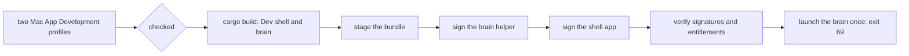

# macOS Dev bundle

A signed, provisioned bundle is the only way the brain gets its data protection keychain groups
on macOS: an unsigned or ad-hoc Cargo build can't hold them, so it stays refused. `cargo xtask
mac-bundle` builds that bundle for the Dev edition. It's for development on a Mac you've
provisioned; release signing, Developer ID and notarization are separate and not done yet.

```text
cargo xtask mac-bundle --identity <sha1> --shell-profile <file> --brain-profile <file> --out <new-dir>
```



- **Inputs.** `--identity` is the 40-digit SHA-1 of an Apple Development certificate whose
  private key is on this Mac; no name matching, so codesign can't pick a different one. Each
  profile must be a current macOS profile from one team, naming exactly the role's App ID from
  `constants::AppleIds::DEV` and allowing the role's own group and the shared instance group.
  `--out` must not exist yet.
- **Layout.** `Kumochi Dev.app/Contents/MacOS/kumochi`, with the brain nested at
  `Contents/Helpers/kumochid.app` as a background-only app (`LSBackgroundOnly`). Each app embeds
  its own profile at `Contents/embedded.provisionprofile`.
- **Signing.** The brain helper is signed first, then the shell, each with hardened runtime, no
  timestamp, and exactly three entitlements: its App ID, its team, and two keychain groups (its
  App ID and the instance group). The signed entitlements are read back and must match.
- **Launch check.** Every product entry on macOS still exits 69, so the signed brain is run once
  with no arguments and must exit 69 within 10 s. The system kills a binary whose signature or
  entitlements its profile doesn't authorize before `main`, so a 69 shows they were accepted.
- **Nothing identifying is printed or committed.** The team, identity and profile values stay in
  the output folder, and codesign's stderr, which can name them, is withheld.
- **The first signed use** of the key may ask for the login keychain password. Only the Mac's
  owner answers that.
