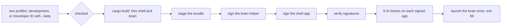

# macOS Dev bundle

A signed, provisioned bundle is the only way the brain gets its data protection keychain groups
on macOS: an unsigned or ad-hoc Cargo build can't hold them, so it stays refused. `cargo xtask
mac-bundle` builds that bundle for the Dev edition. It's for development on a Mac you've
provisioned. With `--beta` it signs the same Dev edition with a Developer ID identity and
Developer ID profiles instead, for beta artifacts; notarization is separate and not done yet.

```text
cargo xtask mac-bundle [--beta] --identity <sha1> --shell-profile <file> --brain-profile <file> --out <new-dir>
```



- **Inputs.** `--identity` is the 40-digit SHA-1 of a certificate whose private key is on this
  Mac: Apple Development without `--beta`, Developer ID Application with it; no name matching, so codesign can't pick a different one. Each
  profile is read once, and those bytes are both checked and embedded. It must be a current macOS
  profile from one team, authorize that certificate, name exactly the role's App ID from
  `constants::AppleIds::DEV` under the profile's own App ID prefix, and allow the role's own
  group and the shared instance group under that prefix. The prefix is read from the profile's
  `ApplicationIdentifierPrefix`, never assumed to be the team: they usually match, but an older
  App ID can have its own. Both profiles must share the team and the prefix. Without `--beta`
  a profile must be a development one, listing at least one device in `ProvisionedDevices`;
  with it, a Developer ID one, with `ProvisionsAllDevices` true and no device list. Which of
  these top-level keys are present comes from one successful parse of the profile; a present
  key that can't be read as its type refuses the profile, so a failed read never counts as an
  absent key. The
  expiry is checked again after the build, just before signing. `--out` must not exist yet.
  These checks read the profile's decoded contents without verifying Apple's signature on it, so
  they catch a wrong or stale profile early but aren't the authority: the system is, when it
  launches each app.
- **Layout.** `Kumochi Dev.app/Contents/MacOS/kumochi`, with the brain nested at
  `Contents/Helpers/kumochid.app` as a background-only app (`LSBackgroundOnly`). Each app embeds
  its own profile at `Contents/embedded.provisionprofile`.
- **Signing.** The brain helper is signed first, then the shell, each with hardened runtime, no
  timestamp, and exactly three entitlements: its App ID, its team, and two keychain groups (its
  App ID and the instance group). The App ID and both groups start with the profile's prefix; the
  team entitlement is the bare team.
- **K-8 checks.** After signing, each app is checked as it will ship, reading back its own
  signature and the profile embedded in it rather than what the task asked for. `codesign -d
  --entitlements` must show no `com.apple.security.get-task-allow`, with any value, so no
  debugger can take the task port. `codesign -dvvv` must describe a thin, single-architecture
  Mach-O with exactly one code directory and one hash choice, carrying the hardened-runtime
  flag. A universal app, or a slice signed with alternate digests, is refused, because the
  display shows only one of its slices or directories. The embedded profile must
  grant exactly the role's App ID and the team, so another role's profile can't stand in. The
  signed App ID, team and keychain groups must be exactly that profile's prefixed App ID, team
  and granted groups, and nothing else may be signed in. These run in both modes,
  so a Dev bundle is held to the same rule.
- **Launch check.** Every product entry on macOS still exits 69, so the signed brain is run once
  with no arguments and must exit 69 within 10 s; it's killed and reaped if it doesn't. The system
  kills a binary whose signature or entitlements its profile doesn't authorize before `main`, so a
  69 shows the brain's were accepted. The shell isn't launched, so its signature is only checked
  statically.
- **Beta mode.** `--beta` changes only the identity and profile kind: `--identity` is a
  Developer ID Application certificate's hash, and each profile a macOS Developer ID profile
  for the same Dev App IDs. The bundle, entitlements and K-8 checks are the same. Shortcut:
  there's no secure timestamp (`--timestamp=none`, so signing makes no network call) and no
  notarization, so Gatekeeper refuses the app once it's downloaded to another Mac. Add both before
  the beta goes to anyone else.
- **Nothing identifying is printed or committed.** The team, identity and profile values stay in
  the output folder. Messages name only the option or the role, never a path or an argument's
  value. The stderr of codesign and the other tools, and Cargo's build output, which can name them
  or local paths, are withheld; a failed build says which `cargo build` shows why.
- **The first signed use** of the key may ask for the login keychain password. Only the Mac's
  owner answers that. Each codesign call gets 2 minutes, and `cargo metadata`, `security`,
  `plutil`, `base64` and `shasum` 30 s each, in their own process group. At the deadline the
  whole group is stopped once and the task fails, so a prompt nobody answers doesn't hang it, and
  a pipe a helper outside the group keeps open fails it 2 s later. The Cargo build and `date`
  aren't bounded.
