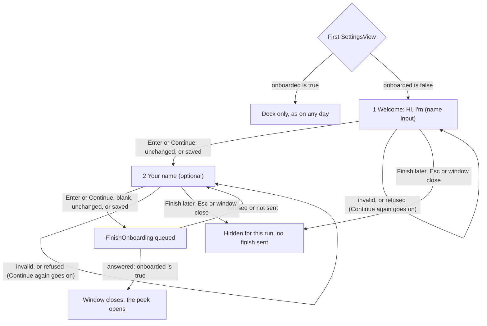

# Onboarding

On a launch where the brain's first `SettingsView` says `onboarded: false`, the shell opens one
window under the dock: the welcome, where the assistant's name can change, then the user's own
name. Sign-in and the shortcut steps come later. The brain decides whether onboarding is owed
(see [settings](settings.md)); the shell keeps nothing durable.

## Who owns what

- The brain owns the `onboarded` flag and both names in `config.toml`.
- `shell/settings.rs` owns the name drafts, their validation and saves, as for Settings, and
  `Settings::finish_onboarding`, which puts `FinishOnboarding` in the same ordered answer queue
  (`Slot::Onboarding`), so the brain's one answer completes it and no other change.
- `shell/onboarding.rs` is the plain state: the step, the field whose save it waits for, and
  whether a finish is queued. It holds no text, so it has nothing to log.
- `presence/onboarding.rs` owns the window (`Presence.onboarding`), the launch decision, and
  Finish later (`Presence.onboarding_later`, for this run only).

## Flow

## Rules

- **Continue reads the field, not `save`'s answer.** `save` returns false for an unchanged
  value, a save in flight and an unsent one alike. So a field still saving waits for its answer
  (blur may have started the save), a validation or offline error stays, and anything else goes
  on, including the brain's error left after a refusal once the draft is back at the saved name.
  A profile whose `config.toml` refuses every write isn't trapped. With no settings view,
  Continue does nothing.
- **The brain closes the window.** A click only queues the finish; the window closes when a view
  with `onboarded: true` arrives, and only a finish this window asked for opens the peek.
- **Nothing blocks.** Every action is a non-blocking send and every result a `LinkEvent`. On a
  disconnect the step stays, the input and Continue are disabled (Finish later isn't, since it
  sends nothing), and a save or finish in flight is forgotten so it can be pressed again.
- **Closing halfway** (Finish later, Esc, the native close) saves a valid name still being edited,
  as closing Settings does, drops one that can't be sent, and sends no finish. Onboarding is then
  put off for the run (`ThisRun::PutOff`), as it is when the window fails to open.
- **Nothing shows over it.** While the window shows, the peek stays closed (`panels::Owner::Onboarding`),
  a double-tap opens nothing, and the taskbar button and a dock press bring the window to the front.
  It joins capture exclusion (`exclusion::Slot::Onboarding`), since it shows names.
- **Esc** is bound in the window's own key context and goes through `Presence::escape` as
  `Panel::OnboardingEdit` (restore the saved name) or `Panel::Onboarding` (Finish later); see
  [input](input.md#esc).
- No name is read from the machine, and none is logged: log lines are fixed text with a step kind.

## Hold to talk

Holds are dropped in `Gesture::handle` on main today, so onboarding needs no hold gate yet. When
hold to talk lands, `deliver` in `presence/gesture.rs` takes one more `Rc<Cell<bool>>` that
`Presence` sets while the window shows, and `Fence::reduce` drops holds while it's set.
