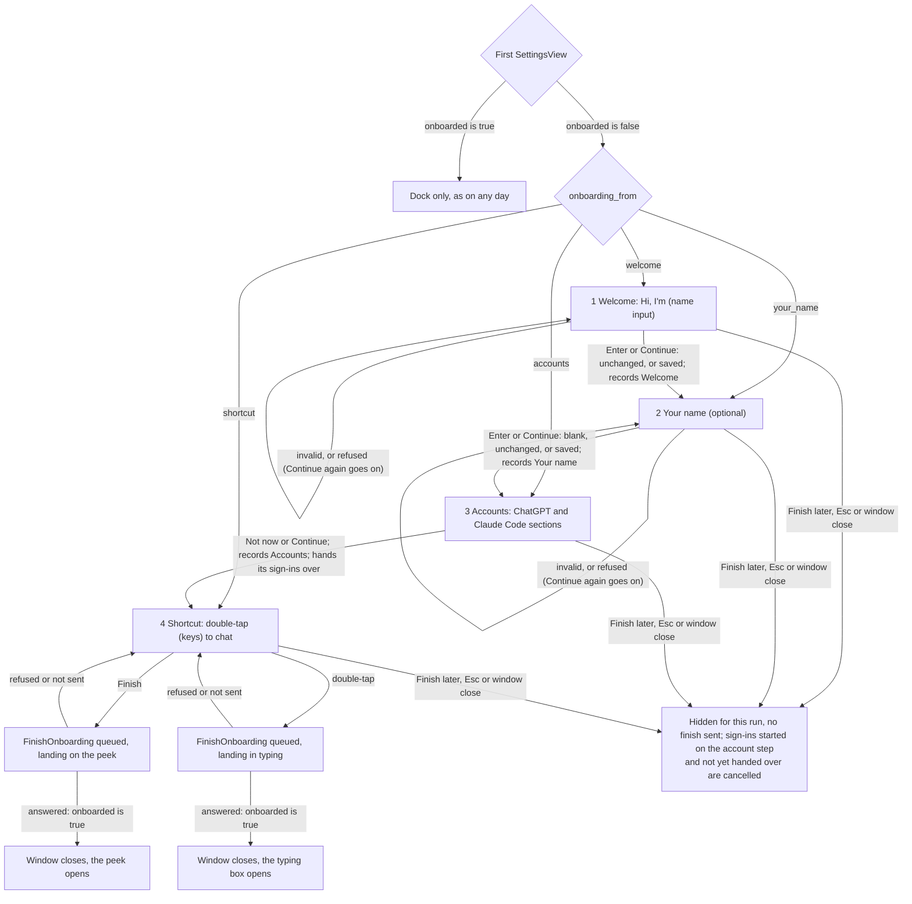

# Onboarding

On a launch where the brain's first `SettingsView` says `onboarded: false`, the shell opens one
window under the dock: the welcome, where the assistant's name can change, the user's own name,
then the account step, which offers every model connection, then the shortcut, which is also the
finish. The
brain decides whether onboarding is owed and remembers which steps were completed (see
[settings](settings.md)); the shell keeps nothing durable.

## Who owns what

- The brain owns the `onboarded` flag, `onboarding_from` (the first step not yet completed) and
  both names in `config.toml`.
- `shell-core/settings.rs` owns the name drafts, their validation and saves, as for Settings, and
  `Settings::finish_onboarding`, which puts `FinishOnboarding` in the same ordered answer queue
  (`Slot::Onboarding`), so the brain's one answer completes it and no other change. A completed
  step is recorded with `CompleteOnboardingStep` in its own slot (`Slot::OnboardingStep`), which
  never counts as the finish, so a record queued just before it can't refuse it.
- `shell-core/onboarding.rs` is the plain state: the step, the field whose save it waits for (the
  account step has none), and whether a finish is queued. It holds no text, so it has nothing to
  log.
- `shell/sign_in_mark.rs` is a sign-in one surface asked for, until it ends: `Settled`,
  `Open { generation, shown }` or `CancelOwed`. `Presence` keeps one per connection for the
  window (`onboarding_chatgpt`, `onboarding_claude`) and one for Settings; `presence/sign_ins.rs`
  moves them on each view and error, and sends the cancels.
- `presence/onboarding/accounts.rs` draws the account step from Settings' own sections
  (`account_section`, `claude_section`) without Sign out or Disconnect, routes their buttons
  through the marks.
- `presence/onboarding.rs` owns the window (`Presence.onboarding`), the launch decision, and
  whether it may still open this run (`Presence.onboarding_run`, put off by Finish later).

## Flow

## Rules

- **A launch resumes at `onboarding_from`,** clamped to the last step this build has. A step is
  recorded as the window moves on from it; the brain keeps only the furthest, and
  `FinishOnboarding` removes the key. A record that's refused or can't be sent shows nothing:
  at worst that step shows again next launch.
- **Continue reads the field, not `save`'s answer.** `save` returns false for an unchanged
  value, a save in flight and an unsent one alike. So a field still saving waits for its answer
  (blur may have started the save), a validation or offline error stays, and anything else goes
  on, including the brain's error left after a refusal once the draft is back at the saved name.
  A profile whose `config.toml` refuses every write isn't trapped. With no settings view,
  Continue does nothing.
- **The brain closes the window.** A click only queues the finish; the window closes when a view
  with `onboarded: true` arrives, and only a finish this window asked for opens the peek or the
  typing box.
- **Nothing blocks.** Every action is a non-blocking send and every result a `LinkEvent`. On a
  disconnect the step stays, the input and Continue are disabled (Finish later isn't, since it
  sends nothing), and a save or finish in flight is forgotten so it can be pressed again.
- **Closing halfway** (Finish later, Esc, the native close) saves a valid name still being edited,
  as closing Settings does, drops one that can't be sent, and sends no finish. Onboarding is then
  put off for the run (`ThisRun::PutOff`), as it is when the window fails to open.
- **Nothing shows over it.** While the window shows, the peek stays closed (`panels::Owner::Onboarding`),
  a double-tap opens nothing before the shortcut step, and the taskbar button and a dock press
  bring the window to the front.
  It joins capture exclusion (`exclusion::Slot::Onboarding`), since it shows names.
- **The account step** shows until Not now or Continue completes it; connecting alone doesn't, so
  a window closed after connecting resumes there unless the profile is now in use. Its one button
  reads Not now (ghost) until a model connection is usable (a complete `ChatGPT` account, or
  Claude Code `Ready`), then Continue. Focus goes to the window's root, so Enter starts nothing.
  Once a `ChatGPT` sign-in this window asked for completes, the plan line shows beside the button.
- **The shortcut step** reads Double-tap (keys) to chat with (assistant), with `shortcut-keys` as
  a keycap, and has one ordinary button, Finish. Its real action is the gesture: a double-tap
  (`Onboarding::double_tap`, from `Effect::OpenInput`) queues `FinishOnboarding` landing in
  typing, and Finish queues it landing on the peek. Either goes once until it's answered or
  refused. The step records nothing: only the finish ends it. Enter does nothing there.
- **A dismissal cancels this window's sign-ins.** A mark opens only on an op the window actually
  queued (Sign in or Enable for `ChatGPT`, Connect Claude Code). Until the brain shows the wait,
  no view on the asking connection settles it, refused or complete: a Claude Code frame may carry
  only the Anthropic half, sent before the brain read Connect, and a deferred Sign in again is
  answered by the unchanged complete account. It settles once the wait it showed ends, on a newer
  connection's view that isn't waiting, on a `ChatGPT` sign-in error that offers a new one, or at
  the hand-over; the cost is one cancel the brain ignores after a refused attempt. While the
  window shows, Settings and chat can't start a sign-in (see above), so an open mark meets no
  other surface's sign-in except through adoption. Finish later, Esc and the native
  close take each open mark once and send its cancel through `cancel_sign_in`, past `allows`,
  because the brain may start the sign-in late and ignores a cancel when nothing is signing in.
  A cancel that can't be sent stays owed across a link drop: it goes at the next waiting view.
  It's dropped by a first view with no wait, by a `ChatGPT` sign-in error, or by any op the user
  sends that connection from any surface: Settings, chat or onboarding. Open again keeps a shown
  wait shown, since the brain replaces the attempt without a new view. Continue and Not now hand
  a waiting sign-in over to the rest of the app instead, as an unasked finish does, and the
  hand-over lasts the window's life: from the shortcut step on, the window owns no sign-in, so
  nothing is cancelled and nothing is adopted, at open or after a link drop
  (`onboarding_owns_sign_ins`). Before that step, after a shell restart, the window adopts a
  sign-in it finds waiting, as it opens (`set_onboarding`) or on a connection's first view. That
  is wrong in one accepted case: after Finish later, a sign-in started from Settings or chat that
  is still waiting when the shell crashes is adopted by the relaunched window, and dismissing it
  cancels it.
- **Focus comes back after a section button goes.** The sections replace their buttons when the
  view changes, so a focused one takes the window's key context, and Esc, with it. The window
  restores focus the way Settings does (`settings::restore_lost_focus`).
- **Esc** is bound in the window's own key context and goes through `Presence::escape` as
  `Panel::OnboardingEdit` (restore the saved name) or `Panel::Onboarding` (Finish later); see
  [input](input.md#esc).
- No name is read from the machine, and none is logged: log lines are fixed text with a step kind.
- **Kumo under the welcome** is a still image, not the peek's `KumoView`: no animator, frame loop,
  hit test or pull. When the window opens, the background executor bakes the body at the peek's
  64 px for the window's scale and shades `FrameState::IDLE` once (`kumo_view::still`); the view
  keeps the one `RenderImage`. Its 64 px box is laid out from the start, so the welcome doesn't
  move when the image lands. Nothing is shaded or allocated per frame, and the image leaves GPUI's
  atlas with the window's renderer when the window closes.

## Hold to talk

Holds are paused while the window shows. Opening it sets `voice.paused`, an `Rc<Cell<bool>>`
that `deliver` in `presence/gesture.rs` reads on every key event and deadline, and closing it
clears the flag. `Fence::reduce` drops a hold that meets the pause, whichever event reaches the
threshold: no warm-up `KeyDown`, no armed microphone gate, nothing sent to the brain and no
notice. A hold that began while paused stays dropped after the window closes, and the next one
goes through. A hold already recognised when the window opens (a reconnect can reopen it) ends
through `cancel_voice`, with input cleared. One not yet recording ends at once with the cancelled
notice. One already recording shows the stopping notice until its microphone has stopped and
joined, then ends.
