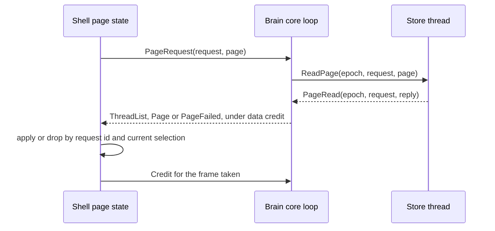

# The threads panel

The dock's **Threads…** command opens an interactive surface anchored against the dock,
clamped to the work area like the typing panel. Opening a thread selects the thread that the
next typed turn continues; **New thread** clears that selection and opens the typing panel.
Neither action sends a thread mutation or creates a row until a turn is submitted. There is no delete
command, dialog, or protocol operation in this panel.

`shell/threads.rs` owns plain page state. `presence/threads.rs` owns window lifetime, activation,
and nonblocking requests; `presence/thread_view.rs` composes the two virtualized lists:

- gpui-kit's `ListState<ThreadsDelegate>` supplies thread selection, search, and load-more;
- GPUI's variable-height `list()` supplies the messages, displayed oldest first. Older pages
  are inserted at the top, preserving the visible scroll anchor. Page Up and Page Down scroll
  the focused message region; its scrollbar and Older messages command are also available.
  The messages are the user's turns, the stored answers and the drawing steps; a Stop's record
  of which steps stayed isn't listed, since the steps themselves are.

Search uses the store's literal FTS phrase matching, not query syntax, and settles for 150 ms
[guess]. Results are ranked by the best matching event, with descending thread id breaking
ties. Clearing the search restores updated-time ordering. Overlong searches are refused before
they can leave an unanswered, unencodable request.
A search continuation carries the last thread's rank, as exact float bits, so it continues
even when that thread has since stopped matching or been deleted. Ranks are live, not a
snapshot: reopen after matching events change to refresh the ranked list. A cursor whose rank
isn't finite fails the page.

## Requests and staleness

There is at most one unanswered request for the threads list and one for events. Changing the
query or open thread invalidates its pending reply but does not free its slot: the replacement
waits until that reply is taken. Request ids are checked when replies are applied. Closing the
thread drops its eventual page too, and dropped page frames still earn credit. Page frames
never wait for a run's first RunState.

Disconnect clears in-flight flags. Connected asks for both first pages again, when a thread is
open, through the new Session. Frames from another generation are dropped, and sends through
an ended Session fail. The brain also fences store completions by connection epoch, so neither
an old page nor an old read failure reaches the replacement connection. A current read failure
answers `PageFailed` rather than an empty page that would read as a missing thread: the store
thread logs the error's kind, the request's slot frees, and the panel says the read failed until
a later page lands. The connection and typing stay up.

Pages are read only while the panel is shown. Opening it reads the first list page; closing it
clears the open thread, and requests needed meanwhile wait until it opens again.

## Ordering and repair

The live list uses `(updated_ms DESC, id DESC)` keyset paging. A thread that isn't updated
appears exactly once, in order. A thread updated between pages moves above the cursor and is
skipped by later pages, never repeated. It appears again when the first page is refreshed.

A RunState for a thread that isn't first, including an unlisted thread, requests that refresh
once. Rows from the fresh first page replace the same ids anywhere in the loaded list and move
to the top. The older-page cursor stays where it was. Ranked search results aren't repaired. A RunState that
arrives while a list read is in flight earns one more read once that reply lands, since the
reply may predate it.

A RunState for the open thread rereads its newest events and puts the ones newer than what's
shown on top, keeping older pages and their cursor. When that page doesn't reach the
newest event shown, it replaces the list with its own cursor, so the events between stay
reachable by scrolling. A Stop or failure is told before its
outcome is written, so that read can miss the last text until the thread's next RunState.

shortcut: more than 50 threads updated between first-page reads can leave one out of order
until reopening the panel. Revisit this when one turn can update many threads concurrently.

Events use the existing `(thread, id)` index, newest first on the wire, with a `before` id.
Deleting or nonexistent threads return an empty page with no continuation. An event larger
than a page is cut at a character boundary and marked `cut`; the panel says it was shortened.
shortcut: a cut event cannot be read in full until the chat panel can page within an event.

## Budgets and the purge

Each page has at most 50 rows [guess] and 32 KiB of encoded frame, header included [guess].
The continuation names the last row actually sent, including a page shortened by the byte
budget. Defensive truncation also makes a single impossible, oversized stored title fit;
normal titles are already limited by the coordinator.

Two shell page requests occupy at most 64 KiB of frame bytes, plus bounded queue metadata,
leaving roughly 448 KiB of the 512 KiB data queue for runs. The brain permits four unanswered
page requests [guess], counting a reply until its write finishes; a fifth breaks the connection.
Pages share credit, the queue cap, and the stall watchdog with run data. At the cap, engine
events and new turns wait. RunEnd keeps its existing ordered, one-event-past-the-cap allowance.
Stop revokes only its run's unsent frames, never page frames.

Store reads execute one autocommit statement on the serving connection and finish it before
returning. They neither cancel a purge copy nor postpone its quiet deadline. Due or completed
purge work is still serviced when reads arrive. A serving reader sees the committed WAL end,
so even a statement stepped but not finished permits a complete drain; no page operation
retains a snapshot after it returns.

Search words, titles, and page text never enter tracing, diagnostics, error Display, or
loggable Debug. The pipe tap records control only; pages always travel on data.

Esc stops work first, clears a drawing second, and only then dismisses the threads panel while
it is focused. The panel counts as focused only once its window reports activation, as the
typing panel does, so a deactivation that arrives before then can't hide a panel that just
opened. Blur hides it without restoring the old foreground; ordinary dismissal restores
the previous foreground when Capsula still owns it. Newly created panels inherit an active
hold's capture exclusion. The initial panel size, 48 by 34 interface rems, is a [guess].
