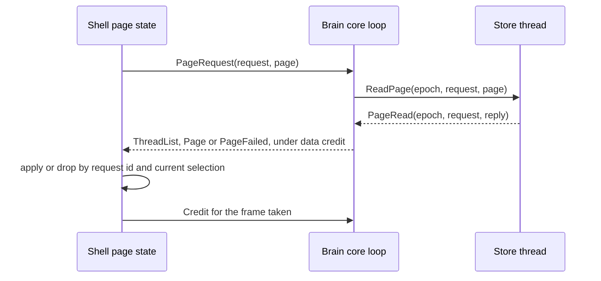

# Panels

## Settings panel

The status surface also has **Settings…**. It opens a separate retained panel with the same
48-by-34-rem initial size and `Layout::anchored_panel` placement as Tasks. **General** contains
the assistant's name and your optional name; **Accounts** is reserved and empty for now.
Labels, inline validation, saving and offline feedback use the shell's Fluent catalog.
App identity continues to come from `protocol::constants`; assistant labels use the name
received from the brain, or `DEFAULT_ASSISTANT_NAME` before any `SettingsView`, as a Fluent
argument, not the product name.

Settings does not hide on deactivation. Esc operates only when Settings is focused: stop,
clear, cancel the active field edit, then dismiss on the next Esc. Stop and clear leave the
edit intact. Its close button dismisses it too. The status panel stays hidden until Settings
closes, so Retry and Quit there require closing Settings first; native-menu Retry still works.
Opening the typing panel
or Tasks, or moving the dock, uses the same dismissal path. On dismissal, an active field
saves as on blur. If local validation or sending fails, **Settings not saved** remains on the
dock and the retained draft and error are available on reopening. The previous foreground is restored through the existing platform
presence interface. The native focus handoff requires a real Window and remains an owner
hand check; pure Esc and save ordering are unit-tested. A new Settings panel inherits the
current capture exclusion, just like Tasks and typing.

`presence/settings.rs` owns this lifetime, `presence/settings_view.rs` composes Kit's TabBar
and Inputs, and `shell-core/settings.rs` owns drafts and ordered answers. See
[settings](settings.md#shell-editor) for the FIFO and error lifetime, and
[using Settings](../user/settings.md) for the workflow.

## Tasks workflow

The dock's **Tasks…** command opens an interactive surface anchored against the dock,
clamped to the work area like the typing panel. Opening a task changes only the viewed history,
not the input target. **Switch to this task** explicitly targets the viewed task and is hidden
when it is already the target. **Back to Kumo** targets and views the assistant's conversation.
It is available in the panel header and in the typing panel
whenever the target isn't Kumo; the typing panel also names the target.

**New task** changes the target to `Target::New` and opens the typing panel. It creates no row
until a turn is submitted. Closing the tasks panel doesn't change the target. Target capture,
selection revisions and the defaults to Kumo are described in [runs](runs.md#the-shells-input-target).

The open task's **Delete** asks first, in a gpui-kit alert dialog. The dialog names what
Kumochi can't remove: issues already filed on GitHub, and what the model provider keeps. A
confirmed task stays listed until the brain answers, its row marked Deleting… and disabled.
Confirming deletion of the targeted task immediately returns input to Kumo; deleting a task
that is only being viewed leaves the target alone. Then its row and messages go. While four
deletes [guess] are unanswered, or waiting on turns sent before them, Delete says to wait. A delete that
hid nothing leaves the task and says so, without restoring its old input target. The protocol is
in [ipc](ipc.md#deleting-a-thread).

Consequential confirmations use `shell/confirmation.rs`: Cancel owns the initial keyboard
focus and participates in Tab traversal. Enter never confirms an unfocused default action,
so a held Enter that opened Delete can't commit it. Enter on Cancel and Escape dismiss without
deleting; Tab to the danger button, then Enter or Space, or click it to confirm. Enter is
routed only to the focused Cancel or danger button, never an unfocused default action.
The one-shot callback is consumed before it runs, and Kit restores the previous focus on
dismissal. `open` returns the Cancel focus handle, or `None` when another dialog is active
or a previous confirmation is still exiting. A weak per-window lifetime guard follows the
Kit builder through unmount, because Kit's `has_active_dialog` excludes exiting dialogs.

## Labels and inline rename

The plain list pins Kumo first using `ThreadRow.kind == Main`; continuations omit it. Search
ranks it like any other row. The shell's `row_label` uses the assistant name from the latest
IPC `SettingsView` for Kumo everywhere, including search and the target label, never its empty
stored title. Before any settings arrive, it falls back to
`protocol::constants::DEFAULT_ASSISTANT_NAME`. Kumo has no Delete. Answers are labelled with
the same assistant name.

Choosing **Rename** on the viewed row opens an inline gpui-kit `Input`. Enter validates
and sends the edit; Esc cancels it only after stop and clear have had their turns. Shell-core
checks the currently open row and its kind at save time, so a stale editor closes without a
send even if the view hasn't refreshed yet. Validation errors stay inline:

- A task uses `ThreadTitle`: trimmed, one line, 1–80 Unicode scalar values, no control
  characters or U+2028/U+2029. It sends `ThreadOp::Rename`.
- Kumo uses `AssistantName`: the same text restrictions with a 1–24-character limit. It sends
  `SettingsOp::SetAssistantName`, never a generic thread rename.

A sent task rename is not a confirmed title. The shell rereads the authoritative list page and
updates the displayed title only from that page; a send or an older in-flight read isn't a
save acknowledgement. Kumo's displayed name changes only on the next `SettingsView`.
The reread can race the rename across the two pipes and show the old title. The
`ThreadsChanged` the brain sends after every committed title closes that gap: the list is read
again, or the read in flight is marked stale and earns one more, and the page of every rename no
page has shown yet is read again too, whether the notification beats the stale reply or follows
it. A rename stays unconfirmed until a page shows the title that was sent, or its task is
deleted. A search shows it at its next read.
If a delete invalidates an in-flight rename reread, its original page cursor is queued again
before the first-page repair, so an offpage renamed task still gets confirmed without reviving
the deleted row. A search change, refresh or hide discards these old-query rereads.
Settings updates preserve the input draft, keyboard focus, viewed history, target and selection
revision; changing a name never retargets input. See [settings](settings.md).

## Page state

`shell-core/threads.rs` owns page state and projects the stored conversation rows, including
grouping and the event id used as each row's key. `presence/threads.rs` owns window lifetime,
activation, and nonblocking requests; `presence/thread_view.rs` composes the task list with the
retained `presence/messages.rs` conversation component:

- gpui-kit's `ListState<ThreadsDelegate>` supplies thread selection, search, and load-more;
- GPUI's variable-height `list()` supplies the messages, displayed oldest first. Scroll-triggered
  older pages are inserted at the top, preserving the visible scroll anchor. The explicit
  Older messages button reveals the newly loaded page instead; pages that only extend an
  existing drawing placeholder or contain assistant segments hidden by the provisional preview
  continue until an older visible row or the true start is reached. A failed event read advances
  the history revision, so later successful reads cannot revive its pending navigation.
  Selection changes and reconnects also cancel that navigation. If the first event read after
  reconnect fails, a successful Older read replaces the unverified cache instead of extending it.
  Page Up and Page Down scroll
  the focused message region; its scrollbar and Older messages command are also available.
  The messages are the user's turns, the stored answers and the drawing steps; a Stop's record
  of which steps stayed isn't listed, since the steps themselves are.

History labels stored drawing markers “Drawing step” without claiming they appeared on screen.
Adjacent empty markers group only with the same known run and scene;
text, cut notices and unknown metadata break groups. Presentation keeps the newest event id
as each group's key, while raw events and pagination cursors stay intact. The list is sized
from derived rows, including when it first opens with already loaded events. Grouping holds
only its current adjacent group, not a scene cache. Reading history never restores, clears or
invalidates the live overlay; typed visual replay remains separate work.

`Messages` owns the message region's focus, scrollbar, page-navigation keys and measurement
invalidation. Its Older messages callback retains the model it belongs to, so it never pages
another surface's selected task. Moving the component out of Tasks does not change its layout
or rendering.

Presence keeps two independent `Threads` models: Tasks owns browsed history, while the focused
chat history follows `Runs::thread()` and is displayed below the retained composer. Both
models receive connection, settings, run, rename, title-change and deletion updates. Browsing
does not select the chat's task. Every chat show selects the focused task before refreshing,
including reopening with unchanged focus after a hide cleared its selection.

Chat keeps a bounded trailing preview for the focused run, with an explicit cut marker.
While that preview is provisional, it hides only the same run's stored assistant rows, never
user turns, drawing steps or issues. Stored event ids remain distinct: one run can commit
several assistant rows, and streamed text is not a reliable stored-row identifier. Only a
first-page or repair request issued after committed Done can replace the preview; a page
already in flight, a failed read or an older-page continuation cannot. Failed and interrupted
runs remain provisional until superseded or disconnected, because their control state can
precede storage. Selection and connection changes clear the proof. Font changes invalidate
the list's measured heights, including the live row.

Opening chat stamps a completed run before issuing its first history request. Stored
rows and the live preview are formatted into shared-string snapshots when their state
changes, not while drawing each frame. Stable row identities splice changed ranges without
resetting an older reader's scroll anchor when a live row appears or stored proof lands.

The list highlight follows changes to `Threads.open`, including Back to Kumo and hide/reopen.
Unrelated model notifications preserve a row highlighted with the arrow keys, so Enter still
opens that row. Page updates remap the highlight by row id. Confirming a targeted task's delete
refreshes the cached header target immediately, without waiting for a link reply. Enter and
Save share the same rename availability check, so an offline or deleting row cannot send an
edit. Conversation and target presentation notify their views only when their content changes;
an answer delta alone does not redraw the tasks panel.

Search uses the store's literal FTS phrase matching, not query syntax, and settles for 150 ms
[guess]. Results are ranked by the best matching event, with descending thread id breaking
ties. Clearing the search restores updated-time ordering. Overlong searches are refused before
they can leave an unanswered, unencodable request.
A search continuation compares with the last thread's rank as the store scores it now, so it
continues after a write moves every rank. Ranks are live, not a snapshot: any change to indexed
text, a match or not, can move them, so reopen to refresh the ranked list. The cursor also
carries the rank as exact float bits, used only once the thread's events are gone; a deletion
moves the other ranks too, so that continuation can skip or repeat rows. A cursor whose rank
isn't finite fails the page.

## Requests and staleness

Each model has at most one unanswered request for the task list and one for events. Together
they can occupy all four of the brain's page slots; another page consumer must share this cap,
not add a fifth request. One shared allocator hands out nonwrapping ids starting at 1 and records
each pending request's target model. Exhaustion ends the connection before an id can be reused.
Presence routes each reply by pending ownership to exactly one model and returns that
frame's data credit once, whether the model applies it or drops it. Changing the
query or open thread invalidates its pending reply but does not free its slot: the replacement
waits until that reply is taken. Request ids are checked when replies are applied. Closing the
thread drops its eventual page too, and dropped page frames still earn credit. Page frames
never wait for a run's first RunState.

Disconnect clears in-flight flags. Connected asks for both first pages again, when a thread is
open, through the new Session. Frames from another generation are dropped, and sends through
an ended Session fail. The brain also fences store completions by connection epoch, so neither
an old page nor an old read failure reaches the replacement connection. A current read failure
answers `PageFailed` rather than an empty page that would read as a missing thread: the store
thread logs the error's kind, the request's slot frees, and the panel says the read failed until
a later page lands. The connection and typing stay up.

Pages are read only while the panel is shown. Opening it reads the first list page; closing it
clears the open thread, and requests needed meanwhile wait until it opens again.

## Ordering and repair

Issue events render saved cards in the same message list in browse and
chat, using the [shared issue cache](issues.md).
The title-only event remains visible while details load or are unavailable;
status, content and duplicate warnings update without changing the event id.
Saved URLs are text, not actions. The existing focus, PageUp/PageDown and scroll
anchor behavior remain the navigation path. Draft and definite-failure cards
open the existing cancel-first confirmation only with a current approval and
exactly matching verified account and repository. Dismiss is available for
Draft, Failed and Unknown; only Unknown offers GET-only Check again. An unusable
binding explains replacement rather than silently selecting the new default.

`Presence` owns a checked monotonic `u64` operation counter for the app lifetime,
so closing or replacing either history cannot reuse an identity. The displayed
card cache shares pending state and the last submitted request across both
views. Only a successful control enqueue admits pending; a failed queue leaves
visible retry feedback. Progress `ActionState { request: None }` does not
release it. A matching final acknowledgement releases pending even at an
unchanged version, without losing correlation for the following refusal.
Refusal feedback requires the last request and authoritative version/approval;
both frame kinds pass the session generation fence in Presence. A new attempt
replaces feedback, and disconnect drops the shared card state.

The live list uses `(updated_ms DESC, id DESC)` keyset paging. A thread that isn't updated
appears exactly once, in order. A thread updated between pages moves above the cursor and is
skipped by later pages, never repeated. It appears again when the first page is refreshed.

A RunState for a thread that isn't first, including an unlisted thread, requests that refresh
once. Rows from the fresh first page replace the same ids anywhere in the loaded list and move
to the top. The older-page cursor stays where it was. Ranked search results aren't repaired. A RunState that
arrives while a list read is in flight earns one more read once that reply lands, since the
reply may predate it.

A RunState for the open thread rereads its newest events. A reader following the tail
gets the new events; when the new page doesn't overlap, its cursor keeps the gap reachable.
In a bounded view, an older reader keeps the same window and can page forward to new events.
A Stop or failure is told before its
outcome is written, so that read can miss the last text until the thread's next RunState.

shortcut: more than 50 threads updated between first-page reads can leave one out of order
until reopening the panel. Revisit this when one turn can update many threads concurrently.

Events use the existing `(thread, id)` index in either direction and travel newest first.
GPUI still reads only backwards and retains all older pages it loaded. A view constructed with
`Threads::bounded_pair` retains at most 200 events and 128 KiB of event text per view.
Loading a page evicts the opposite edge and makes those events reachable from the nearest
retained id. That view supplies an actual visible event id and offset, and the core preserves
the exact anchor if that event is still present. A saved-event refresh re-reads the retained
range; a screen-capability note anchors at the stored tail but shows only with its anchor row.
Each event includes its stored timestamp, but time never orders a page.
Deleting or nonexistent threads return an empty page with no continuation. An event larger
than a page is cut at a character boundary and marked `cut`; the panel says it was shortened.
shortcut: a cut event cannot be read in full until the chat panel can page within an event.

## Budgets and the purge

Each page has at most 50 rows [guess] and 32 KiB of encoded frame, header included [guess].
The continuation names the last row actually sent, including a page shortened by the byte
budget. The events query itself reads no more than the budget of each event's text, counted in
bytes since SQLite's character functions stop at a NUL, and the rows past the budget are dropped
in one pass by their own encoded sizes. Defensive truncation also makes a single impossible, oversized stored title fit;
normal titles are already limited by the coordinator.

Four shell page requests occupy at most 128 KiB of frame bytes, plus bounded queue metadata,
leaving roughly 384 KiB of the 512 KiB data queue for runs. The brain permits four unanswered
page requests [guess], counting a reply until its write finishes; a fifth breaks the connection.
Pages share credit, the queue cap, and the stall watchdog with run data. At the cap, engine
events and new turns wait. RunEnd keeps its existing ordered, one-event-past-the-cap allowance.
Stop revokes only its run's unsent frames, never page frames.

Store reads execute one autocommit statement on the page reader's own connection and finish it
before returning, after every store op queued before them (see
[the store](store.md#page-reads-and-checkpoints)). A write queued behind a long search doesn't
wait for it, and reads neither cancel a purge copy nor postpone it. No page operation retains a
snapshot after it returns.

Search words, titles, and page text never enter tracing, diagnostics, error Display, or
loggable Debug. The pipe tap records control only; pages always travel on data.

Esc stops work first, clears a drawing second, cancels an active inline rename third, and only
then dismisses the tasks panel while it is focused. Stop or clear leaves the edit intact; after
cancel, another Esc dismisses. The panel counts as focused only once its window reports
activation, as the typing panel does, so a deactivation that arrives before then can't hide a panel that just
opened. Blur hides it without restoring the old foreground; ordinary dismissal restores
the previous foreground when Kumochi still owns it. A hide that fails leaves the panel open
and focused, so Esc and Close still work. Newly created panels inherit an active
hold's capture exclusion. The initial panel size, 48 by 34 interface rems, is a [guess].
