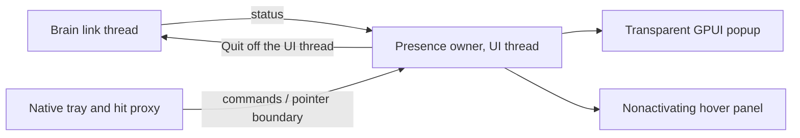

# Presence and native surfaces

The shell owns the dock, hover panel, typing panel and tray on GPUI's UI thread. The dock opens
and the keyboard is armed before the brain link starts connecting; [input.md](input.md) covers
the shortcut, the typing panel and Esc. A link failure changes its label to Offline; Retry never sends
the previous input again.

The dock is a small transparent `PopUp` window. Its native styles include layered,
transparent, no-activate and tool-window; app-window is removed. A separate native hit proxy
owns its resting rectangle. The proxy is visually transparent but receives mouse entry and
exit. The panel is interactive, nonactivating and excluded from the taskbar in the same way.
The panel is created at startup, then explicitly positioned and sized while still hidden.
GPUI saves requested bounds for a hidden window instead of applying them immediately; leaving
the native window at Windows' default size also leaves its renderer's textures oversized.
Hidden placement bounds those resources without moving window creation into the first hover.
The same panel is hidden and reused, never recreated for each hover. The typing panel is the
one exception to never activating: it's a tool window without no-activate, created on the first
double tap, activated only explicitly, and hidden rather than closed. While it's open, hover
leaves it alone and the hover panel stays hidden.
Neither surface uses GPUI's normal title bar. Native creation, styles, placement and lifetime
live under `platform/windows`; Rust view code handles no raw window pointers.

The nine positions are calculated from the primary display's physical work area, not its
entire screen. Logical dimensions are converted using the dock's scale factor. The panel
touches the dock and clamps inward at an edge. Crossing their shared edge keeps it open.
Leaving both starts one 80 ms grace timer; there is no idle polling. Synchronous native
placement calls `bounds_changed` afterwards so GPUI receives its otherwise-dropped resize.

The native tray menu offers position, Retry and Quit. Position is deliberately session-local
until the brain's settings flow and Settings → General arrive. No settings file is written by
the shell. Closing a transient panel is not Quit. Quit uses the existing idempotent link
shutdown and waits off the UI thread before exiting.

`capsula --smoke` shows the panel programmatically after one second and requests the same
graceful Quit after ten seconds, without moving the pointer or sending input. Initial surfaces are
small even before placement, so a transparency failure cannot cover the desktop. This is a
bounded launch check, not a performance benchmark or permission to inject input.

For idle measurements, build the workspace in release mode, then run `cargo xtask bench idle`.
It refuses an existing product process, launches the release shell at normal priority with a
bounded graceful-quit deadline, settles for thirty seconds, and samples user plus kernel time
over sixty seconds. CPU is percent of one core; memory is endpoint private bytes, not working
set or peak memory. `--duration 1..60` shortens a harness smoke check, not an acceptance run.
The task checks that the same shell, brain and worker survive the sample and waits for all
three to exit. Run only in an agreed quiet window; the benchmark sends no input.
`--baseline <release-directory>` samples older binaries with the same counters and closes the
spawned shell's own status window with `WM_CLOSE` after the sample; it never targets another app.
`--panel` opens the current shell's panel programmatically before settling, so the sample
includes the panel's steady-state resources rather than only the never-hovered dock.

Geometry tests cover all anchors, negative work-area origins, edge containment and the
hidden-panel boundary. Transparency, cross-process click-through, native focus and Alt-Tab
behavior need desktop evidence; a style bit or unit test alone cannot certify them. Stretch
and outline hit testing are a later layer; this layer has no per-frame region updates.
