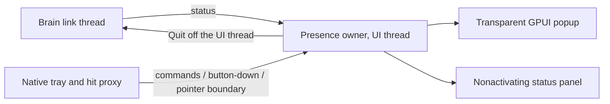
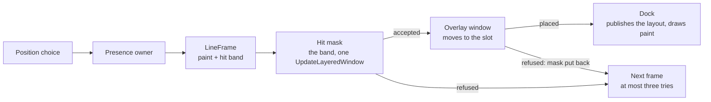
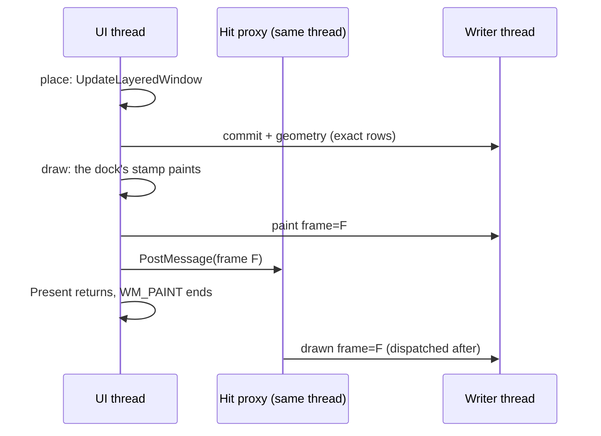

# Presence and native surfaces

Overlay hit testing belongs to the presenter's `OverlayOwner`, not to a view. The native
`OverlayWindows` adapter binds the dock paint window and body proxy in the Dock layer,
panels in Panels, and every newly created drawing host in Overlay before it can be shown.
Regional and selection surfaces attach through the same seam. The dock paint and drawing
windows pass mouse input through their entire bounds, including painted pixels; only the
dock's separate body proxy takes its input. Regions enables only the
currently registered input windows. The [mode diagram and exit rules](input.md#overlay-pointer-ownership)
cover the temporary Selecting mode; no production hold enters it yet.

Every bound Windows surface must be created topmost. Both the shared GPUI `PopUp` options and
the native dock proxy set `WS_EX_TOPMOST` at construction; new native bindings must preserve
this precondition.

The adapter restacks top-first as panels, dock/body proxy, regional input, drawing overlay,
then dormant selection. Showing a drawing reapplies this order after its native placement,
even when the input mode has not changed. A replacement host, including after clearing or
reconnecting, binds and configures again while hidden. Selecting puts its surface above those
groups, then drops it back on exit. Every restack uses
`SWP_NOACTIVATE`, and every non-panel surface keeps `WS_EX_NOACTIVATE`; only the existing
explicit panel activation path can take foreground. GPUI cannot express cross-process regional
click-through or these Win32 restacks. The macOS equivalent is nonactivating `NSPanel`,
`ignoresMouseEvents` and window levels: it must ignore mouse events over the entire drawing,
never activate it, and restore this order after every show or placement. It is not implemented
or verified here.

The shell owns the dock, status panel, typing panel and tray on GPUI's UI thread. The dock opens
and the keyboard is armed before the brain link starts connecting; [input.md](input.md) covers
the shortcut, the typing panel and Esc. A link failure shows in the status panel; Retry never sends
the previous input again.

`presence::stage` unions the accepted dock layout, the status peek's minimum reservation
and the accepted bounds of the visible typing, Threads or Settings panel. It chooses the
largest-area usable band below, above, left or right, in that tie order, with a
32-logical-pixel inset and at least 240×160 logical pixels left after the inset. If no band
is usable, it retries with only the dock and peek reserved, then uses the inset work area
as a last resort. On a display too small for both, an open panel can cover a drawing and
its entrance can play unseen. Opening or closing a panel updates placement before the next paint;
when the dock lands, panels re-anchor before the stage is recomputed. While a drawing is on
screen it keeps its stage as long as that stage still fits inside the newly chosen one for the
same work area, dock layout and scale: a drawing that stays put is easier to follow than one
that re-centres every time space frees up. So closing a panel, including the typing panel a
held voice request hides while it runs, leaves the drawing where it is. A panel opening over
it, a dock move or a display change re-places it, and a drawing that starts on a cleared
screen takes the best stage at that moment. "On screen" means any scene the presenter holds,
including one that hasn't painted yet. A reconnect counts as a cleared screen, so recovered
drawings take the best stage. A drawing that replaces one still held takes the kept stage,
which may be smaller than the best one, until the screen clears. The typing panel
retains its accepted size when re-anchored, like Threads and Settings.
A retained GPUI display observer refreshes the dock's scale and anchor,
the drawing stage and a shown overlay's bounds after display changes. Existing views snap
to the new stage; their scene clocks and prepared geometry stay intact. See
[scene.md](scene.md#canvas-and-overlay-placement) for the canvas and scale-envelope rules.
The work area is read fresh at placement transitions, not polled while sampling frames.
Work-area-only changes wait for the next placement; add a work-area notification through
the presence adapter.

Before the link starts, the shell starts the scene dropper or fails startup. Typed scene frames
are protected at the pipe reader, including stale frames and queued or undelivered event batches.
Preparation and recovery inputs and answers keep that protection through cancellation, rejected
results and lost recipients. Clear, Stop and disconnect swap out their owned containers; the UI
does not destroy their scene payloads. A dead dropper stops scene intake and new preparation.

The dock is a transparent `PopUp` overlay, sized to its slot. Its native styles include
layered, transparent, no-activate and tool-window; app-window is removed. A separate native hit
proxy owns exactly the line's trigger band and reports pointer entry and exit (see
[The line and hit testing](#the-line-and-hit-testing)). The panel is interactive, nonactivating and excluded from the taskbar in the same way.
The panel is created hidden at startup, so the first click doesn't create a window.
The same panel is hidden and reused, never recreated for each click. The typing panel is the
one exception to never activating: it's a tool window without no-activate, created on the first
double tap, activated only explicitly, and hidden rather than closed. While it's open, pointer
events and dock clicks leave it alone and the status panel stays hidden. `presence/text.rs`
owns its lifetime and retains a GPUI `observe_window_activation` subscription. A previously
active, visible typing surface hides on deactivation, preserving its `InputState` and dropping
the saved foreground without restoring it. Reopening an already visible surface preserves its
activation latch; only a hidden-to-visible transition resets it. Initial inactive notifications
leave an unactivated box clickable, and hiding clears the latch before Esc restores focus.
GPUI's activation state is queued, not a current native foreground query: rapid away/back
within one queued activation can still hide a now-active box. Revisit that limit if reproduced.
Esc and explicit dismiss keep their existing conditional foreground restoration.
Neither surface uses GPUI's normal title bar. Native creation, styles, placement and lifetime
live under `platform/windows`; Rust view code handles no raw window pointers.

The nine positions are calculated from the primary display's physical work area, not its
entire screen. Logical dimensions are converted using the dock's scale factor. The panel
touches the dock and clamps inward at an edge. Crossing their shared edge keeps it open.
Pointer entry on the band opens it without activation; a button-down does nothing. A Stop
fallback stays open regardless of pointer departure while needed.
Leaving both starts one 80 ms grace timer; there is no idle polling. The timer rechecks typing
and Stop ownership before hiding. Synchronous native
placement calls `bounds_changed` afterwards so GPUI receives its otherwise-dropped resize.

The native tray menu offers position, Retry and Quit. Position is deliberately session-local
until the brain's settings flow and Settings → General arrive. No settings file is written by
the shell. Closing a transient panel is not Quit. Quit uses the existing idempotent link
shutdown and waits off the UI thread before exiting.

`kumochi --smoke` shows the panel programmatically after one second and requests the same
graceful Quit after ten seconds, without moving the pointer or sending input. Initial surfaces are
small even before placement, so a transparency failure cannot cover the desktop. This is a
bounded launch check, not a performance benchmark or permission to inject input.

For idle measurements, run `bench idle` as the gate identity (see
[the gate identity](gate-identity.md)); it builds the release shell and brain it measures.
Before launching the shell, the benchmark spins one thread in three two-second trials,
measuring `QueryThreadCycleTime` divided by wall time and printing each rate and the highest.
Each role and the process-tree total report calibrated cycle CPU as
`cycles / (highest_rate * wall) * 100`, beside `GetProcessTimes`. The slice 1 CPU gate reads
the calibrated column because tick-charged process times can alias the 144 Hz workload.
This is a measured saturated-thread normalization, not a fixed clock-frequency assumption;
preemption and frequency changes can affect calibration, so retain the rates and both columns.
It refuses an existing product process, launches the release shell at normal priority with a
bounded graceful-quit deadline, settles for thirty seconds, and samples user plus kernel time
over sixty seconds. CPU is percent of one core; memory is endpoint private bytes, not working
set or peak memory. `--duration 1..60` shortens a harness smoke check, not an acceptance run.
`--onboarding` leaves onboarding owed, so the sample covers the shell with the onboarding window
open; a gate launch is otherwise onboarded.
The task checks that the same shell, brain and both workers survive the sample and waits for all
four to exit. Run only in an agreed quiet window; the benchmark sends no input.
`--baseline <release-directory>` samples older binaries with the same counters. After the sample,
it sends `WM_CLOSE` to the spawned shell's presence proxy, which requests the normal graceful
Quit path. Pre-dock binaries fall back to closing their single visible status window. Both
paths verify the spawned shell's PID; neither targets another app.
`--panel` opens the current shell's panel programmatically before settling, so the sample
includes the panel's steady-state resources rather than only the dock before any panel opens.
The current shell also counts its dock frames: the benchmark passes `--input-diagnostics` and
`--settle-after-ms=30000`, the shell writes `dock settled` when the sample starts and
`dock paints settled=N` at Quit, and the benchmark fails unless `N` is 0. A baseline may predate
the count, so it isn't checked.

Geometry tests cover all anchors, negative work-area origins, edge containment, the
hidden-panel boundary and the overlay. Transparency, cross-process click-through, native
focus and Alt-Tab behavior need desktop evidence; a style bit or unit test alone cannot certify
them.

The ignored five-second `presence::overlay_fixture::smoke_primary_overlay` test uses the
production dock/drawing setup and drawing-show functions. It checks the real GPUI windows'
pass-through styles, dock-above-drawing order and UI-thread activation before painting;
run it only in an approved native window turn. Hidden adapter tests serialize their windows,
take one owned-handle z-order snapshot per assertion batch and inspect only their own thread's
activation, so ordinary desktop app switching does not invalidate them.

## The line and hit testing

At rest the dock is a short line, 56 × 3 logical pixels, near the work area's edge
(`presence/line.rs`). GPUI draws it as a rounded rect with a fill and a 1 px border, so its ends
are antialiased. The hit proxy owns the line plus a trigger band 8 logical pixels above and
below it, so the pointer finds the line without it growing. Paint and hit are kept apart: a
`LineFrame` holds the line's snapped device pixels (`paint`, each edge rounded half toward zero
as GPUI snaps what it draws) and the band (`hit`, `paint` grown by the trigger and rounded
outward), and only `hit` is owned.

- **The hit proxy** is a per-pixel-alpha layered window (`platform/windows/hit_mask.rs`).
  Owned pixels have alpha 1, which is invisible but hit-tested. The rest have alpha 0, which
  Windows passes through to whatever lies beneath, in any process. It never gets
  `WS_EX_TRANSPARENT` or a region. Its bitmap is allocated once, sized to the dock's slot, and
  the proxy sits exactly on the band. Raw Input, the tray, the Esc hotkey and capture exclusion
  stay on this same window.
- **Acceptance.** `Line`, in `crates/shell-core/src/presence/line/machine.rs` with no GPUI,
  keeps the accepted placement, the requested one, and what Windows holds: the proxy's mask,
  the overlay's position and whether the proxy is shown. A request becomes current only when all
  three hold it, in that order: the mask upload, the overlay move, then showing the proxy and
  checking its tray entry.
  Only then are the layout, the overlay's origin and the line published. A refused upload moves
  nothing. A refused overlay move puts the accepted mask back first; if that's refused too, the
  surfaces are apart, and the next attempt finishes the move under the mask Windows already
  holds. A refused show is retried the same way. Each attempt carries on from what Windows
  holds, at the dock window's next frame and with that frame's own window, at most three times
  in a row. A new position choice replaces the request and gets three more. If the last attempt
  fails with the surfaces apart, or with the proxy never shown, the dock fails closed: its line
  is cleared and the overlay and the proxy are hidden, so no line shows without its band and no
  band takes clicks without its line. An overlay that won't hide is left empty. A proxy that
  won't hide has its mask emptied instead, and if that's refused too the shell quits with a
  logged error rather than leave a band taking clicks. The dock comes back on the next position
  choice; a display change doesn't bring it back yet, under the display limitation (OSC-188).
  Drawing frames come from the dock's window, so drawings stop moving while it's hidden
  (frame-rate.md). The surfaces sit behind a small `Surfaces` trait, so the tests run every
  failure against a fake desktop. Windows may not report the mask moving under a still pointer,
  so the owner rechecks hover after the dock moves.
- **Painting.** The dock window is the click-through overlay, placed once per accepted
  placement. It repaints when the accepted placement changes and whenever the dock is refreshed:
  Listening, a link change or a settings notice. A settled dock has none of these, so it costs
  nothing.
- **Listening** turns the line's fill to the theme's primary colour.
- **Peek.** Pointer entry on the band opens the status panel as the peek, with Kumo beside the
  link status, the offline notice and the settings-not-saved notice; a button-down does
  nothing. An open peek stays while the pointer is over the band or the panel, and the 80 ms
  grace timer covers the gap between them. The panel's background is blurred where Windows
  allows it, with 85% opacity as the fallback. The stretch is gone with the old pill: motion
  trials return with the pull (C2a), and `cargo xtask bench stretch` says so.
- **Screen line.** The dock and its peek say nothing about the screen, in any state: no icon
  and no tooltip, whether a hold will send the picture, the setting is off, or something else
  stops it. A hold says nothing about the picture it will send, and shows the
  [pointer's line](#a-screen-holds-pointer-line) instead. When the picture isn't included,
  the line under the status says why, in place of the settings notice; when it is, nothing
  shows and history carries its icon. The typing panel shows the same line when no voice
  status does. A hold that is voice only from the start shows nothing.
  `Presence::refresh_screen` pushes the line after link events and dock refreshes; it
  compares first, so a batch that changes nothing allocates nothing.
- **Screen note.** The same refresh tells the conversation's model (`Threads::screen_sees`)
  what [the check](ipc.md#screen-holds) says of the default model: a hold sends it the picture
  (`On`), or it can't take one (`ModelCantSee`). The first answer after start-up is
  remembered and says nothing. A changed answer leaves one `ScreenNote` in the hold's target
  conversation when that is the open one and its first page has landed: a centred, muted line
  with the picture's icon, after the newest message, saying the model doesn't support
  screenshots or that it does. The other states (the setting off, not ready, a thread with
  its own model, no capture) say nothing and leave what is remembered alone. The note lives
  in the shell only and is never stored: a newer one replaces it, a change while the target
  is another conversation, one with no thread yet or one whose page hasn't landed drops it,
  and a restart forgets it. It isn't a message, so paging up skips it when it looks for the
  first one (`first_message` in `presence/messages.rs`).
- **Kumo in the peek.** `presence/kumo_view.rs` owns a 64-pixel Kumo. Its body is baked once,
  on the background executor at the launch scale, and kept across hiding as a prewarm; a scale
  change needs a restart (OSC-188 wires display changes). The peek is 380 wide and only as tall
  as its content (124): Kumo, the name and the status form one row, with Chat…, Tasks… and
  Settings… below; Quit lives in the tray. Size and weight carry the hierarchy, since muted
  text fails AA contrast over the glass. Chat… opens the typing panel in its own 380×140
  rect, anchored to the accepted dock like the threads and settings panels, so a refused
  move never detaches it. The typing and threads panels get their notices pushed by
  presence instead of reading presence when they draw, because a new window draws its first
  frame while presence is still opening it. Opening the peek blinks once, or shows one still
  frame under reduced motion, and Listening changes the mood. Each opening and each Listening
  edge re-reads the system's reduced-motion preference through Kit's
  `apply_system_reduce_motion`, since Windows posts no change Kit can follow. Frames come from the peek window's next-frame
  callback, paced by the frame-rate cap, and stop once nothing animates, so a settled peek
  shades nothing. Each animated frame is a new image and the one it replaced is dropped a
  frame later (OSC-175's exception until the images are pooled). Quit logs how many frames
  were shaded and how many repeated the one before.

Unit tests put the line at 125% and 150% from a fractional origin and check the last owned
pixel and the first pass-through pixel on each side, check that the band fits its slot at
every scale, and check that only an accepted upload moves the line. Real click receipt on the
band and pass-through beyond it are desk checks.

## Gate observer

`kumochi --gate-observer=<file>` records what the dock really did, for the gate harness. Like
the fixtures it needs `--quit-after-ms` or `--smoke`, or the shell refuses to start, and so
does `--receipt-fixture`, which also needs the observer and only starts the dock middle-left
for the gate's click-receipt phases. The tray's nine positions are unchanged. A normal run has no observer, no file and no writer thread;
the only per-frame cost is checking that the observer is absent.

`main` creates the file, a bounded queue of 256 fixed-size records, 256 spare row tables and the
writer thread before GPUI starts. The UI thread only stamps the performance counter and moves a
record into the queue without waiting; the writer formats it and flushes whenever it catches up.
A record is a few words. A geometry's 512-row table stays on the heap: the UI thread fills its
own table, swaps it for a spare and moves only the pointer through the queue, and the writer
hands the table back once it's written. So a commit allocates nothing and never copies a row
table on the stack; with no spare left, the geometry is dropped and counted like a full queue.
Each record is one line:

- `startup version=2 pid= dock_hwnd= panel_hwnd= proxy_hwnd= scale= position= work_area= dock= overlay=
  panel= qpc_frequency= row_cap=512 queue=256 repaint_message=0x8010 marker=0x43505331`. It
  follows the first position's commit and the paints GPUI makes while it opens each window.
  Rectangles are `x,y,width,height` in physical pixels.
- `geometry id=G origin_y=Y rows=N trimmed=true|false spans=…`, sent the first time a mask
  proposal's rows differ from the last one sent. Each of the `N` rows from `Y` is
  two `drawn` spans and then four `owned` spans, comma-separated, rows separated by `;`, each
  span `left:right` (half-open) or `-`. The drawn spans are one per shape: the line with its
  drip, then the body with its stub. Four is `ROW_SPANS`, what a hit-mask row holds: two shapes,
  each with a current and a previous snapshot. For the line, the first `drawn` is its `paint`
  and the first `owned` the band's `row_spans` the mask is given, not a copy; the rest are `-`,
  and `trimmed` is always `true`. Version 2 is this row; version 1 had one drawn and two owned.
  The gate harness requires
  each row to own what it draws, and a committed geometry to own exactly its `proxy` rectangle.
  Taller than 512 rows, it's `… overflow` with no rows, never truncated.
- `commit seq= begin_qpc= qpc= result=shape|moved|unchanged|failed proposal=G epoch=E
  geometry=A proxy=…`, after every `UpdateLayeredWindow` call. `begin_qpc` is read right before
  the call and `qpc` when it returned, so `[begin_qpc, qpc]` holds the whole upload; when Windows
  starts routing by the new mask inside it isn't known. A gate excludes a click whose input
  interval overlaps a changed-epoch upload's. Without the observer, no counter is read. `proposal` is the
  uploaded geometry; `epoch` and `geometry` are the accepted state after it. Only an accepted
  change of rows (initial, or a new position) advances the epoch; a failure logs its proposal
  and leaves both.
- `hover id=H qpc= visible=true|false click_qpc=`, on every status panel show or hide. The
  legacy name and paint IDs are unchanged. `qpc` is state entry, before native placement;
  `click_qpc` keeps its legacy name but carries the native pointer-entry counter when a pointer
  entry opened the panel, and zero otherwise; older builds always log zero.
- `paint frame=F qpc= kind=dock|panel hover= drawn_epoch= drawn_geometry= mask_epoch=`. A dock
  frame is stamped by the dock's zero-size `Stamp` element with `hover=0`; `drawn_geometry`'s `drawn` spans
  are the rows it paints, and `0` means no commit yet. A panel frame is stamped by a zero-size
  element in the panel, present only with the observer, with the latest `hover` id and
  `drawn_epoch=0 drawn_geometry=0`. Frame ids count across both.
- `target frame=F qpc= kind=stop hover=H rect=x,y,w,h inside=true|false`, from the status
  panel's Stop button each time it paints: its painted bounds in physical screen pixels (the
  panel's client origin plus the bounds GPUI laid out, times the scale), not a guessed spot. A
  wrapper hands every phase to the button, so its layout and handling are unchanged. The
  panel's stamp is its first child, so `frame` is the panel frame this paint belongs to and
  the paint lies in its `[paint qpc, drawn qpc]`; `inside` says the bounds lie within the
  panel's client area. Only the status panel's Stop is recorded, not the typing panel's.
- `drawn frame=F qpc=`: the paint posts its frame id to the proxy. GPUI on Windows draws and
  calls `Present(0, 0)` synchronously inside the window's paint message, so the proxy, on the same
  thread, dispatches the post only after that returns, for the panel as for the dock. A present
  in `[paint qpc, drawn qpc]` on that surface's swap chain is that frame's; this bounds when it
  was submitted, not when it was shown. `open_window` paints each window once before the proxy
  exists, and presents it on a later frame. Up to 8 such frames are kept and posted from that
  window's next frame after `startup`, ahead of its present, so the dock's cold first frame
  keeps a wider but still bounding interval. A ninth counts as `post_failed`.
- `click qpc= point=x,y mask_epoch= marker=0x43505331`: a left press on the proxy whose extra
  info is `INPUT_SESSION_MARKER`. `point` is the press's physical screen point from
  `GetMessagePos`, as Windows routed it, not the client point converted with the proxy's
  origin at dispatch, which a move in between would shift. Other clicks are never read or
  recorded.
- `repaint qpc=`: the harness posted `OBSERVER_REPAINT_MESSAGE` to the proxy, and the dock is
  asked to repaint with no input. Without the observer, the proxy ignores it.
- `close commits= frames= dropped= overflow= post_failed= unposted=`, then the writer's `end
  lines= write_errors=`. A missing close or end line, or any nonzero `dropped`, `overflow`,
  `post_failed` or `write_errors`, makes the run invalid for the gate. `unposted` counts early
  frames whose window never drew again, such as the hidden panel's; they have no `drawn` line,
  so a gate that joins one of them is invalid. At Quit the observer stops before it takes these
  counts: later frames, commits and proxy notes record nothing, so the counts match the lines
  above them, and frames still in flight keep no `drawn` line. The writer then writes every
  record it already accepted, then `close` and `end`.

Records hold geometry, handles and times only: no text, prompts, screenshots or other apps'
content. Unit tests cover the exact rows, the overflow, the epoch rule and every line's format;
display timing and click receipt need an approved session.

## The drawing

`crates/shell-core/src/drawing.rs` holds what's drawn: at most four scenes by `SceneId`, each a
list of steps, and the recovery that restores them on each connection. It's plain state, no
GPUI, so its rules are unit-tested. `runs.rs`, beside it, keeps the runs, turns, the fence and
the answer text, and hands it the steps it lets through.

- A live step for a new scene admits it the way the brain does: the newest four, evicting the
  oldest, so a `ClearDrawing` never names more than four.
- `drawing()` is true while a scene is shown or a recovery Esc could cancel is awaiting or
  receiving, so Esc with nothing moving clears, recovery included. A moving run still stops
  first.
- On a disconnect the shown scenes stay until the next `Scenes` reconciles them; recovery state
  and held chunks go.
- Scene ids, revisions and counts are the only things it reports; its errors never carry labels.

[ipc](ipc.md#scenes-and-recovery) has the recovery states and the install rules.

## A screen hold's pointer line

While a screen hold's keys are down, the shell draws where the pointer goes, in the drawing
overlay, as the picture will show it. `presence/ink.rs` holds the three pieces.

- **The sampler.** `Sampler` owns one hold's [path recorder](input.md#a-holds-pointer-path) and
  the line as the overlay strokes it: the recorder's points and then the pointer's own place.
  The kept points trail the pointer by the recorder's easing, so the last stretch is what makes
  the stroke reach the pointer. The line is reserved once, for 2,048 points, and is copied from
  the recorder only on a frame that changed it, so the sampler allocates nothing. Asking GPUI
  for the next frame (`on_next_frame`) allocates twice a frame, pointer moving or not.
- **The strokes.** `strokes` builds the line as two paths: a white edge, then a pink core to
  paint over it. The brain paints the same path on the hold's image as one capsule per segment
  (`crates/brain/src/screen/ink.rs`), so the strokes have round joins and round ends
  (`Scratch::capsules`). The colours and half-widths are the painter's: pink `255, 20, 147`,
  1.5 image pixels for the core and 2.5 with the edge. A width on screen is the picture's width
  mapped back to the display: the brain shrinks a display to fit 1,280 by 720 and never enlarges
  it, so on a 2,560 by 1,440 display the line is 6 physical pixels of pink inside 10 of white.
  Neither crate sees the other's numbers; a test on each side pins the same literals.
- **What a frame costs.** GPUI takes each path by value, so the line is two exactly sized
  allocations per frame, handed to GPUI like every other stroke in the overlay. A line that
  needs more vertices than the stroke scratch holds is refused, not grown.
- **The stamp.** `Presence::acquire_stamped` takes the capture lease and then reads the
  performance counter. Every surface was excluded before that reading, so the brain's capture
  can refuse any frame drawn before it. A reading that isn't a positive number gives the lease
  back and refuses.

Points are physical desktop pixels, and the overlay covers the primary display from the
desktop's origin, so a point needs only the display's scale to become the overlay's logical
pixels. A point is drawn at its pixel's centre, where the painter puts it.

**While the keys are down** (`presence/voice.rs`). A hold whose recognition went out as
`ScreenHoldRecognized` starts a sampler from where the pointer was read at recognition. A hold
whose pointer couldn't be read then still sends the screen, with no line.

The pointer is read once on every frame, with no timer (`line_frame`), and each frame asks for
the next (`want_line_frame`). Until the overlay shows, the frames are the dock's, because
Windows paints no hidden window. Once it shows they are the overlay's own, so the pointer a
frame reads is in that frame's paint. These frames come at the display's refresh and not at
the [Max frame rate](frame-rate.md): the line follows a hand, and a capped line trails it. A
frame ends the line when the pending hold is no longer this one, was released or has ended. It
reads the pointer without blocking and skips a failed read. It repaints only when the line
changed. So once the eased line has caught up with a pointer that rests, about 45 ms and up
to 3 more points, a frame keeps no point and asks for no paint. The line also stops in
`end_voice`, which every cancel and failure reaches, and as soon
as the standing notice stops being `On` (`screen_changed`, after every batch of link events).
That last stop is the gesture's one ask about its release, so the release sends nothing even
if the notice comes back, and the hold's line says why.

The overlay shows while a drawing is visible or the line has points (`sync_overlay`), so a line
alone shows it and a line's end hides it when no drawing is up. Its hidden window is opened
when the presence starts and again after every hide (`prepare_overlay`), so a line only shows
it: opening a window takes about 20 ms on Rez, and about 230 ms in a build with debug
assertions, where the window backend compiles its shaders at run time. A hide closes its
window, and the next one opens once the update that hid it is over, so a release takes its
lease and its stamp and sends before that open, not after it. If an open fails, the next show
opens its own. Both strokes are rebuilt on
every overlay paint, about 1.2 ms at the 2,048-point cap on Rez. That isn't what costs a long
line frames: a frame is shown only if its time to Present and its GPU work fit the compositor's
pickup point together ([The present budget](frame-rate.md#the-present-budget)), so the
`shortcut:` at the build, keeping the triangles between paints, wouldn't be enough alone.

**At release** (`release_screen`), in order: the line stops; `Runs::releases_screen` is asked,
once; the pointer read with the release delivery picks the display, and a release without one
sends nothing; `acquire_stamped` takes the lease and the stamp; `Runs::screen_release` builds
the one `ScreenRelease`, which is sent at once. `KeyUp` follows as before. Whatever stops this
short leaves the hold voice-only, and its line says the screen wasn't ready. A lease whose
release couldn't be built or sent is given back at once and tells no lapse. A release while the
capture before it still holds its lease is refused the same way. The overlay's next hidden
window opens after the send, so the lease covers the surfaces that exist then; a window opened
under a held lease joins it before it is shown, as every late surface does.

The line is drawn on the primary display only, like every drawing. A release with the pointer
on another display sends that display's picture with an empty path: what the model gets never
shows a line the user didn't see on it.

`measure_the_hold_line`, an ignored test beside the code, times building both paths for lines
of 2, 256 and 2,048 points, and a sampler's worst case of a new point on every frame.

## The screen watch's sources (evidence builds only)

Screen marks stay up only while nothing may have changed the screen
([Screen scenes in the shell](scene.md#screen-scenes-in-the-shell-dormant)). What tells the
watch on Windows is `platform/windows/screen_watch.rs`, the shell's side of shell-core's
`Sources`. No shipped build installs it. `Presenter::watch_sources` is called in one place,
compiled only under the `screen-evidence` feature and reached only with `--screen-evidence`,
which a build without the feature refuses and which needs a quit deadline. The mouse thread
and the foreground hook compile only for tests and for that feature.
`cargo xtask check-shipped`, which CI runs, fails if the shipped selection (the shell and the
brain with their default features) turns the feature on.

Every build reports a hold's recognition, its run and its end to the watch, sources or not:
where each report is made is in [The shell's reports](scene.md#the-shells-reports). A
release is reported only when sources are installed. Without them no watch runs, and a
screen scene that arrives all the same is skipped.

Every source does one thing: it sets the watch's bit and queues a `PresenceEvent::ScreenWoke`,
which carries nothing. The keys, the window in front and the proxy's messages queue at most
one wake while a watch listens, because the presenter's read of a set bit ends the watch. The
mouse thread queues at most one for each arm, however often its bit is read and set again,
and that one can arrive after the watch has stopped. The event loop answers with
`Presenter::source_woke`. Which key it was, where the pointer was and which window came
forward stay inside the module and are never logged. An answer a source can't get counts as
a change: a record that can't be read, a window that can't be named.

| Source | Heard by | Registered | Counts when |
|---|---|---|---|
| Keys | The proxy's keyboard Raw Input, as `Keys::on_message` reduced it | Always; inert unless a watch is armed | A key goes down while another process's window is in front, unless it repeats a talk key the released hold still had down |
| Lock, desktop switch, suspend, lost keys | The same adapter's `Reset` | Always; inert unless armed | Always |
| Display and scaling | `WM_DISPLAYCHANGE` on the proxy, `WM_DPICHANGED` on the overlay's subclass | Always; inert unless armed | Always |
| Window in front | One `EVENT_SYSTEM_FOREGROUND` hook, out of context, so on the UI thread | `start` to `stop` | The window is another process's |
| Mouse | Raw Input to a message-only window on the `screen-watch` thread | `start` to `stop` | A button goes down or the wheel turns while the window under the pointer is another process's. A move ends after one read and one mask |

- **The mouse thread** (`screen_watch/sources.rs`) is spawned once with the sources and lives
  as long as the process. A mouse can report thousands of times a second, and with its own
  window as the target none of those records reaches the UI's queue or the proxy. Arming and
  disarming are messages on its own queue, so neither interrupts a record being handled. An
  arm's bit waits in a queue the two threads share, under a lock held for one push or pop,
  until the thread dispatches that arm's message. A record costs one `GetRawInputData` and
  one mask; only a press or a wheel turn goes on to ask which window is under the pointer.
  An arm's one wake is queued without waiting, which may allocate. No record takes a lock,
  and none logs.
- **`start`**, on the UI thread, never joins the mouse thread or waits for its
  acknowledgement. It and `stop` share one lock with that thread, held for a push or a pop
  of a short queue; its contention was not measured. `start` first gives back
  anything a failed `stop` left, and says no if that still fails. It says no, and takes
  nothing, when the process already has a mouse registration it didn't make, or when the
  registrations can't be read. Then it posts the arm for the new bit, registers the mouse to
  the thread's window and sets the hook, in that order: the arm is queued before the
  registration exists, so no record is handled ahead of it. A step that fails undoes the
  steps before it. Last it arms the UI thread's half with the talk keys the hold still had
  down.
- **`stop`** makes the UI thread's half inert at once, posts the disarm, gives back the
  registration and unhooks. The registration is removed only when it reads as still
  targeting the mouse window. It is forgotten when it reads as gone or as another
  component's, and it stays owed when it can't be read: nothing says it is gone. A second
  `stop` does nothing. What is still owed is logged with a fixed word, and the next `stop`
  or `start` tries again before anything is armed. A record the thread handles after `stop`
  returned and before it reaches the disarm sets only the stopped watch's own bit, never a
  newer watch's, and queues that arm's one wake if it hasn't been queued.
- **The thread's end**, whether its window closed, a message couldn't be read or it unwound,
  runs one guard. Nothing stays published, so a later `start` says no. The watch the thread
  was armed for, and every watch whose arm it never dispatched, counts as changed and is
  woken, the armed one only if its arm's one wake wasn't queued before, so no marks stay up
  trusting a mouse source that is gone. The window is destroyed if it is still there, and
  then its class is unregistered. A registration still standing goes with the window:
  Windows drops a mouse registration when its target window is destroyed, which the ignored
  test `a_mouse_registration_ends_with_the_worker_s_window` saw on build 10.0.26200. A
  `stop` between the publication's clearing and that destruction reads the registration as
  another component's and forgets it, and the destruction then removes it. The thread is
  not started again: no marks show until Kumochi restarts.
- **Quit** sets a flag and then posts the window a close. A thread that hasn't published its
  window yet sees the flag, destroys the window and ends. The UI never joins it.

Run natively so far: the two ignored tests in `sources_tests.rs`, once each on Windows build
10.0.26200. One registers the mouse to the thread's own window, removes it and leaves
nothing; the other sees the registration go with the window. Nothing here has run against
real input, and no shipped or evidence build has been launched with it.

## Held words after a lost brain

`Voice.recovery` is one slot, created when a hold is accepted and separate from the
microphone hold's teardown. It records `Stamp.session`, the gesture, the target thread and
selection revision, whether the hold asked for a picture, and the words once a matching
`HoldWords` arrives on the same session.

- A matching `HoldStored` consumes it. Thinking doesn't.
- `end_voice` and `cancel_voice` discard it first, before any cancel goes to the brain, so
  Esc, a cancel, a typed submit, a target change, deleting the thread, quitting and the brain's
  Empty, Cancelled and failures (Busy and ChoiceChanged included) all drop it. `escape` also
  drops it when no hold is pending, for an Esc during the answer. A newer accepted hold
  replaces it. Late words for a dropped slot have nothing to fill.
- A held run's `Failed` or `Interrupted` drops it too, matched by the hold's gesture or by the
  run its Thinking named, so a run that wasn't stored never gives its words back, even after
  Answering ended the microphone hold. Another run's failure leaves a newer hold's slot alone.
- Its lifetime is bounded by events, not time: a receipt that never comes keeps the one
  bounded copy until the next accepted hold, Esc, cancel, quit, a failed or stopped run, or the
  first loss.
- At the first `LinkEvent::State` loss, `recover_hold` runs before `cancel_voice`, the session
  is cleared and `Runs::disconnected` drops the main thread. It puts the words into the
  composer only when the target is the same thread (not `None`) and selection revision, a
  composer exists and it's empty. `TextView::restore` says whether it inserted. Nothing is
  shown, focused or switched. Then the slot is gone, whether or not the words went in.
- The notice is `Voice.lost`, outside `voice.status`, so the teardown, Connected and Retry
  leave it. The status panel and composer show it before the voice status. "Not sent. Your words
  are in the box." needs a real insertion; otherwise it's "Not sent. Hold to try again.", and a
  hold with a picture adds "The picture wasn't kept." A newer hold attempt, accepted or
  refused, a typed submit and the microphone owner's `HoldUnavailable` replace it, so a newer
  reason always shows; the restored draft stays where it is.

There is no composer until one has been created, by typing or by a voice answer's panel, so
a loss before that shows the plain notice.

## Perch hosts

The perch (C2b) drops Kumo on another app's title bar. C2b-1 adds the reads and the geometry.
C2b-2's carry calls them; kumo.md, "The carry", says how.

- `platform::host` holds the plain data: `PhysicalRect`, `HostId`, `WatchGen`, `HostChange`,
  the raw caption `Facts` and `Label`. A `Label` is another app's window title, so it's screen
  text. It sits in an inline buffer of 64 UTF-16 units, cut at a unit boundary without half of a
  surrogate pair, and its `Debug` prints only its length. Nothing logs it or sends it to the brain.
- `platform::windows::host::host_at` walks the z-order under a point, skipping Kumochi's own
  windows and any hidden, minimized, cloaked or click-through ones. The desktop and the
  taskbars end the walk with no host. It reads the window rectangle, the DWM frame, the
  monitor's work area and effective DPI, the host's own DPI, the title bar, DWM's caption-button
  bounds, and the standard top inset and button width. A host without `WS_CAPTION` gets a
  standard resizable window's metrics at its DPI instead of its own zero inset. The title comes
  from `GetWindowTextW`, which for another process's window reads the copy the system keeps
  and sends no message into that app's thread.
- `watch_host` installs five out-of-context `SetWinEventHook`s (location change, minimize,
  hide, cloak and destroy), filtered to the host's process and thread. They deliver
  `PresenceEvent::HostChanged { w, change }` on the UI thread's message loop. If any hook fails,
  the ones before it are removed in reverse order. Dropping the watch unhooks every hook before
  its route is cleared. A hook that `UnhookWinEvent` refuses stays in its route, marked no
  longer live so its callback sends nothing, and keeps that slot taken; the next `watch_host`
  retries it, and the slot frees only once every hook is gone.
- `presence::perch::caption` applies §10.4's caption rules. When the reported title bar and
  buttons agree, the caption is the bar left of the leftmost exclusion. Otherwise it's the
  standard band, scaled from host units by `monitor_dpi / layout_dpi` and rounded up, cut to the
  frame and the work area. For a host without a caption, the band runs from the frame's top
  (revision 12's guess). A usable reported button always stays an exclusion, and while the two
  DPIs differ it's read both as physical pixels and as host units.
- `presence::perch::place` sits the body above the title bar if the work area has room, and
  otherwise just below the caption inside the frame, with the card beside the body. Sizes
  convert at the host monitor's scale. A placement counts only if the body and the card stay
  in the work area and 4 px clear of every exclusion along the whole straight settle from the
  drop point.
