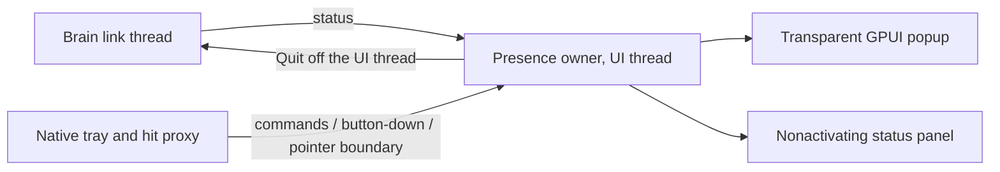
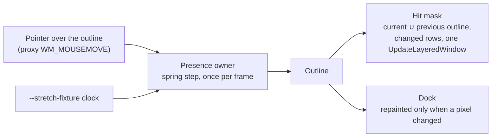
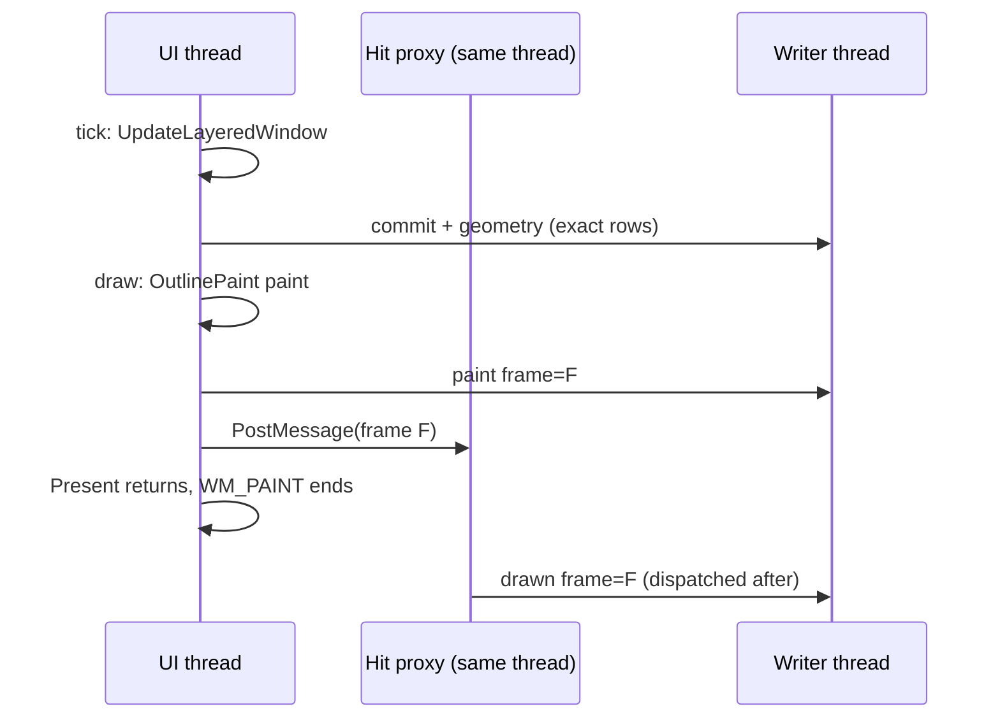

# Presence and native surfaces

The shell owns the dock, status panel, typing panel and tray on GPUI's UI thread. The dock opens
and the keyboard is armed before the brain link starts connecting; [input.md](input.md) covers
the shortcut, the typing panel and Esc. A link failure changes its label to Offline; Retry never sends
the previous input again.

The dock is a transparent `PopUp` overlay, sized for the stretch. Its native styles include
layered, transparent, no-activate and tool-window; app-window is removed. A separate native hit
proxy owns exactly the outline's pixels and reports pointer entry and exit (see
[Stretch and hit testing](#stretch-and-hit-testing)). The panel is interactive, nonactivating and excluded from the taskbar in the same way.
The panel is created at startup, then explicitly positioned and sized while still hidden.
GPUI saves requested bounds for a hidden window instead of applying them immediately; leaving
the native window at Windows' default size also leaves its renderer's textures oversized.
Hidden placement bounds those resources without moving window creation into the first click.
The same panel is hidden and reused, never recreated for each click. The typing panel is the
one exception to never activating: it's a tool window without no-activate, created on the first
double tap, activated only explicitly, and hidden rather than closed. While it's open, pointer
events and dock clicks leave it alone and the status panel stays hidden. `presence/text.rs`
owns its lifetime and retains a GPUI `observe_window_activation` subscription. A previously
active, visible typing surface hides on deactivation, preserving its `InputState` and dropping
the saved foreground without restoring it. Reopening an already visible surface preserves its
activation latch; only a hidden-to-visible transition resets it. Initial inactive notifications
leave an unactivated box clickable, and hiding clears the latch before Esc restores focus.
GPUI's activation state is queued, not a current native foreground query: rapid away/back
within one queued activation can still hide a now-active box. Revisit that limit if reproduced.
Esc and explicit dismiss keep their existing conditional foreground restoration.
Neither surface uses GPUI's normal title bar. Native creation, styles, placement and lifetime
live under `platform/windows`; Rust view code handles no raw window pointers.

The nine positions are calculated from the primary display's physical work area, not its
entire screen. Logical dimensions are converted using the dock's scale factor. The panel
touches the dock and clamps inward at an edge. Crossing their shared edge keeps it open.
Hover never opens it: the proxy's left-button-down toggles it without activation. A Stop
fallback stays open regardless of pointer departure or further dock clicks while needed.
Leaving both starts one 80 ms grace timer; there is no idle polling. The timer rechecks typing
and Stop ownership before hiding. Synchronous native
placement calls `bounds_changed` afterwards so GPUI receives its otherwise-dropped resize.

The native tray menu offers position, Retry and Quit. Position is deliberately session-local
until the brain's settings flow and Settings → General arrive. No settings file is written by
the shell. Closing a transient panel is not Quit. Quit uses the existing idempotent link
shutdown and waits off the UI thread before exiting.

`capsula --smoke` shows the panel programmatically after one second and requests the same
graceful Quit after ten seconds, without moving the pointer or sending input. Initial surfaces are
small even before placement, so a transparency failure cannot cover the desktop. This is a
bounded launch check, not a performance benchmark or permission to inject input.

For idle measurements, build the workspace in release mode, then run `cargo xtask bench idle`.
Before launching the shell, the benchmark spins one thread in three two-second trials,
measuring `QueryThreadCycleTime` divided by wall time and printing each rate and the highest.
Each role and the process-tree total report calibrated cycle CPU as
`cycles / (highest_rate * wall) * 100`, beside `GetProcessTimes`. The slice 1 CPU gate reads
the calibrated column because tick-charged process times can alias the 144 Hz workload.
This is a measured saturated-thread normalization, not a fixed clock-frequency assumption;
preemption and frequency changes can affect calibration, so retain the rates and both columns.
It refuses an existing product process, launches the release shell at normal priority with a
bounded graceful-quit deadline, settles for thirty seconds, and samples user plus kernel time
over sixty seconds. CPU is percent of one core; memory is endpoint private bytes, not working
set or peak memory. `--duration 1..60` shortens a harness smoke check, not an acceptance run.
The task checks that the same shell, brain and worker survive the sample and waits for all
three to exit. Run only in an agreed quiet window; the benchmark sends no input.
`--baseline <release-directory>` samples older binaries with the same counters. After the sample,
it sends `WM_CLOSE` to the spawned shell's presence proxy, which requests the normal graceful
Quit path. Pre-dock binaries fall back to closing their single visible status window. Both
paths verify the spawned shell's PID; neither targets another app.
`--panel` opens the current shell's panel programmatically before settling, so the sample
includes the panel's steady-state resources rather than only the dock before any panel opens.

Geometry tests cover all anchors, negative work-area origins, edge containment, the
hidden-panel boundary and the stretch overlay. Transparency, cross-process click-through, native
focus and Alt-Tab behavior need desktop evidence; a style bit or unit test alone cannot certify
them.

## Stretch and hit testing

The presence has one outline, in `presence/outline.rs`: the resting pill, plus a round bulb
joined to it by a tapering neck while it stretches. The dock's painting and the hit proxy read
the same `row_span` for each physical pixel row, so a drawn pixel is a pixel that takes the
pointer.

- **The hit proxy** is a per-pixel-alpha layered window (`platform/windows/hit_mask.rs`).
  Pixels inside the outline have alpha 1, which is invisible but hit-tested. The rest have
  alpha 0, which Windows passes through to whatever lies beneath, in any process. It never gets
  `WS_EX_TRANSPARENT` or a region. Its 32-bit bitmap and row table are allocated once, sized
  for the largest stretch. A frame rewrites only the rows whose span changed, and calls no Win32
  function when none did. The proxy moves only when the outline's box leaves its current
  rectangle; it then becomes the box plus a 24 px margin (logical), in the same
  `UpdateLayeredWindow` call. Raw Input, the tray, the Esc hotkey and capture exclusion stay on
  this same window.
- **Ownership.** Each frame the mask owns the outline the dock is about to draw and, if it
  changed, the previous frame's outline too. A row holds at most two spans, merged when they
  touch. So a retracting edge stays hit-tested for the one frame its drawing may take to reach
  the screen, and the frame after motion stops trims the mask to the outline alone. A position
  choice is a jump, not motion: the mask owns only the new placement at once, so it never has
  to span two placements. Nothing waits for the display, so a frame presented more than one
  frame late can still expose a retracting edge, a drawn pixel the pointer passes through.
  The dock shows only an outline the mask accepted. A failed upload is
  retried on the next frame, for at most three frames in a row; then frames stop until a
  pointer event or position choice starts another burst.
- **Painting.** The dock window is the click-through overlay: the dock's slot grown by the
  stretch's reach, inside the work area. It's placed once per position choice, never per frame.
  The outline paints as one border quad and one fill quad per device-pixel row, and GPUI snaps
  them to the same pixels the mask owns, so edges are hard rather than antialiased. The label
  stays on the resting pill.
- **Motion.** The stretch starts when the pointer reaches the outline. Each frame reads the
  pointer, aims the bulb under it, or 96 px (logical) toward it from the nearest point of the
  pill's spine, and steps one critically damped spring. Past that reach plus the bulb's radius,
  or over the shown panel, the bulb heads back to the pill's center. Frames come from GPUI's
  `on_next_frame` and are requested only while the bulb moves. A settled bulb requests none:
  under a still pointer, the proxy reports the pointer's next move over the body once, and at
  rest the next entry starts the stretch again. There's no hook, mouse capture, timer or polling.
- **Status panel.** Left-button-down on the outline toggles the panel; hover only stretches
  the dock. An open panel stays while the pointer is over the outline or the shown panel.
  The pill's rounded corners and the slot's 4 px padding pass the pointer through, and
  the 80 ms grace timer covers the 4 px gap between the pill and the panel. Windows may not
  report the outline moving under a still pointer, so after each accepted mask update the owner
  checks whether the pointer's side of the outline changed, and rechecks hover only then.
- **Per frame**, Capsula's code allocates nothing and takes no lock. GPUI itself still boxes
  each `on_next_frame` callback and rebuilds the dock's small element tree when it repaints.

Unit tests cover the outline's edge, interior and exterior pixels, a stretched body beyond the
resting pill, the retracting band owned for one frame and then trimmed, touching and separate
spans in one row, a jump owning only the new placement, failed uploads advancing nothing, the
margin rule for proxy moves, the spring settling without overshoot, the bulb's reach and
release, and the fixture's path. Real click receipt over the body and through
to another process is checked only in an approved input session.

`capsula --stretch-fixture` (with `--quit-after-ms` or `--smoke`, or it refuses to start)
drives the same frame path from a clock instead of the pointer: out to full reach and back every
two seconds, toward the middle of the overlay, until Quit. It sends no input. With
`--input-diagnostics=<file>` the shell writes `stretch active` and `stretch settled` lines, and
at Quit a `stretch totals` line for the whole run: frames (`ticks`), in-place mask updates
(`shape`), margin moves (`moves`), frames with no pixel change (`unchanged`) and failed updates
(`failed`). No content is recorded.

`cargo xtask bench stretch [--duration 1..60] [--baseline <release-directory>]` measures it.
It launches the current release with `--stretch-fixture` and diagnostics, warms for thirty
seconds, then samples user plus kernel time, cycles and private bytes of the shell, brain and
worker over the duration (thirty seconds by default). CPU is percent of one core, with the same
pre-launch cycle-rate calibration as idle and GetProcessTimes beside it. After Quit it requires a totals line with
`failed=0`. Lifetime counters are printed separately and are never divided into the sample's
cycles. A bounded 1 Hz `typeperf` samples DWM's CPU and PID alongside. Its first row is blank,
so it's kept as an invalid warm-up and never read as zero. DWM's bounded window extends past
the CPU sample; use its CSV timestamps. It's whole-desktop context, not Capsula's CPU. A baseline (older main)
gets neither fixture nor diagnostics: it has no stretch, so the pair compares a stretching
presence with a still one, not like for like. Run only in an agreed quiet window.

## Gate observer

`capsula --gate-observer=<file>` records what the dock really did, for the gate harness. Like
the fixtures it needs `--quit-after-ms` or `--smoke`, or the shell refuses to start, and so
does `--receipt-fixture`, which also needs the observer and only starts the dock middle-left
for the gate's click-receipt phases. The tray's nine positions are unchanged. A normal run has no observer, no file and no writer thread;
the only per-frame cost is checking that the observer is absent.

`main` creates the file, a bounded queue of 256 fixed-size records and the writer thread before
GPUI starts. The UI thread only stamps the performance counter and moves a record into the
queue without waiting; the writer formats it and flushes whenever it catches up. Each record
is one line:

- `startup version=1 pid= dock_hwnd= panel_hwnd= proxy_hwnd= scale= position= work_area= dock= overlay=
  panel= qpc_frequency= row_cap=512 queue=256 repaint_message=0x8010 marker=0x43505331`. It
  follows the first position's commit and the paints GPUI makes while it opens each window.
  Rectangles are `x,y,width,height` in physical pixels.
- `geometry id=G origin_y=Y rows=N trimmed=true|false spans=…`, sent the first time a mask
  proposal's rows differ from the last one sent. Each of the `N` rows from `Y` is
  `drawn,owned,owned` separated by `;`, each span `left:right` (half-open) or `-`. They come
  from the same `row_span` the dock paints and `row_spans` the mask is given, not from a copy.
  Taller than 512 rows, it's `… overflow` with no rows, never truncated.
- `commit seq= begin_qpc= qpc= result=shape|moved|unchanged|failed proposal=G epoch=E
  geometry=A proxy=…`, after every `UpdateLayeredWindow` call. `begin_qpc` is read right before
  the call and `qpc` when it returned, so `[begin_qpc, qpc]` holds the whole upload; when Windows
  starts routing by the new mask inside it isn't known. A gate excludes a click whose input
  interval overlaps a changed-epoch upload's. Without the observer, no counter is read. `proposal` is the
  uploaded geometry; `epoch` and `geometry` are the accepted state after it. Only an accepted
  change of rows (initial, stretched, trimmed) advances the epoch; a failure logs its proposal
  and leaves both.
- `hover id=H qpc= visible=true|false click_qpc=`, on every status panel show or hide. The
  legacy name and paint IDs are unchanged. `qpc` is state entry, before native placement;
  `click_qpc` is zero except for click-triggered changes. The proxy captures that native
  button-down counter once, before observer or event processing, and carries it through the
  unconditional product event to placement. A tagged `click` receipt shares exactly that
  `click_qpc`, so the harness measures from native receipt rather than queued owner handling.
- `paint frame=F qpc= kind=dock|panel hover= drawn_epoch= drawn_geometry= mask_epoch=`. A dock
  frame is stamped in `OutlinePaint`'s paint with `hover=0`; `drawn_geometry`'s `drawn` spans
  are the rows it paints, and `0` means no commit yet. A panel frame is stamped by a zero-size
  element in the panel, present only with the observer, with the latest `hover` id and
  `drawn_epoch=0 drawn_geometry=0`. Frame ids count across both.
- `target frame=F qpc= kind=stop hover=H rect=x,y,w,h inside=true|false`, from the status
  panel's Stop button each time it paints: its painted bounds in physical screen pixels (the
  panel's client origin plus the bounds GPUI laid out, times the scale), not a guessed spot. A
  wrapper hands every phase to the button, so its layout and handling are unchanged. The
  panel's stamp is its first child, so `frame` is the panel frame this paint belongs to and
  the paint lies in its `[paint qpc, drawn qpc]`; `inside` says the bounds lie within the
  panel's client area. Only the status panel's Stop is recorded, not the typing panel's.
- `drawn frame=F qpc=`: the paint posts its frame id to the proxy. GPUI on Windows draws and
  calls `Present(0, 0)` synchronously inside the window's paint message, so the proxy, on the same
  thread, dispatches the post only after that returns, for the panel as for the dock. A present
  in `[paint qpc, drawn qpc]` on that surface's swap chain is that frame's; this bounds when it
  was submitted, not when it was shown. `open_window` paints each window once before the proxy
  exists, and presents it on a later frame. Up to 8 such frames are kept and posted from that
  window's next frame after `startup`, ahead of its present, so the dock's cold first frame
  keeps a wider but still bounding interval. A ninth counts as `post_failed`.
- `click qpc= point=x,y mask_epoch= marker=0x43505331`: a left press on the proxy whose extra
  info is `INPUT_SESSION_MARKER`. `point` is the press's physical screen point from
  `GetMessagePos`, as Windows routed it, not the client point converted with the proxy's
  origin at dispatch, which a move in between would shift. Other clicks are never read or
  recorded.
- `repaint qpc=`: the harness posted `OBSERVER_REPAINT_MESSAGE` to the proxy, and the dock is
  asked to repaint with no input. Without the observer, the proxy ignores it.
- `close commits= frames= dropped= overflow= post_failed= unposted=`, then the writer's `end
  lines= write_errors=`. A missing close or end line, or any nonzero `dropped`, `overflow`,
  `post_failed` or `write_errors`, makes the run invalid for the gate. `unposted` counts early
  frames whose window never drew again, such as the hidden panel's; they have no `drawn` line,
  so a gate that joins one of them is invalid. At Quit the observer stops before it takes these
  counts: later frames, commits and proxy notes record nothing, so the counts match the lines
  above them, and frames still in flight keep no `drawn` line. The writer then writes every
  record it already accepted, then `close` and `end`.

Records hold geometry, handles and times only: no text, prompts, screenshots or other apps'
content. Unit tests cover the exact rows, the overflow, the epoch rule and every line's format;
display timing and click receipt need an approved session.

## The drawing

`crates/shell/src/drawing.rs` holds what's drawn: at most four scenes by `SceneId`, each a list of
steps, and the recovery that restores them on each connection. It's plain state, no GPUI, so its
rules are unit-tested. `runs.rs` keeps the runs, turns, the fence and the answer text, and hands
it the steps it lets through.

- A live step for a new scene admits it the way the brain does: the newest four, evicting the
  oldest, so a `ClearDrawing` never names more than four.
- `drawing()` is true while a scene is shown or a recovery Esc could cancel is awaiting or
  receiving, so Esc with nothing moving clears, recovery included. A moving run still stops
  first.
- On a disconnect the shown scenes stay until the next `Scenes` reconciles them; recovery state
  and held chunks go.
- Scene ids, revisions and counts are the only things it reports; its errors never carry labels.

[ipc](ipc.md#scenes-and-recovery) has the recovery states and the install rules.
