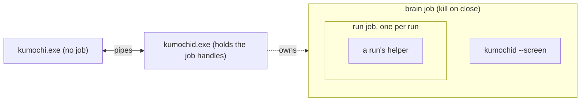
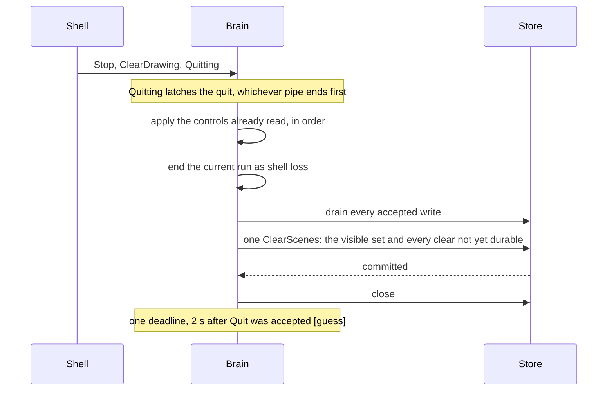

# Processes, jobs and recovery

Kumochi runs as two processes, and the brain runs its helpers inside Windows Job Objects so that
nothing it started can outlive it.

Each process starts its scene dropper before accepting scene data and fails startup if the
thread cannot start. Retirement never joins that thread from the shell's UI.

- **The brain job** has `JOB_OBJECT_LIMIT_KILL_ON_JOB_CLOSE`, and only the brain holds its handle.
  When the brain exits or is killed, Windows ends everything in it.
- **A run job** nests inside the brain job. A helper is created with
  `PROC_THREAD_ATTRIBUTE_JOB_LIST` naming both jobs, so it's inside from its first instruction.
  Ending a run terminates its run job and waits until the job is empty, which ends that run's
  processes and nothing else.
- **The screen worker** sits in the brain job directly, so ending a run never touches it. In
  slice 0 it's a placeholder that only waits.
- Helpers inherit no handles, and nothing secret is ever on their command lines.
- **The shell** isn't in any job, so a brain crash doesn't take the window with it. Each process
  starts the other detached and, where the starting job allows it, outside that job.

## Recovery

| What happens | What the other process does |
|---|---|
| The shell dies | The brain relaunches it after 0.2 s, then 1 s, then 5 s, then stops: a fourth crash within a minute isn't relaunched. A shell that dies before connecting counts |
| The brain dies | Its helpers end with it. The shell restarts it once; a second loss within a minute shows Retry |
| No shell for 30 s, and none being relaunched | The brain exits with its helpers, so a shell that gave up on a slow brain or quit before it was up leaves nothing behind. The next shell starts a new brain |
| A shell is started by hand | It finds the running brain through the pipes and the capability |
| Quit | The shell sends `Quitting`. The brain clears the visible scenes (below), cancels any pending shell relaunch, ends its jobs, deletes the instance capability and exits, then the shell exits. A shell still connecting starts no brain, and tells one it already started once it connects |

## The visible scenes

The visible set is the newest four scenes, by `SceneId`, that belong to a live thread and have
no `scene_cleared` event. Every way a scene leaves the set writes that event, so the brain reads
back at start the set it held in memory:

- the user clears it (`ClearDrawing`);
- a fifth scene begins: labelled placeholders clear the oldest in the new first step's
  transaction; typed v1 drawings instead wait for that clear and every earlier typed clear
  to be acknowledged before writing the new first step;
- a Stop keeps none of a scene's steps: a labelled scene clears with the run's outcome;
  a typed scene's zero cut commits before its acknowledgement, followed by its clear;
- the user quits.

So only a crash, or a shell that restarts, brings drawings back. A scene's id leaves the brain
only once its first step has committed; the run's later steps wait for it without blocking the
core loop. shortcut: on the staged labelled path, a crash between Stop and its outcome loses
which steps Stop kept; typed v1 cuts are already durable before acknowledgement.

- **Accepting Quit.** The control reader latches the quit when it reads `Quitting`. If another
  pipe ended first, the same read carries on for up to 250 ms [guess], still applying the
  controls it forwards, so a `Quitting` already in the pipe, even one partly read, is accepted.
- **One deadline.** Ending the run, draining the writes, the clear and closing the store all use
  the same absolute deadline, and none restarts a budget. Only a committed clear is a complete
  quit. A timeout or a failed write is logged, without content, as incomplete: the scenes come
  back at the next start, as after a crash. The shell isn't relaunched either way.
- **Typed work.** Quit drains in-flight typed lookups, steps and cuts even after their run
  ended. A failed cut has no reply to wait for: clear-all supersedes that debt and Quit waits
  for the resulting durable clear instead. A clear that is not acknowledged is incomplete.

The dock's status panel is transient: closing it isn't Quit. Quit lives in the tray and status
panel and follows the same bounded, idempotent link shutdown. See [presence](presence.md).
